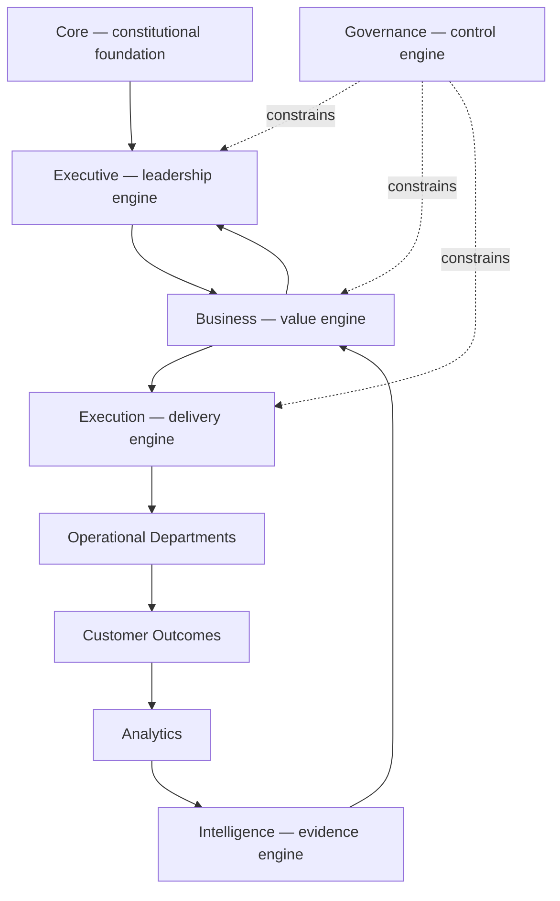
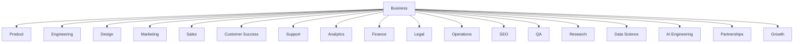

# Business Layer Charter

> Business is the enterprise **value architecture** of Umer AI OS — the layer whose entire mandate is answering, continuously: *where should the organization invest, why does that investment create value, and how will the organization know value was realized.* It is distinct from `Executive/`, which leads and coordinates; distinct from `Governance/`, which constrains; distinct from `Intelligence/`, which remembers and evidences; distinct from `Execution/`, which runs. Business is the layer that decides what is worth running in the first place.

Governed by `Core/AI_OS_CONSTITUTION.md`. Boundaries formalized in `Business/LAYER_INTERFACES.md`. This charter is itself an architectural commitment ratified via the `RFC/` process (`RFC/RFC_PROCESS.md`) and is not amended casually.

## Why This Layer Exists, Separately From Executive

`Executive/CEO/CEO_AGENT.md` decomposes a stated objective into delegated work and coordinates it — but a CEO that also originates market research, sets pricing, defines customer segments, and decides product portfolio balance is not one role anymore, it's six: CEO, Chief Product Officer, Chief Strategy Officer, Chief Revenue Officer, VP Product, and Portfolio Office, collapsed into one accountability, one context window, one point of failure. `Core/AI_OS_CONSTITUTION.md`'s own Core Principle #1 — "specialization over generalism, one Agent, one clear mandate" — is what this charter is actually honoring by splitting Business out. The Executive layer **consumes** Business's outputs (a prioritized opportunity, a business case, a roadmap) as the input to its delegation decisions; it does not produce them.

## The Three Enduring Questions

Business exists to answer these three questions, continuously, for as long as this OS operates — everything else in this layer is machinery built to answer them well:

1. **Where should the organization invest?** (Opportunity Management, Portfolio Management)
2. **Why does that investment create value?** (Business Case Management, Customer Strategy, Market Intelligence, Commercial Strategy)
3. **How will the organization know value was realized?** (Portfolio Analytics)

These questions don't change as the organization grows from one product to a hundred, or as delivery Departments and org charts reshuffle over a decade — which is why Business is organized around **stable bounded contexts** (`Business/Contexts/`), not around whatever Departments happen to exist this quarter.

## What Business Owns

| Domain | Scope |
|---|---|
| Opportunity Management | Discovery, evaluation, scoring, prioritization of opportunities before they become funded work |
| Product Portfolio | Portfolio strategy, product lifecycle, investment balancing, sunset decisions, product hierarchy |
| Product Management | Product vision, positioning, roadmap ownership, feature value analysis, customer problem definition |
| Customer Domain | Personas, segmentation, jobs-to-be-done, customer journeys, value propositions |
| Market Domain | Market sizing (TAM/SAM/SOM), competitor positioning interpretation, market trends, adoption analysis |
| Commercial Strategy | Pricing, packaging, monetization, licensing, revenue models |
| Business Strategy | Growth initiatives, strategic themes, business objectives, investment allocation |
| Innovation Management | Idea pipeline curation (business framing), incubation, validation, experimentation portfolio |
| Business Case Management | ROI, cost-benefit, expected outcomes, financial assumptions, strategic alignment |
| Portfolio Economics | Expected value, business risk, resource ROI, investment efficiency |

Each of these maps to exactly one of the nine bounded contexts in `Business/Contexts/` — see that folder for the operational detail per domain.

## What Business Explicitly Does Not Own

Boundaries are as load-bearing as ownership — a layer that quietly absorbs a neighboring layer's mandate breaks the same single-responsibility principle this charter exists to protect.

| Not owned by Business | Actually owned by |
|---|---|
| Delegation, planning, project coordination, staffing | `Executive/` (CEO, Project Manager) |
| Policies, compliance, audit, standards, approvals | `Governance/` |
| Memory, research repositories, lessons learned, knowledge management | `Intelligence/` — Business **consumes** intelligence, it does not own the systems that produce and store it |
| Workflow, routing, runtime orchestration, approval mechanics | `Execution/` |
| Implementation, software architecture, delivery | Engineering and other delivery Departments (future `Departments/`) |

Business is authoritative on **what** creates value and **why**; it is never authoritative on **how** something gets built, approved, or remembered.

## Position in the Enterprise Model



Six engines, six non-overlapping responsibilities: Core is the constitutional foundation, Executive is the leadership engine, Business is the value engine, Execution is the delivery engine, Governance is the control engine, Intelligence is the evidence engine. None of them do another's job; all of them are required for the system to function as one coherent enterprise rather than six independently-optimizing parts.

## Future Dependency Graph

Every delivery Department, current or future, ultimately traces its work back to Business intent — this is the organizing principle for how Business scales to a 10-year, 100+-Department horizon without itself needing to be redesigned:



A new Department, whenever it's created (per `Governance/ORGANIZATIONAL_CHART.md`'s intake gate), must be able to state which Business bounded context its work traces back to — Engineering to Product Management's roadmap, Marketing to Commercial Strategy's positioning and Customer Strategy's segments, Finance to Business Case Management's investment proposals, and so on. A Department that cannot name this traceability is doing work disconnected from organizational value creation, per the architectural risk this charter exists to prevent.

## Interaction With Executive — Consumer, Not Producer

```
Executive asks: "What should we invest in?"
Business answers: "This portfolio maximizes organizational value" — with evidence.
Executive remains accountable for the decision and its delegation.
Business remains authoritative on the economic reasoning behind the recommendation.
```

This mirrors `Governance/ORGANIZATIONAL_CHART.md`'s RACI pattern: Business is Responsible for producing the recommendation (opportunity scoring, business case, portfolio position); the CEO is Accountable for the resulting investment decision, exactly as the CEO is Accountable for any other decision crossing into Executive's authority per that document's Decision Authority table. Business's outputs are **inputs to** `Executive/CEO/CEO_AGENT.md`'s Objective-Decomposition Pattern — a well-formed opportunity handed to the CEO already carries validated customer problem, market context, and a business case, so the CEO's Scoping stage (`Execution/REQUEST_LIFECYCLE.md`) starts from evidence, not a blank page.

## Governing Rules

1. **Business never sets its own approval bar.** Every Business decision above a stated threshold (a full portfolio reallocation, a new pricing model, sunsetting a revenue-bearing product) is bound by `Governance/DECISION_LOG_STANDARD.md` and, where irreversible or externally consequential, `Core/AI_OS_CONSTITUTION.md` §5 rule 3's human-accountability rule — Business proposes with rigor, it doesn't unilaterally ratify its own highest-stakes calls.
2. **Business consumes Intelligence, it does not maintain it.** Market Intelligence's bounded context (`Business/Contexts/Market_Intelligence.md`) explicitly interprets `Intelligence/COMPETITIVE_INTELLIGENCE_FRAMEWORK.md` and `Intelligence/RESEARCH_LIBRARY_STANDARD.md` output into business decisions — it never forks a parallel research repository.
3. **Business decisions enter Execution the same way any other request does.** A validated opportunity or approved roadmap item becomes a `Execution/REQUEST_LIFECYCLE.md` request like any other — Business does not get a side channel into delivery that bypasses the engine every other Department uses.
4. **Structural changes to this Charter go through `RFC/RFC_PROCESS.md` first**, exactly as any other cross-cutting architectural layer, per that process's scope.

## Metadata

```yaml
version: 1.0.0
status: active
last_reviewed: 2026-07-22
owner: CEO (ratification), Business layer (stewardship of its own bounded contexts)
```
