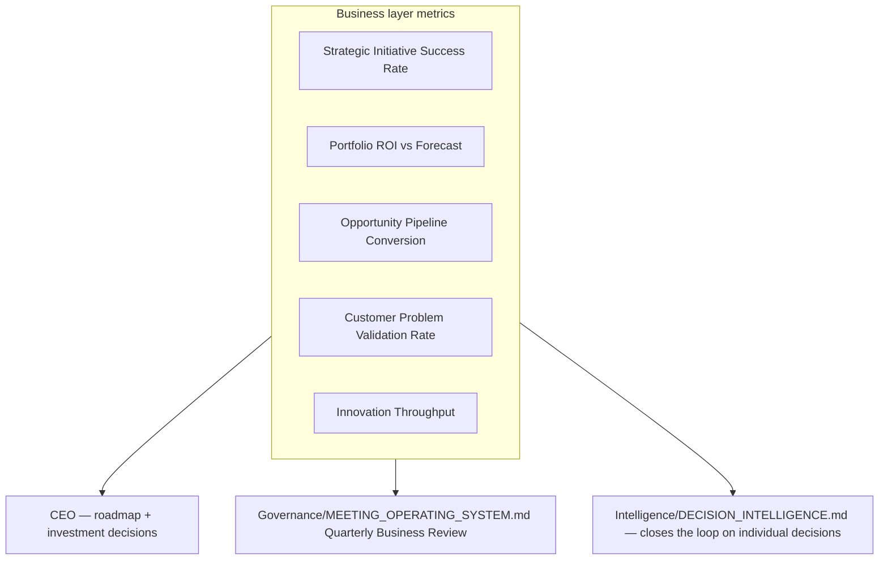

# Business Metrics

> How the Business layer itself is measured — by value creation and decision quality, never by activity volume. This extends `Governance/KPI_FRAMEWORK.md`'s design rules (every KPI has a formula/source, a counter-metric, leading + lagging balance) to the Business layer specifically, and is distinct from the existing "Business" row in `Governance/KPI_FRAMEWORK.md`, which measures the **financial outcomes** a delivery-facing Business function produces (Revenue, MRR, Churn). These metrics measure whether the **Business layer's decisions** were good ones — a different, higher-order question.

Governed by `Governance/KPI_FRAMEWORK.md` (design rules this extends), `Intelligence/DECISION_INTELLIGENCE.md` (the outcome-tracking mechanism several of these metrics are computed from).

## Why These Are Different From `Governance/KPI_FRAMEWORK.md`'s Business Row

`Governance/KPI_FRAMEWORK.md` already tracks Revenue, MRR, Profit/Margin, Churn, and Runway — the financial *results* of running the business. Those remain valid and unchanged. What's missing, and what this document adds, is measurement of the **decision-making layer that determines which investments produce those results in the first place** — a business can have healthy revenue by luck or momentum while its investment decision-making is actually poor (high variance, low hit rate, weak evidence discipline), and this document exists to make that visible rather than hidden behind aggregate financial health.

## Core Metrics

| Metric | Formula / Definition | Source | Type | Counter-metric |
|---|---|---|---|---|
| Strategic Initiative Success Rate | % of initiatives meeting their stated Success Criteria (`Business/BUSINESS_ARTIFACT_STANDARDS.md`) within their planned window | `Intelligence/DECISION_INTELLIGENCE.md` outcome tracking | Lagging | Paired with Initiative Volume — a high success rate on very few, over-conservative bets is itself a signal, not pure success |
| Portfolio ROI vs. Forecast | Actual realized value / Business Case projected value, portfolio-wide | Portfolio Analytics (`Contexts/Portfolio_Analytics.md`) | Lagging | Paired with Forecast Confidence Calibration — consistently accurate-looking ROI with wide confidence intervals means less than it appears |
| % Investment Aligned to Strategic Themes | Dollar/effort-weighted % of active initiatives traceable to a current Strategic Theme (`Contexts/Strategy.md`) | Portfolio Management | Leading | Paired with Innovation Throughput — 100% alignment with zero exploratory investment risks strategic myopia |
| Opportunity-to-Investment Cycle Time | Time from Opportunity Record creation to Investment Proposal decision | `Execution/REQUEST_LIFECYCLE.md` + Business Case Management timestamps | Leading | Paired with Decision Quality (below) — speed without quality is not the goal |
| Opportunity Pipeline Conversion | % of scored Opportunities that become funded Investment Proposals | Portfolio Management | Leading | Paired with Problem Validation Rate — a high conversion rate on unvalidated opportunities is a red flag, not a success |
| Customer Problem Validation Rate | % of funded initiatives whose underlying customer problem was validated (research or direct evidence) before funding, per `Business/BUSINESS_ARTIFACT_STANDARDS.md`'s evidence_sources requirement | Customer Strategy + Business Case Management | Leading | Paired with Cycle Time — validation takes time; this is the check against skipping it for speed |
| Product Adoption / Retention Trend | Per-product trend, aggregated at portfolio level | `Governance/KPI_FRAMEWORK.md` Product KPIs, rolled up | Lagging | Paired with Portfolio Balance — a portfolio optimized only for the highest-adoption product may be under-investing in future growth |
| Revenue Mix Diversification | % of revenue concentrated in top 1-2 products/segments (inverse — lower concentration = higher diversification) | Portfolio Analytics + Finance data | Lagging | Paired with Portfolio ROI — diversification for its own sake without ROI discipline is not the goal |
| Business Case Forecast Accuracy | Actual outcome / forecast outcome, averaged across closed Business Cases, with variance | `Intelligence/DECISION_INTELLIGENCE.md` outcome tracking | Lagging | Paired with Forecast Confidence Calibration |
| % Initiatives With Measurable Outcomes | % of funded initiatives with a stated, falsifiable Outcome Definition (`Business/BUSINESS_ARTIFACT_STANDARDS.md`) at funding time, not added retroactively | Business Case Management | Leading | — (a direct process-health signal; should trend toward 100%) |
| Product Portfolio Balance | Distribution of active products/initiatives across lifecycle stages (Incubating / Growth / Mature / Sunset), per `Contexts/Portfolio_Management.md` | Portfolio Analytics | Leading | Paired with Portfolio ROI — balance without ROI discipline is not itself success |
| Innovation Throughput | Validated experiments (`Intelligence/INNOVATION_LAB.md` Validated status) / total experiments run in period | Innovation (`Contexts/Innovation.md`) | Leading | Paired with Strategic Alignment — unlimited experimentation with no eventual alignment to strategy is directionless |
| Business Decision Cycle Time | Time from a decision being ready for review to a logged `Governance/DECISION_LOG_STANDARD.md` resolution | Business Case Management + Governance | Leading | Paired with Decision Reversal Rate — fast decisions that get reversed often aren't actually fast, they're premature |
| Realized Value vs. Expected Value | Same computation as Portfolio ROI vs. Forecast, but tracked per-initiative rather than portfolio-aggregate, to catch individual outliers the aggregate hides | Portfolio Analytics | Lagging | Paired with Portfolio ROI (aggregate) |

## Forecast Confidence Calibration (Supporting Metric)

A metric about the other metrics: for Business Cases that stated a confidence level in their projection, track whether outcomes actually fell within stated confidence bounds at the expected rate (a well-calibrated "80% confidence" projection should be right about 80% of the time, not 40% or 100%). This is what prevents Portfolio ROI and Forecast Accuracy from being gamed by consistently vague or consistently overconfident projections — both look fine on the headline metric while being genuinely unreliable.

## Roll-Up



These roll up to the CEO exactly as `Governance/KPI_FRAMEWORK.md`'s existing roll-up describes (lagging, business-value-shaped metrics are the CEO's primary consumption), and specifically feed the Quarterly Business Review's strategy re-examination step (`Governance/MEETING_OPERATING_SYSTEM.md`).

## Anti-Patterns

- **Measuring Business by activity volume.** Number of Business Cases produced, number of opportunities scored — these are not on this list deliberately; volume without quality is exactly the failure mode this document exists to avoid rewarding.
- **Ignoring the counter-metric.** Per `Governance/KPI_FRAMEWORK.md`'s design rule, extended here — every metric above has one specifically because Business-layer metrics are unusually easy to game in isolation (a 100% success rate from only funding safe bets, a fast cycle time from skipping validation).
- **Treating forecast accuracy as fixed at Business Case approval time.** Forecast Confidence Calibration exists specifically because a single accuracy number hides whether the underlying confidence discipline is real.

## Metadata

```yaml
version: 1.0.0
status: active
last_reviewed: 2026-07-22
owner: Business (Portfolio Analytics context), CEO (consumption), Chief of Staff (metric integrity audit per Governance/KPI_FRAMEWORK.md rules)
```
