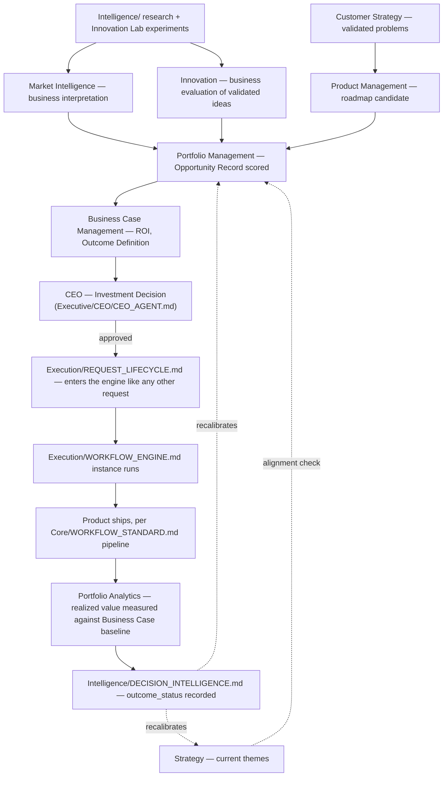

# Business Playbook

> The narrative reference for how the Business layer's nine bounded contexts actually operate together, end to end — from a raw market signal to a funded, executing initiative to a measured outcome that recalibrates the next decision. Read after `Business/BUSINESS_LAYER_CHARTER.md`, `Business/LAYER_INTERFACES.md`, and the nine `Business/Contexts/` documents — this shows them working as one system.

Governed by `Core/AI_OS_CONSTITUTION.md`. Architectural changes to this layer follow `RFC/RFC_PROCESS.md`.

## The Full Value Loop



This loop is the literal mechanism behind the three enduring questions in `Business/BUSINESS_LAYER_CHARTER.md` — every arrow above is one of the nine bounded contexts doing its one job, handing off to the next, with the loop closing back through Intelligence rather than ending at "shipped."

## How an Idea Actually Becomes a Funded Initiative

1. **Signal arrives** — from Market Intelligence (a competitor move, a market shift), Customer Strategy (a validated pain point), or Innovation (a Lab-validated experiment). None of these alone constitute a decision to invest.
2. **Portfolio Management creates an Opportunity Record**, scoring it and checking it against Strategy's current themes.
3. **If it clears the portfolio bar**, Business Case Management builds the full ROI case — pulling Revenue Model from Commercial Strategy, market sizing from Market Intelligence, evidenced assumptions throughout.
4. **The Investment Proposal goes to the CEO** — per `Business/LAYER_INTERFACES.md`, Business is Responsible for the recommendation, the CEO is Accountable for the decision. A material investment decision is logged per `Governance/DECISION_LOG_STANDARD.md` regardless of outcome.
5. **On approval, it enters `Execution/REQUEST_LIFECYCLE.md`** exactly like any other request — Business does not get a side channel into delivery. Its Business Case's stated success criteria become the Scoping stage's success criteria directly, so Execution doesn't re-derive what Business already established with rigor.
6. **The Execution engine runs it** through `Core/WORKFLOW_STANDARD.md`'s pipeline, Business staying informed but not operationally involved (per the ownership boundary — Business doesn't delegate, schedule, or coordinate).
7. **Portfolio Analytics measures the realized outcome** against the Business Case's immutable baseline once the instance reaches Monitoring/Learning (`Execution/WORKFLOW_ENGINE.md`).
8. **`Intelligence/DECISION_INTELLIGENCE.md` records the verdict** — confirmed, contradicted, or mixed — which recalibrates how similar future opportunities are scored and how much weight similar reasoning patterns get next time.

## How Every Department Traces Back to Business

Per `Business/LAYER_INTERFACES.md`'s Department dependency table, any delivery Department's current work should be answerable against one Business bounded context:

| If asked... | The traceable answer comes from |
|---|---|
| "Why is Engineering building this?" | Product Management's Roadmap, tracing to an Opportunity Record |
| "Why does the UX look like this?" | Customer Strategy's Journey Map / Value Proposition Model |
| "Why is Marketing saying this?" | Commercial Strategy's Positioning/GTM Strategy |
| "Why does this cost what it costs?" | Commercial Strategy's Pricing Model |
| "Why are we tracking this metric and not another?" | Portfolio Analytics' Business-meaningful KPI definitions |
| "Why did we fund this over the alternative?" | Business Case Management's Investment Proposal + Portfolio Management's Prioritization Matrix |

A Department that cannot answer this — building, designing, or marketing something with no traceable Business origin — is doing disconnected work, per the architectural risk this whole layer exists to close.

## Worked Example — End to End

**Signal:** Market Intelligence flags, from an `Intelligence/COMPETITIVE_INTELLIGENCE_FRAMEWORK.md` Tier 1 tracker update, that a competitor just dropped a feature we don't have, and it's driving their marketing.

1. Market Intelligence produces a Competitive Positioning Map update noting the gap and its likely customer impact, citing the tracker entry.
2. Portfolio Management creates an Opportunity Record for closing the gap, scores it — checks against Strategy's current themes (does closing this gap serve "deepen enterprise retention"? Yes) — and it clears the bar.
3. Business Case Management builds the case: cost estimate from a quick Architecture consult, revenue-retention-risk-avoided estimate from Commercial Strategy's Revenue Model, Outcome Definition ("churn rate among enterprise accounts citing this gap drops below X% within one quarter of shipping").
4. CEO approves; logged per `Governance/DECISION_LOG_STANDARD.md`, cross-linked to the Business Case.
5. Enters `Execution/REQUEST_LIFECYCLE.md`, scored again by `Execution/PRIORITY_FRAMEWORK.md` (Strategic Alignment and Business Value inherited from the Business Case, Urgency reflecting the competitive timing), runs the pipeline.
6. Ships. Portfolio Analytics tracks churn among the flagged accounts over the following quarter against the Outcome Definition's stated threshold.
7. `Intelligence/DECISION_INTELLIGENCE.md` records whether the reasoning held — feeding the next time a competitive-gap opportunity is scored.

## Anti-Patterns (Layer-Level)

- **Skipping straight from signal to funded initiative without an Opportunity Record or Business Case.** Every investment passes through the full chain, even quickly for small bets — the rigor scales down (a smaller Business Case for a smaller bet) per `Core/OUTPUT_STANDARD.md`'s general scaling principle, but it never skips entirely.
- **Business operating a side channel into delivery.** Every funded initiative enters `Execution/REQUEST_LIFECYCLE.md` — no exceptions, regardless of how urgent or executive-sponsored.
- **A Department unable to trace its work to a Business context.** Caught at `Governance/ORGANIZATIONAL_CHART.md`'s Department intake gate and at any Chief of Staff process audit.
- **The feedback loop not closing.** A shipped initiative whose realized value is never measured against its Business Case baseline is exactly the failure this entire playbook's loop diagram exists to prevent — Portfolio Analytics' review cadence is what makes closure structural, not optional.

## The One-Sentence Summary

**Business is the value engine: it turns market signals, validated customer problems, and evidenced experiments into rigorously-cased investment decisions that the CEO ratifies and the Execution engine runs — then closes the loop by measuring whether the value was actually realized, so the next decision is better calibrated than the last.**

## Metadata

```yaml
version: 1.0.0
status: active
last_reviewed: 2026-07-22
owner: Business (playbook stewardship), CEO (ratification)
```
