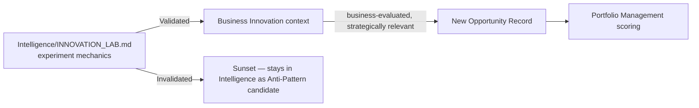

# Bounded Context: Innovation

> Maintains future competitiveness by giving unvalidated ideas a business-side home — the context that curates the idea pipeline in economic terms and hands validated concepts to Portfolio Management as new Opportunity Records. This context does not duplicate `Intelligence/INNOVATION_LAB.md` — it is that Lab's business-side counterpart, applying commercial and strategic judgment to what the Lab validates experimentally.

Governed by `Business/BUSINESS_LAYER_CHARTER.md`, `Intelligence/INNOVATION_LAB.md` (the experimental mechanics this context's ideas run through).

## Purpose

Ensure the organization has a managed, business-evaluated pipeline of future bets — distinct from the current portfolio's day-to-day investment decisions — so competitiveness a decade out isn't left to chance or to whoever happens to have a good idea in a given quarter.

## Owns

- Idea pipeline curation, from a **business** framing (is this idea strategically interesting, not just experimentally feasible)
- Incubation (early-stage business support for a promising idea before it's ready for full Portfolio Management scoring)
- Validation oversight (business-side judgment on whether `Intelligence/INNOVATION_LAB.md`'s experimental validation is sufficient to warrant portfolio-level consideration)
- Experimentation portfolio (the business view across all active experiments — which strategic themes they serve, what they'd be worth if validated)

## Does Not Own

- The mechanical experiment lifecycle (Captured → Scored → Validating → Validated/Invalidated → Sunset) — that state machine and its rigor belongs entirely to `Intelligence/INNOVATION_LAB.md`; this context consumes its outcomes
- Funding decisions once an idea graduates to a full opportunity (Portfolio Management, via a new Opportunity Record)
- Long-term product roadmap once validated (Product Management)

## The Relationship to `Intelligence/INNOVATION_LAB.md`



`Intelligence/INNOVATION_LAB.md` runs the falsifiable experiment and produces a Validated/Invalidated verdict — that mechanical rigor is Intelligence's job (evidence). This Business context adds the second-order judgment: *even a Validated idea* isn't automatically promoted — it still needs to be assessed against current Strategic Themes and portfolio capacity before becoming a real Opportunity Record. A technically-validated idea that doesn't fit any current strategic theme stays in this context's Experimentation Portfolio as a tracked, future-relevant bet rather than being force-fit into the current portfolio.

## Key Artifacts

- **Experiment Portfolio** — every entry links to its `Intelligence/INNOVATION_LAB.md` record; adds the business lens (strategic relevance, rough commercial potential) that Lab record doesn't itself carry
- **Innovation Pipeline** — the business-side view of pipeline stage, mirroring but not duplicating the Lab's own lifecycle states

## Interfaces

- **Consumes from:** `Intelligence/INNOVATION_LAB.md` (validation verdicts), Strategy (current themes to assess relevance against)
- **Produces for:** Portfolio Management (new Opportunity Records from validated, strategically-relevant ideas)

## Review Cadence

Experiment Portfolio reviewed at Monthly Business Review; a Validated idea's strategic-fit assessment happens as soon as the Lab's verdict lands, not held to the calendar, since a competitively time-sensitive validated idea shouldn't wait for a scheduled review.

## Anti-Patterns

- **Re-running the Lab's experimental rigor inside this context.** If this context starts scoring falsifiability or running its own validation experiments, it has absorbed `Intelligence/INNOVATION_LAB.md`'s mandate — the boundary is business judgment on top of Intelligence's experimental verdict, not a parallel experimental process.
- **Force-fitting every Validated idea into the current portfolio.** Some validated ideas are correctly held for a future strategic cycle — the Experimentation Portfolio exists precisely so "not now" doesn't mean "forgotten."

## Metadata

```yaml
version: 1.0.0
status: active
last_reviewed: 2026-07-22
owner: Business (Innovation), consumes Intelligence/INNOVATION_LAB.md exclusively for experimental mechanics
```
