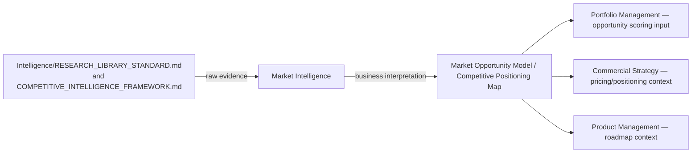

# Bounded Context: Market Intelligence

> Converts `Intelligence/` layer research into business decisions. This is the single most boundary-sensitive context in Business — it explicitly **consumes** Intelligence's research and competitive tracking and **produces** business interpretation, never the reverse. If this context starts storing raw research itself, the boundary with `Intelligence/` has broken.

Governed by `Business/BUSINESS_LAYER_CHARTER.md`, `Business/LAYER_INTERFACES.md`'s Intelligence → Business interface.

## Purpose

Answer "given what Intelligence knows about the market and competitors, what should we actually do about it" — the translation step between evidence and decision that neither Intelligence (which doesn't decide) nor the CEO (who shouldn't have to re-derive market interpretation from raw research every time) should have to do alone.

## Owns

- Market opportunities (interpreted from research, not raw market data itself)
- Industry positioning (where the organization sits, given the competitive landscape)
- Competitor implications (what a competitor's move, tracked in `Intelligence/COMPETITIVE_INTELLIGENCE_FRAMEWORK.md`, actually means for our roadmap/pricing/positioning decisions)
- Market sizing interpretation (TAM/SAM/SOM as a business input, built from Research Library market reports)
- Adoption analysis (interpreting adoption trend data into a business implication)

## Does Not Own

- The research itself, the competitor trackers, or the shelf-life/currency mechanics of that research — all owned and maintained by `Intelligence/RESEARCH_LIBRARY_STANDARD.md` and `Intelligence/COMPETITIVE_INTELLIGENCE_FRAMEWORK.md`
- Commissioning new research (Market Intelligence requests it from Intelligence's existing systems; it doesn't run its own parallel research process)
- Pricing decisions (Commercial Strategy — Market Intelligence informs pricing with competitive context, it doesn't set the price)

## Key Artifacts

- **Market Opportunity Model** — built directly from `Intelligence/RESEARCH_LIBRARY_STANDARD.md` market reports, dated, shelf-life stated exactly like its source
- **Competitive Positioning Map** — built from `Intelligence/COMPETITIVE_INTELLIGENCE_FRAMEWORK.md` tracker data, refreshed on the same cadence as the underlying competitor tier (Tier 1 monthly, Tier 2 quarterly, per that document's cadence table)

## The Consume-Not-Own Discipline

Every Market Intelligence artifact's `evidence_sources` field (per `Business/BUSINESS_ARTIFACT_STANDARDS.md`) must cite a specific `Intelligence/` entry — an artifact here with no such citation is either an undisciplined guess or, worse, a sign this context has started doing Intelligence's job. At review, the Chief of Staff checks this specifically as part of the cross-layer boundary audit (`Business/LAYER_INTERFACES.md` Anti-Patterns).



## Interfaces

- **Consumes from:** `Intelligence/RESEARCH_LIBRARY_STANDARD.md`, `Intelligence/COMPETITIVE_INTELLIGENCE_FRAMEWORK.md` exclusively for evidence
- **Produces for:** Portfolio Management (opportunity context), Commercial Strategy (competitive pricing/positioning context), Product Management (roadmap context), Strategy (theme validation against real market conditions)

## Review Cadence

Tied to the underlying `Intelligence/` source's own cadence — a Market Opportunity Model is only as fresh as the Research Library entry it's built from; re-interpretation is triggered whenever the source refreshes (per `Intelligence/RESEARCH_LIBRARY_STANDARD.md`'s staleness sweep), not on an independent schedule.

## Anti-Patterns

- **Commissioning parallel research.** If Market Intelligence needs data Intelligence doesn't have, the correct move is requesting Intelligence run it (via `Intelligence/RESEARCH_LIBRARY_STANDARD.md`'s normal process), not standing up an independent research effort inside Business.
- **Interpreting stale source research as current without flagging it.** A direct violation of `Core/COMMUNICATION_STANDARD.md`'s honesty rule, inherited here specifically because this context sits right at the evidence-to-decision boundary where staleness is easiest to accidentally launder into false confidence.

## Metadata

```yaml
version: 1.0.0
status: active
last_reviewed: 2026-07-22
owner: Business (Market Intelligence), consumes Intelligence layer exclusively for evidence
```
