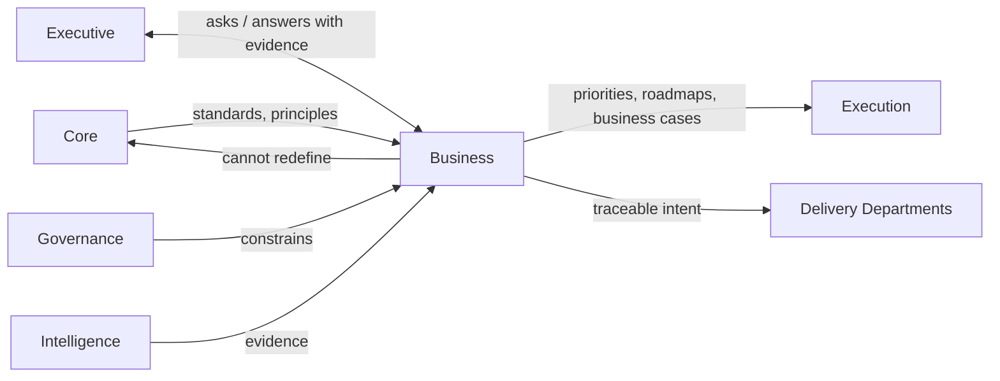

# Business Layer Interfaces

> The explicit contracts between Business and every other layer — what Business consumes, what it produces, and where the authority boundary sits. `Business/BUSINESS_LAYER_CHARTER.md` states the ownership boundary in principle; this document makes each boundary a concrete, checkable interface, the same way `Execution/ARTIFACT_CONTRACTS.md` makes deliverable shape concrete rather than aspirational.

Governed by `Business/BUSINESS_LAYER_CHARTER.md`. Cross-cutting changes to any interface below follow `RFC/RFC_PROCESS.md`.

## Interface Summary



## Core → Business

**Core provides:** `Core/AI_OS_CONSTITUTION.md`'s principles and philosophy, `Core/DECISION_FRAMEWORK.md`'s reasoning method, `Core/COMMUNICATION_STANDARD.md`'s evidence-based communication rules, `Core/QUALITY_STANDARD.md`'s Business Value gate (which Business's outputs are directly judged against), `Core/OUTPUT_STANDARD.md`'s response shape.

**Business cannot:** redefine any Core standard, invent its own decision-making method, or communicate in a way that violates `Core/COMMUNICATION_STANDARD.md`'s no-hallucination rule — a business case built on an unstated assumption is a Core violation, not a Business-layer style choice.

**Concretely:** every Business artifact (`Business/BUSINESS_ARTIFACT_STANDARDS.md`) that makes a claim about market size, customer need, or expected value cites its evidence per `Core/COMMUNICATION_STANDARD.md`, and every investment recommendation states its trade-offs per `Core/DECISION_FRAMEWORK.md`.

## Executive ↔ Business

**Direction:** bidirectional — this is the one interface that isn't strictly one-way, because Executive both consumes Business output and originates the questions Business answers.

| Executive asks | Business answers with |
|---|---|
| "What should we invest in?" | A ranked opportunity or portfolio recommendation (`Business/Contexts/Portfolio_Management.md`), evidenced |
| "Is this objective validated?" | A Business Case (`Business/Contexts/Business_Case_Management.md`) |
| "What's the roadmap?" | A Product Roadmap artifact (`Business/Contexts/Product_Management.md`) |
| "Did that investment pay off?" | Portfolio Analytics realized-vs-expected value (`Business/Contexts/Portfolio_Analytics.md`) |

**Executive remains accountable** for the resulting investment/delegation decision (per `Governance/ORGANIZATIONAL_CHART.md`'s RACI — CEO is Accountable, Business is Responsible for the recommendation). **Business remains authoritative** on the economic reasoning — the CEO does not unilaterally override a Business Case's evidence without logging why, per `Governance/DECISION_LOG_STANDARD.md`.

**Business never delegates, staffs, or coordinates work directly** — a Business Case handed to the CEO becomes a `Execution/REQUEST_LIFECYCLE.md` request through the normal funnel; Business does not instruct a Department directly.

## Governance → Business

**Governance constrains Business** exactly as it constrains every other layer — Business cannot:

- Approve its own highest-stakes decisions (full portfolio reallocation, new pricing model, sunsetting revenue-bearing product) without the `Governance/DECISION_LOG_STANDARD.md` process and, where applicable, `Core/AI_OS_CONSTITUTION.md` §5 rule 3's human-accountability rule.
- Violate a compliance or risk threshold set in `Governance/RISK_MANAGEMENT_FRAMEWORK.md` — a commercially attractive opportunity that fails a Security or Financial risk threshold does not proceed on Business's recommendation alone.
- Skip the `Governance/KPI_FRAMEWORK.md` design rules when defining its own metrics (`Business/BUSINESS_METRICS.md` still requires paired counter-metrics, leading + lagging indicators).
- Bypass `Governance/ORGANIZATIONAL_CHART.md`'s RACI when a decision crosses into another layer's authority.

**Business consumes** `Governance/ORGANIZATIONAL_CHART.md` for its own placement questions, `Governance/RISK_MANAGEMENT_FRAMEWORK.md`'s Business/Financial risk categories as direct inputs to Business Case evaluation.

## Intelligence → Business

**Intelligence provides evidence; Business converts it into decisions.** This is the single most important boundary in the whole layer, and the one most likely to erode without explicit statement:

| Intelligence answers | Business answers |
|---|---|
| "What do we know about this market/competitor?" (`Intelligence/COMPETITIVE_INTELLIGENCE_FRAMEWORK.md`, `Intelligence/RESEARCH_LIBRARY_STANDARD.md`) | "What should we do about it?" (`Business/Contexts/Market_Intelligence.md`) |
| "What patterns/best practices exist?" (`Intelligence/PATTERN_LIBRARY_STANDARD.md`, `Intelligence/BEST_PRACTICES_LIBRARY.md`) | "Does this opportunity fit a proven pattern of value creation?" |
| "What happened last time we tried something like this?" (`Intelligence/CASE_STUDY_STANDARD.md`, `Intelligence/DECISION_INTELLIGENCE.md`) | "Should we do it again, differently, or not at all?" |

**Business never forks a parallel knowledge repository.** Market Intelligence's bounded context (`Business/Contexts/Market_Intelligence.md`) explicitly reads from `Intelligence/`, adds business interpretation, and writes its *interpretation* (not raw research) back as a Business artifact — the underlying research stays owned and stored by Intelligence.

## Execution ← Business

**Business provides:** priorities (`Execution/PRIORITY_FRAMEWORK.md`'s Business Value and Strategic Alignment dimensions are directly populated from Business's scoring), roadmaps, business cases, initiatives, and success criteria.

**Execution operationalizes them:** a Business-originated opportunity that clears validation becomes a request entering `Execution/REQUEST_LIFECYCLE.md` exactly like any other request — Classification will typically mark it Type=New Objective, and its Scoping stage inherits the Business Case's stated success criteria directly rather than re-deriving them.

**Business does not:** own routing, approval mechanics, or runtime state — once a Business-originated initiative enters a `Execution/WORKFLOW_ENGINE.md` instance, its progress is tracked and gated exactly like any other instance.

## Business → Delivery Departments (Future)

Every current and future delivery Department consumes Business intent as a standing interface, not a one-time handoff:

| Department | Consumes from Business |
|---|---|
| Engineering | Product priorities and roadmap (`Product_Management.md`) |
| Design | Customer problems and experience goals (`Customer_Strategy.md`) |
| Marketing | Positioning, messaging, GTM strategy (`Commercial_Strategy.md`, `Customer_Strategy.md`) |
| Sales | Pricing, packaging, value propositions (`Commercial_Strategy.md`) |
| Support / Customer Success | Customer commitments and service expectations (`Customer_Strategy.md`) |
| Analytics | Business-meaningful KPI definitions, not just operational metrics (`Business/BUSINESS_METRICS.md`, `Portfolio_Analytics.md`) |
| Finance | Investment cases and portfolio plans (`Business_Case_Management.md`, `Portfolio_Management.md`) |
| Legal | Commercialization/licensing strategy needing contractual support (`Commercial_Strategy.md`) |

A Department unable to name which Business bounded context its current work traces back to is doing untethered work — this traceability check is part of `Governance/ORGANIZATIONAL_CHART.md`'s intake gate for any new Department going forward.

## Anti-Patterns

- **Business absorbing Executive's coordination role.** Business recommends and evidences; it does not delegate, schedule, or staff — that boundary violation is exactly what this Charter and interface document exist to prevent.
- **Business forking a parallel Intelligence repository.** Any Business document that stores raw research rather than interpreted business decisions has crossed into Intelligence's territory and should be moved.
- **Business bypassing Execution's funnel.** An "urgent business priority" handed directly to a Department without entering `Execution/REQUEST_LIFECYCLE.md` breaks the same uniformity that makes the Execution engine valuable in the first place.
- **Business self-approving high-stakes decisions.** Any decision that would normally require CEO/human sign-off under `Governance/ORGANIZATIONAL_CHART.md`'s RACI does not become self-approved merely because Business originated the recommendation.

## Metadata

```yaml
version: 1.0.0
status: active
last_reviewed: 2026-07-22
owner: CEO (interface ratification), Chief of Staff (interface compliance audit)
```
