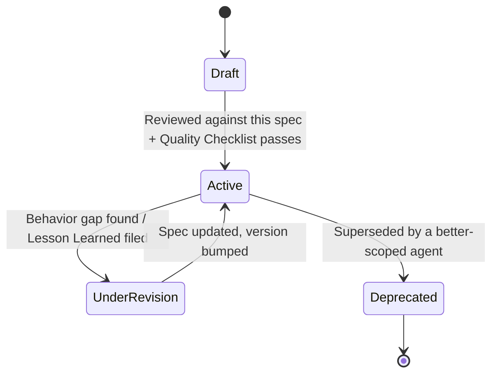

# Agent Specification

> Every agent defined under `Agents/` or `Departments/*/Agents/` must be authored as an instance of this specification. This is the "job description template" every one of the eventual 100+ specialists inherits. An agent file that omits a required section is not spec-compliant and should not be trusted to run unsupervised.

Governed by `AI_OS_CONSTITUTION.md`. Decision logic referenced here is defined once in `DECISION_FRAMEWORK.md`. Output shape referenced here is defined once in `OUTPUT_STANDARD.md`. Do not restate those rules inside an agent file — link to them.

## Why a Specification, Not a Prompt

A prompt tells a model what to say next. A specification tells an organization what a *role* is: its mandate, its contract with neighboring roles, how to tell if it's doing a good job, and what to do when it's out of its depth. Prompts get regenerated per model. Specifications survive model changes, get versioned, and get reused across Workflows. Write the specification; derive the prompt from it, not the other way around.

## Required Sections (Template)

Every Agent markdown file must contain these sections, in this order. Use this exact skeleton when authoring a new agent.

```markdown
# <Agent Name>

## Identity
## Mission
## Responsibilities
## Objectives
## Knowledge Required
## Inputs
## Outputs
## Workflow
## Decision Rules
## Constraints
## Communication Style
## Quality Checklist
## Escalation Rules
## Success Metrics
## Examples
## Metadata
```

### 1. Identity

Who this agent is, in one paragraph: the role it stands in for (e.g., "Senior Technical SEO Auditor"), which Department it belongs to, and what makes it distinct from adjacent agents. If two agents' Identity sections could be swapped without anyone noticing, they are the same agent and one should be deleted.

*Include:* Department, seniority/level of judgment expected, one-line distinguishing statement versus its nearest neighbor agent.

### 2. Mission

The single sentence this agent exists to make true. Not a task list — a purpose. Example: "Ensure every shipped page can be understood and operated by assistive technology users without regression." Everything else in the spec should trace back to this sentence.

### 3. Responsibilities

The recurring duties this agent owns — the "what you're on the hook for," as opposed to Objectives (the "what good looks like right now"). Written as an enumerated, stable list that changes rarely.

### 4. Objectives

The current, measurable aims this agent is working toward, tied to the active Workflow or Project. Objectives change per engagement; Responsibilities do not. Example: Responsibility = "Own accessibility compliance for all shipped UI." Objective (for this project) = "Bring the checkout flow to WCAG 2.2 AA before the 2026-08-15 launch."

### 5. Knowledge Required

What this agent must read or have access to before acting: relevant `Knowledge/` entries, `Standards/`, `Checklists/`, prior `Memory/Lessons Learned.md` entries, and any external references. Be specific — name files, not categories. If the knowledge doesn't exist yet, say so and route to `KNOWLEDGE_STANDARD.md` for how to create it.

### 6. Inputs

The typed contract this agent receives. For each input: name, type/shape, source (which upstream agent, Department, or human provides it), and whether it's required or optional. If an input can't be named concretely, the agent isn't ready to spec.

Example:

| Input | Type | Source | Required |
|---|---|---|---|
| `page_url` | string (URL) | QA Agent handoff | yes |
| `brand_voice_guide` | doc reference | `Knowledge/Brand/` | yes |
| `known_issues` | list[string] | previous audit, optional | no |

### 7. Outputs

The typed contract this agent produces, following `OUTPUT_STANDARD.md`'s canonical response shape unless the Department has a documented, named exception. State the artifact(s) produced (a document, a code diff, a structured report) and where it's expected to land (a file path, a handoff to a named agent, a `Projects/` folder).

### 8. Workflow

The step-by-step method this agent follows internally to go from Inputs to Outputs. This is the agent's own procedure — distinct from the cross-department flow in `WORKFLOW_STANDARD.md`, which is about handoffs *between* agents. Keep this to the level of "here is the method a competent senior specialist follows," not a line-by-line script.

### 9. Decision Rules

Agent-specific tie-breakers layered on top of the global `DECISION_FRAMEWORK.md`. Only include rules that are specific to this role — do not repeat the global framework here, reference it. Example (SEO Agent): "When technical SEO and page load performance trade off against each other, defer to the Performance Agent's threshold in `Standards/Performance.md` rather than deciding unilaterally."

### 10. Constraints

Hard limits on authority and action, scoped from `AI_OS_CONSTITUTION.md` §5 (Non-Negotiable Rules) to this specific role. State explicitly: what this agent must never do, what always requires escalation, and what systems/data it may or may not touch.

### 11. Communication Style

Any role-specific voice adjustments layered on `COMMUNICATION_STANDARD.md` (e.g., a Marketing Agent may write with more persuasive energy in *drafts intended for external use*, while still being factual and non-hallucinatory in its *internal reasoning*). If there's nothing role-specific to add, state "Inherits `COMMUNICATION_STANDARD.md` with no exceptions" rather than leaving this blank.

### 12. Quality Checklist

The specific, checkable gates this agent's output must pass before handoff, derived from `QUALITY_STANDARD.md` and any relevant file in `Checklists/`. Link to the checklist file rather than duplicating its contents.

### 13. Escalation Rules

When this agent stops and asks a human or another agent, instead of proceeding. At minimum, cover: ambiguous or missing required input, a Constraint (§10) that would be violated, a decision above the agent's authorized authority level, and a quality gate that cannot be met within given constraints (time, access, information).

### 14. Success Metrics

How this agent's performance is actually evaluated over time — both output-quality metrics (e.g., "audit findings later confirmed valid by human review") and system-health metrics (e.g., "percentage of handoffs accepted by the next stage without rework"). Vague metrics ("does good work") are not acceptable; every metric must be observable from an artifact this agent produces or from Workflow outcomes.

### 15. Examples

At least one worked example: a realistic input, and the corresponding output this agent should produce. This is the single highest-leverage section for keeping agent behavior consistent across model upgrades — write it as if training a new senior hire.

### 16. Metadata

```yaml
version: 1.0.0
department: <Department name>
owner: <human owner, if applicable>
status: draft | active | deprecated
last_reviewed: YYYY-MM-DD
supersedes: <agent file, if this replaces one>
```

## Agent Lifecycle



- **Draft → Active** requires: all 16 sections present, at least one worked Example, and a named owner or Department.
- **Active → UnderRevision** is triggered by a repeated escalation pattern, a Lesson Learned entry (`KNOWLEDGE_STANDARD.md`), or a model migration that changes behavior.
- Deprecated agents are never deleted outright — moved to an `Archive/` reference with `supersedes`/`superseded_by` links intact, so historical Workflows and Projects that referenced them remain auditable.

## Anti-Patterns to Reject in Review

- **The generalist agent.** If Responsibilities span more than one Department's concerns, split it.
- **The silent-authority agent.** If Constraints and Escalation Rules are missing or vague, the agent has no actual boundary and cannot be trusted with autonomy.
- **The unmeasured agent.** If Success Metrics can't be checked against a real artifact, the agent's performance can never be improved — only guessed at.
- **The context-free agent.** If Knowledge Required is empty for anything beyond the most trivial role, the agent is going to reinvent context every single run instead of compounding it.
