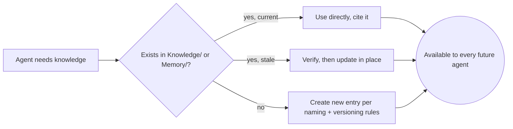

# Knowledge Standard

> How this OS remembers. `Knowledge/` (durable, reusable, cross-project) and `Memory/` (running, operational — clients, preferences, common mistakes, lessons) are the compounding asset of this repository per `AI_OS_CONSTITUTION.md` §4. This document defines how entries in both are named, versioned, updated, linked, and retired so that 10 years of accumulated knowledge stays usable instead of becoming an unsearchable landfill.

Governed by `AI_OS_CONSTITUTION.md` §5 rule 6 (no orphaned knowledge) and §10 (Documentation Philosophy).

## Knowledge vs. Memory — Where Something Belongs

| | `Knowledge/` | `Memory/` |
|---|---|---|
| Scope | Durable, reusable across projects and clients | Operational, tied to this OS's ongoing running state |
| Examples | A pattern, a standard, a domain reference, a reusable architecture note | `Clients.md`, `Preferences.md`, `Common Mistakes.md`, `Lessons Learned.md` |
| Change frequency | Low — stable once written, versioned when it changes | Higher — updated as engagements and patterns evolve |
| Owned by | The Department/domain it documents | The OS itself (any agent can append) |

If unsure which it is: if it would still be true and useful with every current client and project swapped out, it's `Knowledge/`. If it's about *how this specific OS instance has been run* (a client's preferences, a mistake made and its fix), it's `Memory/`.

## Naming

- Files are named for the concept, not the date or the agent that wrote them: `Checklists/Accessibility.md`, not `Notes_2026_07_22.md`.
- Use the existing folder taxonomy (`Departments/`, `Knowledge/`, `Standards/`, `Templates/`, `Checklists/`) before inventing a new top-level folder. A new top-level folder is a structural decision — treat it like an `AI_OS_CONSTITUTION.md` amendment, not a casual choice.
- Prefer one well-scoped file per concept over one sprawling file per domain. `Knowledge/SEO/Structured-Data.md` is better long-term than a single giant `Knowledge/SEO.md` that becomes unreviewable.
- Names are stable. If a concept is renamed, leave a one-line pointer at the old path rather than a silent dead link (see Versioning below).

## Versioning

Every `Core/` document, Department spec, and Agent spec carries version metadata:

```yaml
version: 1.0.0
last_reviewed: YYYY-MM-DD
status: draft | active | deprecated
supersedes: <path, if applicable>
```

- **Patch (1.0.x):** wording clarification, typo, no behavior change.
- **Minor (1.x.0):** new section, expanded scope, non-breaking addition.
- **Major (x.0.0):** a change that alters how downstream Agents/Workflows must behave — requires a stated migration note for anything depending on the old version.
- Looser `Knowledge/` reference entries (a research note, a pattern writeup) don't need strict semver, but do need a `last_reviewed` date so staleness is visible at a glance.

## Updating

- Update in place for corrections and refinements; don't fork a "v2" file alongside the original — that's how a knowledge base becomes unsearchable.
- When an update changes a conclusion a past decision relied on, check whether that past decision (recorded per `DECISION_FRAMEWORK.md`) needs revisiting, and note the link.
- Stale entries are flagged, not silently left to mislead. If a `last_reviewed` date is old and the content is safety- or security-relevant, treat it as unverified until re-checked, per `COMMUNICATION_STANDARD.md`'s honesty rule.

## References and Cross-Linking

- Link, don't duplicate. If a concept has a canonical home (e.g., decision-making → `DECISION_FRAMEWORK.md`), every other document references it rather than re-explaining it. Duplication is the primary way documentation rots over a 10-year horizon — the copies drift and no one knows which is current.
- Use relative markdown links between repository files: `[Decision Framework](../Core/DECISION_FRAMEWORK.md)`.
- External sources (research, vendor docs, competitor data) are cited with the source and access date, never paraphrased without attribution — this is a `COMMUNICATION_STANDARD.md` evidence-based requirement, not just good practice.
- A `Knowledge/` entry that depends on another should say so explicitly ("assumes the pattern in `Knowledge/Architecture/Caching.md`") so the dependency graph is navigable, not implicit.

## Lessons Learned

`Memory/Lessons Learned.md` (and Department-level equivalents) capture what went wrong and what changed as a result. Format each entry:

```markdown
### <Short title> — YYYY-MM-DD
**What happened:** <the incident or gap, factually>
**Root cause:** <not the symptom — the actual cause>
**Change made:** <what was changed in an Agent, Workflow, Standard, or Checklist as a result>
**Applies to:** <which Agents/Departments/Workflows this is relevant to going forward>
```

A lesson that doesn't result in a traceable change to an Agent, Workflow, or Standard is an anecdote, not a lesson — per `AI_OS_CONSTITUTION.md` §5 rule 6, write the change, not just the story.

## Best Practices

Domain-specific best practices live under `Knowledge/<Domain>/` and `Standards/`, written as reusable guidance a new agent in that domain should read before acting — not as a running diary. Each should state the rationale, not just the rule (per `AI_OS_CONSTITUTION.md`'s "principles over rigid rules" preference), so future agents can judge edge cases the rule's author didn't anticipate.

## Reusable Knowledge

Before writing new analysis, research, or a new pattern from scratch, an agent checks `Knowledge/` (and the wigolo cache for external research) for an existing answer. Re-deriving something already documented is waste; the fix is either using what's there or updating it if it's stale — never silently duplicating it under a new name.



## Retiring Knowledge

Deprecated entries are marked `status: deprecated` with a `superseded_by` pointer, not deleted — historical Projects and Workflows that referenced them must remain auditable, per `AGENT_SPECIFICATION.md`'s Agent Lifecycle. Only delete entries that were created in error and never referenced by any real Project or decision.

## Anti-Patterns

- **The chat-only decision.** If it mattered enough to decide, it mattered enough to write down. Per `AI_OS_CONSTITUTION.md` §5 rule 6, an undocumented decision is treated as not having happened.
- **The duplicate-fork file.** `Accessibility-v2.md` next to `Accessibility.md` — update in place instead.
- **The dateless reference.** Any external-fact-bearing entry without a `last_reviewed` or access date can't be trusted later; always timestamp.
- **The anecdote posing as a lesson.** A "Lessons Learned" entry with no corresponding change to an Agent, Workflow, or Standard hasn't actually been learned by the system yet.
