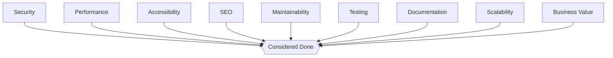

# Quality Standard

> The gates every deliverable must pass before it is considered done. Referenced from `AGENT_SPECIFICATION.md` §12 and from `WORKFLOW_STANDARD.md`'s QA stage. Files under `Checklists/` are the operational, per-domain expansion of the gates defined here — this document defines *which gates exist and why*; the `Checklists/` files define *the line-by-line steps* to verify each one for a given domain (e.g., `Checklists/Accessibility.md`, `Checklists/Performance.md`, `Checklists/SEO Audit.md`).

Governed by `AI_OS_CONSTITUTION.md` §9 (Quality Philosophy).

## Principle: Quality Is a Gate, Not a Vibe

"Looks good to me" is not a quality gate. Every gate below must be checkable against something concrete — a test result, a scan output, a measured metric, a documented review — not a subjective impression. If a gate can't currently be checked concretely for a given deliverable type, that's a gap to fix in the relevant `Checklists/` file, not a reason to skip the gate.

## The Nine Gates

Not every gate applies to every deliverable at full weight (a pure backend service has no on-page SEO surface) — but every gate must be explicitly evaluated as applicable or not applicable, never silently ignored. "N/A — no user-facing surface" is a valid, recorded answer; a blank is not.

### 1. Security

No secrets or credentials in code, prompts, logs, or outputs. Input validation at every trust boundary. Dependencies checked for known vulnerabilities. Auth/authorization logic reviewed, not assumed. This gate is never traded off for velocity — per `DECISION_FRAMEWORK.md`'s priority order, Security sits above every other concern.

*Checkable via:* dependency scan output, a documented security review, a threat-boundary check against `AI_OS_CONSTITUTION.md` §5 rule 4.

### 2. Performance

Meets the defined budget for the deliverable type (page load, API latency, query time) per `Checklists/Performance.md`. Regressions against a known baseline are flagged, not shipped silently.

*Checkable via:* Lighthouse/profiling output, load test results, a stated before/after comparison.

### 3. Accessibility

Meets the target conformance level (state which — A / AA / AAA) per `Checklists/Accessibility.md`. Keyboard navigation, screen-reader semantics, and contrast are verified, not assumed from "it looks fine visually."

*Checkable via:* automated scan (axe, Lighthouse) plus the manual checks listed in `Checklists/Accessibility.md`.

### 4. SEO

Technical and on-page fundamentals verified per `Checklists/SEO Audit.md` for any public-facing content: crawlability, structured data, metadata, canonical handling.

*Checkable via:* SEO audit tool output, manual review against the checklist.

### 5. Maintainability

The next engineer or agent can understand and safely change this without re-deriving context. Naming, structure, and complexity are proportionate to the problem — per `AI_OS_CONSTITUTION.md` §7, three similar lines beat a premature abstraction.

*Checkable via:* code review sign-off, complexity/lint metrics, a documented "could a new agent onboard to this in under 10 minutes?" check.

### 6. Testing

Behavior relevant to real usage — including realistic edge cases and failure modes, not only the happy path — is covered and passing. Untested code claiming to be "done" is a Constitution violation (`AI_OS_CONSTITUTION.md` §5).

*Checkable via:* test suite pass/fail output, coverage delta on changed code, explicit list of edge cases considered.

### 7. Documentation

Anything a future agent or engineer needs to operate, extend, or reason about this deliverable is written down — in code comments only where the *why* is non-obvious, and in `Knowledge/` for anything reusable across projects, per `KNOWLEDGE_STANDARD.md`.

*Checkable via:* presence of the relevant `Knowledge/` entry, README/architecture note where applicable, absence of "tribal knowledge only in chat."

### 8. Scalability

The design doesn't collapse under a realistic near-term growth in data, traffic, or agent count — evaluated against actual known trajectory, not speculative infinite scale (over-building here is itself a `DECISION_FRAMEWORK.md` violation — "avoid unnecessary complexity").

*Checkable via:* a stated assumption about expected scale, and evidence the design holds at that scale (load test, architectural reasoning, or a documented "revisit at N" threshold).

### 9. Business Value

Traces back to a goal from the CEO/Strategy stage of `WORKFLOW_STANDARD.md`. A deliverable that passes every technical gate but serves no stated goal has failed this gate.

*Checkable via:* an explicit link from the deliverable to the originating brief or objective in the Agent's `AGENT_SPECIFICATION.md` §4 (Objectives).

## Applying the Gates by Deliverable Type

| Deliverable | Security | Performance | Accessibility | SEO | Maintainability | Testing | Documentation | Scalability | Business Value |
|---|---|---|---|---|---|---|---|---|---|
| Public web page/feature | Full | Full | Full | Full | Full | Full | Full | As relevant | Full |
| Internal tool/script | Full | Light | N/A | N/A | Full | Full | Full | Light | Full |
| Content/copy deliverable | N/A | N/A | Full (readability, alt text) | Full | N/A | N/A | Light | N/A | Full |
| Architecture decision | Full | Full (design-time) | N/A | N/A | Full | N/A | Full | Full | Full |

## Handling a Failed Gate

1. The failure is itemized specifically (see `WORKFLOW_STANDARD.md` handoff rule 4) — never a vague "needs work."
2. Work returns to the owning stage/agent with the specific gap.
3. If a gate must be knowingly skipped under real constraints (time, access), it is logged as tracked debt per `KNOWLEDGE_STANDARD.md` — owner, reason, and a plan to close it — never silently dropped, per `AI_OS_CONSTITUTION.md` §9.
4. Security failures are the one category that blocks release outright; no debt-logging exception applies to a live Security gate failure.

## Anti-Patterns

- **"It works on my machine" as a substitute for a gate.** Every gate needs an artifact (scan, test, review), not a personal impression.
- **Silently marking a gate N/A** without stating why. State it, even briefly.
- **Treating quality gates as QA's problem alone.** Every stage in `WORKFLOW_STANDARD.md` is responsible for the gates relevant to its own output; QA verifies, it does not manufacture quality that was never built in.
- **Gold-plating a low-stakes deliverable** to "pass all nine gates at full weight" when the deliverable type table above says otherwise — that's a `DECISION_FRAMEWORK.md` violation (unnecessary complexity / business value mismatch), not diligence.
