# Specialist Architecture Standard

> The universal enterprise framework for every AI worker in Umer AI OS. This is the job-family / engineering-ladder equivalent: every future Specialist must conform to it. It does **not** redesign Agents, Departments, Runtime, or Capabilities — it defines how specialized workers are classified, contracted, lifecycle-managed, and composed.

Governed by `Core/AI_OS_CONSTITUTION.md`. Instantiates and extends `Core/AGENT_SPECIFICATION.md`. Bound to Departments by `Departments/DEPARTMENT_ARCHITECTURE_STANDARD.md`. Invoked mechanically by `Runtime/Domains/Agent_Runtime.md`. Capability nouns remain owned by `Enterprise_Architecture/`. Work meaning remains owned by `Execution/`. The standard unit dispatched to a Specialist is the **Work Package** (`Execution/WORK_MANAGEMENT_FRAMEWORK.md`) — Runtime never executes a bare Task.

**Noun rule:** A **Specialist** is a refinement of **Agent** (`Enterprise_Architecture/ENTERPRISE_TAXONOMY.md`). There is no second worker type. "Specialist" names the enterprise worker class; "Agent" remains the canonical taxonomy noun and file form. Specs live under `Agents/` or `Departments/*/Agents/` as Agent Specification instances that additionally satisfy this Standard.

---

## 1. Why Specialists Exist

### Why Specialists exist

Umer AI OS scales by **specialization over generalism** (Constitution + Operating Principles). A Specialist exists to hold **one durable mandate** inside **exactly one Department**, realizing one or more registered Capabilities without owning foundational-layer mandates.

Specialists exist so that:

1. **Judgment stays bounded.** Authority, constraints, and escalation are role-scoped — not rediscovered per run.
2. **Composition replaces generalism.** Cross-concern outcomes are produced by Workflows and handoffs, not by one omniscient worker.
3. **Accountability stays assignable.** One Accountable per concern; dual Accountable for one Capability is forbidden (DAS).
4. **Learning compounds.** Lessons, patterns, and metrics attach to a stable mandate, not to ephemeral prompts.
5. **Models remain dependencies.** Specs survive model changes; Model Routing binds models at Runtime.

A Specialist is the **worker**. It is not a Department, not a Workflow, not a Capability, not a prompt pack, and not a Runtime domain.

### Why Runtime should never directly execute work

Runtime is the **mechanical kernel** (RFC-002). It invokes, schedules, isolates, enforces, routes models, stores artifacts, audits, and recovers *mechanically*.

Runtime must never:

- Originate Business intent or investment judgment
- Own Workflow *meaning*, gate *policy*, or handoff *protocol* (Execution owns those)
- Design Specialist mandates or Department structure
- Be the organizational home of delivery work
- Treat "run a model" as "complete the work"

**Work** is: typed Inputs → Specialist judgment under mandate → sealed Outputs/Artifacts, inside an Execution instance, under Governance policy, against EA Capability bindings.

Runtime **materializes** that work. It does not **decide** or **own** it. If Runtime "directly executes work," the OS collapses into a tool runner: no accountability, no Capability binding, no Department ownership, no audit of *why*.

### Why Departments should never contain implementation logic

A Department is an **organizational unit** that realizes registered Capabilities and is the single parent of its Specialists (DAS + Org Chart). Departments own:

- Charter, operating model, interfaces, artifact *type* extensions, specialty quality bars
- Context topology (bounded contexts — not Agents, not sub-Departments)
- Which Specialists are staffed and which Capabilities they Accountably realize

Departments must **not** contain implementation logic because:

1. **Implementation is work product**, not org structure — it moves as Artifacts through Execution.
2. **Org charts reorganize; Capabilities and Artifacts must outlive them** (EA Taxonomy).
3. **Logic in Department folders bypasses Execution** — the forbidden side-channel.
4. **Mixing org doctrine with implementation** makes the Department both the worker and the workplace — ownership collision with Specialists and Execution.

Departments **charter and staff**. Specialists **perform**. Execution **orchestrates meaning**. Runtime **runs the machine**.

---

## 2. Specialist Architecture Standard

### Inheritance from Agent Specification

Every Specialist **is** an Agent Specification instance. The 16 required Agent Spec sections remain mandatory and are not replaced:

Identity · Mission · Responsibilities · Objectives · Knowledge Required · Inputs · Outputs · Workflow · Decision Rules · Constraints · Communication Style · Quality Checklist · Escalation Rules · Success Metrics · Examples · Metadata

### Challenge to the proposed section list

The proposed enterprise list is directionally correct but incomplete and partially conflates layers:

| Proposed | Verdict | Challenge |
|---|---|---|
| Identity | Keep | Must include Department, Spec ID, Authority Class, nearest-neighbor distinction |
| Mission | Keep | Single sentence; must remain valid across models/tools for a decade |
| Department | Keep (binding) | Exactly one; not a soft affiliation |
| Capability Mapping | Keep — rename **Capability Accountability** | Mapping alone allows dual Accountable; must declare Accountable / Responsible / Consulted per EA Capability ID |
| Skill Set | Keep — clarify | **Skills** = Runtime-callable units (Registry). Not Capabilities. Not soft résumé bullets |
| Tool Permissions | Keep | Allowlist only; resolved via Registry + Trust at Runtime — never open-ended |
| Context Requirements | Keep | Typed handles from Execution Context + Department Contexts; not "whatever fits" |
| Memory Requirements | Keep | What must be read/written via Memory Access → Intelligence SoR; forbid local-only org memory |
| Inputs / Outputs | Keep | Already Agent Spec §§6–7; must cite Artifact Contract types |
| Runtime Contracts | Keep | Binding to Agent Runtime mandate/spec-hash/sandbox/budget — Specialist does not invent Runtime policy |
| Artifact Contracts | Keep | Produce/consume only registered `Execution/ARTIFACT_CONTRACTS.md` types (or Dept-extended types with single owner) |
| Quality Contracts | Keep | Checklist + gates; link `QUALITY_STANDARD.md` / Dept quality bars — do not duplicate |
| Escalation Rules | Keep | Must name *who* (Lead, Executive role, human, peer Specialist class) |
| Collaboration Rules | Keep | Which patterns this Specialist may enter (see §5) |
| Approval Requirements | Keep | What this Specialist may approve vs must request; irreversible stays HITL |
| Failure Recovery | Keep | Specialist-local recovery vs Execution Failure Recovery vs Runtime Resilience — do not conflate |
| Performance Metrics | Keep | Must fit `Governance/KPI_FRAMEWORK.md`; forbid LOC/message-volume theater |
| Lifecycle | Keep | Spec lifecycle ≠ run lifecycle ≠ Department lifecycle (see §4) |

### Expanded required enterprise sections

In addition to Agent Spec §§1–16, every Specialist conforming to this Standard must declare the following **enterprise sections** (may be nested under Metadata / Constraints / Escalation where that preserves Agent Spec order — but the content is mandatory and reviewable):

| # | Section | Purpose |
|---|---|---|
| E1 | **Department Binding** | Exactly one Department; Lead Agent parent; Org Chart leaf placement |
| E2 | **Capability Accountability** | EA Capability IDs with RACI; fail-closed if unbound at Runtime |
| E3 | **Authority Class** | Judgment level: Advise · Produce · Verify · Constrain · Approve (scoped) · Escalate-only |
| E4 | **Specialist Class** | Taxonomy class from §3 (primary + optional secondary interaction mode) |
| E5 | **Non-Goals / Anti-Mandate** | Explicit work this Specialist must refuse (prevents silent mandate expansion) |
| E6 | **Skill Bindings** | Named Skills/Plugins from Registry Fabric; version range; no vendor model IDs |
| E7 | **Tool Permission Set** | Allowlist + data domains permitted; egress only via Extension Runtime |
| E8 | **Context Contract** | Required/optional context keys; Department Context affiliation(s) |
| E9 | **Memory Contract** | Read/write scopes into Intelligence; retention class; no SoR in local run state |
| E10 | **Artifact I/O Contract** | Artifact types produced/consumed; ownership on produce |
| E11 | **Runtime Binding Contract** | Spec hash/version; sandbox class; resource/cost envelope; time bound |
| E12 | **Quality Contract** | Entry/exit checklists; rework thresholds; independent verification triggers |
| E13 | **Gate & Approval Contract** | Gates this Specialist feeds or staffs; what it cannot auto-approve |
| E14 | **Collaboration Affinity** | Allowed patterns: delegate, handoff, review, pair, escalate, approve, reject, merge |
| E15 | **Escalation Matrix** | Ambiguity · Constraint breach · Authority exceed · Quality fail · Cost/time breach · Safety |
| E16 | **Failure & Recovery Contract** | Retryable vs fatal; compensation; when to suspend vs kill run |
| E17 | **Observability Contract** | Events/metrics this Specialist must emit for Runtime Observability + Dept metrics |
| E18 | **Human Accountability Anchor** | Named human/role for irreversible, spend, external, or policy exceptions |
| E19 | **Coverage & Succession** | Who covers when Suspended/Retired; pairing backup class |
| E20 | **Version & Compatibility** | Semver; `supersedes` / `superseded_by`; Workflow compatibility window |
| E21 | **Compliance & Trust Class** | Trust principal class; data sensitivity; Security consultation triggers |
| E22 | **Cost & Resource Class** | Budget class; max tools/run; parallelism limits |

**Anti-patterns for the Standard itself**

- Replacing Agent Spec with a parallel template
- Treating "Skill Set" as Capability ownership
- Encoding prompts or model IDs in the Standard
- Giving Specialists Accountability for foundational layers (Core, Governance, Intelligence SoR, Execution meaning, EA nouns, Runtime mechanics, Business value judgment)

---

## 3. Specialist Taxonomy

### Challenge to the example taxonomy

The example list (Executive, Business, Engineering, Design, QA, Security, Analytics, Research, Platform, Infrastructure, Review, Approval) mixes **three different axes** and must not be used as a flat enum:

1. **Org home** (Engineering, Design, …) — already owned by Org Chart + DAS  
2. **Leadership / value layers** (Executive, Business) — not Delivery Departments; Specialists there are leadership or value-engine roles, not "another Department family"  
3. **Interaction mode** (Review, Approval) — collaboration patterns, not durable job families  

**Rejected as primary taxonomy:** naming Specialist families only after Department names (duplicates Org Chart), or inventing Platform/Infrastructure families that bypass Engineering Contexts already Chartered.

### Canonical taxonomy (three axes)

Every Specialist is classified on **all three axes**. Primary filing uses Axis A + Axis B; Axis C is declared on the Collaboration Affinity section.

#### Axis A — Mandate Domain (where judgment lives)

| Class | Home | Notes |
|---|---|---|
| **Executive Specialists** | `Executive/` | Leadership judgment, delegation, coordination — not delivery implementation |
| **Business Specialists** | `Business/` | Value, portfolio, investment intent, product/commercial judgment |
| **Delivery Specialists** | Chartered `Departments/` | Engineering, Design, QA, Security, Analytics (and future DAS Departments) |
| **Control Specialists** | Governance-adjacent staffing only when explicitly Chartered | Policy interpretation / compliance *assistance* — Governance remains policy owner; these Specialists do not become a Governance Department |
| **Evidence Specialists** | Intelligence-adjacent or Analytics/Research contexts | Research, lessons synthesis, competitive evidence — Intelligence remains knowledge SoR |

Delivery Specialists are further **filed by Department**, not by a competing parallel enum. Platform and Infrastructure concerns are **Engineering Contexts** (or future Platform Department via DAS), not separate top-level Specialist kingdoms.

#### Axis B — Authority Class (what the mandate may do)

| Authority Class | Meaning |
|---|---|
| **Advise** | Recommends; cannot seal delivery Artifacts alone |
| **Produce** | Creates Artifacts under mandate |
| **Verify** | Independent check (prototypically QA); must not own the production it verifies |
| **Constrain** | May block or require controls (prototypically Security); does not replace producer |
| **Enable** | Measurement, platform enablement (prototypically Analytics / Eng Platform Contexts) |
| **Approve (scoped)** | May clear named gates only; never irreversible/spend/external without Human Anchor |
| **Orchestrate** | Coordinates other Specialists inside Executive/Execution rules — does not implement delivery |

#### Axis C — Interaction Mode (how it collaborates)

| Mode | Meaning |
|---|---|
| **Solo Producer** | Default produce path |
| **Reviewer** | Reviews peers' Artifacts; Review is a mode, not a Department |
| **Approver** | Staffs a gate; Approval is Execution/Governance policy, not a freestanding family |
| **Pair Primary / Pair Secondary** | Concurrent dual-mandate work with explicit merge rules |
| **Delegate Lead** | May spawn sub-mandates to child Specialists inside same Department rules |
| **Integrator** | Merges accepted handoffs / parallel branches per Execution Parallel rules |

### Filing rule

```text
Specialist Class ID = Mandate Domain + Department (if Delivery) + Authority Class + primary Interaction Mode
```

Examples (illustrative, not staffing):

- Delivery / Engineering / Produce / Solo — Application Delivery Specialist  
- Delivery / QA / Verify / Reviewer — Release Validation Specialist  
- Delivery / Security / Constrain / Approver — Threat-Gate Specialist  
- Business / — / Advise / Solo — Portfolio Analytics Specialist (value judgment remains Business; Analytics Department remains measurement plane)  
- Executive / — / Orchestrate / Delegate Lead — Project Manager Specialist  

### Growth preference (unchanged)

Prefer: **new Specialist (Agent) → Team → Capability on existing Department → new Department → new Domain (RFC, rare)**.

---

## 4. Specialist Lifecycle

Two lifecycles must never be conflated:

- **Spec lifecycle** (mandate existence) — this section  
- **Run lifecycle** (one invocation) — owned mechanically by Agent Runtime; semantically by Execution  

### Spec lifecycle states

```mermaid
stateDiagram-v2
    [*] --> Proposed
    Proposed --> Created: Spec authored (Agent Spec + this Standard)
    Created --> Registered: Capability IDs bound; Registry entry; Org Chart leaf
    Registered --> Active: Activation gate passed
    Active --> Suspended: Policy, safety, quality, or cost breach
    Suspended --> Active: Recovery attestation
    Suspended --> Retired: Not restored
    Active --> UnderRevision: Behavior gap / Lesson / contract change
    UnderRevision --> Active: Version bump; compatibility noted
    Active --> Retired: Superseded or Department stage retreat
    Retired --> Archived: Audit retention
    Archived --> [*]
```



| Stage | Meaning | Owner of decision | Runtime behavior |
|---|---|---|---|
| **Creation** | Spec drafted under Agent Spec + this Standard; Department Binding declared | Department Lead + human owner; CoS audit of form | Not dispatchable |
| **Registration** | EA Capability IDs bound; Registry Fabric provider entry; Org Chart leaf; Artifact types declared | EA (nouns) + Registry + Governance placement | Resolvable but not Active |
| **Activation** | Staffing gate (DAS Stage ≥3 for Delivery); Quality Checklist exists; Example present; Human Anchor named | Department Lead + Executive as Org Chart RACI | Dispatchable |
| **Execution** | *Run* state, not Spec state: mandate.bind → sandbox → loops → seal | Execution (meaning) + Runtime (mechanics) | Agent run record |
| **Suspension** | Temporarily non-dispatchable; in-flight runs may complete or kill per Failure Contract | Governance policy trigger + Department Lead | Fail closed on new dispatch |
| **Recovery** | Attestation that root cause addressed; metrics reset rules applied | Department Lead + Governance as required | Re-Active |
| **Retirement** | Superseded or scope ended; `superseded_by` required if replaced | Department Lead + Executive for org impact | Not dispatchable; historical Workflows remain auditable |
| **Versioning** | Semver on Spec; material contract changes bump major; Runtime binds by hash/version | Spec owner; RFC if cross-layer contracts change | Pin or float per Workflow compatibility window |

**Rules**

- Draft/Created Specialists must not receive delivery-affecting work.
- Unbound Capability → Registration incomplete → Runtime fail closed.
- Retirement never silent-deletes; Archive retains links for audit.
- Department Stage retreat below Staffed may force Suspension of its Specialists.

---

## 5. Collaboration Architecture

All collaboration occurs **inside Execution instances** (or Executive coordination that results in Execution entry). No Specialist-to-Specialist side channel that mutates delivery Artifacts outside handoff/gate protocol.

| Pattern | Definition | Ownership transfer | Constraints |
|---|---|---|---|
| **Delegate** | Lead or Orchestrate Specialist assigns a sub-mandate to a child Specialist | Child Accountable for sub-mandate Outputs; parent remains Accountable for integration | Same Department unless Execution Parallel + interface contract says otherwise |
| **Handoff** | Formal package between Departments/Specialists per `Execution/DEPARTMENT_HANDOFFS.md` | Transfers **only** on Receiver Acknowledgment | Itemized rejection returns ownership to sender |
| **Review** | Reviewer mode Specialist assesses Artifact against Quality Contract | No ownership transfer unless gate says review is blocking acceptance | Verifiers must not have Produced the same Artifact |
| **Pair** | Two Specialists concurrent on shared objective with split Non-Goals | Joint until Merge; each seals own Artifact slice | Requires Pair Affinity on both specs; conflict → escalate |
| **Escalate** | Stop and route per Escalation Matrix | Ownership stays with escalator until decision returns | Ambiguity, Constraint, Authority, Quality, Cost, Safety |
| **Approve** | Scoped Approver clears a named Execution gate | Gate record authorizes next stage; not a general power | Irreversible/spend/external → Human Anchor; non-auto-approvable |
| **Reject** | Itemized refusal of handoff, review, or gate package | Ownership remains with sender/producer | Must cite contract clause; vibes-based reject forbidden |
| **Merge work** | Integrator combines parallel branches / pair slices | Integrator Accountable for merged Artifact | Per Execution Parallel rules; conflicts escalate |
| **Share context** | Pass Execution Context handles + Department Context refs | Context ownership stays with Execution Context Management | No silent context rewrite by receiver |
| **Share memory** | Read/write via Memory Access into Intelligence SoR | Intelligence owns content SoR | Specialists never treat run-local state as org memory |
| **Share artifacts** | Reference registered Artifact IDs in handoff/gate packages | Producer owns until handoff ack / gate policy says otherwise | Only registered types; single owner per type |

**Collaboration anti-patterns**

- Pairing across Departments without an Execution Parallel plan  
- Reviewer who also produced the Artifact under review  
- "Approval Specialist" Department that centralizes all gates (gates are Execution/Governance)  
- Sharing memory by pasting secrets into prompts  
- Merge without Integrator mandate  

---

## 6. Specialist Contracts

Specialists **consume** these contracts; they do not own the contract systems.

| Contract surface | Specialist obligation | Counterparty owner |
|---|---|---|
| **Runtime** | Bindable spec hash/version; honor sandbox, tool allowlist, budget, time bound; emit run events | Runtime (Agent Runtime + Trust + Registry + Observability) |
| **Departments** | Exactly one parent; obey Department Charter, Interfaces, quality bars, Context topology | Department (DAS) |
| **Execution** | Enter via Request Lifecycle; honor Workflow stages, gates, handoffs, context packages, failure recovery semantics | Execution |
| **Business** | Consume intent/priority/value signals; do not originate portfolio investment decisions unless Business Specialist | Business |
| **Memory** | Use Memory Access scopes only; write lessons via Intelligence pathways | Intelligence (content) + Runtime Memory Access (plumbing) |
| **Artifacts** | Produce/consume registered types; seal outputs; no shadow formats | Execution Artifact Contracts (+ Dept registry extensions) |
| **Knowledge** | Declare Knowledge Required; create missing knowledge via Knowledge Standard — do not invent private canon | Core Knowledge Standard + Intelligence / Governance knowledge rules |
| **Tools** | Call only allowlisted Skills/Tools/Plugins through Registry + Trust + Extension | Runtime Registry Fabric / Trust / Extension |
| **Policies** | Obey Governance RACI, risk appetite, KPI rules, document lifecycle; escalate policy conflicts | Governance |

**Contract rule:** Material changes to cross-layer Specialist binding (e.g., mandate attestation shape, handoff package fields) require versioned contract updates and RFC when they break existing usage.

---

## 7. Specialist Metrics

All metrics conform to `Governance/KPI_FRAMEWORK.md`: ≥2 leading + ≥2 lagging; counter-metrics required; **forbid** story points, LOC, and message volume as primary KPIs.

| Family | Intent | Example measures (observables) |
|---|---|---|
| **Quality** | Output fitness | Handoff acceptance rate; rework rate; post-seal defect escapes; checklist pass-through |
| **Reliability** | Mandate integrity | Mandate violation rate; kill rate; Suspension frequency; Recovery time |
| **Collaboration** | Healthy composition | Ack latency; itemized reject validity; escalation resolution time; pair-merge conflict rate |
| **Efficiency** | Value per resource | Cost/run vs envelope; cycle time within stage; unnecessary tool-call rate |
| **Consistency** | Spec fidelity across versions/models | Example-regression score; cross-model output contract compliance; version drift incidents |
| **Cost** | Economic control | Cost/successful Artifact; budget-breach rate; idle Suspended capacity |
| **Learning** | Compounding improvement | Lessons filed → spec revisions; recurrence of same Failure Mode; time-to-UnderRevision after signal |

Department metric families and Runtime Agent metrics remain; Specialist metrics **roll up** into them — they do not create a competing KPI kingdom.

---

## 8. Failure Modes

| ID | Failure mode | Symptom | Structural countermeasure |
|---|---|---|---|
| SF-01 | **Generalist collapse** | Mandate spans multiple Departments/Capabilities | Split Specialist; Non-Goals enforced |
| SF-02 | **Mandate expansion** | Quietly does neighbor's work | Anti-Mandate + Runtime mandate.bind |
| SF-03 | **Unbound Capability** | Works without EA ID | Registration gate; Runtime fail closed |
| SF-04 | **Side-channel delivery** | Bypasses Execution | Org policy + no Artifact seal outside Workflow |
| SF-05 | **Runtime-as-worker** | Kernel "just does the task" | Ownership Boundaries; Agent Runtime anti-patterns |
| SF-06 | **Department-as-codebase** | Implementation logic stored as Department doctrine | Artifacts + Execution only |
| SF-07 | **Verifier capture** | QA/Security Produce what they Verify/Constrain | Authority Class separation |
| SF-08 | **Local memory SoR** | Org truth only in run state | Memory Contract → Intelligence |
| SF-09 | **Model hard-bind** | Spec pins vendor model ID | Model Routing only |
| SF-10 | **Silent authority** | Missing Constraints/Escalation | Activation gate rejects |
| SF-11 | **Unmeasured worker** | No observable Success Metrics | KPI Framework + Activation gate |
| SF-12 | **Zombie Specialist** | Retired/Suspended still dispatched | Registry status + Runtime resolver |
| SF-13 | **Approval absolutism** | Approver clears irreversible without Human Anchor | Gate policy + HITL Session Runtime |
| SF-14 | **Handoff abandon** | Sender marks done without ack | Ownership-on-ack protocol |
| SF-15 | **Pair deadlock** | No merge/escalation path | Collaboration Affinity + Escalation Matrix |
| SF-16 | **Cost runaway** | Unbounded tools/loops | Resource envelope; kill; Suspension |
| SF-17 | **Taxonomy spoof** | "Platform Specialist" as shadow Department | Axis A filing + DAS growth order |
| SF-18 | **Foundational cosplay** | Specialist claims Core/Governance/EA/Runtime ownership | Non-Goals + layer ownership verification |

---

## 9. Ten-Year Specialist Architecture

### Decade thesis

By year ten, Umer AI OS runs **hundreds of Specialists** across many Departments without redesigning the worker architecture. Stability comes from: one worker noun (Agent/Specialist), one parent (Department), one Capability registry (EA), one work funnel (Execution), one machine (Runtime), one constitution (Core).

### Horizon map

| Horizon | Specialist architecture focus | Explicit non-goals |
|---|---|---|
| **Y0–Y1** | Standard ratified; staff minimum coverage into Chartered Department Contexts; Registration + Activation discipline; no new foundational layer | No prompt OS; no model-specific ladders; no Marketing/SEO staffing without DAS |
| **Y2–Y3** | Teams as scale unit; Specialist Classes catalogued; cross-Department Pair/Review norms mature; metrics rollups trusted | No "Agent society" policy inside Runtime; no dual Department parents |
| **Y4–Y6** | Dynamic coverage & succession; automated Suspension on reliability SLOs; Capability Heat Map informs staffing, not the reverse | EA remains descriptive; Business remains value owner |
| **Y7–Y10** | Multi-Department ecosystems; Specialist marketplaces *inside* Registry bindings; continuous version compatibility windows | Still no Runtime-owned mandates; still no Department implementation logic; still human anchors for irreversible acts |

### Invariants that must still be true in year ten

1. Specialist = Agent refinement; no parallel worker taxonomy  
2. Exactly one Department parent  
3. Capability nouns in EA; unbound → fail closed  
4. All delivery-affecting work enters Execution  
5. Runtime invokes; never originates work meaning  
6. Departments organize; Specialists perform  
7. Intelligence owns knowledge content SoR  
8. Governance owns policy; gates enforce it  
9. Models are swappable dependencies  
10. Growth order: Specialist → Team → Capability → Department → Domain (RFC)

### What deliberately does not evolve into

- A Specialist "foundation layer" peer to Core/Runtime  
- Prompt-centric architecture  
- Model-vendor job ladders  
- Autonomous approval of irreversible actions  
- Ownership of Business portfolio or EA taxonomy by workers  

---

## Ownership Verification

| Claim | Status | Evidence in this Standard |
|---|---|---|
| ✓ No ownership overlap | Pass | Capability Accountability single-Accountable; contracts table assigns counterparties |
| ✓ Runtime remains infrastructure | Pass | §1 + Runtime contract: invoke/enforce/audit only |
| ✓ Departments remain organizational | Pass | §1 + Department Binding; no implementation logic |
| ✓ Specialists remain workers | Pass | Noun rule; taxonomy; lifecycle as staffing of mandates |
| ✓ Business remains value owner | Pass | Business contract; Business Specialists advise/produce value artifacts, do not seize Execution/Runtime |
| ✓ Execution remains workflow owner | Pass | Collaboration + Execution contract; no side channels |
| ✓ Intelligence remains knowledge owner | Pass | Memory Contract → Intelligence SoR |
| ✓ Governance remains policy owner | Pass | Policies contract; Suspension/Approval under policy |
| ✓ Enterprise Architecture remains structural owner | Pass | Capability IDs; taxonomy extension rule; no Specialist-owned nouns |
| ✓ Core remains constitutional owner | Pass | This Standard lives under Core; Agent Spec retained as instance template |

---

## Conformance Checklist (Activation Gate)

A Specialist may move Registered → Active only if:

1. All Agent Spec §§1–16 present with at least one Example  
2. Enterprise sections E1–E22 declared and non-vacuous  
3. Exactly one Department Binding on Org Chart  
4. Every Accountable Capability ID exists in EA and is uniquely Accountable  
5. Tool/Skill allowlists resolve in Registry Fabric  
6. Artifact types are registered  
7. Human Accountability Anchor named for irreversible class  
8. Metrics fit KPI Framework  
9. Non-Goals / Anti-Mandate present  
10. No model vendor IDs; no foundational-layer ownership claims  

---

## Related Documents

- `Core/AGENT_SPECIFICATION.md` — instance template  
- `Core/AI_OS_CONSTITUTION.md` — constitutional rules  
- `Departments/DEPARTMENT_ARCHITECTURE_STANDARD.md` — Department binding & growth order  
- `Governance/ORGANIZATIONAL_CHART.md` — Specialist Agent leaf placement  
- `Enterprise_Architecture/ENTERPRISE_TAXONOMY.md` — Agent / Specialist noun  
- `Execution/WORK_MANAGEMENT_FRAMEWORK.md` — work hierarchy + Work Package dispatch  
- `Execution/DEPARTMENT_HANDOFFS.md` · `Execution/ARTIFACT_CONTRACTS.md` · `Execution/APPROVAL_GATES.md`  
- `Runtime/Domains/Agent_Runtime.md` · `Runtime/RUNTIME_OWNERSHIP_BOUNDARIES.md`  
- `Governance/KPI_FRAMEWORK.md`

## Metadata

```yaml
version: 1.0.0
status: active
layer: Core
last_reviewed: 2026-07-22
owner: Chief AI Workforce Architect
supersedes: null
extends:
  - Core/AGENT_SPECIFICATION.md
  - Departments/DEPARTMENT_ARCHITECTURE_STANDARD.md
```
