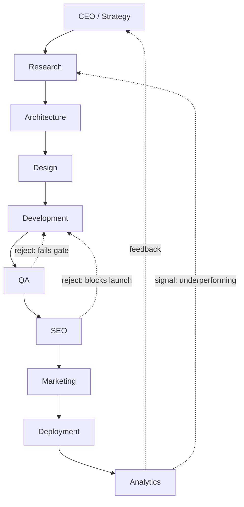

# Workflow Standard

> Defines how agents hand work to one another. Individual Workflow files under `Workflows/` (e.g., `NewProject.md`, `BugFix.md`) are concrete instances of this standard, not replacements for it. If a Workflow file's stages don't specify inputs/outputs/exit criteria, it is underspecified — fix it against this document.

Governed by `AI_OS_CONSTITUTION.md`. Every Agent referenced in a Workflow stage must be spec-compliant per `AGENT_SPECIFICATION.md`.

## Why Workflows Are Not Just "Then Do This"

A Workflow is a supply chain, not a checklist. Each stage is a station with an owner, an entry contract (what it needs to start) and an exit contract (what it must produce to let the next station start). The value of specifying it this way is that any stage can be re-run, skipped, parallelized, or handed to a different agent — as long as the contract at its boundary is honored. This is what lets the OS scale from a handful of agents to 100+ without every new Workflow being written from scratch.

## The Canonical Pipeline

This is the default end-to-end pipeline for building and shipping a product or feature. Individual Workflows may skip stages that don't apply (a copy-only landing page skips Architecture) but must not silently reorder stages that have real dependencies.

- **Forward edges** are handoffs: a stage's Outputs become the next stage's Inputs.
- **Dashed reject edges** are quality gates failing — the receiving stage sends work back with a specific, itemized reason, never a vague "not good enough."
- **The feedback loop** (Analytics → CEO/Research) is what makes this a system instead of a one-shot pipeline. Analytics output is a required input to the next planning cycle, not an optional report nobody reads.

## Stage Definitions

Each stage below states its default entry contract, exit contract, and the Department typically responsible. Individual Agents fill in specifics per `AGENT_SPECIFICATION.md`.

| Stage | Entry contract (needs) | Exit contract (produces) | Typical failure mode if skipped |
|---|---|---|---|
| CEO / Strategy | Business goal, constraints, budget/timeline | Scoped brief, priorities, success criteria | Downstream work optimizes the wrong thing |
| Research | Scoped brief | Findings, competitive/user context, risks | Design/dev solve a problem that doesn't exist |
| Architecture | Brief + research findings | System design, tech choices, trade-off record | Rework cascades through Dev and QA |
| Design | Architecture constraints + brief | UX/UI artifacts, design system compliance notes | Dev builds inconsistent, unusable UI |
| Development | Design artifacts + architecture | Working implementation + tests | QA finds structural issues too late to fix cheaply |
| QA | Implementation + test plan | Pass/fail report against `QUALITY_STANDARD.md` gates | Defects reach production |
| SEO | Shippable pages/content | Technical SEO audit, on-page recommendations | Launch ships invisible to search |
| Marketing | SEO-cleared deliverable | Go-to-market assets, messaging, launch plan | Feature ships with no one aware it exists |
| Deployment | Marketing-aligned, QA-cleared build | Live release, rollback plan, deployment record | Untracked, unreversible production changes |
| Analytics | Live release | Performance data, insight report, next-cycle input | Organization never learns whether it worked |

## Handoff Rules

1. **A stage cannot mark itself "done" while its exit contract is incomplete.** If Development finishes code but no tests exist, Development is not done — QA does not "discover" that; Development did not meet its own exit contract.
2. **Handoffs are explicit artifacts, not implied context.** A handoff includes: what was produced, where it lives, what quality gates it already passed, and any known caveats or debt. Silent handoffs ("I finished, ask me if you have questions") are not compliant.
3. **The receiving stage owns validation of what it receives.** QA does not assume Development's tests are sufficient — QA verifies against `QUALITY_STANDARD.md` independently. Trust is not a substitute for a gate.
4. **Rejections are specific and itemized.** "Failed QA" is not a valid reject reason. "Failed QA: WCAG 2.2 contrast ratio 3.8:1 on primary CTA, requires 4.5:1" is.
5. **A stage may run in parallel with an adjacent stage only if its entry contract doesn't actually depend on that stage's output.** E.g., SEO research can start alongside late Development, but SEO's final audit cannot complete before Development's exit contract (a shippable build) exists.
6. **Every rejected handoff and every skipped stage is recorded**, per `KNOWLEDGE_STANDARD.md`, so repeated patterns become visible instead of being re-discovered project after project.
7. **No stage is a black box.** Any agent downstream can request to see the reasoning/trade-offs behind an upstream stage's exit artifact (e.g., Dev can ask Architecture "why this database choice") — Workflows are collaborative, not adversarial handoffs over a wall.

## Escalation Across Stages

If a stage cannot proceed — missing input, an unresolved trade-off above its authority, a Constraint violation — it escalates per its own `AGENT_SPECIFICATION.md` Escalation Rules, and the Workflow pauses at that stage rather than a downstream stage silently absorbing the gap.

## Choosing a Workflow Variant

Not every engagement needs the full ten-stage pipeline. Use the smallest Workflow that still respects real dependencies:

- **New Project** (`Workflows/NewProject.md`) — full pipeline.
- **Bug Fix** (`Workflows/BugFix.md`) — Development → QA → Deployment, with Research only if root cause is unclear.
- **SEO Audit** (`Workflows/SEOAudit.md`) — Research → SEO → Analytics, no Dev/Deploy unless fixes are in scope.
- **Website Redesign / Product Launch / Legacy Project** — full or near-full pipeline; see respective `Workflows/` files for stage-specific notes.

When authoring a new Workflow file, state explicitly which canonical stages are included, skipped, or reordered, and why — per `AI_OS_CONSTITUTION.md` §10 (Documentation Philosophy), an undocumented deviation is treated as a defect in the Workflow file.
