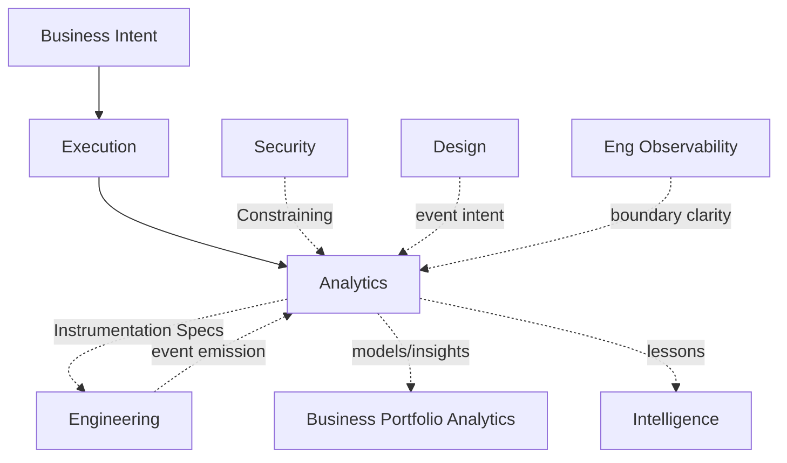

# Analytics Dependency Graph

Governed by `Departments/Analytics/ANALYTICS_CHARTER.md`.



## Inputs

| Input | Source | Type |
|---|---|---|
| Questions / success metrics needs | Business via Execution | Required for insight initiatives |
| System change capacity | Engineering | Required Enabling to implement instrumentation |
| PII/data rules | Security | Required Constraining when personal data involved |
| Experience event intent | Design | Optional Enabling |

## Outputs

| Output | Consumer | Type |
|---|---|---|
| Metric Dictionary, Event Taxonomy, Instrumentation Specs | Engineering, QA, Business | Required Enabling |
| Analytics Models, Insight Artifacts | Business, Executive | Enabling |
| Experiment Results (integrity-certified) | Business | Enabling |
| Data Quality Incidents | Eng / Security | As needed |

## Required Dependencies

Business Intent for what to measure; Engineering to emit; Security for sensitive data; Governance KPI rules; Execution for change work.

## Optional Dependencies

Design event intent; Intelligence patterns; Observability liaison for signal boundary.

## Cycle Check

Analytics does not Sequential-block Engineering feature start. Instrumentation may be Sequential **exit** criteria when Business success criteria require measurement — declared on the Execution instance, not a standing global gate.

## Metadata

```yaml
version: 1.0.0
status: active
last_reviewed: 2026-07-22
owner: Analytics, Chief of Staff
```
