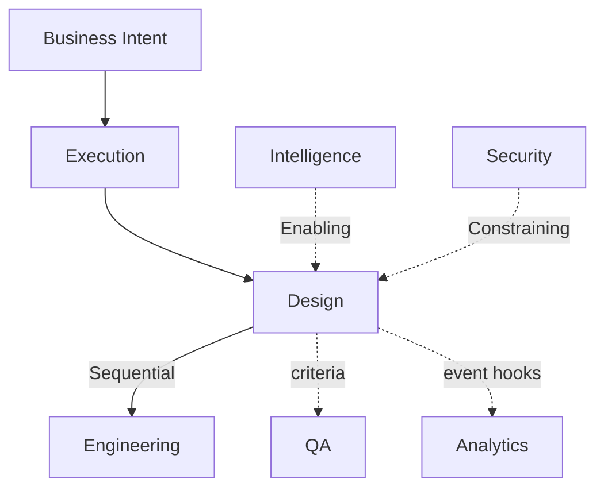

# Design Dependency Graph

Governed by `Departments/Design/DESIGN_CHARTER.md`.



## Inputs

| Input | Source | Type |
|---|---|---|
| Problem/outcome, segments, journeys (business-level) | Business via Execution | Required Sequential |
| Execution instance | Execution | Required Sequential |
| Prior research/patterns | Intelligence / Business Market or Customer contexts | Optional Enabling |
| Security UX constraints | Security | Required Constraining when applicable |

## Outputs

| Output | Consumer | Type |
|---|---|---|
| Experience + Interface specs, Design System refs | Engineering | Required Sequential (when UX in scope) |
| Experience acceptance criteria | QA | Enabling |
| Experience event intent | Analytics | Optional Enabling |

## Required Dependencies

Business Intent via Execution; Core/Governance; EA binding; Engineering as Sequential downstream for build; Security when auth/privacy surfaces in scope.

## Optional Dependencies

Intelligence deep research; Analytics partnership; future Marketing brand alignment.

## Cycle Check

Engineering rejection of Design handoff returns ownership — not a Sequential Design←Engineering build dependency for new work start.

## Metadata

```yaml
version: 1.0.0
status: active
last_reviewed: 2026-07-22
owner: Design, Chief of Staff
```
