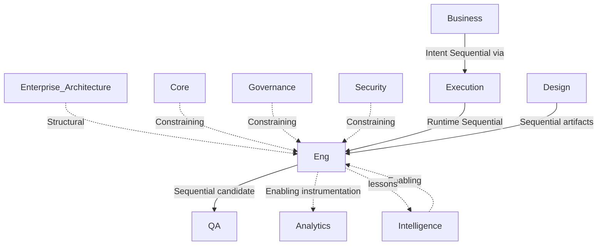

# Engineering Dependency Graph

> Inputs, outputs, required and optional dependencies for Engineering. Edge types per `Enterprise_Architecture/CROSS_DOMAIN_DEPENDENCY_MODEL.md`.

Governed by `Departments/Engineering/ENGINEERING_CHARTER.md`.

## Graph Overview



## Inputs

| Input | Source | Dependency type |
|---|---|---|
| Approved initiative / success criteria | Business via Execution | Required Sequential |
| Execution instance + gates + context | Execution | Required Sequential |
| Design handoff package | Design | Required Sequential when UX/UI in scope; else N/A logged |
| Security control / threat requirements | Security | Required Constraining for applicable Capability classes |
| Capability/Domain nouns | Enterprise Architecture | Required Structural |
| Patterns / prior lessons | Intelligence | Optional Enabling |
| Analytics event contracts | Analytics | Optional Enabling (Required when measurement in success criteria) |

## Outputs

| Output | Consumer | Dependency type (for consumer) |
|---|---|---|
| Release Candidate + Eng test evidence | QA | Required Sequential |
| Service/API/Event contracts | QA, Security, Analytics, future Support | Enabling |
| SLO / telemetry baselines | QA, Analytics, future Support | Enabling |
| Feasibility / constraint notes | Executive, Business | Informational |
| Technical lessons / ADRs | Intelligence, Governance | Enabling |
| Debt register proposals | Executive / Business prioritization | Informational → may become Sequential work when funded |

## Required Dependencies

1. Core constitutional inheritance  
2. Governance control plane  
3. Business Intent via Execution (no side channel)  
4. Execution runtime participation  
5. Enterprise Architecture structural binding  
6. Design Sequential input when the initiative includes experience surfaces  
7. Security Constraining input for classes Security designates  
8. QA as Required Sequential downstream before release authority  

## Optional Dependencies

1. Intelligence patterns (strongly recommended, not a start-block)  
2. Analytics instrumentation partnership  
3. Future Support/Operations Enabling edges (Phase later)  

## Cycle Check

No Sequential cycle involving Engineering ↔ Design ↔ QA is permitted beyond the forward pipeline. Feedback (Analytics insights, Support incidents, QA rejections) is **Enabling or return-of-ownership on rejected handoff**, not a reverse Sequential “QA must finish before Engineering may start new work” cycle.

## Bottleneck Watch

Engineering is a known Sequential hub (`Enterprise_Architecture/CROSS_DOMAIN_DEPENDENCY_MODEL.md`). New Phase-later Departments must justify any new Sequential edge onto Engineering.

## Metadata

```yaml
version: 1.0.0
status: active
last_reviewed: 2026-07-22
owner: Engineering, Chief of Staff (cycle/bottleneck review)
```
