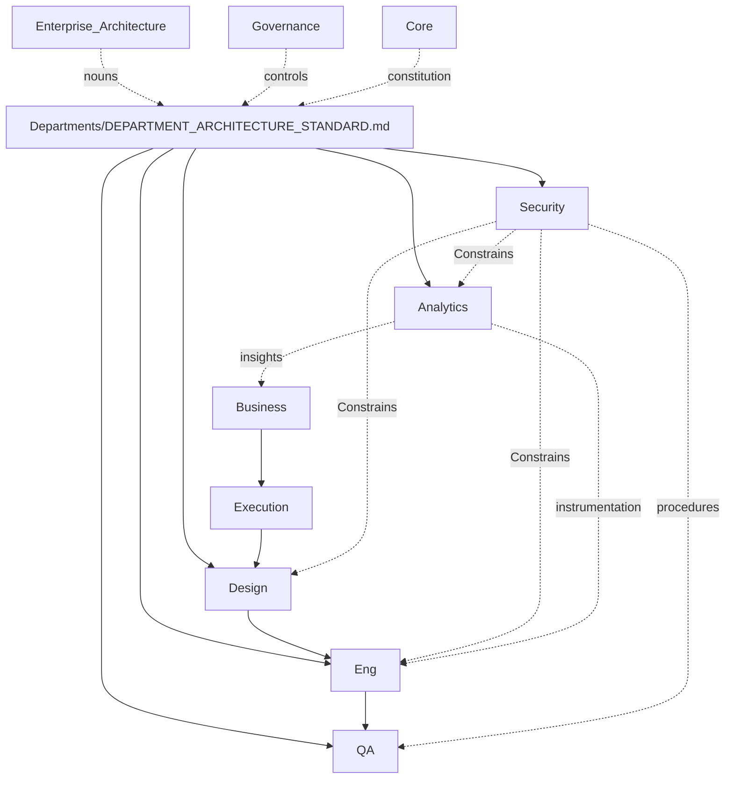

# Phase 2 Departments Playbook

> How the Department Architecture Standard and the five Core Delivery Departments work as one system on top of the completed foundational layers. Read after `Departments/DEPARTMENT_ARCHITECTURE_STANDARD.md` and each Department Playbook.

## What Phase 2 Added



Foundational layers unchanged. Departments execute specialized Capabilities.

## How an Initiative Crosses Phase 2 Departments

1. Business evidences and prioritizes; CEO decides; work enters Execution.  
2. If experience surfaces: Design produces handoff → Engineering acknowledges.  
3. Security Constrains designated classes (Threat Model / Specs) without becoming a universal Sequential stage.  
4. Engineering delivers on Platform golden paths → Release Candidate to QA.  
5. Analytics Instrumentation Specs apply when measurement is in success criteria.  
6. QA independently validates → Release Validation Record into release RACI.  
7. Lessons harvest to Intelligence; Portfolio Analytics (Business) judges value using Analytics measurement outputs.

## Department Roles in One Line Each

| Department | One line |
|---|---|
| Engineering | Turns approved intent into operable, changeable systems |
| Design | Makes product intent usable and systemized |
| QA | Independently proves releasable ≠ merely built |
| Security | Owns controls and assurance; constrains delivery |
| Analytics | Owns the measurement plane; not value judgment or SLOs |

## What Comes After Phase 2

Later phases may Charter Marketing, Sales, Support, Finance, Legal, Operations, etc. — each must pass DAS + Org Chart §6 + EA binding. Until then, stubs remain Stage 0.

Agents are not created in Phase 2. When Staffed, Agents follow `Core/AGENT_SPECIFICATION.md` inside these Contexts.

## One-Sentence Summary

**Phase 2 makes delivery real as organization: a universal DAS, five Chartered Departments with non-overlapping ownership, and a pipeline-plus-constraints graph that preserves every completed layer’s mandate.**

## Metadata

```yaml
version: 1.0.0
status: active
phase: 2
last_reviewed: 2026-07-22
owner: Chief of Staff
```
