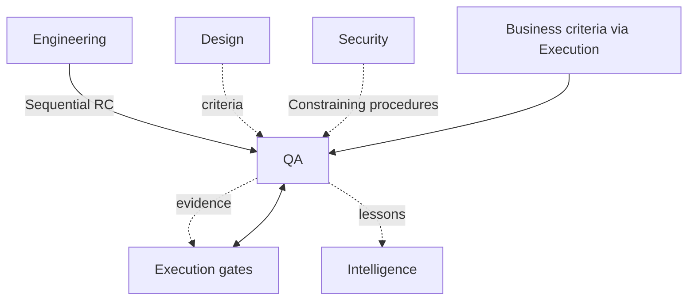

# QA Dependency Graph

Governed by `Departments/QA/QA_CHARTER.md`.



## Inputs

| Input | Source | Type |
|---|---|---|
| Release Candidate + Eng evidence | Engineering | Required Sequential |
| Acceptance / success criteria | Business via Execution | Required Sequential |
| Experience criteria | Design | Optional Enabling (Required when UX in scope) |
| Security verification procedures | Security | Required Constraining when designated |
| Core gate definitions | Core | Required Constraining |

## Outputs

| Output | Consumer | Type |
|---|---|---|
| Gate evidence / Validation Record | Execution, Executive release RACI | Required |
| Itemized rejection | Engineering (ownership return) | Required on fail |
| Defect themes | Intelligence / CI system | Enabling |

## Required Dependencies

Engineering Sequential upstream; Execution; Core Quality; Governance; Business criteria; Security when applicable.

## Optional Dependencies

Design criteria; Analytics measurement checks; Intelligence patterns.

## Cycle Check

QA does not Sequential-gate Engineering’s ability to *start* new instances — only to *exit* toward release. Rejections are ownership return, not a reverse pipeline stage.

## Metadata

```yaml
version: 1.0.0
status: active
last_reviewed: 2026-07-22
owner: QA, Chief of Staff
```
