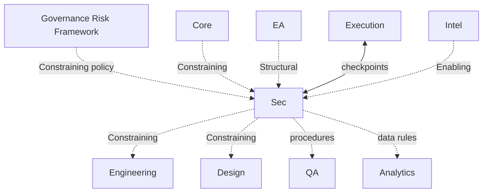

# Security Dependency Graph

Governed by `Departments/Security/SECURITY_CHARTER.md`.



## Inputs

| Input | Source | Type |
|---|---|---|
| Risk appetite / thresholds | Governance | Required Constraining |
| System Maps / Architecture Models | Engineering | Required Enabling for reviews |
| Initiative scope via Execution | Execution | Required when security-designated |
| Threat intel / patterns | Intelligence | Optional Enabling |

## Outputs

| Output | Consumer | Type |
|---|---|---|
| Threat Models, Control Requirements | Engineering, Design | Required Constraining for designated work |
| Verification Procedures | QA | Required when delegated |
| Assurance Evidence | Governance | Required for compliance/risk records |
| Exception recommendations | Executive / Human Principal | As needed |

## Required Dependencies

Core, Governance Risk Framework, EA Domain binding, Execution participation for designated work, Engineering as primary Constrained delivery peer.

## Optional Dependencies

Intelligence; future Legal/HR/IT; Analytics data-plane rules (Required when PII measurement involved).

## Cycle Check

Security must not become a Sequential stage on every Engineering start (bottleneck anti-pattern). Default edge is **Constraining/Enabling**. Sequential only when a specific control artifact is a true prerequisite for a designated class — declared explicitly per initiative.

## Metadata

```yaml
version: 1.0.0
status: active
last_reviewed: 2026-07-22
owner: Security, Chief of Staff
```
