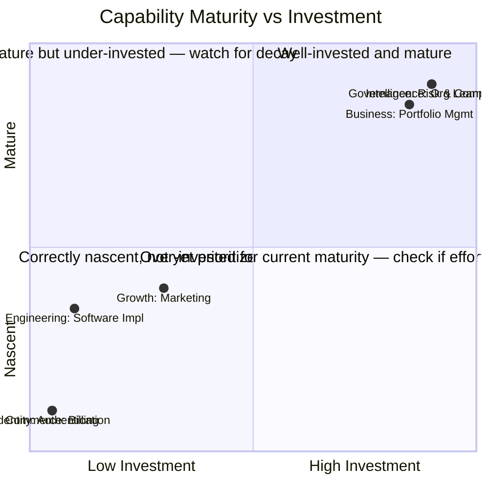

# Capability Heat Map

> A maturity/ownership/investment view over the `Enterprise_Architecture/ENTERPRISE_CAPABILITY_MODEL.md` registry — the single artifact that lets the CEO or Business's Portfolio Management glance at the entire capability set and see, at once, what's strong, what's thin, who owns what, and where investment is (or isn't) flowing. This document is **descriptive only** — per `Enterprise_Architecture/ENTERPRISE_ARCHITECTURE_CHARTER.md`'s governing rule, it never itself decides whether a gap should be funded; it makes the gap visible for Business to decide.

Governed by `Enterprise_Architecture/ENTERPRISE_ARCHITECTURE_CHARTER.md`, `Enterprise_Architecture/ENTERPRISE_CAPABILITY_MODEL.md` (the registry this heat map is computed over).

## The Three Axes

| Axis | Scale | What it shows |
|---|---|---|
| **Maturity** | Nascent → Developing → Mature → Commoditized | How developed the capability's realization currently is |
| **Ownership** | Unowned → Partially Owned → Clearly Owned | Whether a specific Department/Agent is accountable for this capability today |
| **Investment** | None → Light → Active → Heavy | How much current Business-approved investment (per `Business/Contexts/Portfolio_Management.md`) is flowing toward this capability |

## Heat Map Entry Template

```markdown
## <Capability Name>
- Domain: <Enterprise_Architecture/ENTERPRISE_DOMAIN_MAP.md domain>
- Maturity: Nascent | Developing | Mature | Commoditized
- Ownership: Unowned | Partially Owned (<by whom>) | Clearly Owned (<by whom>)
- Investment: None | Light | Active | Heavy
- Trend (vs. last quarter): Improving | Stable | Declining
- Notes:
```

## Current Heat Map (Initial Snapshot)

| Capability | Domain | Maturity | Ownership | Investment | Trend |
|---|---|---|---|---|---|
| Opportunity & Portfolio Management | Business | Mature | Clearly Owned (Business/Portfolio Management) | Heavy | Improving |
| Customer Understanding | Business | Mature | Clearly Owned (Business/Customer Strategy) | Active | Stable |
| Decision Traceability | Governance | Mature | Clearly Owned (Governance) | Heavy | Stable |
| Risk & Compliance | Governance | Mature | Clearly Owned (Governance) | Heavy | Stable |
| Organizational Learning | Intelligence | Mature | Clearly Owned (Intelligence) | Heavy | Stable |
| Orchestration & Workflow Execution | Execution | Mature | Clearly Owned (Execution) | Heavy | Stable |
| Software Implementation | Product Delivery | Developing | Partially Owned (`Departments/Engineering` folder exists, unstaffed) | None | — (not yet started) |
| Visual & UX Design | Product Delivery | Developing | Partially Owned (`Departments/Design` folder exists, unstaffed) | None | — |
| Quality Assurance | Product Delivery | Developing | Partially Owned (`Departments/QA` folder exists, unstaffed) | None | — |
| Search Visibility (SEO) | Growth | Developing | Partially Owned (`Departments/SEO` folder exists, unstaffed) | None | — |
| Marketing & Positioning | Growth | Developing | Partially Owned (`Departments/Marketing` folder, `Business/Commercial_Strategy`) | Light | — |
| Analytics & Measurement | Insight | Developing | Partially Owned (`Departments/Analytics` folder, `Business/Portfolio_Analytics`) | Light | — |
| Billing | Commerce | Nascent | Unowned | None | — |
| Pricing & Packaging | Commerce | Developing | Clearly Owned (Business/Commercial Strategy — decision-making only, no delivery Service yet) | Light | — |
| Authentication | Identity | Nascent | Unowned | None | — |
| Authorization / Permissions | Identity | Nascent | Unowned | None | — |
| Lead Management / Sales Pipeline | Growth (Sales) | Nascent | Unowned | None | — |
| Customer Support & Escalations | Customer-Facing | Nascent | Unowned | None | — |

## Reading the Map — What This Snapshot Actually Shows

At this point in the OS's build-out, the heat map honestly shows exactly what you'd expect: the **foundational layers** (Governance, Intelligence, Execution, and Business's own decision-making contexts) are Mature and Heavily invested, because they've been fully specified — while **delivery capabilities** (Software Implementation, Design, QA) are Developing with folders but no staffing, and **commercial/customer-facing capabilities** (Billing, Authentication, Sales, Support) are Nascent or entirely Unowned. This is not a hidden problem this document is uncovering — it's the same gap the human principal's own Phase 2 roadmap already names as the next major body of work. The value of this heat map going forward is tracking whether that gap actually closes on schedule, quarter over quarter, rather than staying a static observation.

## Heat Map Visualization (Conceptual)



## How Business Consumes This Map

Per `Enterprise_Architecture/ENTERPRISE_ARCHITECTURE_CHARTER.md`'s boundary rule, this heat map never itself recommends funding a gap — it makes the gap visible, and `Business/Contexts/Portfolio_Management.md` decides whether and when to create an Opportunity Record addressing it. In practice: an Unowned, Nascent, Uninvested capability that the primary Value Stream (`Enterprise_Architecture/ENTERPRISE_VALUE_STREAMS.md`) actually requires (e.g., Billing, once Commerce becomes business-critical) is exactly the kind of signal Portfolio Management should be scanning this map for at each Quarterly Business Review.

## Review Cadence

Recomputed monthly (ownership and investment change often enough to warrant it); full trend analysis at Quarterly Business Review, cross-referenced against `Business/BUSINESS_METRICS.md`'s Product Portfolio Balance metric.

## Anti-Patterns

- **Treating this heat map as a funding recommendation.** It is strictly descriptive — the moment this document starts saying "we should invest in X," it has crossed into Business's territory and violated `Enterprise_Architecture/ENTERPRISE_ARCHITECTURE_CHARTER.md`'s boundary rule.
- **Letting the snapshot go stale.** An outdated heat map actively misleads Portfolio Management's scanning — the monthly recompute cadence is not optional busywork, it's what keeps this artifact trustworthy.
- **Coloring maturity by aspiration rather than fact.** A capability is scored Nascent if it's actually Nascent, even if a Department "plans to" mature it soon — plans belong in a Business Case, not in this document's current-state snapshot.

## Metadata

```yaml
version: 1.0.0
status: active
last_reviewed: 2026-07-22
owner: Chief of Staff (data currency), Business Portfolio Management (interpretation and funding decisions)
```
