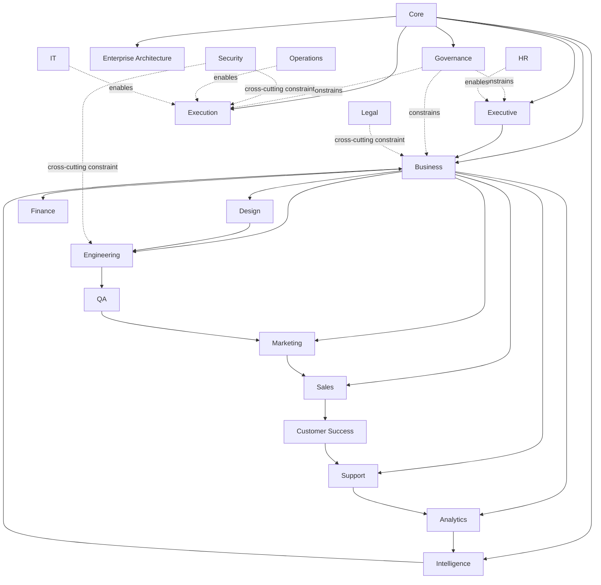
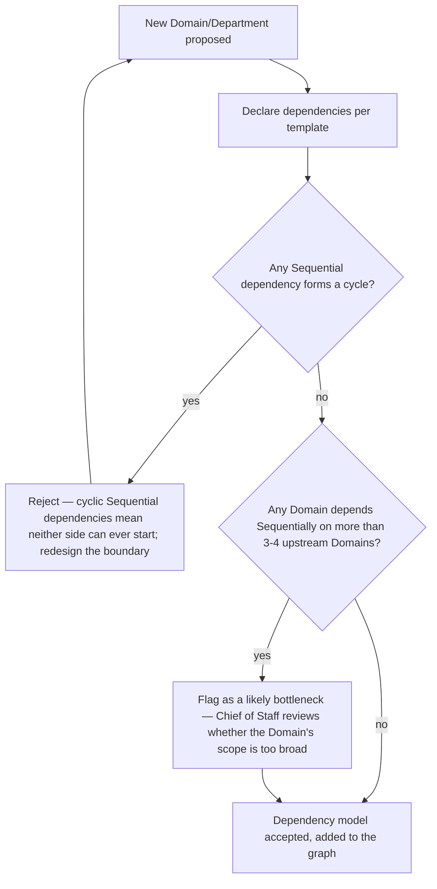

# Cross-Domain Dependency Model

> Every Domain (`Enterprise_Architecture/ENTERPRISE_DOMAIN_MAP.md`), every interface, every ownership boundary, modeled as one dependency graph — extending `Governance/ORGANIZATIONAL_CHART.md`'s RACI (which governs *decision authority* for what exists today) with the *structural* dependency graph that stays valid regardless of which Departments currently exist. Where the Domain Map shows *what* the domains are, this document shows *what depends on what*.

Governed by `Enterprise_Architecture/ENTERPRISE_ARCHITECTURE_CHARTER.md`. Extends `Governance/ORGANIZATIONAL_CHART.md` and `Business/LAYER_INTERFACES.md` rather than duplicating either.

## Why This Is Distinct From `Governance/ORGANIZATIONAL_CHART.md`

`Governance/ORGANIZATIONAL_CHART.md` models reporting lines, RACI, and decision authority — *who decides* and *who reports to whom*, for the Departments that currently exist. This document models *structural dependency* — which Domain's work is prerequisite to which other Domain's work being possible at all — independent of current staffing. A Domain can structurally depend on another even before either has a single Department or Agent (e.g., Sales structurally depends on Commercial Strategy's Pricing Model existing, regardless of whether a Sales Department has been created yet). This document is useful *before* Departments exist, which is exactly the point of building it now, per Phase 1's sequencing.

## The Full Cross-Domain Dependency Graph



## Dependency Types

Not all dependencies are the same kind — conflating them produces a graph that's technically complete but practically unreadable. This model distinguishes four kinds:

| Type | Meaning | Example |
|---|---|---|
| **Foundational** | Domain B cannot exist or operate correctly without Domain A's standards already in place | Every Domain depends on Core |
| **Sequential** | Domain B's work cannot start until Domain A produces a specific exit artifact | Engineering depends on Design's artifacts, per `Core/WORKFLOW_STANDARD.md`'s handoff rules |
| **Constraining** | Domain A doesn't produce Domain B's inputs, but limits what Domain B may do | Governance and Security constrain Engineering and Execution without providing their working inputs |
| **Enabling** | Domain A provides infrastructure/support Domain B needs to function, without being in its direct work sequence | Operations and IT enable Execution's runtime without being a pipeline stage themselves |

Every edge in the graph above is one of these four types — when adding a new Domain or Department, state which type(s) of dependency it has on each neighboring Domain, per the template below.

## Dependency Declaration Template

Used when proposing a new Department (extending `Governance/ORGANIZATIONAL_CHART.md` §6's intake gate) or a new Domain (`Enterprise_Architecture/ENTERPRISE_DOMAIN_MAP.md`'s RFC requirement):

```markdown
## Cross-Domain Dependencies: <new Domain/Department>

| Depends on (Domain) | Type | What specifically is needed |
|---|---|---|
| | Foundational / Sequential / Constraining / Enabling | |

## Depended on by (Domain) | Type | What this Domain provides
|---|---|---|
| | | |
```

This mirrors `Core/AGENT_SPECIFICATION.md`'s Inputs/Outputs discipline at the Department/Domain level rather than the individual Agent level — the same "if you can't write down what you receive and produce, you're not ready" principle, applied one layer up.

## Checking for Circular or Unhealthy Dependencies



A **Sequential** cycle (A needs B's output before B needs A's) is a structural defect caught here before any Department is built around it — this is the cross-domain-scale equivalent of `Execution/PARALLEL_EXECUTION.md`'s Dependency Check, just applied at Domain/Department design time rather than per-instance runtime.

## Reading the Graph for Bottleneck Risk

A Domain with many Sequential inbound dependencies (many other Domains waiting on it) is a structural bottleneck risk as the organization scales — in the graph above, **Business** and **Engineering** both have several inbound Sequential dependents, which is expected given their central role in the primary Value Stream (`Enterprise_Architecture/ENTERPRISE_VALUE_STREAMS.md`), but is exactly the kind of concentration that should be watched as Domains multiply — a future Domain proposal that would add yet another Sequential dependency on Business or Engineering warrants a specific check (at the Chief of Staff review step) on whether that dependency is truly necessary or could be Enabling/Constraining instead.

## Relationship to `Governance/ORGANIZATIONAL_CHART.md`

| | `Governance/ORGANIZATIONAL_CHART.md` | `Cross-Domain Dependency Model` (this document) |
|---|---|---|
| Answers | Who decides, who reports to whom, RACI for existing Departments | What structurally depends on what, at the Domain level, independent of current staffing |
| Changes | Whenever a Department is created/reorganized | Rarely — Domain-level dependencies are as stable as the Domains themselves |
| Used for | Resolving a live decision-authority ambiguity | Designing a new Domain/Department correctly before it exists |

Both are consulted together at Department creation — the Organizational Chart's intake gate (§6) and this document's dependency declaration are companion steps, not competing ones.

## Review Cadence

Reviewed whenever a new Domain or Department is proposed (declaration required, per above), and wholesale at Quarterly Business Review to check whether real operational experience has revealed a dependency the original declaration missed — logged as a `Governance/CONTINUOUS_IMPROVEMENT_SYSTEM.md` finding if so, since a missed dependency discovered in production is exactly the kind of gap that framework's harvest exists to catch.

## Anti-Patterns

- **Declaring only the convenient dependencies.** A new Domain proposal that understates its real dependencies to look more independent than it is — caught when the actual work later reveals an undeclared Sequential dependency, which is logged as a process finding.
- **Treating every dependency as Sequential.** Over-declaring blocks unnecessary Domain independence — most cross-cutting Domains (Security, Legal, Operations, IT) are Constraining or Enabling, not Sequential, and should be modeled that way so they don't appear to gate every other Domain's forward progress.
- **Ignoring bottleneck concentration.** Adding Domain after Domain that Sequentially depends on the same already-heavily-depended-upon Domain without ever asking whether that Domain's scope should be split.

## Metadata

```yaml
version: 1.0.0
status: active
last_reviewed: 2026-07-22
owner: Chief of Staff (stewardship), CEO (ratification of new Domain-level dependencies via RFC)
```
