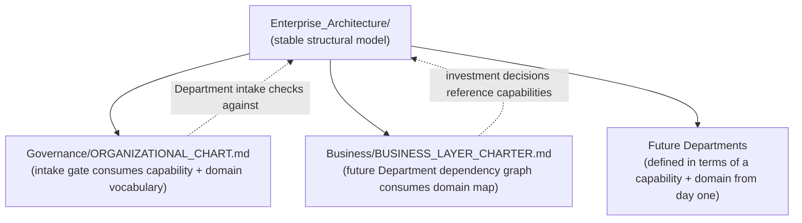

# Enterprise Architecture Charter

> Ratified via `RFC/Records/RFC-001-enterprise-architecture-domain.md`. Enterprise Architecture is the layer that models what the organization **structurally is** — its capabilities, its value flows, its domains, its shared vocabulary, and how those pieces depend on each other — independent of which Departments, products, or Agents happen to exist this quarter. It exists so every future Department inherits consistent terminology and non-overlapping ownership from the moment it's created, instead of each Department inventing its own.

Governed by `Core/AI_OS_CONSTITUTION.md` §4 (Long-Term Philosophy). Consumed by `Governance/ORGANIZATIONAL_CHART.md` §6 (Department intake gate) and `Business/BUSINESS_LAYER_CHARTER.md` (future Department dependency graph).

## Why This Layer Exists, and Why Now

Capabilities and domains change far less often than the Departments or products built to deliver them — "Billing" as a capability has existed, conceptually, since before this OS did, and will still exist in some form a decade from now, regardless of which specific Department or Agent implements it this year. Building this stable layer *before* any delivery Department (Engineering, Design, QA, Marketing, and the rest) means every Department created afterward can be defined in terms of *which stable capability and domain it serves*, rather than each Department improvising its own scope language that later has to be reconciled against every other Department's improvised language. This is the direct, concrete answer to the risk named in `RFC-001`: inconsistent terminology and overlapping ownership discovered only after the fact.

## What This Layer Owns

| Domain | Document |
|---|---|
| A shared vocabulary for every recurring concept in this OS | `ENTERPRISE_TAXONOMY.md` |
| What capabilities the organization possesses | `ENTERPRISE_CAPABILITY_MODEL.md` |
| How value actually flows end to end | `ENTERPRISE_VALUE_STREAMS.md` |
| Every domain the organization operates in, and how they relate | `ENTERPRISE_DOMAIN_MAP.md` |
| How domains and capabilities depend on each other | `CROSS_DOMAIN_DEPENDENCY_MODEL.md` |
| Maturity, ownership, and investment view over the capability set | `CAPABILITY_HEAT_MAP.md` |

## What This Layer Explicitly Does Not Own

Enterprise Architecture is deliberately inert with respect to any real decision — it describes structure, it never decides anything.

| Not owned here | Actually owned by |
|---|---|
| Whether to invest in a capability, and how much | `Business/` (Portfolio Management, Business Case Management) |
| Delegation, scheduling, coordination of real work | `Executive/`, `Execution/` |
| Compliance, risk thresholds, approval mechanics | `Governance/` |
| Memory, research, lessons learned | `Intelligence/` |
| Implementation of any capability | Delivery Departments, once created |
| Organizational reporting lines and RACI for what currently exists | `Governance/ORGANIZATIONAL_CHART.md` (this layer feeds it a stable vocabulary; it does not replace its hierarchy modeling) |

A useful test: if a document in this layer ever states "we should build X" or "Department Y should do Z by Friday," it has drifted out of scope — Enterprise Architecture describes the stable map; Business and Executive decide what to do with it, Execution runs it.

## Relationship to Existing Layers



Enterprise Architecture is read by every other layer as a shared reference; it reads nothing back from them except to stay current (its own review cadence, below) — this one-directional-in-practice relationship is what keeps it stable rather than reactive to every downstream change.

## Governing Rules

1. **This layer changes rarely, and deliberately.** Capabilities and domains are the most stable nouns in the organization — a material change to the Capability Model or Domain Map goes through `RFC/RFC_PROCESS.md`, exactly as this layer's own creation did.
2. **This layer never makes a decision.** Any document here that starts prescribing action rather than describing structure has crossed into Business or Executive territory and should be moved.
3. **Every future Department names its capability and domain at creation**, per `Governance/ORGANIZATIONAL_CHART.md` §6's intake gate, now extended to reference this layer's vocabulary rather than inventing new terms per Department.
4. **The Capability Heat Map is descriptive, not evaluative of business worth.** It shows maturity/ownership/investment as observed facts; whether a low-maturity capability deserves investment is a Business Case Management question (`Business/Contexts/Business_Case_Management.md`), not one this layer answers.

## Review Cadence

Reviewed at every Quarterly Business Review (`Governance/MEETING_OPERATING_SYSTEM.md`) for currency — has a new capability emerged, has a domain's boundary shifted — and at Annual Strategic Review for anything material enough to warrant a fresh RFC.

## Metadata

```yaml
version: 1.0.0
status: active
last_reviewed: 2026-07-22
owner: Chief of Staff (stewardship), CEO (ratification of material changes via RFC)
```
