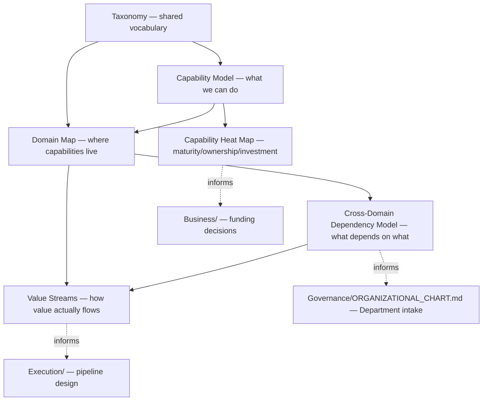
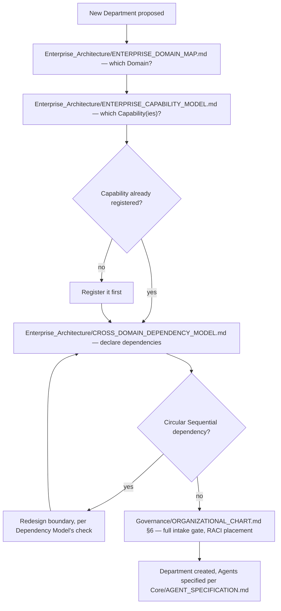

# Enterprise Architecture Playbook

> How the six Enterprise Architecture documents work together, and — most importantly — how every future Department, RFC, and Business decision is expected to actually use them. Read after `ENTERPRISE_ARCHITECTURE_CHARTER.md`, `ENTERPRISE_TAXONOMY.md`, `ENTERPRISE_CAPABILITY_MODEL.md`, `ENTERPRISE_VALUE_STREAMS.md`, `ENTERPRISE_DOMAIN_MAP.md`, and `CROSS_DOMAIN_DEPENDENCY_MODEL.md`.

Governed by `Core/AI_OS_CONSTITUTION.md` §4. Ratified via `RFC/Records/RFC-001-enterprise-architecture-domain.md`.

## The Six Documents, One Picture



Taxonomy is read first because every other document uses its terms. Capability Model and Domain Map are built together (a capability belongs to a domain). Dependency Model and Value Streams both build on the Domain Map, from different angles — one shows structural prerequisite, the other shows the actual flow of value. Heat Map is the one artifact meant to be checked often (monthly) rather than referenced occasionally; it's the living pulse-check over the otherwise-stable Capability Model.

## How This Foundation Changes What Comes Next

Before this layer existed, "build Engineering next" meant inventing Engineering's scope, vocabulary, and boundaries from scratch, with only `Governance/ORGANIZATIONAL_CHART.md`'s existing RACI pattern and `Core/AGENT_SPECIFICATION.md`'s template as a guide. Now, building Engineering means:

1. Check `ENTERPRISE_DOMAIN_MAP.md` — Engineering is already placed in the Delivery Domains group.
2. Check `ENTERPRISE_CAPABILITY_MODEL.md` — Software Implementation is already registered as a Developing-maturity capability under Product Delivery.
3. Check `CROSS_DOMAIN_DEPENDENCY_MODEL.md` — Engineering's declared dependencies (on Design, Sequential; on Business, Sequential for roadmap; on Governance/Security, Constraining) are already sketched in the graph.
4. Check `ENTERPRISE_VALUE_STREAMS.md` — Engineering's segment of the primary value stream (Product → Engineering → QA → Release) is already drawn.
5. Only then does the actual `Departments/Engineering/` specification work begin — populating `Core/AGENT_SPECIFICATION.md`-compliant Agents within a scope that's already consistent with everything else in the organization, rather than a scope that has to be reconciled with seven other Departments after the fact.

This is the direct payoff of sequencing Phase 1 before Phase 2, exactly as recommended: the reconciliation cost that would otherwise be paid repeatedly (once per Department, as inconsistencies surface) is paid once, here, up front.

## How a New Department Proposal Actually Uses This Layer



This flow is now the *de facto* extension of `Governance/ORGANIZATIONAL_CHART.md` §6's intake gate — that document's own text doesn't need to be rewritten (per `RFC-001`'s "What Breaks" analysis: nothing breaks, this is additive), but every future Department proposal walks through this longer, Enterprise-Architecture-aware version of the gate in practice.

## How Business Uses This Layer

`Business/Contexts/Portfolio_Management.md` and `Business/Contexts/Product_Management.md` both consume `CAPABILITY_HEAT_MAP.md` when scanning for where investment is thin relative to where the `ENTERPRISE_VALUE_STREAMS.md` primary stream actually needs strength — this is the concrete mechanism behind `Business/BUSINESS_LAYER_CHARTER.md`'s "where should the organization invest" question gaining a structural, not just financial, input. A capability that's Unowned and Nascent but sits on the critical path of the primary Value Stream is a stronger candidate for a new Opportunity Record than one that's equally thin but peripheral — the Heat Map plus the Value Stream together make that distinction visible, where financial data on its own would not.

## How Governance Uses This Layer

`Governance/ORGANIZATIONAL_CHART.md`'s RACI matrix and `Governance/RISK_MANAGEMENT_FRAMEWORK.md`'s risk categories both gain a stable reference point: a risk or a decision-authority question can now be phrased in terms of a Domain or Capability rather than only in terms of whichever Department currently happens to own it — which stays useful even across a reorganization that changes Department names but not the underlying Domain/Capability structure.

## Keeping This Layer From Becoming Stale

Because Domains and Capabilities are deliberately the most stable nouns in the organization, this layer should need infrequent, deliberate change — if it's being edited every month, that's itself a signal (checked at Quarterly Business Review) that either the modeling was too granular to begin with, or real organizational change is happening fast enough to warrant closer Governance attention. The Heat Map is the one document expected to change often; the other five should not.

## The One-Sentence Summary

**Enterprise Architecture is the stable map every future Department, RFC, and Business decision is placed against — Capabilities and Domains that outlive any single Department, a Value Stream that shows how they connect end to end, a Dependency Model that catches structural mistakes before a Department is built around them, and a Heat Map that keeps the whole thing honest about where the organization actually stands today.**

## Metadata

```yaml
version: 1.0.0
status: active
last_reviewed: 2026-07-22
owner: Chief of Staff (playbook stewardship), CEO (ratification authority)
```
