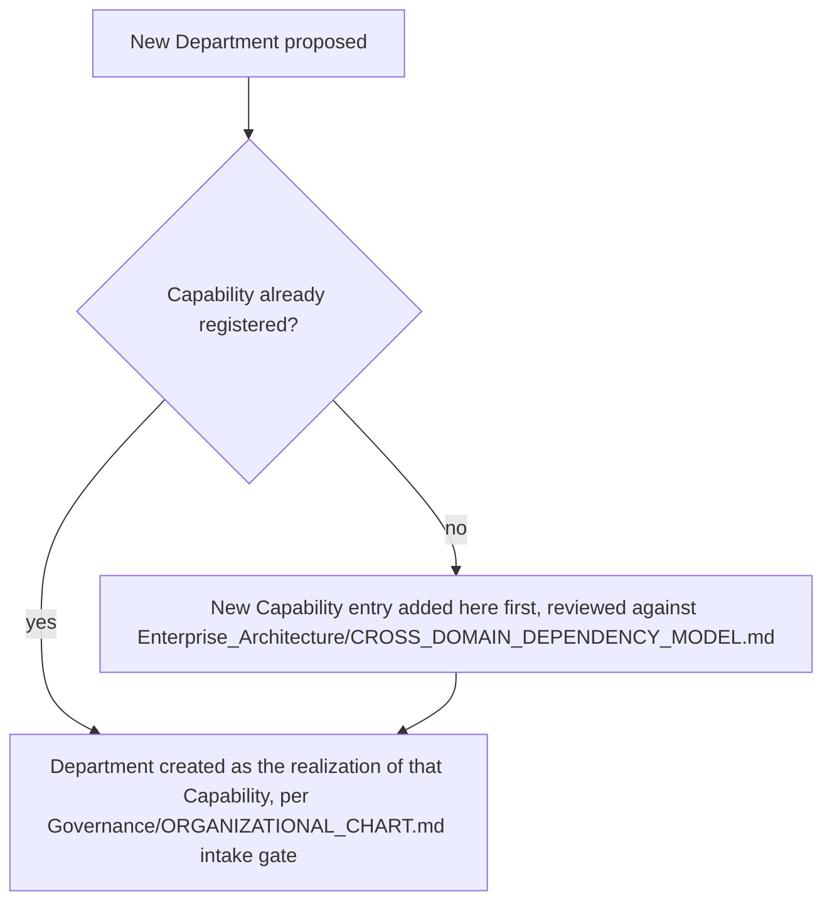

# Enterprise Capability Model

> Answers the single question: **what capabilities does the organization possess?** A capability is what the organization *can do* — stable across reorganizations, product pivots, and Department creation/retirement. This model exists so a new Department is always defined as "the current organizational home for delivering Capability X," never as an ungrounded new scope invented from scratch.

Governed by `Enterprise_Architecture/ENTERPRISE_ARCHITECTURE_CHARTER.md`, `Enterprise_Architecture/ENTERPRISE_TAXONOMY.md` (the term "Capability" is defined there; this document is its registry).

## Why Capabilities, Not Departments or Products

A Department is an org-chart fact — it can be renamed, split, merged, or retired. A Product is a market fact — it can be sunset (`Business/Contexts/Portfolio_Management.md`) without the underlying capability disappearing (Billing doesn't stop being a capability just because one product using it is discontinued). A Capability is neither — it's the durable "can do" that outlives both. This is precisely why `Business/BUSINESS_LAYER_CHARTER.md`'s Portfolio and Product contexts, and `Governance/ORGANIZATIONAL_CHART.md`'s Department intake gate, both need a stable capability reference to check new work against — without it, both are forced to reason from a constantly-shifting Department/Product list instead.

## Capability Levels

Capabilities are modeled at two levels to stay useful at both a strategic glance and an operational level of detail:

- **Level 1 (Capability Domain-Level)** — broad, rarely-changing groupings (e.g., "Commerce," "Identity").
- **Level 2 (Capability)** — the concrete, individually-ownable capability within a Level 1 grouping (e.g., "Billing," "Authentication").

## Capability Registry Entry Template

```markdown
# Capability: <name>

## Level 1 Grouping
<Domain — see Enterprise_Architecture/ENTERPRISE_DOMAIN_MAP.md>

## Definition
What this capability enables the organization to do, in one or two sentences — not how it's currently implemented.

## Current Realization
| Service/Product implementing this capability | Owning Department (if any exist yet) | Status |
|---|---|---|

## Maturity
Nascent | Developing | Mature | Commoditized — see Enterprise_Architecture/CAPABILITY_HEAT_MAP.md for the full scoring

## Dependencies
Other capabilities this one requires to function (per Enterprise_Architecture/CROSS_DOMAIN_DEPENDENCY_MODEL.md).

## Related Business Context
Which Business/Contexts/ document is the primary consumer of decisions about this capability (typically Portfolio Management or Product Management).
```

## Initial Capability Registry (Illustrative — Populated as Departments Are Created)

This registry starts populated with the capabilities implied by the repository's own existing structure and stated future Department roster (`Business/BUSINESS_LAYER_CHARTER.md`'s dependency graph, `Departments/` folder) — not yet exhaustive, extended as real work reveals real capabilities.

| Level 1 Domain | Level 2 Capability | Maturity | Realized by (if any) |
|---|---|---|---|
| Commerce | Billing | Nascent | — |
| Commerce | Pricing & Packaging | Developing | `Business/Contexts/Commercial_Strategy.md` (decision-making only; no delivery Service yet) |
| Identity | Authentication | Nascent | — |
| Identity | Authorization / Permissions | Nascent | — |
| Product Delivery | Software Implementation | Developing | `Departments/Engineering` (folder exists, unpopulated) |
| Product Delivery | Visual & UX Design | Developing | `Departments/Design` (folder exists, unpopulated) |
| Product Delivery | Quality Assurance | Developing | `Departments/QA` (folder exists, unpopulated) |
| Growth | Search Visibility (SEO) | Developing | `Departments/SEO` (folder exists, unpopulated) |
| Growth | Marketing & Positioning | Developing | `Departments/Marketing` (folder exists, unpopulated), `Business/Contexts/Commercial_Strategy.md` |
| Insight | Analytics & Measurement | Developing | `Departments/Analytics` (folder exists, unpopulated), `Business/Contexts/Portfolio_Analytics.md` |
| Insight | Organizational Learning | Mature | `Intelligence/` (fully specified layer) |
| Governance | Risk & Compliance | Mature | `Governance/RISK_MANAGEMENT_FRAMEWORK.md` (fully specified) |
| Governance | Decision Traceability | Mature | `Governance/DECISION_LOG_STANDARD.md`, `Governance/ARCHITECTURE_DECISION_RECORDS_STANDARD.md` (fully specified) |
| Strategy | Opportunity & Portfolio Management | Mature | `Business/Contexts/Portfolio_Management.md` (fully specified) |
| Strategy | Customer Understanding | Mature | `Business/Contexts/Customer_Strategy.md` (fully specified) |
| Operations | Orchestration & Workflow Execution | Mature | `Execution/` (fully specified layer) |

Note the deliberate mix: some capabilities (Insight/Organizational Learning, Governance/Risk, Strategy/Portfolio) are already Mature because their fully-specified layer exists; others (Commerce/Billing, Identity/Authentication) are Nascent because no Department yet implements them — this is expected and healthy at this stage of the OS's build-out, not a gap to panic over.

## How a New Department Uses This Registry

Per `Governance/ORGANIZATIONAL_CHART.md` §6's intake gate, now extended: before a new Department is created, its proposal states which existing Capability (or capabilities) it will realize. If no matching capability exists in this registry, the proposal must add one here first — a Department is never created to deliver an ungrounded, ad hoc scope that isn't traceable to a named, registered Capability.



## Review Cadence

The registry itself is checked for currency at every Quarterly Business Review; maturity scores are recalculated as part of `Enterprise_Architecture/CAPABILITY_HEAT_MAP.md`'s own cadence.

## Anti-Patterns

- **Defining a capability in terms of its current implementation.** "Billing" should not be defined as "the Stripe integration" — the capability is the durable ability; its Service/Product realization is one row in the Current Realization table and can change without redefining the capability itself.
- **One-to-one Capability-to-Department mapping assumed permanent.** A Department may realize multiple capabilities, and a capability may migrate to a different Department after a reorg — the registry tracks the current realization without hard-coding permanence.
- **Registering a capability nobody will use for years just for completeness.** Per `Core/AI_OS_CONSTITUTION.md`'s YAGNI principle — capabilities are registered when a real Department or Business decision needs them named, not speculatively in bulk.

## Metadata

```yaml
version: 1.0.0
status: active
last_reviewed: 2026-07-22
owner: Chief of Staff (registry stewardship), Business Portfolio Management (maturity/investment interpretation)
```
