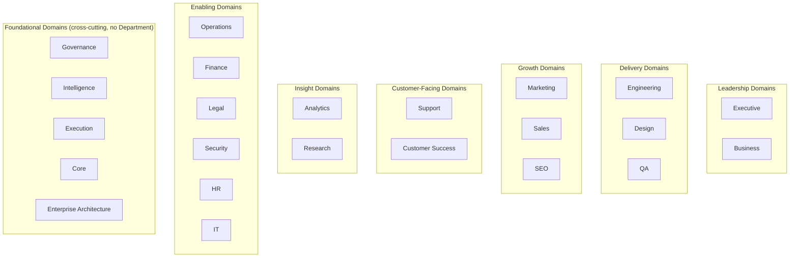

# Enterprise Domain Map

> The full list of domains the organization operates in, and how they relate — the organizational blueprint every future Department is placed against. A Domain (per `Enterprise_Architecture/ENTERPRISE_TAXONOMY.md`) groups related Capabilities (`Enterprise_Architecture/ENTERPRISE_CAPABILITY_MODEL.md`) into a coherent area of concern; this document is the map of those areas and their relationships, not the capabilities themselves.

Governed by `Enterprise_Architecture/ENTERPRISE_ARCHITECTURE_CHARTER.md`.

## Why a Domain Map, Distinct From the Capability Model

The Capability Model answers "what can we do, specifically" (Billing, Authentication). The Domain Map answers "what are the broad areas of concern those specific capabilities live in" (Commerce, Identity) — one level up, and closer to how a new Department proposal or a cross-domain conversation actually starts ("this touches the Growth domain" is a faster, more useful first cut than immediately reasoning about individual capabilities).

## The Domain List



## Domain Definitions

| Domain | Purpose | Current architectural status |
|---|---|---|
| **Executive** | Leadership, delegation, coordination | Fully specified (`Executive/`) |
| **Business** | Value creation, investment decisions | Fully specified (`Business/`) |
| **Engineering** | Software implementation | Folder exists (`Departments/Engineering`), unpopulated |
| **Design** | UX, UI, research, accessibility, design systems | Folder exists (`Departments/Design`), unpopulated |
| **QA** | Testing, automation, performance, security testing, release validation | Folder exists (`Departments/QA`), unpopulated |
| **Marketing** | Brand, content, campaigns, growth | Folder exists (`Departments/Marketing`), unpopulated |
| **SEO** | Search visibility | Folder exists (`Departments/SEO`), unpopulated |
| **Sales** | Lead management, CRM, pipeline, forecasting, revenue | Not yet created |
| **Support** | Customer-facing issue resolution, incident management, knowledge base, escalations | Not yet created |
| **Customer Success** | Ongoing customer relationship and outcome ownership post-sale | Not yet created |
| **Analytics** | Dashboards, experimentation, KPIs, attribution | Folder exists (`Departments/Analytics`), unpopulated |
| **Research** | Deep, dedicated research distinct from Business's Market Intelligence interpretation | Not yet created — currently served by `Intelligence/RESEARCH_LIBRARY_STANDARD.md` at the Intelligence layer |
| **Operations** | Internal operations, administration, cross-cutting automation | Not yet created |
| **Finance** | Budgeting, forecasting, investment tracking, cost tracking (distinct from Business Case Management's *modeling* — Finance tracks actuals) | Not yet created |
| **Legal** | Contracts, licensing support, compliance-facing legal work | Not yet created |
| **Security** | Security architecture, identity, compliance, risk (distinct from `Governance/RISK_MANAGEMENT_FRAMEWORK.md`'s org-wide risk scoring — Security is the delivery Department that implements controls) | Not yet created |
| **HR** | People operations (relevant primarily for the human-staffed parts of the organization, if any) | Not yet created |
| **IT** | Internal technical infrastructure and tooling | Not yet created |
| **Governance** | Control, standards, RACI, risk | Fully specified (`Governance/`) — foundational, not staffed by a Department |
| **Intelligence** | Organizational memory and evidence | Fully specified (`Intelligence/`) — foundational, not staffed by a Department |
| **Execution** | Runtime orchestration | Fully specified (`Execution/`) — foundational, not staffed by a Department |
| **Core** | Constitutional foundation | Fully specified (`Core/`) — foundational, not staffed by a Department |
| **Enterprise Architecture** | Structural modeling (this domain) | Fully specified as of this document — foundational, not staffed by a Department |

## Domain Groupings, Explained

- **Leadership Domains** decide direction and value; they don't implement.
- **Delivery Domains** build; they consume Leadership's intent (per `Business/LAYER_INTERFACES.md`'s Department dependency table) and produce Artifacts.
- **Growth Domains** create and capture demand.
- **Customer-Facing Domains** sustain the relationship post-acquisition — notably still unbuilt in this repository, a real gap the Domain Map makes visible rather than hides.
- **Insight Domains** measure and research — note Analytics (operational/business metrics) is distinct from Research (deep investigation), and both are distinct from Intelligence (organizational memory/evidence architecture).
- **Enabling Domains** are the connective infrastructure a mature organization needs but which don't directly touch the primary value stream's happy path.
- **Foundational Domains** are not staffed by Departments at all — they are architectural layers every Domain above inherits from, per the six-engine model in `Business/BUSINESS_LAYER_CHARTER.md`.

## Domain-to-Capability Mapping

Every Domain's Capabilities are registered in `Enterprise_Architecture/ENTERPRISE_CAPABILITY_MODEL.md` under that Domain as its "Level 1 Grouping" — this document is the map of the groupings themselves; the Capability Model is the detail within each.

## Using This Map

A new Department proposal states which Domain it belongs to before naming its specific Capabilities — this is the first, coarsest placement check in `Governance/ORGANIZATIONAL_CHART.md` §6's intake gate, with the Capability Model providing the finer-grained second check.

## Review Cadence

Reviewed at Quarterly Business Review; a new Domain (as opposed to a new Department within an existing Domain) is significant enough to warrant an `RFC/RFC_PROCESS.md` entry, since it changes the top-level organizational blueprint every future Department is placed against.

## Anti-Patterns

- **Creating a Department without first identifying its Domain.** Produces exactly the disconnected, untethered work `Business/BUSINESS_LAYER_CHARTER.md` already warns against for capabilities — the same discipline applies one level up.
- **Treating a Foundational Domain as if it needed a Department.** Core, Governance, Intelligence, Execution, and Enterprise Architecture are deliberately not staffed by Departments — they are inherited infrastructure, per each layer's own Charter.
- **Letting the Domain list grow without bound.** A genuinely new Domain is rare — most new organizational needs are a new Capability within an existing Domain, not a new Domain itself; the RFC requirement for new Domains exists specifically to keep this list from proliferating casually.

## Metadata

```yaml
version: 1.0.0
status: active
last_reviewed: 2026-07-22
owner: Chief of Staff (stewardship), CEO (ratification of new Domains via RFC)
```
