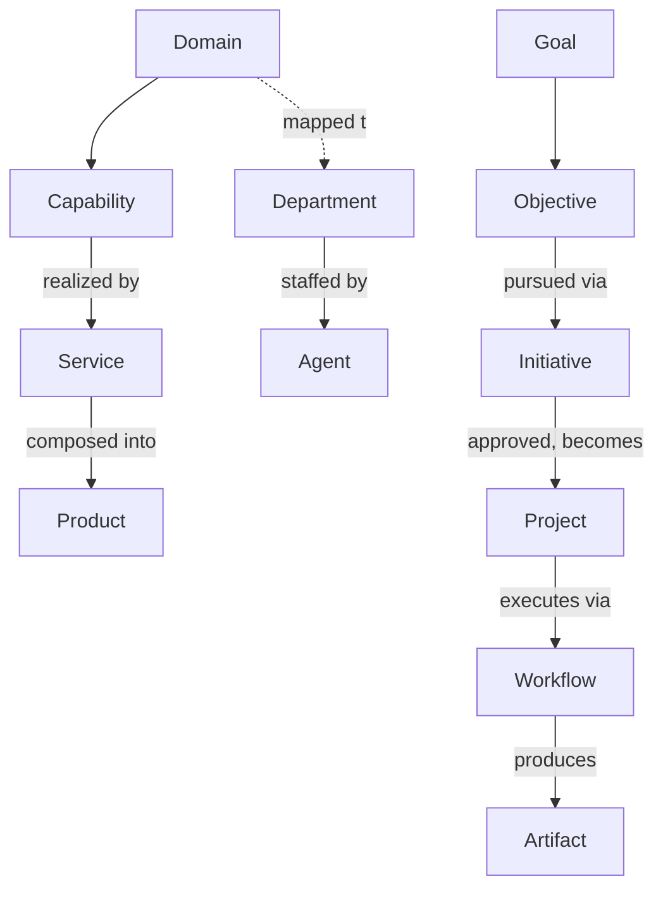

# Enterprise Taxonomy

> The canonical definitions for every recurring noun in Umer AI OS — so "initiative," "project," "service," and "capability" mean exactly one thing regardless of which layer or Department uses them. Every other document in this repository should use these terms consistently rather than redefining them locally; where a layer needs a more specific sub-definition (e.g., `Executive/Project_Manager/Templates/Epic.md`'s specific Epic shape), it specializes a term defined here rather than inventing a competing one.

Governed by `Enterprise_Architecture/ENTERPRISE_ARCHITECTURE_CHARTER.md`. Changes to a term's core definition go through `RFC/RFC_PROCESS.md` if the change would break existing usage across layers.

## Why a Taxonomy Document, Specifically

Without a shared, referenceable set of definitions, "initiative" in Business means one thing, "project" in the Project Manager's templates means something else, and by the time there are 100 Departments each with their own shading of these words, cross-Department communication requires constant clarification. This document exists so any Agent, at any layer, can resolve ambiguity by pointing here instead of guessing or re-litigating the definition per conversation.

## Core Terms

| Term | Definition | Distinguished from |
|---|---|---|
| **Capability** | A stable, durable ability the organization has — what it *can do*, independent of who does it or how. Example: "Billing," "Authentication," "Customer Support." Defined in full in `ENTERPRISE_CAPABILITY_MODEL.md`. | A Department (who does it) or a Product (what's sold) |
| **Domain** | A coherent area of organizational concern grouping related capabilities — e.g., "Commerce," "Platform," "Growth." Defined in full in `ENTERPRISE_DOMAIN_MAP.md`. | A Capability (domains group multiple capabilities) |
| **Department** | An organizational unit (per `Governance/ORGANIZATIONAL_CHART.md`) staffed by Agents that delivers against one or more Capabilities. Departments are the least stable noun in this taxonomy — they reorganize far more often than Capabilities or Domains do. | A Capability (stable) vs. a Department (the current organizational home for delivering it) |
| **Agent** | A single specialized role, per `Core/AGENT_SPECIFICATION.md`, belonging to exactly one Department. | A Department (a Department contains many Agents) |
| **Artifact** | Any typed, contract-bound deliverable moving through the system, per `Execution/ARTIFACT_CONTRACTS.md`'s registry. | A Document (an artifact is a specific registered type; not every document in the repository is an artifact in this technical sense) |
| **Workflow** | A named, defined sequence of stages Departments execute against, per `Core/WORKFLOW_STANDARD.md` and its runtime instance in `Execution/WORKFLOW_ENGINE.md`. | A Value Stream (a Workflow is the mechanical pipeline; a Value Stream, per `ENTERPRISE_VALUE_STREAMS.md`, is the end-to-end flow of value a Workflow is one segment of) |
| **Initiative** | A funded, business-cased body of work pursuing a Strategic Theme, per `Business/Contexts/Strategy.md` and `Business/Contexts/Business_Case_Management.md` — larger than a single task, smaller than a permanent Capability. | A Project (see below) — an Initiative is the Business-layer funding unit; a Project is the Execution-layer tracking unit it becomes once approved |
| **Objective** | A specific, time-bound target in service of a Goal — the CEO's brief states an Objective, per `Executive/CEO/CEO_AGENT.md`. | A Goal (broader, more durable) |
| **Goal** | A durable, longer-horizon aim, typically expressed as a Strategic Theme's Business Objective (`Business/Contexts/Strategy.md`). | An Objective (a Goal is realized through one or more Objectives over time) |
| **Project** | The `Projects/<name>/` tracked unit of work once an Initiative is approved and enters `Execution/REQUEST_LIFECYCLE.md` — the container for its Epics, Sprints, decisions, risks, and retrospective. | An Initiative (the Business-layer funding/rationale unit that a Project operationalizes) |
| **Product** | A durable, customer-facing offering composed of one or more Capabilities, owned by Product Management (`Business/Contexts/Product_Management.md`). | A Service (see below) — a Product is customer-facing and commercially packaged; a Service may be internal-only |
| **Service** | A discrete unit of functionality, internal or external, that implements part of a Capability — may or may not be customer-facing or separately commercialized. | A Capability (a Service is one implementation of a Capability; a Capability may be realized by multiple Services over time as implementation evolves) |
| **Platform** | The shared, cross-cutting technical and organizational infrastructure multiple Products/Services build on (e.g., the future `Platform/` layer referenced in the repository growth plan). | A Product (a Platform is not sold directly to end customers; it enables what is) |

## Term Relationships



## Usage Rule

Any new document in any layer that needs to use one of these terms **must use it in the sense defined here**. If a layer's specific context requires a narrower or more specialized meaning (e.g., `Executive/Project_Manager/Templates/Epic.md`'s particular shape of "Epic" as a sub-unit of a Project), that specialization is stated explicitly as a refinement of the term defined here, not a silent redefinition. A document that uses "initiative" to mean what this taxonomy calls a "project" is a taxonomy violation, flagged at the same Chief of Staff documentation audit that already checks `Governance/KNOWLEDGE_GOVERNANCE.md` compliance.

## Extending the Taxonomy

A genuinely new recurring noun (not yet listed above, needed by two or more layers) is proposed as an addition here — a lightweight addition (not a full RFC) if it's purely additive and doesn't redefine an existing term; a full `RFC/RFC_PROCESS.md` entry if it would change how an existing term is used across layers.

## Anti-Patterns

- **Silent local redefinition.** A Department or layer using "Capability" to mean what this document calls "Service" — creates exactly the cross-Department confusion this taxonomy exists to prevent.
- **Treating Department and Capability as interchangeable.** The single most common conflation — a Capability persists even when the Department delivering it is reorganized, renamed, or split; conflating them makes the Capability Model as unstable as the org chart, defeating its purpose.
- **Adding a new term without checking if an existing one already covers it.** Before proposing an addition, check this document fully — a proliferation of near-synonymous terms is as damaging as no shared vocabulary at all.

## Metadata

```yaml
version: 1.0.0
status: active
last_reviewed: 2026-07-22
owner: Chief of Staff
```
