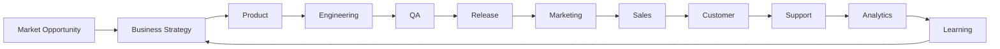
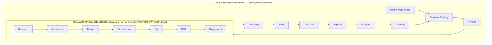
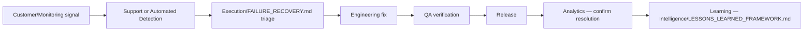
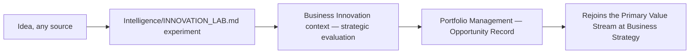

# Enterprise Value Streams

> Maps how value actually flows from a market opportunity to a realized customer/business outcome — the architectural representation `Governance/GOVERNANCE_PLAYBOOK.md` and `Business/BUSINESS_PLAYBOOK.md` each narrate in their own words but neither draws as one canonical, cross-layer picture. `Execution/WORKFLOW_ENGINE.md` explains the delivery *mechanics* of one segment of this flow; this document is the full flow, end to end, connecting Business intent through to realized outcome and back.

Governed by `Enterprise_Architecture/ENTERPRISE_ARCHITECTURE_CHARTER.md`, `Enterprise_Architecture/ENTERPRISE_TAXONOMY.md` (a Value Stream is composed of Workflows, per that document's term relationships).

## Why This Is Its Own Document, Not Just a Restatement of Existing Diagrams

`Core/WORKFLOW_STANDARD.md`'s pipeline diagram, `Business/BUSINESS_PLAYBOOK.md`'s value loop, and `Execution/EXECUTION_PLAYBOOK.md`'s engine diagram each show a piece of this from their own layer's vantage point. None of them is meant to be the single enterprise-wide reference — each is scoped to its layer's concerns. This document is that single reference: the primary value stream, named once, that every layer-specific diagram is a partial view of.

## The Primary Value Stream



This is the canonical enterprise-level value stream — the one every layer's own pipeline diagram is a zoomed-in segment of. Reading it against what's already built:

| Value Stream stage | Realized today by |
|---|---|
| Market Opportunity | `Business/Contexts/Market_Intelligence.md`, `Intelligence/COMPETITIVE_INTELLIGENCE_FRAMEWORK.md` |
| Business Strategy | `Business/Contexts/Strategy.md`, `Business/Contexts/Portfolio_Management.md`, `Business/Contexts/Business_Case_Management.md` |
| Product | `Business/Contexts/Product_Management.md` |
| Engineering | `Departments/Engineering` (not yet populated) |
| QA | `Departments/QA` (not yet populated) |
| Release | `Executive/Project_Manager/Templates/Release.md`, `Execution/WORKFLOW_ENGINE.md`'s Deployment stage |
| Marketing | `Departments/Marketing` (not yet populated), `Business/Contexts/Commercial_Strategy.md` |
| Sales | Not yet a Department; capability registered as Nascent in `Enterprise_Architecture/ENTERPRISE_CAPABILITY_MODEL.md` |
| Customer | The actual end user/buyer — outside the OS's own structure by definition |
| Support | Not yet a Department |
| Analytics | `Departments/Analytics` (not yet populated), `Business/Contexts/Portfolio_Analytics.md` |
| Learning | `Intelligence/` (fully specified layer), `Execution/CONTINUOUS_FEEDBACK.md` |

The loop back from Learning to Business Strategy is not decorative — it's the literal mechanism already specified across `Execution/CONTINUOUS_FEEDBACK.md`'s four loops and `Intelligence/DECISION_INTELLIGENCE.md`'s outcome tracking. This value stream diagram is what makes visible, in one place, that those two documents' loops are segments of the same enterprise-wide circuit, not two unrelated feedback mechanisms.

## Value Stream vs. Workflow — The Relationship

Per `Enterprise_Architecture/ENTERPRISE_TAXONOMY.md`: a Value Stream is the durable, end-to-end flow; a Workflow (`Core/WORKFLOW_STANDARD.md`, instantiated by `Execution/WORKFLOW_ENGINE.md`) is one *segment's* concrete, mechanically-executed pipeline. Specifically:



The Workflow is the delivery mechanics living entirely inside the "Product → ... → Release" segment of the Value Stream — it does not, by itself, represent Market Opportunity discovery or post-release Support/Analytics/Learning, which sit in Business and Intelligence's territory respectively.

## Secondary Value Streams

Not every unit of value creation is a full product build. Two secondary streams recur often enough to name explicitly:

### Defect/Incident Value Stream



### Innovation Value Stream



Both secondary streams are shorter re-entries into the same primary stream, not independent structures — this is deliberate, since maintaining separate parallel architectures for "normal" vs. "bug fix" vs. "innovation" work would fragment exactly the uniformity `Execution/EXECUTION_PLAYBOOK.md` already establishes as a design goal (the same engine runs a one-line bug fix and a full SaaS build).

## Using This Document

- **When designing a new Department**, check which Value Stream segment(s) it will own, and confirm its Inputs/Outputs (`Core/AGENT_SPECIFICATION.md`) match the adjacent segments' Outputs/Inputs exactly — a Department whose stated inputs don't match what the upstream segment actually produces has a value-stream defect, not just a Department-spec defect.
- **When investigating a systemic delay**, trace which Value Stream segment is the bottleneck — this is a different, higher-altitude diagnostic than a single `Execution/WORKFLOW_ENGINE.md` instance's stage history, useful for spotting a structural bottleneck (e.g., every instance stalls at the same segment) rather than an instance-specific one.
- **When onboarding a new Agent type**, this is the map that shows where its work sits in the larger flow of value, beyond its own Department's local view.

## Review Cadence

Reviewed at Quarterly Business Review; a material change (a new stage, a reordered flow) requires an `RFC/RFC_PROCESS.md` entry since it would alter how multiple layers' own diagrams relate to the canonical picture.

## Anti-Patterns

- **Treating the Value Stream as a Workflow.** It is not gated, tracked, or instantiated per project — it's the stable map; `Execution/WORKFLOW_ENGINE.md` is the thing that actually runs.
- **A Department that doesn't map cleanly to any Value Stream segment.** A signal the Department's scope is either mis-defined or genuinely cross-cutting (like Business or Governance) and should be modeled as such rather than forced onto the primary stream.
- **Ignoring the loop-back.** Treating Learning → Business Strategy as optional epilogue rather than the mechanism that makes this a genuine loop rather than a one-shot pipeline — exactly the failure mode `Execution/CONTINUOUS_FEEDBACK.md` already guards against at the instance level; this document is the same discipline at the enterprise level.

## Metadata

```yaml
version: 1.0.0
status: active
last_reviewed: 2026-07-22
owner: Chief of Staff (stewardship), CEO (ratification of material changes via RFC)
```
