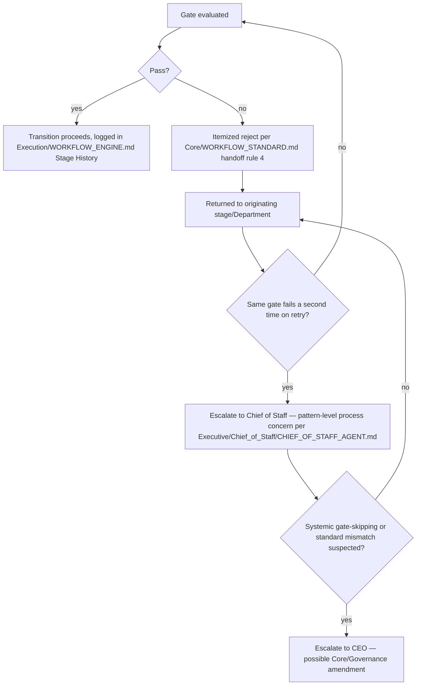

# Approval Gates

> The mechanical enforcement layer for every stage transition in `Execution/WORKFLOW_ENGINE.md`. `Core/QUALITY_STANDARD.md` defines *what* the nine quality gates are; `Governance/ORGANIZATIONAL_CHART.md`'s RACI defines *who* is accountable for a decision in principle. This document defines the actual **checkpoint mechanics**: what must be true, who must explicitly sign, and what happens on failure, at every single stage-to-stage transition in the pipeline.

Governed by `Core/QUALITY_STANDARD.md`, `Core/WORKFLOW_STANDARD.md` (handoff rules), `Governance/ORGANIZATIONAL_CHART.md` (RACI).

## Why Gates Are Explicit Checkpoints, Not Implied Diligence

`Core/WORKFLOW_STANDARD.md` already says a stage isn't "done" until its exit contract is met. Approval Gates make that mechanically checkable: a transition in `Execution/WORKFLOW_ENGINE.md` cannot move to `Complete` in the Stage History table without a recorded gate result. This is the difference between "we're supposed to check quality" (a norm) and "the state machine literally will not advance without a recorded Pass" (an enforced gate).

## Gate Anatomy

Every gate, regardless of which stage transition it guards, has the same four parts:

```markdown
## Gate: <Stage A> → <Stage B>

### Entry Criteria (must be true before Stage B can begin)
- <specific, checkable condition>

### Exit Criteria (Stage A must produce, before this gate can be evaluated)
- <the Core/WORKFLOW_STANDARD.md exit contract for Stage A, made concrete for this pipeline>

### Required Approvals
| Approver | What they confirm |
|---|---|
| | |

### Applicable Core/QUALITY_STANDARD.md Gates
| Gate | Required for this transition? |
|---|---|
| Security | |
| Performance | |
| Accessibility | |
| SEO | |
| Maintainability | |
| Testing | |
| Documentation | |
| Scalability | |
| Business Value | |
```

## The Standard Gate Set (Per Canonical Transition)

| Transition | Entry criteria for next stage | Required approvals |
|---|---|---|
| Scoped → Research/Architecture | Brief exists with stated goal, constraints, success criteria (`Execution/REQUEST_LIFECYCLE.md` Scoping output) | CEO |
| Research → Architecture | Findings documented, `Intelligence/` precedent checked | CEO (Business Value gate) |
| Architecture → Design | ADR(s) exist for material technical decisions (`Governance/ARCHITECTURE_DECISION_RECORDS_STANDARD.md`) | Engineering lead + CEO if cross-department conflict exists |
| Design → Development | Design artifacts complete, design-system compliance checked | Design lead, Engineering lead (feasibility confirmation) |
| Development → QA | Code complete, unit tests passing, self-reported gate checklist filled (`Core/QUALITY_STANDARD.md`) | Engineering lead |
| QA → SEO/Deployment | All applicable `Core/QUALITY_STANDARD.md` gates Pass/Fail/N/A recorded, no open Security fail | QA lead (binding — cannot be overridden by schedule pressure, per `Core/AI_OS_CONSTITUTION.md` §5) |
| SEO → Marketing | Technical SEO audit passed (`Checklists/SEO Audit.md`) | SEO lead |
| Marketing → Deployment | Go-to-market assets ready, messaging aligned to Positioning (`Intelligence/COMPETITIVE_INTELLIGENCE_FRAMEWORK.md` if applicable) | Marketing lead, CEO (business go/no-go) |
| Deployment → Monitoring | Release packaged per `Executive/Project_Manager/Templates/Release.md`, rollback plan exists | CEO + Chief of Staff (per Release template sign-off) |
| Monitoring → Learning | Observation window elapsed with no unresolved regression, KPI baseline captured | Project Manager |

## Escalation on Gate Failure



- A **Security** gate failure never proceeds regardless of schedule pressure or repeat count — it always returns to the originating stage, per `Core/AI_OS_CONSTITUTION.md` §5 rule 4. There is no escalation path that overrides a live Security fail; the only path forward is fixing it.
- Any other gate's **second consecutive failure** on the same transition is itself a signal (mirroring `Governance/CONTINUOUS_IMPROVEMENT_SYSTEM.md`'s recurrence-triggers-review rule) — routed to the Chief of Staff to check whether the gate criteria, the Department's spec, or the upstream stage's exit contract is actually the problem, rather than treated as a third routine retry.

## Approval Recording

Every gate evaluation is recorded in the instance's `execution-state.md` (per `Execution/WORKFLOW_ENGINE.md`), never verbally or informally:

```markdown
## Gate Record: <Stage A> → <Stage B>
- Evaluated: YYYY-MM-DD
- Result: Pass | Fail | Fail — escalated
- Approver(s): <name/role>
- Core/QUALITY_STANDARD.md gates: <table of Pass/Fail/N/A>
- Notes: <anything material to the decision>
```

This record is what `Intelligence/DECISION_INTELLIGENCE.md` and `Governance/CONTINUOUS_IMPROVEMENT_SYSTEM.md` later query when assessing whether a recurring gate-failure pattern exists across projects — the individual record only has to be complete and accurate; the pattern-detection happens elsewhere, on top of consistently recorded data.

## Gate Customization Per Project

A specific `Projects/<name>/` engagement may add project-specific gates (e.g., a regulated-industry client requiring a compliance sign-off between Development and QA) but may **never remove** a standard gate from the table above — additions are logged in the instance's execution-state as a stated customization with a reason; removals are not permitted without a `Governance/` amendment, since the standard gate set is what makes every instance comparable and auditable at scale.

## Anti-Patterns

- **Implicit approval.** A stage transition proceeding because "no one objected" — every gate requires an explicit recorded approval, silence is never sufficient (mirrors `Governance/DOCUMENT_LIFECYCLE.md`'s "silence is never approval" rule).
- **Gate-shopping.** Re-running a failed gate evaluation repeatedly with cosmetic changes until it happens to pass, instead of addressing the actual finding — caught by the second-failure escalation rule.
- **Security override under deadline pressure.** Never permitted, regardless of who's asking — this is the one gate with zero flexibility, matching `Core/AI_OS_CONSTITUTION.md`'s non-negotiable rules exactly.
- **Undocumented project-specific gate removal.** Any deviation from the standard gate set that isn't logged and justified is treated as a Governance violation, not a shortcut.

## Metadata

```yaml
version: 1.0.0
status: active
last_reviewed: 2026-07-22
owner: Chief of Staff (gate compliance audit), Project Manager (recording mechanics), QA (Security/Quality gate authority)
```
