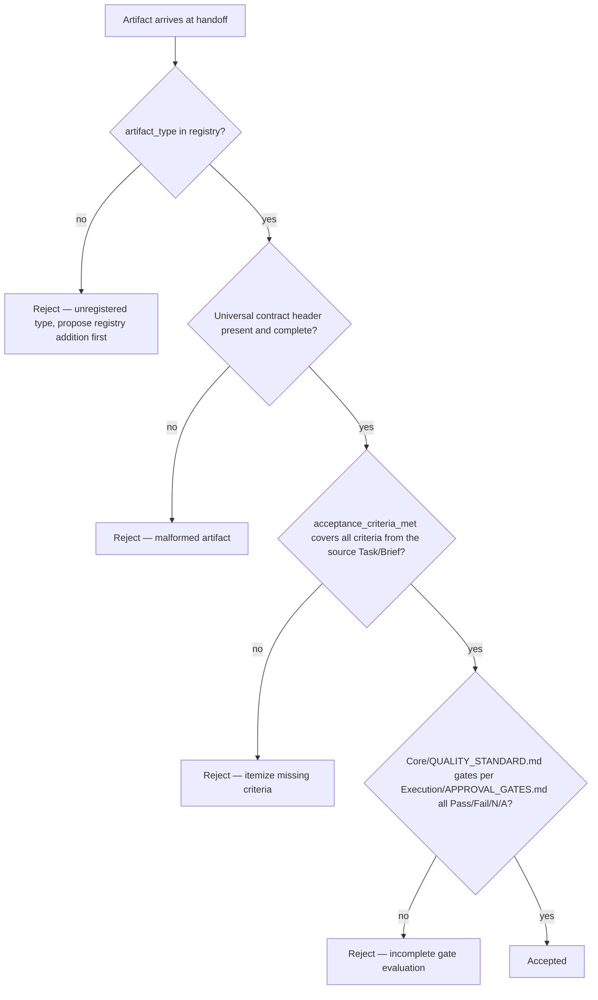

# Artifact Contracts

> The standard format every deliverable takes as it moves through a `Execution/WORKFLOW_ENGINE.md` instance — what shape an artifact must have, how it's versioned, how it's validated at a handoff, and what "acceptance criteria met" concretely means for each artifact type. `Core/OUTPUT_STANDARD.md` defines the shape of an Agent's *written response*; `Execution/ARTIFACT_CONTRACTS.md` extends that to every *deliverable type* moving through the pipeline — code, designs, content, research, decisions — so `Execution/DEPARTMENT_HANDOFFS.md`'s validation checklist has something concrete to check against.

Governed by `Core/OUTPUT_STANDARD.md`, `Core/QUALITY_STANDARD.md`, `Execution/DEPARTMENT_HANDOFFS.md`.

## Why Artifacts Need Typed Contracts

An artifact without a declared type and contract is unvalidatable — a receiving Department can't mechanically check "is this actually complete" against an undefined shape. Every artifact that crosses a `Execution/DEPARTMENT_HANDOFFS.md` boundary declares its type from the table below, and that type determines exactly what "valid" means.

## Artifact Type Registry

| Type | Produced by (typical) | Format | Versioning | Acceptance criteria source |
|---|---|---|---|---|
| Brief | CEO | `Core/OUTPUT_STANDARD.md` shape | Semver, per `Governance/DOCUMENT_LIFECYCLE.md` | Goal, constraints, success criteria all stated explicitly |
| Research Finding | Product/Business/any Department | `Intelligence/RESEARCH_LIBRARY_STANDARD.md` template | Dated (research is time-bound) | Sourced per `Core/COMMUNICATION_STANDARD.md`, shelf-life stated |
| ADR | Engineering/Architecture | `Governance/ARCHITECTURE_DECISION_RECORDS_STANDARD.md` template | Immutable once Accepted; superseded, not edited | All template sections complete, Alternatives Considered rigor met |
| Design Artifact | Design | Design-system-conformant file + rationale note | Semver | Design system compliance + usability review passed |
| Code | Engineering | Repository commit(s) + test suite | Git history (immutable) | `Core/QUALITY_STANDARD.md` Testing + Security gates passed |
| Test Plan / Results | QA | Structured pass/fail against acceptance criteria | Tied to the code version tested | Every acceptance criterion in the source `Executive/Project_Manager/Templates/Task.md` addressed |
| SEO Audit | SEO | `Checklists/SEO Audit.md` conformant report | Dated | Every checklist item addressed with Pass/Fail/N/A |
| Marketing Asset | Marketing | Channel-appropriate format + messaging rationale | Semver | Aligned to Positioning (`Intelligence/COMPETITIVE_INTELLIGENCE_FRAMEWORK.md` if applicable) |
| Release Package | Project Manager | `Executive/Project_Manager/Templates/Release.md` | Semver, immutable once shipped | All `Core/QUALITY_STANDARD.md` gates Pass/Fail/N/A recorded |
| Decision | CEO/any Executive | `Governance/DECISION_LOG_STANDARD.md` template | Sequential ID, immutable once Decided | Alternatives Considered + Trade-offs + Impact Analysis complete |

Every future Department that introduces a new deliverable kind registers it here with the same five columns before it's used in a live handoff — an artifact type not in this registry cannot be validated per `Execution/DEPARTMENT_HANDOFFS.md`'s checklist, and a handoff carrying an unregistered type is itself a validation failure.

## The Universal Contract Shape

Regardless of type, every artifact declares this minimal header so it's mechanically identifiable at a handoff boundary:

```yaml
artifact_type: <from the registry above>
version: <per the versioning column>
produced_by: <Department/Agent>
produced_for: EXEC-### (the Execution/WORKFLOW_ENGINE.md instance)
acceptance_status: draft | submitted | accepted | rejected
acceptance_criteria_met: [<list, checked>]
```

## Versioning Rules

- **Immutable types** (ADR, Decision, Release Package, Code via git history) are never edited post-acceptance — a change produces a new version/entry with an explicit supersession link, per `Governance/ARCHITECTURE_DECISION_RECORDS_STANDARD.md` and `Governance/DECISION_LOG_STANDARD.md`'s existing immutability rules, now applied uniformly across every artifact type that shares this property.
- **Mutable types** (Design Artifact, Marketing Asset, Brief) follow `Governance/DOCUMENT_LIFECYCLE.md`'s semver rules — patch for correction, minor for addition, major for a change that alters what a downstream Department must do differently.
- **Time-bound types** (Research Finding, SEO Audit) are dated rather than semver'd, since their validity is about currency, not incremental revision — per `Intelligence/RESEARCH_LIBRARY_STANDARD.md`'s shelf-life model.

## Validation Mechanics

Validation at a handoff (`Execution/DEPARTMENT_HANDOFFS.md`) checks an artifact against its type's contract, mechanically:



This is the concrete mechanism behind `Execution/DEPARTMENT_HANDOFFS.md`'s validation checklist item "artifacts conform to their stated contract" — this flowchart is what that checklist item actually means, applied per artifact.

## Acceptance Criteria — Source of Truth

An artifact's acceptance criteria are never invented at validation time — they trace back to the originating `Executive/Project_Manager/Templates/Task.md` or `Epic.md` acceptance criteria, or the Brief's stated success criteria for a Brief-type artifact. Validation checks the artifact against criteria that were fixed *before* the work started, per `Executive/Project_Manager/PROJECT_MANAGER_AGENT.md`'s Decision Rule that a task without acceptance criteria is never scheduled — this document is what makes that rule enforceable at the artifact level, not just the scheduling level.

## Worked Example

```yaml
artifact_type: Code
version: (git commit abc1234)
produced_by: Engineering
produced_for: EXEC-203
acceptance_status: submitted
acceptance_criteria_met:
  - "Checkout API returns 200 within 2s p95 under load test — VERIFIED, see load-test-report link"
  - "No new Security gate findings — VERIFIED, see dependency scan link"
  - "Test coverage on changed lines >= 85% — VERIFIED, 91% actual"
```

Validated against QA's `Execution/APPROVAL_GATES.md` Development→QA gate: all three criteria trace to the originating Task's acceptance criteria, all are marked VERIFIED with linked evidence (not just asserted) — this passes; an entry claiming "VERIFIED" with no linked evidence would fail validation on the "malformed artifact" branch above.

## Anti-Patterns

- **Unregistered ad hoc artifact types.** A new deliverable kind used in a live handoff without first being added to the registry — breaks mechanical validation for every future instance of that type, not just this one.
- **Asserted-not-evidenced acceptance criteria.** "Tests pass" with no linked test report — indistinguishable from a false claim at validation time, and treated as a validation failure per `Core/COMMUNICATION_STANDARD.md`'s evidence-based rule.
- **Editing immutable artifacts post-acceptance.** Directly contradicts the versioning rules for ADRs, Decisions, and Release Packages — always supersede instead.
- **Acceptance criteria invented at validation time.** Judging an artifact against criteria that weren't fixed before work started — this is scope-shifting after the fact and is explicitly disallowed; criteria trace to the original Task/Brief only.

## Metadata

```yaml
version: 1.0.0
status: active
last_reviewed: 2026-07-22
owner: Chief of Staff (registry stewardship), each Department (its artifact types), QA (validation mechanics for Code/Test artifacts)
```
