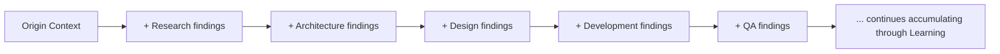

# Context Management

> The shared context model that travels with a `Execution/WORKFLOW_ENGINE.md` instance as it moves through stages and Departments — what every Agent actually needs to know beyond its own immediate task to act correctly, how it's packaged, how it's inherited by a new stage without being re-derived from scratch, and when it goes stale. This is the piece of the Execution engine that keeps `Executive/CEO/CEO_AGENT.md`'s brief, `Intelligence/`'s retrieved precedent, and each Department's accumulated findings from being silently lost or re-explained badly at every handoff.

Governed by `Execution/DEPARTMENT_HANDOFFS.md` (context is a required part of every handoff package), `Intelligence/ORGANIZATIONAL_MEMORY.md` (the retrieval this context often carries).

## Why Context Needs Explicit Management

Without a defined context model, each Department either re-derives context it should have inherited (wasteful, and risks drifting from the original brief) or receives an ad hoc, incomplete summary from whoever happened to write the handoff (per `Core/WORKFLOW_STANDARD.md`'s warning against "implied context"). This document defines context as a first-class, versioned artifact that travels with the instance — not a side conversation.

## The Context Package

Every `Execution/WORKFLOW_ENGINE.md` instance carries one living Context Package at `Projects/<name>/context/EXEC-###-context.md`, updated (never overwritten wholesale) as the instance progresses:

```markdown
# Context Package: EXEC-###

## Origin
- Original request: link to Execution/REQUEST_LIFECYCLE.md entry
- Scoped brief: link to Projects/<name>/brief.md
- Stated speed/quality bias: <from Executive/CEO/CEO_AGENT.md Decision Framework application>

## Retrieved Intelligence (set at kickoff, per Intelligence/ORGANIZATIONAL_MEMORY.md retrieval strategy)
| Type | Entry | Relevance |
|---|---|---|
| Pattern | | |
| Case Study | | |
| Competitive Intel | | |
| Research Library | | |

## Accumulated Findings (appended by each stage, never overwritten)
| Stage | Finding | Date | Link to full artifact |
|---|---|---|---|

## Active Constraints
Budget, timeline, technical, compliance — carried from Origin, updated only via a logged Governance/DECISION_LOG_STANDARD.md entry if they change mid-flight.

## Client/Domain-Specific Notes
Link to relevant Memory/Clients.md entries — e.g., "this client's API always returns malformed dates" (per the motivating example for the Intelligence layer) lives here, surfaced automatically rather than rediscovered.

## Context Version
v<n> — last updated YYYY-MM-DD by <Department>
```

## Context Inheritance

When a stage transition occurs (per `Execution/DEPARTMENT_HANDOFFS.md`), the receiving Department inherits the **entire** Context Package by reference, not a re-summarized excerpt — it reads the full accumulated context, not just what the immediately-prior stage chose to highlight. This is the specific mechanism that prevents "every future agent starts from zero" at the handoff level, not just at the project-kickoff level `Intelligence/ORGANIZATIONAL_MEMORY.md` already addresses.



Context only ever **grows** through the pipeline (each stage appends, per Accumulated Findings) — it is never truncated or summarized-down mid-flight, because a later stage may need an earlier stage's specific reasoning even if it looks irrelevant to the stage that added it (e.g., QA needing to know a specific Architecture trade-off to understand why a test result looks the way it does).

## Context Packaging Rules

1. **Every stage appends, never edits, a prior stage's Accumulated Findings entry** — corrections are new entries stating what changed and why, preserving the historical record (mirrors `Governance/ARCHITECTURE_DECISION_RECORDS_STANDARD.md`'s immutability principle, applied to context instead of decisions).
2. **Retrieved Intelligence is set once, at kickoff**, per `Intelligence/ORGANIZATIONAL_MEMORY.md`'s retrieval strategy — but any stage may add a newly-discovered relevant entry if it finds one mid-flight, logged with which stage found it.
3. **Active Constraints changes require a Decision Log entry**, not a silent edit — constraints are load-bearing for every downstream stage's decisions, so a silent change would invalidate earlier reasoning without anyone knowing.

## Context Expiration

Context isn't permanently fresh — a Context Package's Retrieved Intelligence and Active Constraints can go stale if the instance runs long enough, or if a parallel track (`Execution/PARALLEL_EXECUTION.md`) changes something the context assumed was fixed.

| Element | Freshness rule |
|---|---|
| Retrieved Intelligence | Re-checked if the instance runs longer than one `Governance/MEETING_OPERATING_SYSTEM.md` Monthly cadence without closing — a Pattern or Competitive Intel entry could itself have changed |
| Active Constraints | Never expire silently — only change via a logged Decision Log entry, so there's no "staleness," only explicit updates |
| Accumulated Findings | Never expire — historical findings remain valid as history even if a later finding supersedes their conclusion; supersession is stated, not deleted |
| Client/Domain Notes (from `Memory/`) | Re-checked against current `Memory/Clients.md` at any stage that's been waiting more than one sprint cycle, in case the client relationship context has changed |

```mermaid
flowchart TD
    A[Stage about to act] --> B{Context Package touched in last Monthly cadence?}
    B -- yes --> C[Proceed — context considered fresh]
    B -- no --more than one cadence stale --> D[Re-verify Retrieved Intelligence + Client Notes before proceeding]
    D --> E[Update Context Version, log what was re-verified]
    E --> C
```

## Context and Parallel Execution

When tracks run concurrently (`Execution/PARALLEL_EXECUTION.md`), both read from the same Context Package but append independently — at the sync point, if both tracks appended findings that conflict, that's surfaced as a `Execution/PARALLEL_EXECUTION.md` conflict, not silently reconciled by whichever track's finding was written last.

## Anti-Patterns

- **Context re-derivation.** A Department re-researching something already in Accumulated Findings because it didn't read the full Context Package — wastes effort and risks drifting from what was actually already established.
- **Silent context editing.** Overwriting a prior stage's finding instead of appending a correction — destroys the historical record `Intelligence/LESSONS_LEARNED_FRAMEWORK.md`'s root-cause analysis later depends on.
- **Treating constraints as mutable without logging.** A budget or timeline "informally" changing mid-project without a Decision Log entry — invalidates every downstream decision that assumed the original constraint, invisibly.
- **Ignoring staleness on long-running instances.** Assuming Retrieved Intelligence from kickoff is still accurate after months of elapsed time without the freshness check.

## Metadata

```yaml
version: 1.0.0
status: active
last_reviewed: 2026-07-22
owner: Project Manager (package maintenance), each Department (append discipline)
```
