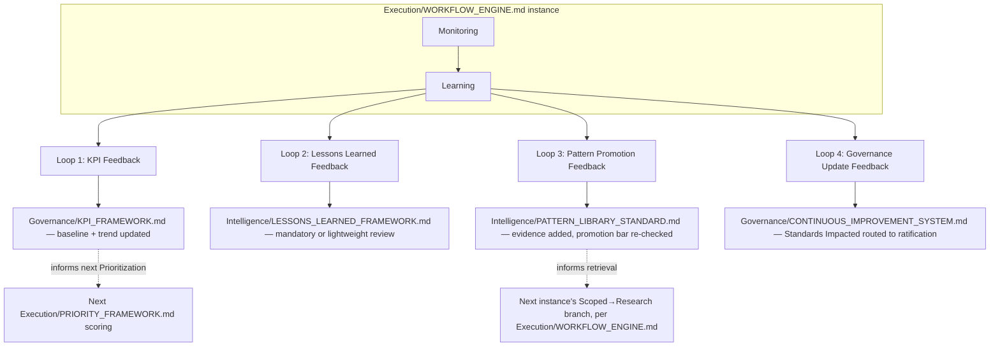
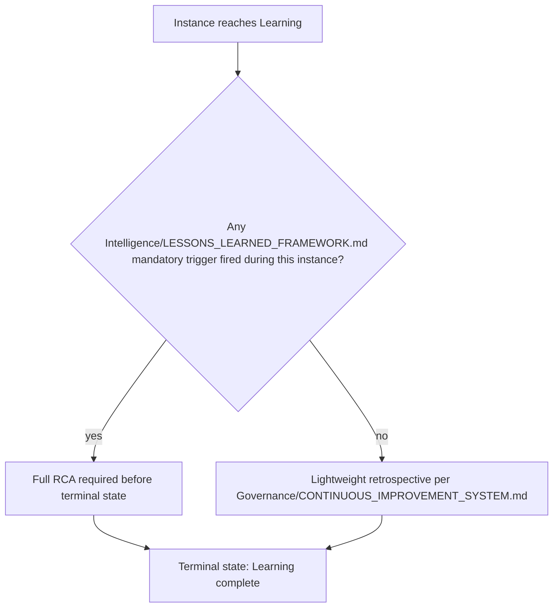

# Continuous Feedback

> The literal wiring between the Execution engine and the rest of the OS's learning systems — how a `Execution/WORKFLOW_ENGINE.md` instance's Monitoring and Learning stages actually connect to `Governance/KPI_FRAMEWORK.md`, `Intelligence/LESSONS_LEARNED_FRAMEWORK.md`, `Intelligence/PATTERN_LIBRARY_STANDARD.md`, and `Governance/` standards. This document introduces no new scoring model or promotion bar of its own — every mechanism it references already exists — it exists purely to specify the **loop**, so feedback is a designed circuit, not something that only happens if someone remembers to do it manually.

Governed by `Governance/CONTINUOUS_IMPROVEMENT_SYSTEM.md` (the harvest this feeds), `Intelligence/ORGANIZATIONAL_MEMORY.md` (the memory this writes into), `Governance/KPI_FRAMEWORK.md` (the metrics this closes the loop against).

## The Four Feedback Loops



## Loop 1: KPI Feedback

At Monitoring, the instance's actual outcome is measured against the KPIs relevant to its domain (`Governance/KPI_FRAMEWORK.md`):

```markdown
## KPI Feedback: EXEC-###
| KPI | Baseline (pre-instance) | Target (stated at Scoping) | Actual (post-Monitoring) | Delta |
|---|---|---|---|---|
```

This record is what `Intelligence/DECISION_INTELLIGENCE.md` later consumes when closing the loop on any decision tagged to this instance (§Loop 4 overlaps here — a decision's `outcome_status` is set from exactly this data). The KPI Feedback record is also what recalibrates `Execution/PRIORITY_FRAMEWORK.md`'s Business Value scoring for similar future requests — if actual impact consistently undershoots stated targets for a request type, that type's future Business Value scores should be discounted accordingly, reviewed at Quarterly Business Review.

## Loop 2: Lessons Learned Feedback

Learning stage entry checks `Intelligence/LESSONS_LEARNED_FRAMEWORK.md`'s mandatory trigger list against what happened during the instance — did a risk get realized, did a Security gate fail after reaching production, did a gate recur. If any mandatory trigger fired, the full Root Cause Analysis is required before the instance can reach its terminal state; otherwise the lightweight sprint-retro-level capture (per `Governance/CONTINUOUS_IMPROVEMENT_SYSTEM.md`) is sufficient.



This is the mechanical enforcement behind `Intelligence/LESSONS_LEARNED_FRAMEWORK.md`'s "mandatory trigger" language — the Workflow Engine literally will not let an instance reach its terminal state with an outstanding mandatory trigger unaddressed.

## Loop 3: Pattern Promotion Feedback

Every artifact and decision produced during the instance is checked against `Intelligence/PATTERN_LIBRARY_STANDARD.md`'s promotion bar: did this instance constitute a 2nd+ episode of an existing Pattern (adds evidence), a novel solution worth tracking as episode 1 (stays episodic for now), or a Critical-impact single occurrence (immediate promotion candidate)?

```markdown
## Pattern Promotion Check: EXEC-###
| Artifact/Decision | Existing Pattern match? | Action |
|---|---|---|
| | Yes — Intelligence/PatternLibrary/<link> | Evidence row added to existing Pattern |
| | No | Logged as episode 1 in Intelligence/LessonsLearned/ or Intelligence/CaseStudies/, per promotion bar |
```

This is the literal mechanism that makes the "Redis cache invalidation" example real: at Learning, the instance is checked against the Pattern Library, not just closed and forgotten.

## Loop 4: Governance Update Feedback

If the instance's Lessons Learned review (Loop 2) or Pattern check (Loop 3) surfaced a "Standards Impacted" finding (per `Intelligence/LESSONS_LEARNED_FRAMEWORK.md`'s template), it's routed into `Governance/CONTINUOUS_IMPROVEMENT_SYSTEM.md`'s Follow-Through Tracking table exactly as any other harvest output — Execution doesn't create a parallel ratification path, it feeds the existing one.

## Feedback Timing — Not Only at Instance Close

While the full loop runs at Learning (instance close), two feedback channels operate continuously, not just at terminal state:

- **KPI Feedback** during Monitoring is checked at each `Governance/MEETING_OPERATING_SYSTEM.md` Weekly Executive Review for any instance currently in Monitoring, not held until formal close — a regression detected mid-Monitoring routes immediately to `Execution/FAILURE_RECOVERY.md`, per that document's flow.
- **Pattern Promotion Feedback** can fire mid-instance if a Critical-impact situation occurs (per the Pattern Library's "single Critical-impact episode" promotion path) — it doesn't wait for Learning if the impact is severe enough to warrant an immediate Pattern/Anti-Pattern entry.

## How This Prevents Feedback From Depending on Memory

The entire point of specifying this as a wired loop rather than a norm ("remember to update the Pattern Library") is that `Execution/WORKFLOW_ENGINE.md`'s Learning stage is a **required, gated stage** — per that document, an instance cannot reach its terminal state without passing through Learning, and Learning cannot be marked complete without Loops 1-4 above being explicitly addressed (even if the answer for a given loop is "no update needed," that's a recorded answer, not an implicit skip).

## Anti-Patterns

- **Treating Learning as optional epilogue.** Per `Execution/WORKFLOW_ENGINE.md`, Learning is a required stage with its own gate — an instance closed without it is not actually closed.
- **KPI Feedback recorded but never reconciled against the original target.** The Delta column exists specifically so a consistent overshoot/undershoot pattern is visible, not just raw actuals in isolation.
- **Pattern Promotion Check skipped because "nothing seemed novel."** Every instance runs the check — most will correctly conclude "matches existing Pattern, evidence added," but that conclusion is itself the required output, not a reason to skip the check.
- **Standards Impacted findings that never reach Governance's Follow-Through Tracking.** A finding logged in the instance record but not actually routed into `Governance/CONTINUOUS_IMPROVEMENT_SYSTEM.md`'s table is exactly the "anecdote, not a lesson" failure that system already exists to prevent — Execution's job is making sure the routing actually happens.

## Metadata

```yaml
version: 1.0.0
status: active
last_reviewed: 2026-07-22
owner: Project Manager (Learning-stage gate mechanics), Chief of Staff (Loop 4 routing compliance)
```
