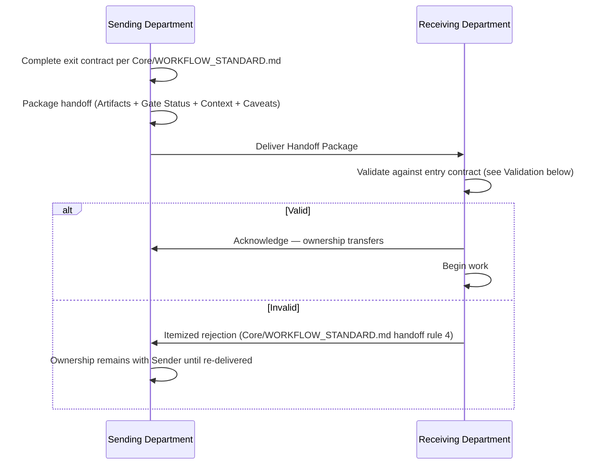

# Department Handoffs

> The literal input/output contract mechanics for a handoff between two Departments inside a running `Execution/WORKFLOW_ENGINE.md` instance. `Core/AGENT_SPECIFICATION.md` §6-7 defines that every Agent has typed Inputs and Outputs in principle; `Core/WORKFLOW_STANDARD.md` defines handoff *rules* (explicit artifacts, receiver validates, itemized rejection). This document defines the actual **transfer protocol** — the concrete package that moves, how ownership formally transfers, and how the receiving Department validates it before accepting.

Governed by `Core/AGENT_SPECIFICATION.md`, `Core/WORKFLOW_STANDARD.md`, `Execution/ARTIFACT_CONTRACTS.md` (the artifact format handoffs carry).

## The Handoff Package

Every handoff between Departments, at every `Execution/WORKFLOW_ENGINE.md` transition, is a single structured package — never a scattering of files with implied context:

```markdown
# Handoff: <From Department> → <To Department>

## Execution Instance
EXEC-### (link to Execution/WORKFLOW_ENGINE.md instance)

## Artifacts Transferred
| Artifact | Location | Contract (Execution/ARTIFACT_CONTRACTS.md type) |
|---|---|---|
| | | |

## Gate Status
Link to the Execution/APPROVAL_GATES.md gate record that authorized this handoff.

## Context Carried Forward
Link to the Execution/CONTEXT_MANAGEMENT.md context package relevant to the receiving Department — not re-explained here, just referenced.

## Known Caveats / Open Items
Anything the sending Department knows is incomplete, uncertain, or deferred — stated explicitly, per Core/COMMUNICATION_STANDARD.md's honesty rule. "No known caveats" is a valid, explicit entry.

## Sender
<Department/Agent, date>

## Receiver Acknowledgment
<Department/Agent, date, and validation result — see Validation below>
```

## Ownership Transfer

Ownership of the work item (accountability for its next stage) transfers **only** at the moment the Receiver Acknowledgment is recorded — not when the sender declares completion. This closes the specific gap `Core/WORKFLOW_STANDARD.md` already names (a stage marking itself done while the exit contract is incomplete): under this protocol, the sending Department remains accountable until the receiving Department has actually validated and accepted the package, which structurally prevents "I'm done, not my problem anymore" hand-waving.



## Validation (Receiver's Responsibility)

Per `Core/WORKFLOW_STANDARD.md` handoff rule 3 ("the receiving stage owns validation of what it receives"), every receiving Department runs this checklist before acknowledging:

- [ ] Every artifact listed is actually present at its stated location
- [ ] Artifacts conform to their stated `Execution/ARTIFACT_CONTRACTS.md` type (not just present, but shaped correctly)
- [ ] The linked gate record shows a Pass (or an accepted N/A) for every `Core/QUALITY_STANDARD.md` gate applicable to this transition
- [ ] Context package is present and current (not a stale link)
- [ ] Known Caveats are ones the receiving Department can actually work with (a caveat that blocks receiving work entirely is grounds for rejection, not silent acceptance)

A receiving Department that skips this checklist and later discovers a gap has, by validating in name only, effectively accepted ownership of a problem it should have caught at the door — this is treated as a Chief of Staff-auditable process failure on the *receiving* side, not retroactively blamed on the sender.

## Rejection

An itemized rejection, per `Core/WORKFLOW_STANDARD.md` handoff rule 4, always cites the specific failed validation checklist item(s) — never a general "not ready":

```markdown
## Handoff Rejected: <From> → <To>
- Failed checklist item(s): <specific>
- Detail: <what's actually missing or wrong>
- Ownership: remains with <Sending Department> until re-delivered
```

Rejection returns ownership (it never transferred) and logs against the sending Department's handoff clean-pass rate (`Executive/Chief_of_Staff/CHIEF_OF_STAFF_AGENT.md` Success Metrics) — the same metric the Chief of Staff already tracks, now with a mechanical trigger instead of a subjective audit call.

## Handoff Types

| Type | Example | Special handling |
|---|---|---|
| Sequential | Design → Development | Standard package above |
| Parallel-merge | SEO research + Development output both feeding Marketing | Both packages required before Marketing's entry contract is met — see `Execution/PARALLEL_EXECUTION.md` |
| Reject/return | QA → Development (gate failure) | Carries the itemized gate failure, not a fresh package — the original context/artifacts are still valid, only the specific failure needs addressing |
| Cross-project | A Pattern/Best Practice used by Project B was discovered mid-flight during Project A | Not a live handoff between Departments in the same instance — routed through `Intelligence/PATTERN_LIBRARY_STANDARD.md` instead, since it's memory retrieval, not pipeline handoff |

## Anti-Patterns

- **Handoff by mention.** "I finished, let me know if you have questions" instead of a structured package — non-compliant per `Core/WORKFLOW_STANDARD.md` handoff rule 2, mechanically unenforceable without the package format above.
- **Rubber-stamp acknowledgment.** Receiver acknowledging without running the validation checklist, then discovering a gap later — treated as a receiving-side process failure, not a sender failure.
- **Ownership limbo.** Both Departments believing the other now owns the work item because the handoff was informal — structurally prevented by the explicit "ownership transfers only at Acknowledgment" rule.
- **Omitting Known Caveats to look more complete.** A violation of `Core/COMMUNICATION_STANDARD.md`'s honesty principle applied specifically to handoffs — an omitted caveat discovered downstream is worse than a stated one, because it erodes trust in every future handoff from that sender.

## Metadata

```yaml
version: 1.0.0
status: active
last_reviewed: 2026-07-22
owner: Chief of Staff (protocol compliance audit), each Department (execution)
```
