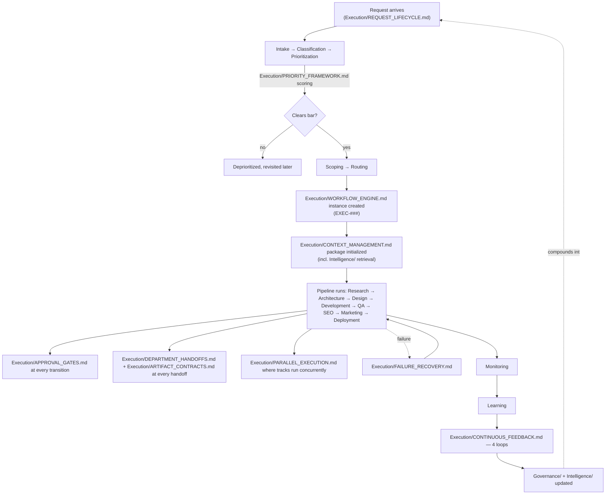

# Execution Playbook

> The narrative reference for how every project — from a one-line bug fix to a full SaaS build — actually flows through the Execution engine end to end. The other ten `Execution/` documents each define one mechanism (intake, the state machine, gates, handoffs, parallelism, priority, context, artifacts, failure recovery, feedback); this document shows them operating together, with five worked examples spanning the range of request types this OS handles.

Governed by `Core/AI_OS_CONSTITUTION.md`. Read after the other ten `Execution/` documents.

## The Full Engine, One Diagram



## Why Five Examples

The engine is the same for every request type — that's the entire point of building it as reusable infrastructure rather than a bespoke process per Department. What differs is which stages run, which are skipped, how much of the machinery gets exercised, and how fast the loop closes. The five examples below are chosen to span that range: a request small enough that most of the pipeline is skipped, up through one large enough to exercise every mechanism in this folder.

## Example 1 — Legacy Bug Fix

**Request:** "The invoice date field shows the wrong date for one specific client's exports."

- **Request Lifecycle:** Intake (Department-raised, discovered during a support ticket) → Classification: Type=Defect, Scope class=Single-department (Engineering) → Prioritization: high Urgency (client-facing, active complaint), moderate Importance, low Complexity → score clears bar easily → Scoping is minimal (the bug itself is the scope) → Routing: directly to Engineering, no CEO delegation needed (single-department).
- **Workflow Engine:** A lightweight instance is created. Research, Architecture, Design, SEO, and Marketing stages are all skipped (`Execution/WORKFLOW_ENGINE.md`'s branch table — no new unknowns, no public surface change) — the instance runs essentially Development → QA → Deployment → Monitoring → Learning.
- **Context Management:** The Context Package pulls the specific client note already in `Memory/Clients.md` — "this client's API always returns malformed dates" (the exact motivating example from `Intelligence/ORGANIZATIONAL_MEMORY.md`) — meaning Engineering starts already knowing the likely root cause instead of rediscovering it.
- **Approval Gates:** Development → QA gate requires a regression test per `Intelligence/BEST_PRACTICES_LIBRARY.md`'s QA default (every escaped-class bug gets a regression test as part of its Definition of Done).
- **Failure Recovery:** Not needed in this case — no retry/rollback.
- **Continuous Feedback:** At Learning, Pattern Promotion Check finds this matches an *existing* Anti-Pattern (`Intelligence/PatternLibrary/API/anti-patterns/...`) about not validating third-party date formats — evidence added to that existing entry rather than creating a new one, since the recurrence bar was already cleared by a prior episode.

## Example 2 — New SaaS Build (Fleet Management)

**Request:** "I want to build a Fleet Management SaaS."

- **Request Lifecycle:** Intake (Human Principal) → Classification: Type=New objective, Scope class=Cross-department → Prioritization scored against the rest of the active portfolio, Opportunity Cost stated explicitly → Scoping: CEO runs its full clarification workflow (`Executive/CEO/CEO_AGENT.md`) → Routing to CEO for full delegation.
- **Workflow Engine:** A full instance, EXEC-203, runs nearly the entire canonical pipeline: Research → Architecture → Design → Development → QA → SEO → Marketing → Deployment → Monitoring → Learning. This is the direct execution of the CEO's Objective-Decomposition Pattern from `Executive/CEO/CEO_AGENT.md` — that document describes the delegation *reasoning*; this instance is the actual state machine that runs it.
- **Context Management:** Retrieved Intelligence at kickoff pulls `Intelligence/CompetitiveIntelligence/` entries for existing fleet-management competitors (if any tracked) and any `Intelligence/ResearchLibrary/` market reports — the CEO's brief is written with this precedent already surfaced, not from a cold start.
- **Parallel Execution:** SEO keyword research and early Marketing positioning work run parallel to late Development, per the standard pattern in `Execution/PARALLEL_EXECUTION.md`'s table — synchronizing at the Deployment gate.
- **Approval Gates:** Every standard gate applies in full; an ADR is produced at Architecture→Design for the core data model (multi-tenant isolation), per `Governance/ARCHITECTURE_DECISION_RECORDS_STANDARD.md`.
- **Failure Recovery:** Mid-project, a downstream-discovered defect in the tenant-isolation approach is found during QA — triaged as a Retry (fixable forward without invalidating the Design stage's work) rather than a Rollback.
- **Continuous Feedback:** At Learning, all four loops fire — KPI Feedback against Product/Business KPIs, a full Case Study drafted (`Intelligence/CASE_STUDY_STANDARD.md`), a new Pattern likely promoted given this is a novel domain for the OS, and any Standards Impacted routed to `Governance/CONTINUOUS_IMPROVEMENT_SYSTEM.md`.

## Example 3 — SEO Audit

**Request:** "Audit our SEO performance — organic traffic has been flat for two quarters."

- **Request Lifecycle:** Intake (Automated signal — Analytics flagged flat organic traffic per `Governance/KPI_FRAMEWORK.md`'s SEO KPIs) → Classification: Type=Signal, Scope class=Single-department (SEO), though findings may spawn cross-department follow-ups → Prioritization: moderate Urgency, high Importance given sustained flatness, low Complexity to audit (though fixes found may be complex) → Scoping is close to automatic (the KPI regression defines the scope) → Routing to SEO directly.
- **Workflow Engine:** A lightweight instance running essentially Research (competitive/keyword landscape check) → SEO stage itself (the audit) → Learning. No Development/Design/Marketing stages unless the audit's findings spawn a separate Enhancement request.
- **Context Management:** Retrieved Intelligence checks `Intelligence/PatternLibrary/SEO/` and `Intelligence/BestPracticesLibrary/` (canonical tag defaults, etc.) against the current site state — the audit isn't starting from zero technical-SEO knowledge each time.
- **Artifact Contracts:** The SEO Audit artifact type (per `Execution/ARTIFACT_CONTRACTS.md`'s registry) — dated, `Checklists/SEO Audit.md`-conformant.
- **Continuous Feedback:** If the audit finds a genuinely new technical issue class (not matching any existing Pattern/Anti-Pattern), Loop 3 creates a new episode in `Intelligence/LessonsLearned/`, not yet promoted (single episode, unless Critical-impact). The audit's findings, if they require Development work, spawn a new `Execution/REQUEST_LIFECYCLE.md` request — the audit itself closes cleanly at Learning without waiting on the fix.

## Example 4 — Website Redesign

**Request:** "Our marketing site feels dated — we want a redesign."

- **Request Lifecycle:** Intake (Human Principal) → Classification: Type=New objective (net-new visual/UX direction even if same site), Scope class=Cross-department → Prioritization scored against portfolio, moderate-to-high Importance (brand impact), Opportunity Cost stated → Scoping via CEO → Routing to CEO.
- **Workflow Engine:** Runs Research (brand/competitive positioning) → Design (heavy emphasis) → Development → QA → SEO (critical here — a redesign risks regressing existing rankings, so this stage is *not* skipped even though it might be for a purely internal tool) → Marketing (launch messaging for the redesign itself) → Deployment → Monitoring → Learning.
- **Approval Gates:** The QA→SEO gate is especially scrutinized here — per `Core/QUALITY_STANDARD.md`'s SEO gate, a redesign must not silently break canonical URLs, existing rankings' underlying content structure, or crawlability. This is a case where an existing `Intelligence/BestPracticesLibrary/` SEO default (canonical tags on templated pages) applies directly and is checked explicitly at this gate.
- **Parallel Execution:** Design and Research can run concurrently (per the standard pattern table) since Research's brand/competitive findings don't block Design's exploratory work, though Design's *final* direction does depend on Research's conclusions — a Dependency Check nuance: early Design exploration is parallel-safe, final Design lock-in is sequential after Research concludes.
- **Failure Recovery:** If Monitoring detects an organic traffic drop post-launch (a real risk for redesigns), this is treated as a Production Incident per `Execution/FAILURE_RECOVERY.md` — immediate mitigation (potentially a partial rollback of specific URL structure changes) before root-causing.
- **Continuous Feedback:** KPI Feedback specifically watches SEO KPIs for several Monitoring cycles post-launch (redesigns have a longer risk tail than typical features) before Learning closes.

## Example 5 — Marketing Campaign

**Request:** "Launch a campaign for our new pricing tier."

- **Request Lifecycle:** Intake (Human Principal or Product, following a pricing decision already logged per `Governance/DECISION_LOG_STANDARD.md`) → Classification: Type=New objective (a discrete campaign), Scope class=Single-department-led (Marketing) but cross-cutting (Business's pricing decision is a hard input, Analytics needed for tracking) → Prioritization scored with high Strategic Alignment if tied to a current-quarter priority → Scoping: campaign goal, budget, channels, success metrics → Routing to Marketing, CEO informed given business-value stakes.
- **Workflow Engine:** A lightweight instance: Research (message-market fit check, per `Intelligence/BEST_PRACTICES_LIBRARY.md`'s Marketing default of validating at small spend before scaling) → Marketing (asset creation) → Deployment (campaign goes live) → Monitoring → Learning. No Development/Design/QA/SEO stages unless the campaign requires new landing pages, in which case those stages activate as a parallel or sequential sub-track.
- **Priority Framework:** Opportunity Cost explicitly names what Marketing capacity this displaces, since campaigns compete with other Marketing work for the same finite Department capacity.
- **Continuous Feedback:** KPI Feedback directly against `Governance/KPI_FRAMEWORK.md` Marketing KPIs (Conversion, CAC, ROI) with explicit Delta tracking against the stated target — this is exactly the kind of decision `Intelligence/DECISION_INTELLIGENCE.md` tracks for `outcome_status`, since campaign performance either confirms or contradicts the "validate small before scaling" Best Practice this campaign followed.

## What's Common Across All Five

Despite very different shapes, every example above:

1. Entered through the same `Execution/REQUEST_LIFECYCLE.md` funnel.
2. Ran inside a `Execution/WORKFLOW_ENGINE.md` instance with an explicit stage history, even when most stages were skipped.
3. Had every stage transition checked by `Execution/APPROVAL_GATES.md`, even when the check was quick.
4. Carried a `Execution/CONTEXT_MANAGEMENT.md` package that started from retrieved `Intelligence/` precedent rather than a blank slate.
5. Closed through the same Learning stage and `Execution/CONTINUOUS_FEEDBACK.md` four loops, so every one of these — from the smallest bug fix to the largest SaaS build — left the organization measurably smarter for the next similar request.

This uniformity, not the size of any individual project, is what makes the engine infrastructure rather than a one-off process — the same reason a CI/CD system is valuable regardless of whether the pipeline it's running is trivial or enormous.

## The One-Sentence Summary

**Every request, regardless of size or Department, enters through one funnel, runs inside one state machine with mechanically enforced gates and contracts, and closes through one feedback loop back into Governance and Intelligence — so the engine that ships a one-line bug fix is the exact same engine, at a different scale, that ships an entire SaaS product.**

## Metadata

```yaml
version: 1.0.0
status: active
last_reviewed: 2026-07-22
owner: Chief of Staff (playbook stewardship), Project Manager (day-to-day engine operation), CEO (ratification authority)
```
