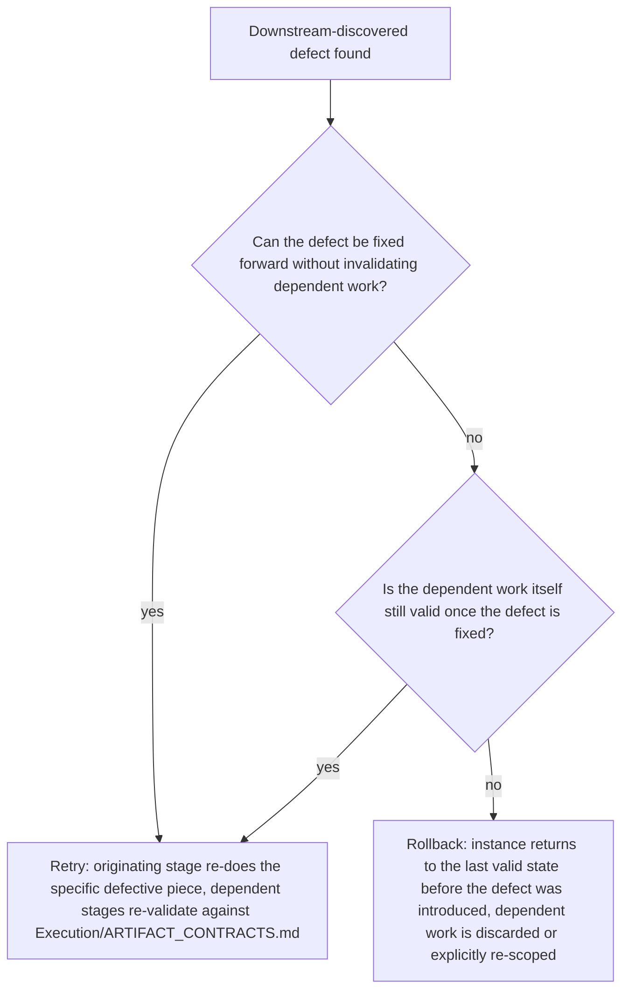
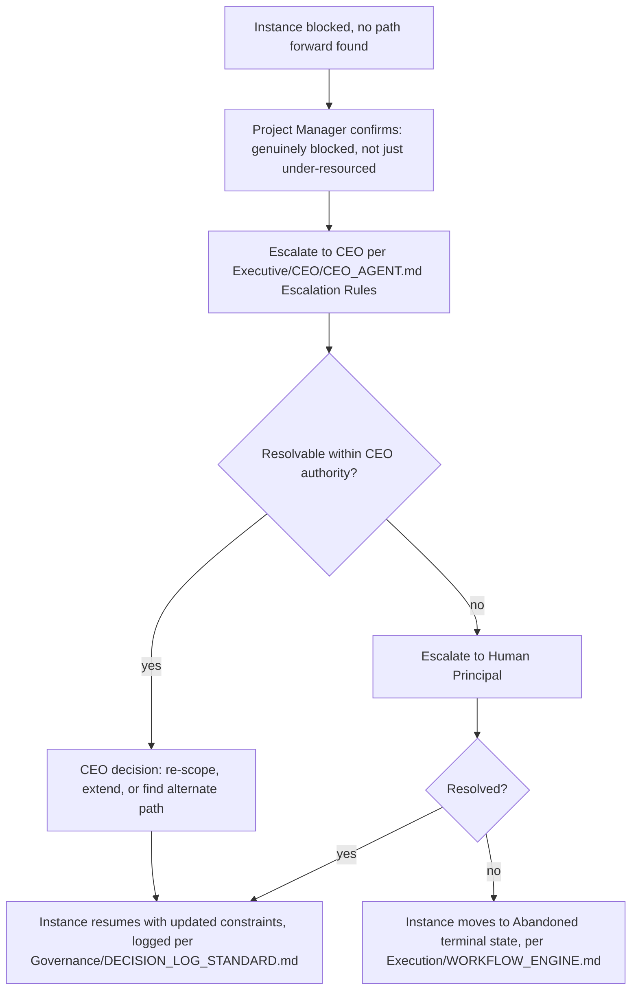
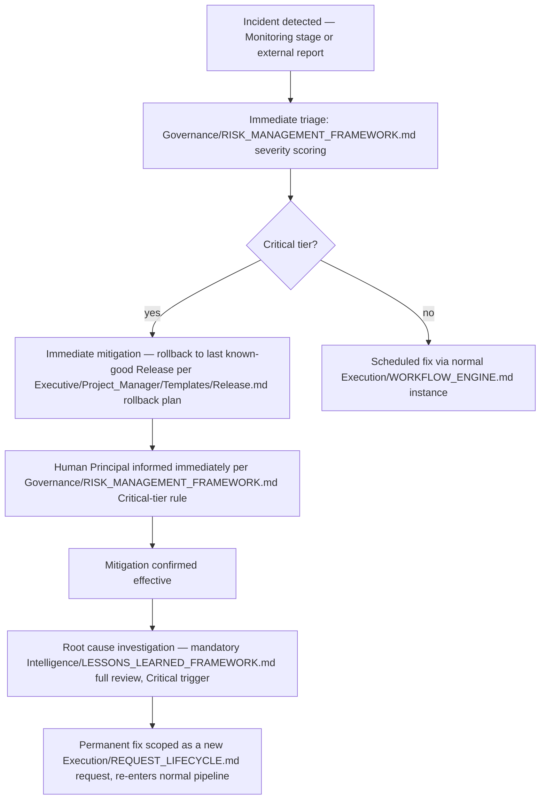

# Failure Recovery

> What happens when a `Execution/WORKFLOW_ENGINE.md` instance doesn't just fail a gate (that's the normal, expected reject/retry loop in `Execution/APPROVAL_GATES.md`) but breaks in a way the normal pipeline can't self-correct — a repeated gate failure with no clear fix, a Department discovering its output is fundamentally wrong after downstream work already depended on it, or a production incident. This document defines retries, rollbacks, escalation, and incident handling as distinct, named responses rather than one undifferentiated "something went wrong."

Governed by `Core/AI_OS_CONSTITUTION.md` §5 (non-negotiable rules on irreversible action), `Governance/RISK_MANAGEMENT_FRAMEWORK.md` (scoring what's realized), `Intelligence/LESSONS_LEARNED_FRAMEWORK.md` (mandatory review this triggers).

## Failure Categories

Not every failure gets the same response — misapplying a heavy response to a light failure (or vice versa) is itself a failure mode this taxonomy prevents.

| Category | Definition | Default response |
|---|---|---|
| Gate failure (normal) | A `Execution/APPROVAL_GATES.md` check fails on first attempt | Itemized reject, return to originating stage — not a Failure Recovery event, handled entirely within Approval Gates |
| Recurring gate failure | Same gate fails 2+ times on retry | Escalate per `Execution/APPROVAL_GATES.md`'s second-failure rule — Chief of Staff investigates process/spec gap |
| Downstream-discovered defect | A stage's output is found wrong only after later stages already built on it | **Retry** or **Rollback** (see below) |
| Blocked instance | No path forward within current constraints (capability gap, external dependency failure) | Escalate to CEO — may result in Abandoned terminal state |
| Production incident | A live, deployed artifact is causing real user/business harm | **Incident Handling** protocol (below) — highest urgency |

## Retry vs. Rollback



- **Retry** is the default and cheaper response — fix the specific defective artifact, then re-run validation (`Execution/ARTIFACT_CONTRACTS.md`) on anything downstream that consumed it, per `Execution/CONTEXT_MANAGEMENT.md`'s freshness-recheck logic.
- **Rollback** is reserved for when the defect invalidates the *reasoning* dependent stages used, not just a detail — e.g., an Architecture decision turns out to be fundamentally wrong after Development has built substantially on it. A Rollback is itself an irreversible-leaning action (discarding real work) and requires CEO sign-off, per `Core/AI_OS_CONSTITUTION.md` §5 rule 3's spirit even when it's not literally externally irreversible — discarding completed work has a real cost that deserves the same deliberateness.

### Rollback Record

```markdown
## Rollback: EXEC-###
- Rolled back to: <stage/state>
- Reason: <the defect and why Retry wasn't sufficient>
- Work discarded: <what's actually thrown away — named specifically>
- Work preserved: <anything salvageable — a Rollback discards the invalidated reasoning, not necessarily every artifact>
- Approved by: CEO
- Logged per: Governance/DECISION_LOG_STANDARD.md (this is itself a significant decision)
```

## Escalation for Blocked Instances

An instance with no forward path under current constraints — a capability gap no Department covers, an external dependency (a third-party API, a client decision) that isn't resolving — escalates rather than stalling silently:



An instance is never left indefinitely "blocked" with no active decision path — per `Execution/WORKFLOW_ENGINE.md`'s terminal states, it either resumes with a resolved path or reaches Abandoned, both logged.

## Incident Handling (Production)

The highest-urgency failure category — something already shipped is causing real harm. This bypasses the normal `Execution/WORKFLOW_ENGINE.md` state machine's stage-by-stage discipline in favor of a compressed emergency protocol, then re-enters normal process for the follow-up fix.



- **Mitigation first, root cause second** — an incident's immediate priority is stopping the harm (typically via the Release's own rollback plan, prepared in advance per `Executive/Project_Manager/Templates/Release.md`), not diagnosing why it happened. Diagnosis happens after the bleeding stops, using the full rigor of `Intelligence/LESSONS_LEARNED_FRAMEWORK.md`'s Root Cause Analysis (mandatory trigger #2: any Realized risk).
- **The permanent fix is never rushed through as part of the incident response itself** — it re-enters `Execution/REQUEST_LIFECYCLE.md` as a proper request and goes through normal gates, specifically so the same Security/Testing rigor applies to the fix that would apply to any other change; incident urgency is not a license to skip `Execution/APPROVAL_GATES.md`.

## Failure Recovery Record

Every Failure Recovery event (not routine gate rejects) is logged in the instance's `execution-state.md`:

```markdown
## Failure Recovery Event
- Category: Recurring gate failure | Downstream-discovered defect | Blocked instance | Production incident
- Detected: YYYY-MM-DD
- Response: Retry | Rollback | Escalation | Incident Handling
- Resolution: <what actually happened>
- Mandatory Lessons Learned triggered: yes/no (per Intelligence/LESSONS_LEARNED_FRAMEWORK.md's trigger list)
```

## Anti-Patterns

- **Treating every failure as an incident.** Escalating a routine gate reject to full Incident Handling wastes urgency and erodes the signal value of a real Critical escalation — use the taxonomy above to route correctly.
- **Rushing a permanent fix through incident-response urgency, skipping gates.** The permanent fix always re-enters normal process — incident urgency justifies the mitigation, never a gate bypass for the real fix.
- **Silent rollback.** Discarding completed work without a logged Rollback Record and CEO approval — treated exactly like any other undocumented decision under `Core/AI_OS_CONSTITUTION.md` §5 rule 6.
- **Stalling instead of escalating.** A blocked instance left in limbo rather than routed through the escalation ladder to a resolved path or an Abandoned state.

## Metadata

```yaml
version: 1.0.0
status: active
last_reviewed: 2026-07-22
owner: Project Manager (triage + retry/rollback mechanics), CEO (rollback approval + blocked-instance escalation), Chief of Staff (mandatory Lessons Learned enforcement)
```
