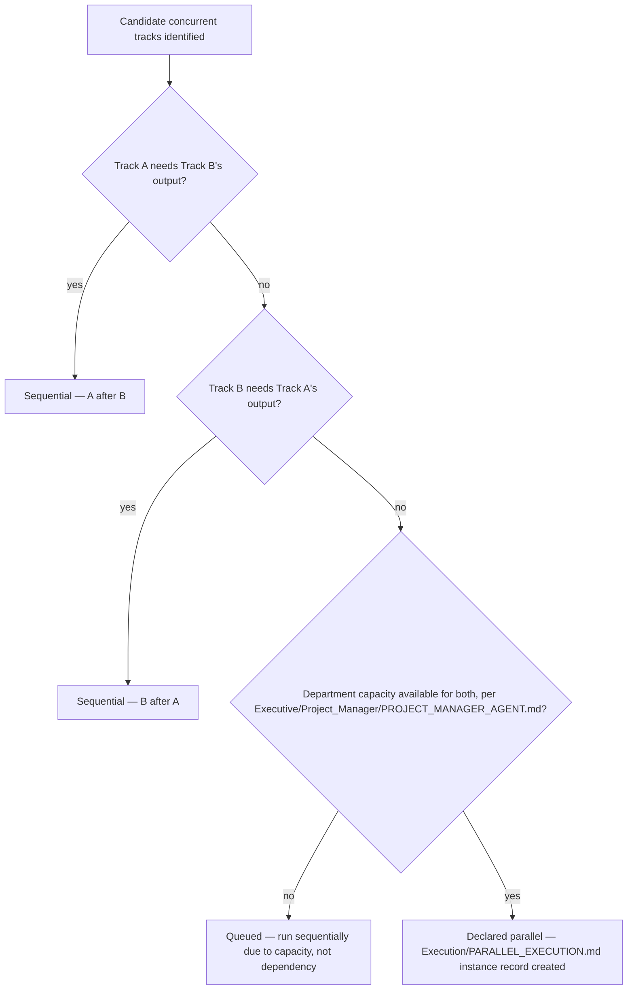
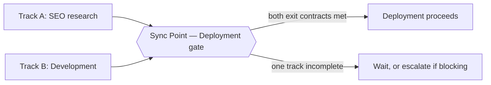
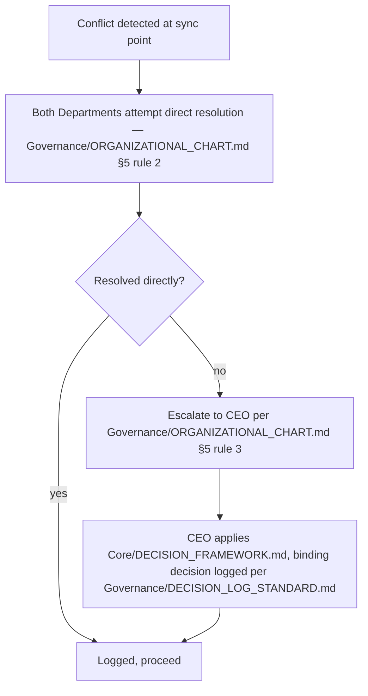

# Parallel Execution

> Which Departments may work concurrently within a single `Execution/WORKFLOW_ENGINE.md` instance, how their outputs synchronize back into one pipeline, and how conflicts between concurrent tracks are resolved. `Core/WORKFLOW_STANDARD.md` handoff rule 5 already establishes the principle ("parallel only where entry contracts don't actually depend on each other"); this document is the operational mechanics for actually running that safely at scale.

Governed by `Core/WORKFLOW_STANDARD.md` handoff rule 5, `Execution/DEPARTMENT_HANDOFFS.md` (parallel-merge handoff type), `Execution/CONTEXT_MANAGEMENT.md` (shared context across concurrent tracks).

## The Core Rule, Restated Operationally

Two Departments may run concurrently **if and only if** neither's entry contract (`Core/AGENT_SPECIFICATION.md` §6, Inputs) depends on the other's exit contract (§7, Outputs). This document doesn't change that rule — it defines how to determine it correctly for a specific instance, and how to manage the concurrency once started.

## Dependency Check (Run Before Declaring Parallel Tracks)

For any two candidate concurrent Department tracks, both questions must be "no":

1. Does Track A's Inputs list anything Track B is expected to produce?
2. Does Track B's Inputs list anything Track A is expected to produce?

If either is "yes," the tracks are sequential, not parallel — no exception. If both are "no," they may run in parallel, subject to the Resource check below.



A "Queued" outcome is explicitly distinguished from "Sequential" in the instance record — Queued means the dependency check passed but capacity forced serialization; Sequential means a real dependency exists. This distinction matters for `Governance/KPI_FRAMEWORK.md`'s Lead Time metric: capacity-driven serialization is a resourcing signal for the Project Manager, not a workflow design flaw.

## Common Parallel Patterns

| Track A | Track B | Why it's safe |
|---|---|---|
| SEO keyword/competitive research | Late-stage Development | SEO research needs the objective and domain, not the finished build |
| Marketing messaging draft | QA testing | Messaging needs Product's positioning, not QA's sign-off |
| Architecture spike | Product research | Architecture needs technical constraints, Product needs market/user validation — largely independent inputs |
| QA test-plan authoring | Late-stage Development | Writing test cases against acceptance criteria doesn't require the finished code, only the spec |

## Synchronization Rules

Parallel tracks reconverge at a defined **sync point** — never left to merge informally whenever each track happens to finish:

1. **The sync point is declared when parallel tracks are declared**, not improvised once both happen to be near done — e.g., "Marketing and QA both feed the Deployment gate; Deployment's entry contract requires both tracks' outputs."
2. **A sync point is itself a `Execution/APPROVAL_GATES.md` gate** — it doesn't pass until every parallel track's exit contract is met, exactly like a normal single-track gate, just with multiple inputs instead of one.
3. **A track that finishes early waits at the sync point**, per `Execution/CONTEXT_MANAGEMENT.md`'s context-freshness rules — an early-finishing track's output may need a freshness re-check if the other track's delayed completion means context has materially changed in the interim (e.g., Marketing drafted messaging early, but a late Architecture pivot changed the product's actual capability — Marketing's draft needs re-validation, not automatic acceptance).



## Conflict Resolution

Concurrent tracks occasionally produce genuinely conflicting outputs (Design's parallel exploration suggests a UI pattern Engineering's parallel Architecture spike says is infeasible on the current stack). This is different from a normal handoff rejection — neither track is "wrong" in isolation, they've diverged.



This is the same escalation ladder `Governance/ORGANIZATIONAL_CHART.md` §5 already defines generally — Parallel Execution's contribution is simply naming the specific trigger (a sync-point conflict) that invokes it, and requiring the conflict to be logged against the instance record regardless of which resolution path closed it.

## Instance Record Addition

Every `Execution/WORKFLOW_ENGINE.md` instance running parallel tracks adds this to its state record:

```markdown
## Parallel Tracks
| Track | Department | Started | Sync Point | Status |
|---|---|---|---|---|
| A | | | Deployment gate | In Progress |
| B | | | Deployment gate | Complete — waiting at sync |

## Conflicts Logged
| Date | Tracks involved | Resolution | Link |
|---|---|---|---|
```

## Limits on Parallelism

Not everything benefits from more concurrency — per `Core/AI_OS_CONSTITUTION.md`'s "avoid unnecessary complexity," a track is only declared parallel when the dependency check genuinely clears it, never by default "to move faster." Declaring false parallelism (tracks that look independent but share a hidden dependency) is a common failure mode this document's Dependency Check exists specifically to prevent — the check is mandatory and recorded, not a mental judgment call skipped under schedule pressure.

## Anti-Patterns

- **Parallelism by assumption.** Declaring tracks concurrent without running the explicit Dependency Check — the check is a required, recorded step, not an implied one.
- **Undeclared sync points.** Letting parallel tracks "merge whenever" instead of a defined gate — produces exactly the race conditions this document exists to prevent.
- **Accepting stale early-finisher output.** A track that finished early is not automatically still valid once its sibling track's delayed completion changes the shared context — freshness must be re-checked, per `Execution/CONTEXT_MANAGEMENT.md`.
- **Treating every disagreement as escalation-worthy.** Direct resolution between the two Departments is the first step, per `Governance/ORGANIZATIONAL_CHART.md` — not every parallel-track conflict needs the CEO.

## Metadata

```yaml
version: 1.0.0
status: active
last_reviewed: 2026-07-22
owner: Project Manager (dependency check + sync point tracking), CEO (conflict resolution authority)
```
