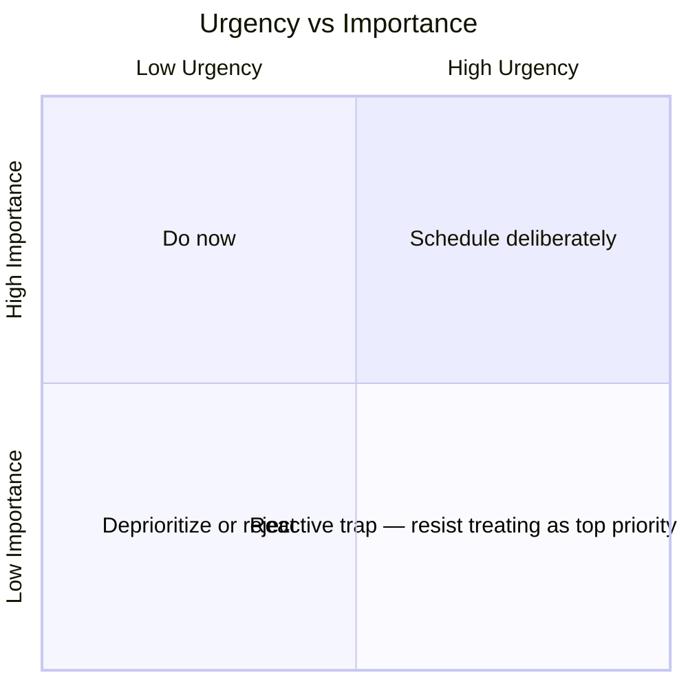
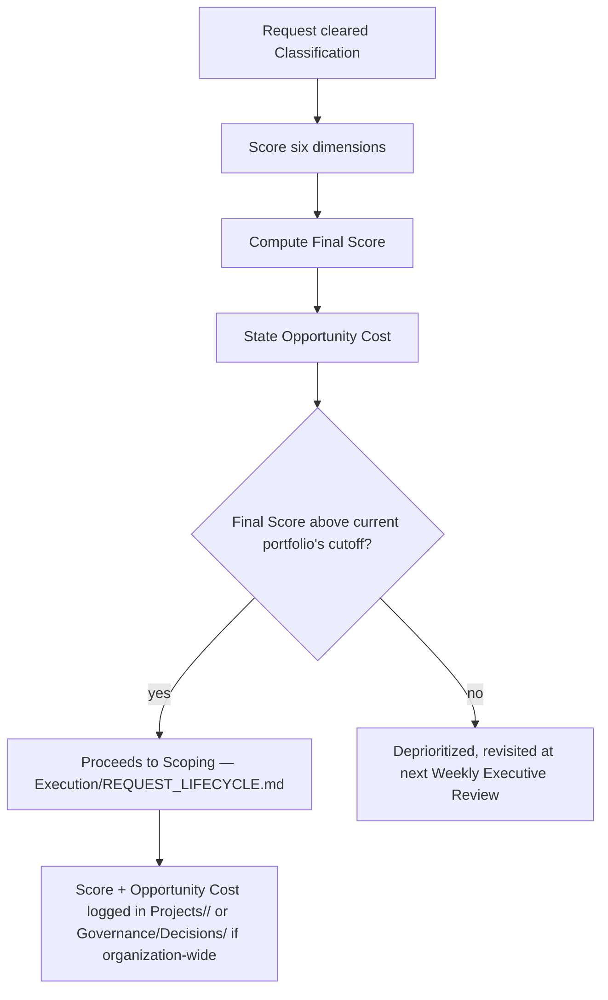

# Priority Framework

> How competing requests and in-flight work are ranked against each other at `Execution/REQUEST_LIFECYCLE.md`'s Prioritization stage and at every Weekly/Monthly review of the active portfolio. Distinct from `Governance/RISK_MANAGEMENT_FRAMEWORK.md` (which scores the danger of something going wrong) and `Intelligence/INNOVATION_LAB.md` (which scores unvalidated ideas specifically) — this framework scores **real, scoped requests already competing for finite Department capacity**, deliberately using a comparable scoring shape so the organization has one consistent numeric intuition across all three, not three unrelated systems.

Governed by `Core/DECISION_FRAMEWORK.md` (the priority order this framework operationalizes into a scoring model), `Executive/CEO/CEO_AGENT.md` (the primary user of this framework's output).

## The Six Dimensions

Every request cleared past Classification (`Execution/REQUEST_LIFECYCLE.md`) is scored 1-5 on each dimension:

| Dimension | 1 | 5 |
|---|---|---|
| Urgency | No time pressure | A hard external deadline or active incident |
| Importance | Peripheral to current goals | Directly serves the stated business objective (`Core/QUALITY_STANDARD.md` Business Value gate) |
| Business Value | Marginal | High, evidenced impact on `Governance/KPI_FRAMEWORK.md` metrics |
| Risk (of not doing it) | Low — nothing bad happens if deferred | High — deferring risks a `Governance/RISK_MANAGEMENT_FRAMEWORK.md` escalation |
| Technical Complexity | Trivial, well-understood | Novel, high-uncertainty, no `Intelligence/PatternLibrary/` precedent |
| Strategic Alignment | Unrelated to current roadmap direction | Directly advances the current-quarter strategic priority |

**Priority Score = Urgency + Importance + Business Value + Risk − Technical Complexity**, with Strategic Alignment applied as a multiplier band (see below) rather than summed — a request perfectly aligned with strategy but otherwise middling should outrank a strategically-irrelevant request with slightly higher raw urgency, and a simple weighted sum doesn't reliably produce that ordering.

```
Base Score = Urgency + Importance + Business Value + Risk − Technical Complexity   (range: -1 to 19)
Final Score = Base Score × Strategic Alignment Multiplier
```

| Strategic Alignment | Multiplier |
|---|---|
| 1-2 (weak/no alignment) | ×0.7 |
| 3 (neutral) | ×1.0 |
| 4-5 (strong alignment) | ×1.3 |

**Why Technical Complexity subtracts rather than adds:** unlike the other dimensions, higher complexity is a cost, not a value signal — a request is not more worth doing because it's harder; complexity is Opportunity Cost made explicit (see below), and should push a request down the queue relative to an equally valuable but simpler one, all else equal.

## Opportunity Cost — Made Explicit, Not Implicit

Every prioritization decision has an opportunity cost: the next-best request that doesn't get worked on because this one did. This framework surfaces that cost directly rather than leaving it implied:

```markdown
## Opportunity Cost Statement (required for any request scored above the Prioritization bar)
- What this displaces: <the next-highest-scored request that will be delayed>
- Estimated delay to the displaced request: <timeframe>
- Is this trade-off acceptable given relative scores?: <CEO judgment, stated>
```

A request is never prioritized in a vacuum — the CEO's Prioritization decision (`Execution/REQUEST_LIFECYCLE.md` stage 3) always names what it's trading against, per `Core/DECISION_FRAMEWORK.md`'s "always explain trade-offs" principle applied specifically to queue ordering.

## Urgency vs. Importance — Avoiding the Classic Trap

The most common prioritization failure this framework exists to prevent: treating Urgency as a proxy for Importance. A loudly-urgent request (an anxious client message, a squeaky-wheel internal ask) is not automatically Important; a quietly-important one (a slow-building technical debt risk, a strategic capability with no external deadline) is not automatically Un-urgent. Scoring them as two separate dimensions — rather than one blended "priority feeling" — is what keeps a high-Urgency/low-Importance request from displacing a low-Urgency/high-Importance one by default.



Requests landing in the "Reactive trap" quadrant (high urgency, low importance) are not ignored — they're handled, but routed to the least-disruptive available capacity rather than preempting higher-Importance work in progress, per the Priority Score formula naturally ranking them lower once Importance and Strategic Alignment are weighed in.

## Applying the Score



The cutoff is not a fixed universal number — it floats with current Department capacity (`Executive/Project_Manager/PROJECT_MANAGER_AGENT.md`'s capacity tracking): a quiet capacity period lowers the effective cutoff (more requests clear), a saturated period raises it. This is reviewed at every Weekly Executive Review, not left static.

## Re-Scoring

Every open, Backlogged (Deprioritized) request is re-scored at the next Weekly Executive Review, not left frozen at its original score — Urgency in particular changes over time (a deadline approaching raises it), and a request's Strategic Alignment can shift if the roadmap itself moves (`Executive/CEO/CEO_AGENT.md` Weekly Workflow's roadmap re-validation step is exactly where this happens).

## Worked Example

| Request | Urgency | Importance | Business Value | Risk | Complexity | Base | Strategic Alignment | Final |
|---|---|---|---|---|---|---|---|---|
| Fix a checkout bug affecting 5% of transactions | 4 | 5 | 4 | 4 | 2 | 15 | 5 | 19.5 |
| Add a requested but unvalidated dashboard widget | 2 | 2 | 2 | 1 | 3 | 4 | 2 | 2.8 |
| Refactor a fragile module before it blocks the next feature | 2 | 4 | 3 | 4 | 4 | 9 | 4 | 11.7 |

The checkout bug clearly leads. The refactor — low Urgency, but real Importance and Risk — correctly outranks the flashier-sounding dashboard widget request, which is exactly the Urgency-vs-Importance trap this framework is designed to catch.

## Anti-Patterns

- **Urgency-only prioritization.** Letting whoever asks most recently or most loudly jump the queue — the explicit six-dimension score exists specifically to prevent this.
- **Skipping the Opportunity Cost statement.** Treats prioritization as if it were free — every prioritization decision displaces something; naming it is mandatory, not optional context.
- **Static scoring.** Never re-scoring a Backlogged request as circumstances change — stale scores produce a queue that no longer reflects reality.
- **Complexity treated as a value-add.** Scoring a request higher because it's technically interesting rather than because it's valuable — Technical Complexity is a cost in this model for exactly this reason.

## Metadata

```yaml
version: 1.0.0
status: active
last_reviewed: 2026-07-22
owner: CEO (scoring authority), Project Manager (cutoff calibration against capacity)
```
