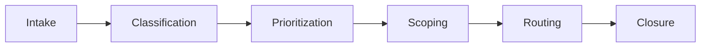
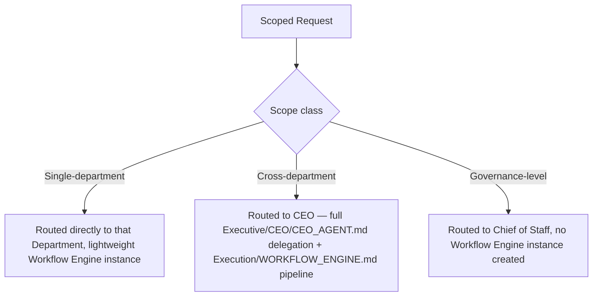
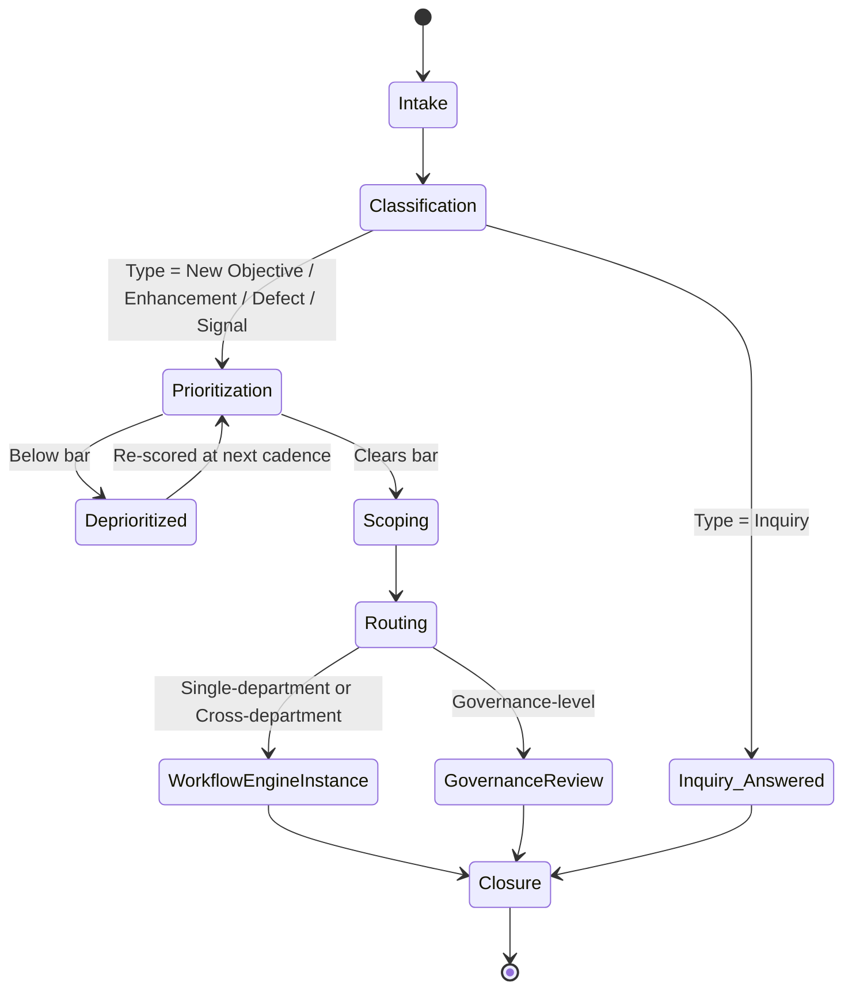

# Request Lifecycle

> The entry point to the entire Execution engine — how *any* request, from any source (human principal, a Department noticing a needed follow-up, an Analytics-triggered signal), becomes a scoped, routed, trackable unit of work. `Executive/CEO/CEO_AGENT.md` describes what the CEO does with a clear business objective once it reaches it; this document defines what happens **before** that — how a raw, possibly-messy request gets classified and shaped into something the CEO's Workflow can act on, and how any request (not just new-project objectives) is handled uniformly.

Governed by `Core/AI_OS_CONSTITUTION.md`. Feeds `Execution/WORKFLOW_ENGINE.md` (which pipeline instance runs once a request is scoped) and `Execution/PRIORITY_FRAMEWORK.md` (how it's ranked against other open work).

## Why Requests Need Their Own Lifecycle, Separate From the Workflow Engine

`Core/WORKFLOW_STANDARD.md` and `Execution/WORKFLOW_ENGINE.md` both assume a scoped unit of work already exists. But real input arrives messy: "the checkout page feels slow," "can we rank for this keyword," "add a new report type," "a client says invoices are wrong." None of these are yet a delegatable objective. The Request Lifecycle is the funnel that turns arbitrary input into exactly one of: a new Workflow Engine run, an addition to an existing one, or a rejection — before any Department is engaged.

## The Six Stages



### 1. Intake

Every request is captured in a single, uniform shape regardless of source — a human message, a Department-raised follow-up, or an automated signal (e.g., Analytics flags a KPI regression per `Governance/KPI_FRAMEWORK.md`).

```markdown
# Request: <slug>

## Source
Human Principal | Department (name) | Automated signal (name the monitor/trigger)

## Raw Description
Verbatim or near-verbatim capture of what was asked/observed — no interpretation yet.

## Received
YYYY-MM-DD

## Status
Intake
```

An Intake entry is never refined or reworded before capture — capturing the raw ask first prevents an early, incorrect assumption from silently overwriting what was actually requested.

### 2. Classification

Every request is classified along two dimensions before anything else happens:

| Dimension | Values |
|---|---|
| Type | New objective (net-new `Projects/`) · Enhancement (extends an active project) · Defect (something built is behaving wrong) · Inquiry (a question, not a work request) · Signal (system-detected, not human-originated) |
| Scope class | Single-department (fits inside one Department's mandate) · Cross-department (needs `Core/WORKFLOW_STANDARD.md`'s pipeline, in full or part) · Governance-level (a process/standard concern, routes to Chief of Staff, not a Workflow Engine run at all) |

Classification determines which downstream path applies (§Routing) — an Inquiry never enters the Workflow Engine at all; it's answered directly and closed. A Defect on an active project re-enters that project's existing execution rather than spawning a new one.

### 3. Prioritization

Every classified request (except Inquiries, answered immediately) is scored per `Execution/PRIORITY_FRAMEWORK.md` before scoping effort is spent on it — a request that will clearly never be prioritized doesn't warrant a full scoping pass. Low-scored requests are logged and revisited at the next Weekly Executive Review (`Governance/MEETING_OPERATING_SYSTEM.md`) rather than scoped immediately.

### 4. Scoping

For requests that clear the prioritization bar, scoping produces exactly what `Executive/CEO/CEO_AGENT.md`'s Workflow needs as its own entry contract: a clarified business goal, constraints, and success criteria. This stage is where the CEO's "ask clarifying questions if ambiguous" step actually happens — Scoping *is* that step, formalized as a distinct lifecycle stage so it's never skipped under the pressure of "just get started."

```markdown
## Scoping Output
- Clarified goal:
- Constraints (budget/timeline/technical/compliance):
- Success criteria:
- Open questions resolved: <list, with answers and source>
- Still ambiguous (if any) — escalated per Escalation Rules in Executive/CEO/CEO_AGENT.md
```

### 5. Routing

Scoped requests are routed based on Classification:



Routing is what actually creates (or attaches to) a `Projects/<name>/` folder and starts a `Execution/WORKFLOW_ENGINE.md` state machine instance — a request is never worked on informally outside this structure, per `Core/AI_OS_CONSTITUTION.md` §5 rule 6 (no undocumented decisions/work).

### 6. Closure

A request's lifecycle closes when either:

- Its resulting Workflow Engine instance reaches its terminal state (`Execution/WORKFLOW_ENGINE.md`), or
- It's resolved without spawning one (an Inquiry answered, a request rejected at Prioritization with a stated reason, a duplicate merged into an existing request).

```markdown
## Closure
- Resolution: Completed via Workflow Engine instance <ID> | Answered directly | Rejected (reason) | Merged into <other request ID>
- Date:
- Follow-up needed: <link to Governance/CONTINUOUS_IMPROVEMENT_SYSTEM.md harvest if this closed a full project>
```

A request is never left in an undefined state — anything not actively progressing through stages 1-5 within a reasonable window is either explicitly deprioritized (with a stated reason, revisited at the next cadence point) or closed, never silently forgotten.

## Full Lifecycle State Machine



## Ownership Per Stage

| Stage | Owner |
|---|---|
| Intake | Whoever/whatever originates it (self-service, no gatekeeper) |
| Classification | Project Manager (mechanical) — escalates ambiguous classification to CEO |
| Prioritization | CEO, using `Execution/PRIORITY_FRAMEWORK.md` |
| Scoping | CEO (per `Executive/CEO/CEO_AGENT.md`'s clarification step) |
| Routing | Project Manager, executing the CEO's scope-class determination |
| Closure | Project Manager (mechanical close), Chief of Staff (confirms `Governance/CONTINUOUS_IMPROVEMENT_SYSTEM.md` harvest completeness if a full project) |

## Anti-Patterns

- **Skipping straight to scoping without classification.** Produces requests scoped as if cross-department when they're actually a single Department's routine work, wasting CEO attention that `Governance/ORGANIZATIONAL_CHART.md`'s RACI already says belongs to that Department alone.
- **Silent deprioritization.** A request that quietly stops moving without an explicit Deprioritized status and stated reason — violates `Core/AI_OS_CONSTITUTION.md` §5 rule 6.
- **Treating every request as a new project.** Most requests are Enhancements or Defects against existing `Projects/` — spawning a redundant new project structure fragments tracking and violates `Execution/CONTEXT_MANAGEMENT.md`'s context-continuity expectations.

## Metadata

```yaml
version: 1.0.0
status: active
last_reviewed: 2026-07-22
owner: Project Manager (mechanical stewardship), CEO (Prioritization + Scoping authority)
```
