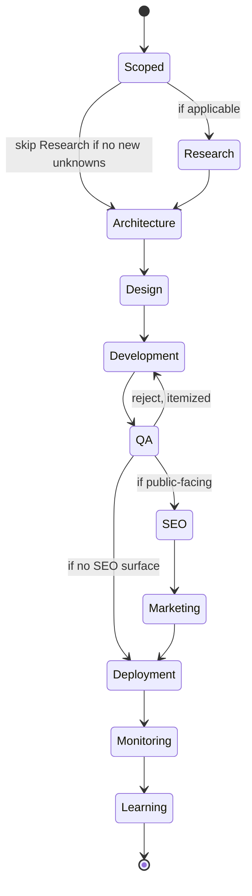
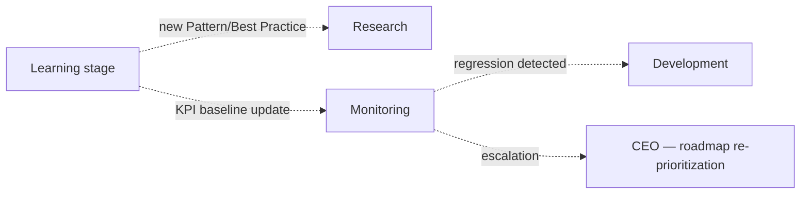

# Workflow Engine

> The runtime state machine that executes `Core/WORKFLOW_STANDARD.md`'s canonical pipeline for a single scoped request (per `Execution/REQUEST_LIFECYCLE.md`). Core defines *what the stages are and what handoff means in principle*; this document defines *how a specific instance of that pipeline actually runs* — states, transitions, conditional branches, and how the CEO's per-engagement pruning (`Executive/CEO/CEO_AGENT.md`'s Objective-Decomposition Pattern) becomes a concrete, trackable state machine instance rather than prose.

Governed by `Core/WORKFLOW_STANDARD.md` (stage definitions and handoff rules this engine executes) and `Executive/EXECUTIVE_OPERATING_MODEL.md` (the executive supervision this engine reports into).

## What "Workflow Engine" Means Here

Every project or scoped request that reaches Routing (`Execution/REQUEST_LIFECYCLE.md`) gets exactly one **Workflow Engine instance** — a concrete state machine, stored at `Projects/<name>/execution-state.md`, that tracks which stage is active, which are complete, which are skipped (and why), and what's blocking progress. It is the literal runtime counterpart to `Executive/Project_Manager/Templates/Epic.md`/`Sprint.md` — the PM templates track scheduling and capacity; this state machine tracks pipeline position and gate status.

## Canonical Workflow (Instantiated)



This mirrors `Core/WORKFLOW_STANDARD.md`'s pipeline exactly, with two additions specific to the runtime: **Monitoring** (the live-in-production observation window before a stage is considered durably complete — distinct from the one-time Analytics stage output) and **Learning** (the explicit terminal state that triggers `Governance/CONTINUOUS_IMPROVEMENT_SYSTEM.md`'s harvest and `Intelligence/ORGANIZATIONAL_MEMORY.md`'s capture, so closing a Workflow Engine instance and closing a Lessons Learned/Case Study cycle are the same event, not two things that can drift apart).

## Instance State Record

```markdown
# Execution State: <Project name>

## Instance ID
EXEC-###

## Current Stage
<one of the pipeline states>

## Stage History
| Stage | Status | Entered | Exited | Gate result (Execution/APPROVAL_GATES.md) |
|---|---|---|---|---|
| Scoped | Complete | | | Pass |
| Research | Skipped | — | — | N/A — reason: <stated> |
| Architecture | Complete | | | Pass |
| Design | In Progress | | | — |

## Active Blockers
<link to Executive/Project_Manager risk register entries currently blocking stage progress>

## Parallel Tracks Active
<link to Execution/PARALLEL_EXECUTION.md instances running concurrently with this one, if any>
```

## Conditional Branches

The engine supports named, pre-defined branch conditions rather than ad hoc improvisation per project — this is what keeps 100+ concurrent instances comparable and auditable:

| Branch point | Condition | Effect |
|---|---|---|
| Scoped → Research | New/unclear domain, no relevant `Intelligence/` precedent found (per `Intelligence/ORGANIZATIONAL_MEMORY.md` retrieval check) | Research stage runs |
| Scoped → Architecture | Domain already well-understood, existing Pattern applies directly | Research skipped, reason logged as "Pattern <link> applies directly" |
| QA → Development | Gate failure per `Execution/APPROVAL_GATES.md` | Returns to Development with itemized reject reason |
| QA → SEO or QA → Deployment | Public-facing surface exists (SEO) vs. purely internal/backend (no SEO) | Branch chosen at Scoping, stated in the instance record, not decided ad hoc mid-flight |
| Any stage → Failure_Recovery | Unrecoverable blocker or repeated gate failure | Handed to `Execution/FAILURE_RECOVERY.md`'s protocol |

Every branch taken is logged in Stage History with its reason — an engine instance is auditable precisely because no transition happens silently.

## Feedback Loops



The Learning stage doesn't just close the instance — it feeds forward into the *next* instance's Scoped→Research branch condition (a future request in the same domain now has a Pattern to check against, per `Intelligence/ORGANIZATIONAL_MEMORY.md`'s retrieval strategy). This is the literal mechanism connecting `Execution/` to `Intelligence/`: see `Execution/CONTINUOUS_FEEDBACK.md` for the full loop specification.

## Parallel Execution Pointer

Multiple stages of the same instance can run concurrently under specific conditions (e.g., SEO keyword research alongside late Development) — governed in full by `Execution/PARALLEL_EXECUTION.md`, referenced here rather than restated, since parallelism is complex enough to warrant its own document.

## Instance Lifecycle vs. Project Lifecycle

One `Projects/<name>/` folder can contain **multiple** Workflow Engine instances over its life — an initial MVP build (EXEC-001), a later major feature (EXEC-014), a critical bug fix (EXEC-015) — each its own state machine instance, sharing the project's accumulated context (`Execution/CONTEXT_MANAGEMENT.md`) but tracked independently. This is what lets `Execution/PARALLEL_EXECUTION.md` reason about concurrency correctly: concurrency is between *instances*, which may or may not belong to the same project.

## Terminal States

| Terminal state | Meaning | Triggers |
|---|---|---|
| Learning (normal close) | Full pipeline completed, in production, observed | `Governance/CONTINUOUS_IMPROVEMENT_SYSTEM.md` harvest, `Intelligence/` capture |
| Rejected at Scoping | Never entered the pipeline | `Execution/REQUEST_LIFECYCLE.md` Closure, no harvest needed |
| Abandoned | CEO-approved early termination (scope cut, deprioritization) | Logged per `Governance/DECISION_LOG_STANDARD.md`, partial harvest if meaningful work occurred |
| Failed — unrecovered | `Execution/FAILURE_RECOVERY.md` protocol exhausted without resolution | Mandatory `Intelligence/LESSONS_LEARNED_FRAMEWORK.md` full review (Critical trigger) |

An instance is never left indefinitely "in progress" with no active work — the Project Manager's status tracking (`Executive/Project_Manager/PROJECT_MANAGER_AGENT.md`) surfaces any instance stalled beyond a normal cadence window as a blocker requiring one of the terminal states above.

## Anti-Patterns

- **Improvised branching.** A stage transition taken for a reason not in the pre-defined branch table — if a genuinely new branch condition is needed, it's proposed as an addition to this document (via `Governance/CONTINUOUS_IMPROVEMENT_SYSTEM.md`), not taken ad hoc and left undocumented.
- **Instances with no state record.** Any project work happening outside a tracked `execution-state.md` is, per `Core/AI_OS_CONSTITUTION.md` §5 rule 6, treated as not having happened.
- **Conflating Deployment with Learning.** Shipping is not the same as closing — Monitoring and Learning are required stages, not optional epilogue, because they're what makes the pipeline a *loop* rather than a one-shot sequence.

## Metadata

```yaml
version: 1.0.0
status: active
last_reviewed: 2026-07-22
owner: Project Manager (instance tracking), Chief of Staff (state-machine compliance audit)
```
