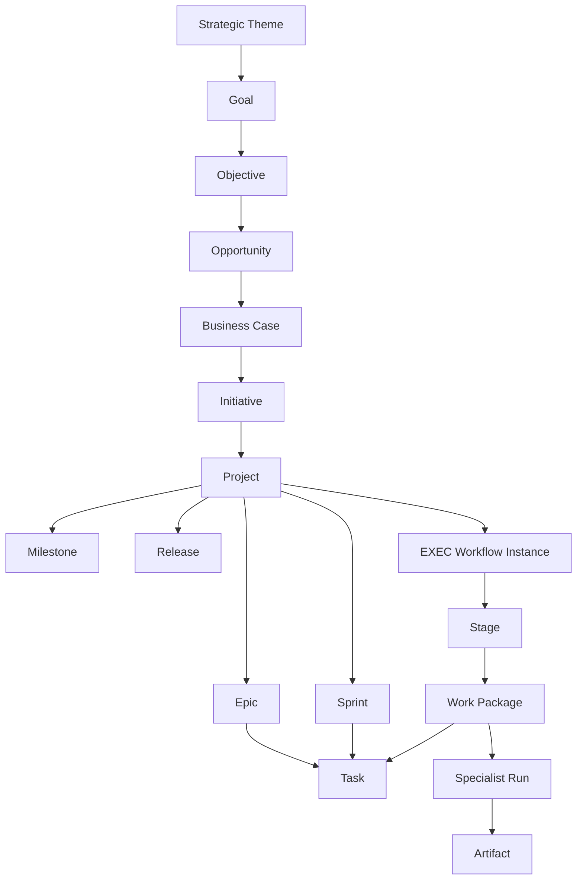

# Work Management Framework

> The enterprise work model for Umer AI OS — the standard unit hierarchy, lifecycles, and contracts that every Department, Specialist, and Runtime invocation must use. This is the missing link between Organization (Departments → Specialists) and mechanical execution (Runtime → Artifacts).

Governed by `Core/AI_OS_CONSTITUTION.md`. Owns **work-object composition and decomposition rules**. Does **not** replace:

| Already owned | Remaining SoR |
|---|---|
| Request funnel | `Execution/REQUEST_LIFECYCLE.md` |
| Pipeline state | `Execution/WORKFLOW_ENGINE.md` |
| Gates | `Execution/APPROVAL_GATES.md` |
| Handoffs | `Execution/DEPARTMENT_HANDOFFS.md` |
| Artifacts | `Execution/ARTIFACT_CONTRACTS.md` |
| Priority scoring | `Execution/PRIORITY_FRAMEWORK.md` |
| Parallel tracks | `Execution/PARALLEL_EXECUTION.md` |
| Failure / Incident | `Execution/FAILURE_RECOVERY.md` |
| Learning harvest | `Execution/CONTINUOUS_FEEDBACK.md` |
| Funding / intent | `Business/` (Initiative, Business Case, Opportunity) |
| Scheduling templates | `Executive/Project_Manager/Templates/` |
| Canonical nouns | `Enterprise_Architecture/ENTERPRISE_TAXONOMY.md` |
| Worker mandates | `Core/SPECIALIST_ARCHITECTURE_STANDARD.md` |
| Invocation mechanics | `Runtime/Domains/Agent_Runtime.md` + Orchestration |

**This framework composes those systems.** It does not invent a parallel engine, a new foundational layer, or a second meaning of Initiative/Project/Workflow/Artifact.

---

## 1. Why a Work Management Framework

Organization without a work model forces every Specialist to invent task shape, acceptance, and state. That produces inconsistent Artifacts, unenforceable gates, and Runtime graphs that cannot bind to mandates.

```text
Organization (Departments)
    → Specialists (workers)
        → Work Objects (THIS FRAMEWORK)
            → Runtime (mechanics)
                → Artifacts (sealed outputs)
```

**Work** (locked sense from Specialist Architecture): typed Inputs → Specialist judgment under mandate → sealed Outputs/Artifacts, inside an Execution instance, under Governance policy, against EA Capability bindings.

---

## 2. Challenge to the Proposed Object List

| Proposed | Verdict | Disposition |
|---|---|---|
| Strategic Objective | **Merge** | Use locked **Objective** (serves a **Goal** under a Strategic Theme). Do not invent "Strategic Objective." |
| Initiative | **Keep** | Business funding unit — already taxonomy-locked. |
| Program | **Reject as core noun** | Duplicates multi-Project Initiative or Portfolio grouping. Coordinate multi-Project work via Business Portfolio + Executive; do not add Program. |
| Epic | **Keep** | Project specialization — Executive template SoR for shape. |
| Feature | **Reject as work hierarchy** | Product packaging of Capabilities (`Business/Contexts/Product_Management.md`). Maps *to* Epics; is not a schedulable unit. |
| Story | **Reject as mandatory object** | Not present in locked PM model. Optional acceptance narrative inside Task; Epic → Task is the canonical decomposition. |
| Task | **Keep** | Smallest **schedulable** unit. |
| Subtask | **Reject** | Infinite nesting. Split into Tasks or use checklist items inside a Task (not separately tracked work objects). |
| Spike | **Keep as Task class** | Time-boxed learning Task — not a separate hierarchy level. |
| Research Item | **Keep as Task class** | Evidence-producing Task; Research *stage* remains Workflow. |
| Defect | **Keep as Work Class** | Aligns with Request Classification Type `Defect`. |
| Incident | **Keep as Work Class** | Aligns with `FAILURE_RECOVERY` production incident — urgency path, then normal Request for permanent fix. |
| Change Request | **Keep as Work Class** | Material change to approved Initiative/Project scope — requires Decision + often Business Case supersede. |
| Review | **Reject as work object** | Collaboration/gate **activity** (Specialist Interaction Mode + Approval Gates). |
| Approval | **Reject as work object** | Gate **result** (`Pass` / `Fail` / `Fail — escalated`). |
| Milestone | **Keep** | Planning checkpoint — not an Artifact producer by itself. |
| Deliverable | **Merge into Artifact** | Business-facing synonym. Contract type remains Artifact. |
| Work Package | **Keep — promoted** | The **dispatch unit** from Project Manager / Orchestration to a Specialist inside an EXEC stage. Fills the Specialist → Runtime gap. |
| Dependency | **Keep as relationship** | Not a container. |
| Risk | **Keep as control object** | Governance Risk Framework; attached to Project/Epic — not decomposition hierarchy. |
| Decision | **Keep as control object** | Decision Log / ADR / Artifact type `Decision`. |
| Blocker | **Keep as state/relationship** | Condition on a work object — not a durable type. |

### Canonical object sets

**A. Intent & funding (Business)**  
Strategic Theme → Goal → Objective → Opportunity → Business Case → **Initiative**

**B. Tracking & decomposition (Executive scheduling + this framework)**  
**Project** → **Milestone** · **Epic** → **Task** (classes) · **Sprint** · **Release**

**C. Pipeline & dispatch (Execution + this framework)**  
**Request** → **EXEC instance** → Stage → **Work Package** → Specialist run → **Artifact**

**D. Classification dimension (Work Class)**  
Applies to Request and/or Task: `NewObjective` · `Enhancement` · `Defect` · `Incident` · `Spike` · `Research` · `ChangeRequest` · `Inquiry` · `Signal`

**E. Relationships & controls (not hierarchy)**  
Dependency · Blocker · Risk · Decision · Review (activity) · Approval (gate result)

---

## 3. Canonical Work Hierarchy



**Cardinality rules**

| Relationship | Rule |
|---|---|
| Initiative : Project | 1 : N (one funding unit may yield multiple Projects over time) |
| Project : EXEC | 1 : N (multiple pipeline instances over project life) |
| Project : Epic | 1 : N |
| Epic : Task | 1 : N |
| Sprint : Task | N : N (Tasks scheduled into Sprints; a Task has ≤1 active Sprint) |
| Milestone : Epic | N : N (Milestone targets one or more Epics; Epic cites target Milestone) |
| Work Package : Task | 1 : N (one dispatch envelope may carry related Tasks to one Specialist) |
| Work Package : Specialist run | 1 : 1 per active attempt (retries are new run records, same Package) |
| Task : Artifact | 1 : N (acceptance criteria trace to Task; Artifacts seal against them) |

**Traceability invariant:** Every sealed Artifact must trace to exactly one Task (or Brief-level success criteria for Brief-type Artifacts at intake), one EXEC instance, and one Initiative (via Project).

---

## 4. Work Object Catalog

For each object: Purpose · Owns · Does Not Own · Parent/Child · Lifecycle · Metadata · Inputs · Outputs · Artifacts · Runtime events · Specialist interactions · Approvals · Success · Failures · Metrics.

### 4.1 Goal

| Field | Definition |
|---|---|
| **Purpose** | Durable aim expressing a Strategic Theme |
| **Owns** | Long-horizon intent framing |
| **Does not own** | Funding, scheduling, pipeline state |
| **Parent / Child** | Theme → Goal → Objective |
| **Lifecycle** | Active · Achieved · Retired · Superseded |
| **Metadata** | `goal_id`, theme ref, owner (Business/CEO), horizon |
| **Inputs** | Strategy, portfolio signals |
| **Outputs** | Objectives |
| **Artifacts** | Strategy docs (Business) |
| **Runtime events** | None required |
| **Specialists** | Business / Executive Advise |
| **Approvals** | CEO for org-level Goals |
| **Success** | Objectives under it deliver measurable outcomes |
| **Failures** | Goal used as Project; unmeasurable Goal |
| **Metrics** | Objectives completed / Outcome attainment |

### 4.2 Objective

| Field | Definition |
|---|---|
| **Purpose** | Time-bound target in service of a Goal (CEO brief unit) |
| **Owns** | Clarified outcome + success criteria seed |
| **Does not own** | Sprint schedule, Department staffing |
| **Parent / Child** | Goal → Objective → Initiative(s) |
| **Lifecycle** | Draft · Accepted · In Pursuit · Met · Missed · Abandoned |
| **Metadata** | `objective_id`, goal ref, due window, success criteria |
| **Inputs** | Scoped Request / CEO brief |
| **Outputs** | Milestones, Initiative proposals |
| **Artifacts** | Brief |
| **Runtime events** | None until Request routes |
| **Specialists** | Executive Orchestrate; Business Advise |
| **Approvals** | CEO accepts Objective |
| **Success** | Success criteria met via delivered Initiatives |
| **Failures** | Objective without criteria; silent scope swap |
| **Metrics** | Time-to-first-Initiative; criteria hit rate |

### 4.3 Opportunity / Business Case

| Field | Definition |
|---|---|
| **Purpose** | Investment evaluation before funding (Business SoR) |
| **Owns** | Scoring, ROI package, Outcome Definition |
| **Does not own** | Execution routing, Runtime |
| **Parent / Child** | Opportunity → Business Case → Initiative |
| **Lifecycle** | Per `Portfolio_Management` / `Business_Case_Management` |
| **Metadata** | Per Business Artifact Standards |
| **Inputs** | Market/signal/research |
| **Outputs** | Approved Case → Initiative |
| **Approvals** | CEO funds; Business does not self-approve |
| **Success** | Funded Initiative with immutable success criteria |
| **Failures** | Side-channel into Departments; mutable Case after Approve |

*(Full field ownership remains in Business contexts — listed here for hierarchy completeness only.)*

### 4.4 Initiative

| Field | Definition |
|---|---|
| **Purpose** | Funded body of work pursuing a Theme/Objective |
| **Owns** | Funding boundary, Business success criteria, Initiative Backlog position |
| **Does not own** | Epics/Tasks, EXEC state, Specialist assignment |
| **Parent / Child** | Objective → Initiative → Project(s) |
| **Lifecycle** | Funded · Executing · Benefit Realizing · Closed · Cancelled |
| **Metadata** | `initiative_id`, case ref, budget class, priority score |
| **Inputs** | Approved Business Case |
| **Outputs** | One or more Projects via Request Lifecycle |
| **Artifacts** | Case, Outcome Definition |
| **Runtime events** | None directly |
| **Specialists** | Business; Executive on promotion to Project |
| **Approvals** | CEO funding; Change Request to reopen criteria |
| **Success** | Outcome Definition met |
| **Failures** | Initiative treated as Project; direct Department assignment |
| **Metrics** | Benefit realization vs Case; time Funded→First Project |

### 4.5 Project

| Field | Definition |
|---|---|
| **Purpose** | Execution tracking container (`Projects/<name>/`) |
| **Owns** | Epics, Sprints, Tasks, risks.md, decisions.md, EXEC instances, retrospective |
| **Does not own** | Business funding truth; Capability nouns; Runtime kernel |
| **Parent / Child** | Initiative → Project → Epic/Sprint/Milestone/Release/EXEC |
| **Lifecycle** | Forming · Active · Stabilizing · Closing · Archived · Abandoned |
| **Metadata** | `project_id`, initiative ref, path, PM owner, status |
| **Inputs** | Routed Request |
| **Outputs** | Releases, Learning harvest |
| **Artifacts** | All project-scoped Artifacts |
| **Runtime events** | `project.opened|closed` (Observability) |
| **Specialists** | PM Orchestrate; Department Specialists via Work Packages |
| **Approvals** | CEO for create/abandon; PM for schedule |
| **Success** | Objective criteria met + Continuous Improvement harvest complete |
| **Failures** | Project without Initiative; work outside Projects/ |
| **Metrics** | Lead time; escaped defects; harvest completeness |

### 4.6 Milestone

| Field | Definition |
|---|---|
| **Purpose** | Named checkpoint on the path to an Objective |
| **Owns** | Target date/outcome check — not task lists |
| **Does not own** | Decomposition (that's Epic/Task) |
| **Parent / Child** | Objective/Project → Milestone ↔ Epic |
| **Lifecycle** | Planned · At Risk · Met · Missed · Dropped |
| **Metadata** | `milestone_id`, project ref, target date, acceptance check |
| **Inputs** | CEO delegation plan |
| **Outputs** | Epic targeting; Sprint goals aligned |
| **Artifacts** | None required (may attach evidence Artifact) |
| **Runtime events** | `milestone.met|missed` |
| **Specialists** | CEO / PM |
| **Approvals** | CEO accepts Milestone Met |
| **Success** | Linked Epics Done + check true |
| **Failures** | Milestone used as Epic; Met without evidence |
| **Metrics** | On-time rate; slip lead time |

### 4.7 Epic

| Field | Definition |
|---|---|
| **Purpose** | Milestone-sized scope container; decomposes into Tasks |
| **Owns** | In/out scope, Definition of Done, child Task set |
| **Does not own** | Sprint time-box mechanics; gate policy |
| **Parent / Child** | Project → Epic → Task; targets Milestone |
| **Lifecycle** | Planned · In Progress · Blocked · Done · Cancelled |
| **Metadata** | Per `Executive/Project_Manager/Templates/Epic.md` + `exec_ids[]` |
| **Inputs** | Delegation plan, success criteria |
| **Outputs** | Child Tasks; stage handoffs |
| **Artifacts** | Epic-level deliverable types as applicable |
| **Runtime events** | `epic.started|blocked|done` |
| **Specialists** | Owning Department Lead; producers on child Tasks |
| **Approvals** | PM plans; stage gates via EXEC |
| **Success** | DoD checklist complete |
| **Failures** | Epic spanning unbound Capabilities; no DoD |
| **Metrics** | Task completion ratio; rework after Done |

**Shape SoR:** `Executive/Project_Manager/Templates/Epic.md`.

### 4.8 Sprint

| Field | Definition |
|---|---|
| **Purpose** | Time-boxed commitment of Tasks (capacity & reporting unit) |
| **Owns** | Sprint Goal, committed Task set, review/retro record |
| **Does not own** | Pipeline position (EXEC); funding |
| **Parent / Child** | Project → Sprint → Task (scheduled) |
| **Lifecycle** | Planning · Active · Review · Closed |
| **Metadata** | Per Sprint template |
| **Inputs** | Backlog Tasks from Epics |
| **Outputs** | Review outcomes; Lessons (light) |
| **Runtime events** | `sprint.started|closed` |
| **Specialists** | PM; Department contributors |
| **Approvals** | PM commits; CEO if scope cut |
| **Success** | Sprint Goal met or explicit cut logged |
| **Failures** | Infinite Sprint; commitment without AC |
| **Metrics** | Commitment reliability; carryover rate |

**Orthogonal to Epic:** Epics span Sprints; Sprints pull Tasks from many Epics.

### 4.9 Task

| Field | Definition |
|---|---|
| **Purpose** | Smallest **schedulable** unit of work |
| **Owns** | Description, Acceptance Criteria, estimate, owner Department/Specialist class |
| **Does not own** | Tool allowlists (Specialist Spec); model choice (Runtime) |
| **Parent / Child** | Epic → Task; scheduled in Sprint; carried by Work Package |
| **Lifecycle** | Backlog · Ready · Assigned · In Progress · Blocked · In Review · Done · Cancelled |
| **Metadata** | Per Task template + `work_class`, `capability_ids[]`, `work_package_id` |
| **Inputs** | Epic scope, context package refs |
| **Outputs** | Artifacts listed on Task; handoff next owner |
| **Artifacts** | Trace AC → Artifact validation |
| **Runtime events** | Via Work Package / Agent run |
| **Specialists** | Exactly one primary Produce/Verify/Constrain Specialist per active attempt |
| **Approvals** | AC satisfaction before Done; gates as EXEC requires |
| **Success** | All AC checked with evidence; Artifacts accepted |
| **Failures** | Task without AC; Subtask sprawl; multi-Department Task |
| **Metrics** | Cycle time Ready→Done; reject rate; AC escape rate |

**Shape SoR:** `Executive/Project_Manager/Templates/Task.md`.

**Task classes (`work_class`)**

| Class | Meaning | Extra rules |
|---|---|---|
| `Standard` | Delivery Task | Normal gates |
| `Spike` | Time-boxed learning | Hard time box; output = findings Artifact; no production Feature claim |
| `Research` | Evidence Task | Writes toward Intelligence pathways; not a substitute for Inquiry Request |
| `DefectFix` | Corrective Task | Links Defect Request / Incident; regression AC required |
| `Change` | Scope-change implementation | Requires approved Change Request Decision first |

### 4.10 Work Package *(dispatch unit — keystone)*

| Field | Definition |
|---|---|
| **Purpose** | The **standard unit of work dispatched to a Specialist** — bridges Task(s) + EXEC stage + Specialist mandate + Runtime run |
| **Owns** | Mandate binding payload: Specialist Spec version, Task IDs, context handle, tool allowlist ref, budget/envelope, stage, EXEC ID |
| **Does not own** | Specialist Spec content; Orchestration policy invention; Artifact type registry |
| **Parent / Child** | EXEC Stage → Work Package → Task(s) → Specialist Run → Artifact(s) |
| **Lifecycle** | Draft · Queued · Dispatched · Running · Awaiting Review · Accepted · Rejected · Cancelled · Failed |
| **Metadata** | `wp_id`, `exec_id`, `stage`, `specialist_id@version`, `task_ids[]`, `context_handle`, `resource_envelope`, `attempt` |
| **Inputs** | Ready Tasks; Context package; Gate entry satisfied |
| **Outputs** | Sealed Artifacts; run record; accept/reject |
| **Artifacts** | All produced under Package attempt |
| **Runtime events** | `workpackage.queued|dispatched|running|completed|failed|cancelled` → Orchestration / Agent Runtime |
| **Specialists** | Exactly one bound Specialist Spec per dispatch |
| **Approvals** | Stage entry gate before Dispatch; output Review/gate before Accepted |
| **Success** | Task AC met; Artifacts accepted; mandate not violated |
| **Failures** | Dispatch without Ready Tasks; multi-Specialist Package; unbound Capability |
| **Metrics** | Mandate violation rate; accept rate; cost/Package; queue wait |

**Rule:** Runtime never executes a bare Task. Runtime executes a **Work Package** bound to a Specialist. Tasks without a Work Package are scheduling records only.

### 4.11 Release

| Field | Definition |
|---|---|
| **Purpose** | Packaged output ready for Deployment stage |
| **Owns** | Release contents, rollback plan, included Epic/Sprint refs |
| **Does not own** | Production incident protocol (Failure Recovery) |
| **Parent / Child** | Project → Release |
| **Lifecycle** | Assembled · Validated · Approved · Deployed · Superseded · Rolled Back |
| **Metadata** | Per Release template |
| **Inputs** | Done Epics/Tasks; QA evidence |
| **Outputs** | Release Package Artifact |
| **Runtime events** | `release.deployed|rolled_back` |
| **Approvals** | Deployment gates; Security non-overridable |
| **Success** | Deployed with rollback plan verified |
| **Failures** | "Whatever is on main"; missing rollback |
| **Metrics** | Deploy success; rollback MTTR |

### 4.12 Request

| Field | Definition |
|---|---|
| **Purpose** | Intake object before scoped work exists |
| **Owns** | Raw ask → classification → routing decision |
| **Does not own** | Sprint planning |
| **SoR** | `Execution/REQUEST_LIFECYCLE.md` — **not redefined here** |
| **Child** | May create/attach Project + EXEC |

### 4.13 EXEC Workflow Instance

| Field | Definition |
|---|---|
| **Purpose** | Pipeline position + gate status for scoped work |
| **Owns** | Stage state machine |
| **Does not own** | Capacity/schedule (Sprint/Task) |
| **SoR** | `Execution/WORKFLOW_ENGINE.md` — **not redefined here** |
| **Child** | Stages → Work Packages |

### 4.14 Artifact

| Field | Definition |
|---|---|
| **Purpose** | Typed sealed deliverable |
| **Owns** | Contract fields, acceptance status |
| **SoR** | `Execution/ARTIFACT_CONTRACTS.md` |
| **Parent** | Produced under Work Package from Task AC |

### 4.15 Dependency *(relationship)*

| Field | Definition |
|---|---|
| **Purpose** | Explicit precedence or information need between work objects |
| **Types** | `finish-to-start` · `start-to-start` · `artifact-consumer` · `external` |
| **Owns** | From/to IDs, type, satisfier Artifact/Decision if any |
| **Lifecycle** | Open · Satisfied · Waived (Decision) · Broken |
| **Rule** | Parallel Execution only when no unsatisfied entry-contract Dependency |
| **Failures** | Implicit dependency; circular Dependency (forbidden — detect at Planning) |

### 4.16 Blocker *(state/relationship)*

| Field | Definition |
|---|---|
| **Purpose** | Active condition preventing progress on Task/Epic/EXEC/Work Package |
| **Owns** | Reason, owner, escalation clock |
| **Lifecycle** | Raised · Mitigating · Cleared · Accepted (work Abandoned/re-scoped) |
| **Rule** | Blocked objects cannot Dispatch new Work Packages |
| **Escalation** | Per Failure Recovery blocked-instance path if no forward path |

### 4.17 Risk *(control)*

| Field | Definition |
|---|---|
| **Purpose** | Uncertain future harm scored and owned |
| **SoR** | `Governance/RISK_MANAGEMENT_FRAMEWORK.md` |
| **Attach** | Project and/or Epic; may freeze Dispatch if Critical untreated |

### 4.18 Decision *(control)*

| Field | Definition |
|---|---|
| **Purpose** | Durable choice affecting scope, risk acceptance, architecture, or priority |
| **SoR** | Decision Log / ADR / Artifact type Decision |
| **Rule** | Change Requests and Rollbacks require Decision records |

### 4.19 Review / Approval *(activities — not objects)*

| Activity | Binding |
|---|---|
| **Review** | Specialist Interaction Mode or stage activity; produces review notes Artifact or gate evidence |
| **Approval** | Gate evaluation result in `APPROVAL_GATES.md` |

Do not create `Review` or `Approval` work-hierarchy IDs.

---

## 5. Enterprise Work Lifecycle

Composes Request + Project scheduling + EXEC + Package + Learning. Stages below are **enterprise phases**; underlying SoRs remain authoritative inside their lanes.


| Phase | Meaning | Primary SoR | Work objects touched |
|---|---|---|---|
| **Intake** | Capture raw ask | Request Lifecycle §Intake | Request |
| **Qualification** | Classify type/scope; Inquiry exit | Request §Classification | Request, Work Class |
| **Prioritization** | Score vs portfolio | Priority Framework + Request | Request, Initiative Backlog |
| **Assignment** | Route to CEO/Dept/CoS; attach Initiative/Project | Request §Routing | Project, EXEC |
| **Planning** | Milestones, Epics, Tasks, Sprints, Dependencies | PM templates + this framework | Milestone, Epic, Task, Sprint, Dependency |
| **Execution** | Dispatch Work Packages; Specialist runs | Work Package + Agent Runtime | WP, Task, Artifact |
| **Review** | Peer/Lead review of outputs | Collaboration + gates | Review activity |
| **Validation** | Artifact contract + AC evidence | Artifact Contracts | Artifact, Task |
| **Approval** | Stage/Release gates | Approval Gates | Gate results |
| **Delivery** | Handoff ack and/or Release deploy | Handoffs + Release | Handoff, Release |
| **Measurement** | KPI / outcome signals | Business + Analytics + Monitoring stage | Initiative outcomes |
| **Closure** | Request/EXEC/Project terminal | Request + Workflow Engine | Request, EXEC, Project |
| **Learning** | Harvest loops | Continuous Feedback + CI System | Lessons, Patterns |
| **Archival** | Retain audit links | Document lifecycle / Project Archive | All IDs immutable |

**No circular lifecycle:** Learning may spawn a **new** Request; it does not reopen a Closed Request in place. Material scope change uses Change Request → Decision → new/updated Tasks — not silent mutation of Done work.

---

## 6. Work Decomposition Rules

1. **Trace upward.** Every Task → Epic → Project → Initiative → Objective → Goal → Theme.
2. **Epic → Task only.** No Story/Subtask layers. If a Task is too large, split Tasks.
3. **One Department per Task.** Cross-Department outcomes use sequential/parallel Tasks + Handoffs — never one multi-Department Task.
4. **AC before Ready.** Task cannot leave Backlog→Ready without acceptance criteria (PM Decision Rule).
5. **Capability binding.** Tasks declare EA Capability IDs; Work Package fails closed if unbound.
6. **Spike/Research caps.** Time box required; cannot permanently replace delivery Epics.
7. **DefectFix links cause.** Must reference Defect/Incident Request ID.
8. **Prefer Specialist before new Epic structure.** Growth order unchanged: Specialist → Team → Capability → Department.
9. **Planning vs pipeline.** Decomposition does not move EXEC stages; completing Tasks feeds stage exit contracts.
10. **Work Package granularity.** Prefer one Specialist, one stage, cohesive Task set; split Packages rather than broaden mandate.

---

## 7. Dependency Management

| Rule | Statement |
|---|---|
| Explicit only | Dependencies are recorded objects — chat mentions do not count |
| No cycles | Planning rejects cyclic graphs |
| Types | `finish-to-start` (default), `start-to-start`, `artifact-consumer`, `external` |
| Satisfaction | Artifact accepted, Decision logged, or Waive Decision |
| Parallel | Allowed iff Parallel Execution rules + no unsatisfied entry Dependencies |
| External | Always have escalation owner + review date |
| Broken Dependency | Raises Blocker on consumers; may trigger Failure Recovery |

---

## 8. Review Gates

Gates remain defined in `APPROVAL_GATES.md` and Core Quality Standard. Work Management adds **binding rules**:

| Gate moment | Required work evidence |
|---|---|
| Stage entry | Prior stage Artifacts accepted; Dependencies satisfied; Work Packages for prior stage Accepted or Cancelled |
| Work Package accept | Task AC evidence; Artifact validation pass; mandate clean |
| Epic Done | All child Tasks Done; Epic DoD |
| Release Approved | QA/Security gates; rollback plan present |
| Project Close | EXEC Learning complete; CI harvest eight outputs |

Projects may **add** gates; may not remove standard ones without Governance amendment. Security failures non-overridable. Silence ≠ approval.

---

## 9. Ownership Transfer Rules

| Transfer | When ownership moves | Protocol |
|---|---|---|
| Request → Project/EXEC | Routing creates/attaches | Request Lifecycle |
| Task schedule ownership | Sprint commit | PM Sprint record |
| Work Package dispatch | Specialist run starts | Runtime run record; Package → Running |
| Artifact / stage work | Handoff Receiver Acknowledgment | Department Handoffs |
| Gate clearance | Recorded Pass | Approval Gates |
| Initiative benefit | Measurement phase | Business Outcome tracking |

**Sender remains Accountable until ack/Pass.** Reject returns ownership with itemized reasons.

---

## 10. Collaboration Contracts

Reuse Specialist Architecture patterns; bind them to work objects:

| Pattern | Work binding |
|---|---|
| Delegate | Parent Work Package spawns child Packages (same Department rules) |
| Handoff | Between Departments at stage boundary — package cites Artifacts + Task IDs |
| Review | Task → In Review; Reviewer Specialist mode; no Produce/Verify conflict |
| Pair | Two Work Packages with shared Epic objective + merge Integrator Package |
| Escalate | Blocker / Escalation Matrix → PM → CEO → Human |
| Approve / Reject | Gates and Package Accepted/Rejected |
| Merge | Integrator Package after Parallel join |
| Share context/memory/artifacts | Context handles + Artifact IDs only |

---

## 11. Escalation Rules

| Trigger | First responder | Escalate to |
|---|---|---|
| Missing AC / ambiguous Task | PM | CEO if Objective unclear |
| Mandate violation | Agent Runtime kill | Department Lead + CoS |
| Recurring gate fail | CoS | CEO |
| Blocked EXEC | PM confirm | CEO → Human |
| Dependency broken external | Named owner | CEO |
| Incident Critical | On-call / Eng + Security | Human Principal immediately |
| Change Request material | Business + CEO | Human if irreversible/spend |

---

## 12. Work State Transitions

### Task

`Backlog → Ready → Assigned → In Progress → Blocked ⇄ In Progress → In Review → Done`  
Also: any non-terminal → `Cancelled` (Decision if committed scope).

### Work Package

`Draft → Queued → Dispatched → Running → Awaiting Review → Accepted`  
Alternates: `Rejected` (requeue or replan Tasks), `Failed`, `Cancelled`.

### Epic

`Planned → In Progress → Blocked ⇄ In Progress → Done | Cancelled`

Legal transitions only. No `Done → In Progress` without Change Request creating **new** Tasks.

---

## 13. Concurrency Rules

1. One active Work Package attempt per Task at a time (except explicit Pair with split AC).
2. Parallel Epics allowed under Parallel Execution + Dependency rules.
3. Multiple EXEC instances per Project allowed; must not mutate the same Artifact ID concurrently without Integrator.
4. Sprint concurrency: a Task belongs to at most one Active Sprint.
5. Specialist concurrency limited by Runtime Resource Economy + Spec Cost Class.

---

## 14. Cancellation Rules

| Object | Who may cancel | Effect |
|---|---|---|
| Request | CEO / CoS (governance) / intake owner for duplicate | No Project work |
| Task | PM (uncommitted); CEO if committed Sprint cut | Artifacts draft discarded or archived unused |
| Work Package | Orchestration / PM / Runtime kill | Run stopped; Task returns Blocked or Ready |
| Epic | PM + CEO if material | Child Tasks Cancelled or reassigned |
| Sprint commitment | PM; CEO if scope cut | Tasks return Backlog/Ready |
| Project | CEO | EXEC Abandoned; Initiative may continue via new Project |
| Initiative | CEO + Business Case closure | No new Projects; open work Cancelled or transferred by Decision |

Cancellation always writes a Decision or Request Closure reason. Silent cancel forbidden.

---

## 15. Rollback Rules

Owned by `FAILURE_RECOVERY.md`. Work Management bindings:

1. Rollback targets EXEC state / Release — not "delete the Epic."
2. Tasks whose Artifacts were invalidated return from Done to Ready or Cancelled+replacement Tasks via Change Request.
3. Work Packages Accepted on invalidated Artifacts are marked superseded; new Packages required.
4. CEO approves Rollback Record.
5. Initiative success criteria do not silently change after Rollback — Change Request if outcome must change.

---

## 16. Runtime Event Map (normative names)

| Event | Emitter |
|---|---|
| `request.intake|classified|routed|closed` | Request / Control Plane |
| `exec.stage.entered|exited|blocked` | Workflow / Orchestration |
| `workpackage.queued|dispatched|running|completed|failed|cancelled` | Orchestration |
| `agent.run.*` | Agent Runtime |
| `artifact.sealed|accepted|rejected` | Artifact Runtime |
| `gate.passed|failed|escalated` | Control Plane |
| `handoff.delivered|acked|rejected` | Orchestration |
| `milestone.met|missed` | PM / Observability |
| `release.deployed|rolled_back` | Release / Ops path |
| `incident.opened|mitigated|closed` | Failure Recovery path |

Semantics of *meaning* stay in Execution; Runtime emits and stores.

---

## 17. Specialist Interaction Summary

| Specialist action | Allowed against |
|---|---|
| Produce | Tasks in Work Package bound to their Spec |
| Verify | Peer Packages/Artifacts — not self-produced |
| Constrain | Gate evidence / security Tasks |
| Advise | Objectives, Cases, Plans — no silent Artifact seal for delivery |
| Orchestrate | Planning + Package dispatch (PM/Executive) |
| Refuse | Anti-Mandate / Non-Goals on Spec |

Specialists do not create Initiatives, approve their own funding, or open EXEC instances outside Request Routing.

---

## 18. Metrics (Work System)

Conform to `Governance/KPI_FRAMEWORK.md`. Forbidden as primary: story points theater, LOC, message volume.

| Family | Examples |
|---|---|
| Flow | Request intake→route time; Task Ready→Done; Package queue wait |
| Quality | AC escape rate; handoff reject rate; gate fail recurrence |
| Reliability | Blocked aging; rollback frequency; mandate violations |
| Predictability | Milestone on-time; Sprint commitment reliability |
| Value | Initiative benefit vs Case; escaped defects post-Release |
| Learning | Harvest completeness; recurrence of same failure mode |

---

## 19. Failure Modes (Work System)

| ID | Mode | Countermeasure |
|---|---|---|
| WM-01 | Specialist executes bare Task (no Work Package) | Runtime accepts Packages only |
| WM-02 | Story/Subtask hierarchy reintroduced | Decomposition rules; review reject |
| WM-03 | Initiative = Project conflation | Taxonomy + Activation audits |
| WM-04 | Feature/Program as shadow Epics | Reject nouns; map to Epic/Portfolio |
| WM-05 | Done Task reopened in place | Change Request → new Task |
| WM-06 | Circular Dependency | Planning validation |
| WM-07 | Multi-Department Task | Split + Handoff |
| WM-08 | AC invented at validation | Artifact Contracts trace rule |
| WM-09 | Deliverable ≠ Artifact dual registry | Single Artifact registry |
| WM-10 | Review/Approval as backlog items | Gates + modes only |
| WM-11 | Work outside Request/Projects | Constitution §5 + routing |
| WM-12 | Runtime invents work meaning | Ownership boundaries |

---

## 20. Architecture Review

| Check | Result | Notes |
|---|---|---|
| No ownership overlap | **Pass** | Business funds; Executive schedules; Execution composes meaning; Runtime mechanizes; Specialists perform; Governance policy; EA nouns |
| No duplicate work objects | **Pass** | Program/Feature/Story/Subtask/Deliverable/Review/Approval rejected or merged |
| No circular lifecycle | **Pass** | Learning spawns new Request; Done immutable without Change Request |
| Compatible with Execution | **Pass** | Composes existing SoRs; does not fork engines |
| Compatible with Runtime | **Pass** | Work Package is the dispatch contract Orchestration/Agent Runtime consume |
| Compatible with Specialists | **Pass** | Package binds Spec version + mandate; one Specialist per dispatch |
| Compatible with Departments | **Pass** | One Department per Task; handoffs for cross-Dept |
| Compatible with Business | **Pass** | Initiative/Case untouched as funding SoR; entry only via Request |
| Decade validity | **Pass** | Hierarchy stable; classes extensible; no model/prompt coupling |

### Decade invariants

1. Artifact ← Task AC ← Epic ← Project ← Initiative  
2. Runtime runs Work Packages, not free-form prompts  
3. Request remains the only intake funnel  
4. PM scheduling ≠ EXEC pipeline (both required)  
5. New work nouns require taxonomy add (and RFC if redefining locked terms)

---

## Related Documents

- `Execution/REQUEST_LIFECYCLE.md`
- `Execution/WORKFLOW_ENGINE.md`
- `Execution/APPROVAL_GATES.md`
- `Execution/DEPARTMENT_HANDOFFS.md`
- `Execution/ARTIFACT_CONTRACTS.md`
- `Execution/PARALLEL_EXECUTION.md`
- `Execution/FAILURE_RECOVERY.md`
- `Execution/CONTINUOUS_FEEDBACK.md`
- `Executive/Project_Manager/Templates/{Epic,Sprint,Task,Release}.md`
- `Business/Contexts/{Strategy,Portfolio_Management,Business_Case_Management}.md`
- `Core/SPECIALIST_ARCHITECTURE_STANDARD.md`
- `Enterprise_Architecture/ENTERPRISE_TAXONOMY.md`

## Metadata

```yaml
version: 1.0.0
status: active
layer: Execution
last_reviewed: 2026-07-22
owner: Chief Delivery Architecture Designer
supersedes: null
composes:
  - Execution/REQUEST_LIFECYCLE.md
  - Execution/WORKFLOW_ENGINE.md
  - Executive/Project_Manager/Templates/
  - Core/SPECIALIST_ARCHITECTURE_STANDARD.md
keystone_object: Work Package
```
