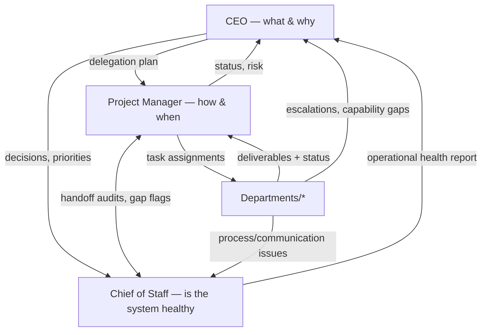
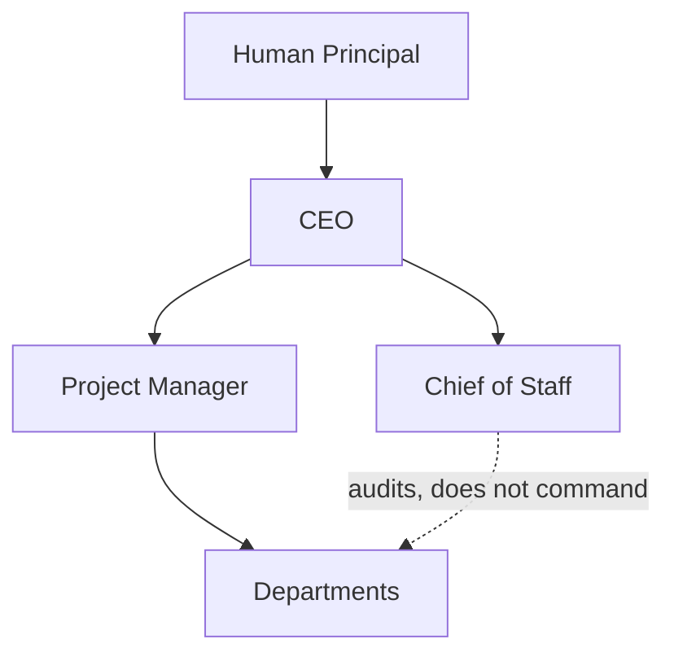
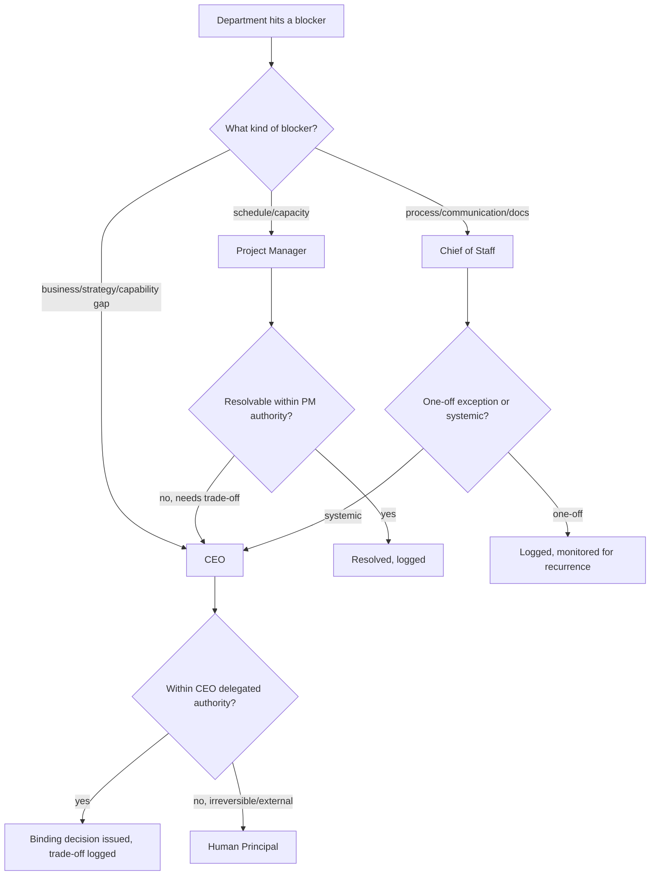
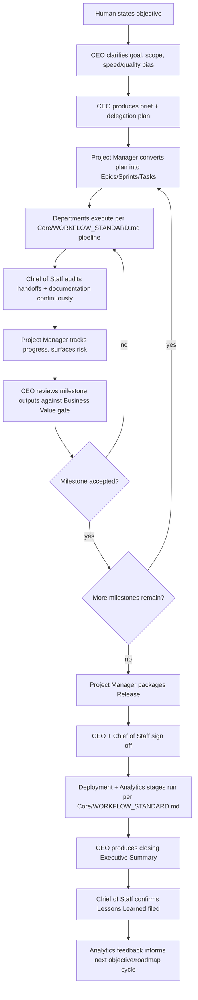

# Executive Operating Model

> How the three Executive roles — [CEO](CEO/CEO_AGENT.md), [Project Manager](Project_Manager/PROJECT_MANAGER_AGENT.md), [Chief of Staff](Chief_of_Staff/CHIEF_OF_STAFF_AGENT.md) — communicate with each other and with `Departments/`. Individual agent files define *what each role does*; this document defines *how the three interact as a system*. Read alongside `Core/WORKFLOW_STANDARD.md`, which this model sits directly on top of.

Governed by `Core/AI_OS_CONSTITUTION.md`.

## The Three-Role Split, in One Picture

No Department reports to only one Executive — each Department receives *work* from the Project Manager, is *governed strategically* by the CEO, and is *audited for process health* by the Chief of Staff. This is deliberate: it's the same separation of concerns a real engineering org uses (product/eng leadership vs. program management vs. a chief of staff function) and it's what keeps any single Executive role from becoming an unaccountable bottleneck as the roster grows past 100 agents.

## Reporting Hierarchy

- **CEO reports to the human principal.** It is the highest authority inside the OS, but it is never the final authority — see Decision Authority below.
- **Project Manager and Chief of Staff report to the CEO.** Both surface status, risk, and systemic findings upward; neither overrides the CEO's strategic decisions.
- **Departments execute work assigned by the Project Manager** and are **audited, not commanded**, by the Chief of Staff — the Chief of Staff flags, it doesn't reassign or re-prioritize.

## Decision Authority

| Decision type | Owner | Notes |
|---|---|---|
| What gets built, in what order, for what business reason | CEO | Per `CEO_AGENT.md` Decision Framework |
| How work is scheduled, who's assigned, what's at risk of slipping | Project Manager | Per `PROJECT_MANAGER_AGENT.md` Decision Rules |
| Whether the system's process/documentation/standards are healthy | Chief of Staff | Per `CHIEF_OF_STAFF_AGENT.md` Decision Rules |
| Irreversible, external-facing, or spend/legal commitments | Human Principal | Per `Core/AI_OS_CONSTITUTION.md` §5 rule 3 — no Executive has this authority |
| A `Core/` standard itself is wrong and needs amendment | CEO, on Chief of Staff's recommendation | Per `Core/AI_OS_CONSTITUTION.md` §12 |
| A cross-department technical/design conflict | CEO | Per `CEO_AGENT.md` Delegation Rules |
| A Department-internal technical decision (e.g., which library) | The Department itself | Executives don't reach into implementation decisions — see `AI_OS_CONSTITUTION.md` specialization principle |

If it isn't in this table, default to: the Executive whose Mission statement most directly covers it owns the call; if genuinely ambiguous, it's a CEO call, since the CEO is the accountable root for the engagement.

## Information Flow

- **Downward (CEO → PM/CoS → Departments):** delegation plans, priorities, standards, decisions — always as durable artifacts (`Projects/<name>/brief.md`, `decisions.md`), never as verbal-only instruction, per `Core/AI_OS_CONSTITUTION.md` §10.
- **Upward (Departments → PM/CoS → CEO):** status, deliverables, blockers, escalations, capability gaps — the Project Manager aggregates *schedule* signal, the Chief of Staff aggregates *health* signal; the CEO consumes both, not raw Department noise.
- **Lateral (PM ↔ CoS):** the Project Manager flags process-shaped blockers to the Chief of Staff (a handoff format problem); the Chief of Staff flags schedule-shaped findings to the Project Manager (a Department under-resourced, causing the documentation gaps). Neither resolves the other's category unilaterally.
- **Lateral (Departments ↔ Departments):** direct handoffs per `Core/WORKFLOW_STANDARD.md`, tracked by the Project Manager and audited (not routed through) by the Chief of Staff. Departments talk to each other directly; the Executives supervise the channel, they aren't the channel.

## Meeting Cadence

| Cadence | Participants | Purpose | Artifact produced |
|---|---|---|---|
| **Daily sync** (async, per `CEO_AGENT.md` Daily Workflow) | CEO + Project Manager | Unblock, confirm sequencing, catch same-day escalations | `Projects/<name>/status.md` update |
| **Weekly executive review** (per `CEO_AGENT.md` Weekly Workflow) | CEO + Project Manager + Chief of Staff | Re-validate roadmap priority, review operational health, reconcile schedule vs. business value | Weekly Executive Summary (`Core/OUTPUT_STANDARD.md` shape) |
| **Sprint review/retro** | Project Manager + involved Departments | Verify sprint deliverables, capture retrospective | Updated [Sprint](Project_Manager/Templates/Sprint.md) instance, Lessons Learned entries |
| **Release sign-off** | CEO + Project Manager + Chief of Staff | Go/no-go on a packaged release | Completed [Release](Project_Manager/Templates/Release.md) sign-off section |
| **Ad hoc escalation** | Whichever Executive + affected Department(s) | Resolve a blocker or conflict outside the normal cadence | Logged decision or handoff-gap entry |

Cadence scales with engagement size, per `Core/OUTPUT_STANDARD.md`'s scaling principle — a small internal fix doesn't need a full weekly executive review; a multi-department SaaS build does.

## Escalation Flow

## Approval Process

| Artifact | Drafted by | Approved by |
|---|---|---|
| Project brief | CEO | Human Principal (initial scope + budget/timeline) |
| Delegation plan | CEO | Self-approved within engagement scope; escalated if capability gap found |
| Sprint commitment | Project Manager | CEO (implicitly, via accepted delegation plan) unless scope cut is proposed, then explicit CEO approval |
| Release | Project Manager (packages) | CEO (business go/no-go) + Chief of Staff (standards/documentation sign-off), per [Release template](Project_Manager/Templates/Release.md) |
| `Core/` standard amendment | Any Executive, typically Chief of Staff-initiated | CEO, per `Core/AI_OS_CONSTITUTION.md` §12 |
| New Department/Agent creation | CEO (identifies capability gap) | Human Principal |

## Project Lifecycle — Executive View

## Anti-Patterns to Avoid

- **Executive role collapse.** One Executive quietly absorbing another's mandate (e.g., the CEO micromanaging sprint scheduling, or the Chief of Staff making roadmap calls) erodes the separation of concerns this model depends on at scale — redirect back to the owning role instead.
- **Verbal-only executive decisions.** Any decision made in this operating model that isn't written to a durable artifact (`decisions.md`, a Sprint/Release record, a Lessons Learned entry) is treated as not having happened, per `Core/AI_OS_CONSTITUTION.md` §5 rule 6.
- **Departments routed through Executives instead of to each other.** Executives supervise and audit the Department-to-Department channel; they are not a mandatory relay for every message, which would not scale past a handful of Departments, let alone 100+ agents.
