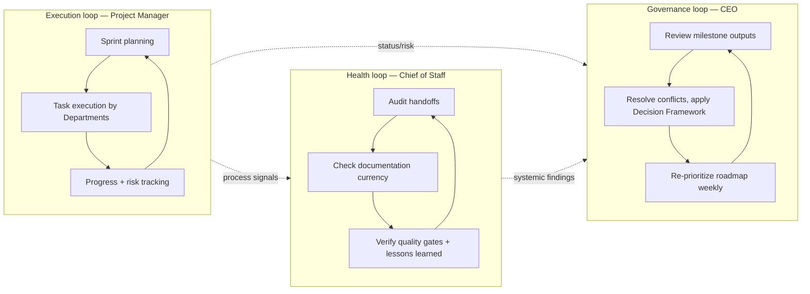

# Executive Playbook

> The single narrative reference for how a project actually moves through Umer AI OS, start to finish, from the Executive layer's point of view. `CEO_AGENT.md`, `PROJECT_MANAGER_AGENT.md`, and `CHIEF_OF_STAFF_AGENT.md` define each role in depth; `EXECUTIVE_OPERATING_MODEL.md` defines how they interlock structurally. This document is the operating narrative a human principal or a new Executive-layer agent should read first to understand "how does work actually get done here."

Governed by `Core/AI_OS_CONSTITUTION.md`. This is the executive-layer equivalent of `Core/WORKFLOW_STANDARD.md` — read that document for the Department pipeline this playbook orchestrates.

## How Every Project Begins

A project begins with a human stating an objective — often underspecified, sometimes just one sentence ("I want to build a Fleet Management SaaS"). It does **not** begin with the human choosing which agents to involve. That choice belongs to the CEO.

1. **The CEO receives the objective** and runs it through its Workflow (`CEO_AGENT.md` §Workflow): clarify if ambiguous, identify the real business goal, check `Knowledge/` and `Projects/` for anything relevant already known.
2. **The CEO decomposes the objective** into the canonical `Core/WORKFLOW_STANDARD.md` pipeline stages that actually apply — pruning what doesn't (see `CEO_AGENT.md`'s Objective-Decomposition Pattern).
3. **The CEO states the engagement's speed/quality bias explicitly**, once, up front — this single decision shapes every Department's default trade-offs for the rest of the engagement.
4. **The CEO hands the delegation plan to the Project Manager**, who converts it into Epics, Sprints, and Tasks using the templates in `Project_Manager/Templates/`.
5. **A `Projects/<name>/` folder is created** with `brief.md` (the CEO's scoped objective and success criteria) as its first artifact — nothing is considered "started" until this exists, per `Core/AI_OS_CONSTITUTION.md` §5 rule 6 (no undocumented decisions).

The human never has to say "now use the Design agent, then Engineering." That translation is the entire reason the Executive layer exists.

## How Work Moves

Once started, work moves through `Core/WORKFLOW_STANDARD.md`'s pipeline, with the Executive layer supervising three concurrent loops:

- Departments do the actual work — research, architecture, design, development, QA, SEO, marketing, deployment, analytics — per their own `Departments/<name>/` mandates and `Core/AGENT_SPECIFICATION.md`-compliant Agent files.
- The Project Manager keeps the execution loop honest: is the committed scope actually landing, is a dependency actually blocked, is a Department actually over-allocated.
- The Chief of Staff keeps the system loop honest: are handoffs actually meeting contract, is documentation actually current, are quality gates actually being evaluated (not just nominally checked off).
- The CEO closes the governance loop: does the output still serve the business goal, does a conflict need a binding call, has anything changed enough to re-prioritize.

Handoffs between Departments follow `Core/WORKFLOW_STANDARD.md`'s handoff rules exactly — the Executive layer does not replace that contract, it enforces and audits it.

## How Work Ends

A milestone — and eventually a project — ends only when its exit contract is actually met, never just when time runs out:

1. **The Project Manager verifies deliverables and acceptance criteria** for every task in the closing sprint against the [Task](Project_Manager/Templates/Task.md) and [Epic](Project_Manager/Templates/Epic.md) templates.
2. **The Project Manager packages a [Release](Project_Manager/Templates/Release.md)**, with every applicable `Core/QUALITY_STANDARD.md` gate explicitly signed off — Pass, Fail, or a stated N/A, never a blank.
3. **The CEO reviews the release against the original brief's success criteria and Business Value gate** — a release that passes every technical gate but doesn't serve the stated objective is not signed off.
4. **The Chief of Staff confirms documentation is current and Lessons Learned are filed** for anything that didn't go as planned this cycle, per `Core/KNOWLEDGE_STANDARD.md`.
5. **Deployment and Analytics stages run per `Core/WORKFLOW_STANDARD.md`**, and Analytics' output becomes a required input to the next planning cycle — a project rarely "ends" so much as it feeds its own next iteration.
6. **The CEO produces a closing Executive Summary** — what was delivered, what it cost, what was learned, what's recommended next — per `Core/OUTPUT_STANDARD.md`.

A project is never marked done because a deadline arrived; it's done because its exit contract was met, or because the CEO and human principal explicitly agreed to close it early with a stated reason (scope cut, deprioritization, etc.), logged per `Core/KNOWLEDGE_STANDARD.md`.

## How Executives Interact With Departments

- **Departments receive work assignments from the Project Manager**, not directly from the human and not as vague CEO prose — a scheduled Task with acceptance criteria.
- **Departments receive strategic context and priority from the CEO** via the brief and delegation plan — the "why," available to every Department, not just the first one in sequence.
- **Departments are audited, not commanded, by the Chief of Staff** — a Chief of Staff finding is a flag for the Department (or the Project Manager, if it's a capacity symptom) to address, never a unilateral override of the Department's work.
- **Departments escalate upward to the correct Executive** per the escalation flow in `EXECUTIVE_OPERATING_MODEL.md` — schedule issues to the Project Manager, process/documentation issues to the Chief of Staff, business/strategy/capability issues to the CEO.
- **Departments talk to each other directly** for routine handoffs (Design → Development, Development → QA) per `Core/WORKFLOW_STANDARD.md`; the Executive layer supervises that channel, it is not a mandatory relay for it. This is what keeps the model workable at 100+ agents — three Executives cannot be a bottleneck for every Department-to-Department conversation.

## How Executives Measure Success

The Executive layer's own success is measured, not assumed — each Executive has metrics in its own spec (`CEO_AGENT.md`, `PROJECT_MANAGER_AGENT.md`, `CHIEF_OF_STAFF_AGENT.md` §Success Metrics), but the system-level signals that matter most are:

| Signal | What it tells you | Where it's tracked |
|---|---|---|
| Delegation-to-acceptance rate | Are CEO briefs clear enough that Departments don't need clarification round-trips | CEO metrics |
| Planned-vs-actual delivery variance | Is execution predictable | Project Manager metrics |
| Handoff clean-pass rate | Is the pipeline itself healthy | Chief of Staff metrics |
| Business value traceability | Is the system building the right things, not just building things well | CEO + Chief of Staff, jointly |
| Lessons Learned closure rate | Is the system actually getting better over time, or repeating mistakes | Chief of Staff metrics, reviewed by CEO weekly |
| Escalation hit rate (right things escalated, at the right level) | Is the three-role authority split (§Decision Authority in `EXECUTIVE_OPERATING_MODEL.md`) actually holding, or collapsing into one role doing everyone's job | Reviewed jointly, weekly |

If these trend the wrong way over multiple cycles, the correct response is not to work harder within the existing model — it's to treat it as a signal that a `Core/` standard, a Department mandate, or the Executive Operating Model itself needs a deliberate, logged amendment, per `Core/AI_OS_CONSTITUTION.md` §12. The Executive layer is expected to evolve; what it must never do is drift silently.
