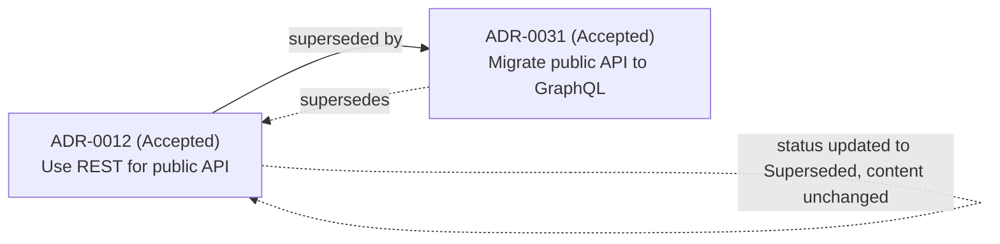

# Architecture Decision Records (ADR) Standard

> The format for recording technical/architectural decisions — as distinct from business/organizational decisions, which use `Governance/DECISION_LOG_STANDARD.md`. ADRs are authored primarily by Engineering and Architecture-facing Agents (the Architecture stage of `Core/WORKFLOW_STANDARD.md`) but the standard is uniform across every Department that makes a durable technical choice — Design systems, Data/Analytics pipelines, SEO technical infrastructure, and so on.

Governed by `Core/AI_OS_CONSTITUTION.md` §7 (Engineering Philosophy) and `Core/AGENT_SPECIFICATION.md`. Cross-reference `Governance/DECISION_LOG_STANDARD.md` when a decision is both business- and technically-consequential — log the business call there, the technical rationale here, and link both directions.

## Why ADRs, Specifically

An ADR is not a design doc and not a comment in code. It exists so that, years later — long after the model, the engineer, or the agent that made the call is gone — someone can answer "why is it built this way" without archaeology. At 100+ Departments and 500+ Agents, the number of technical decisions made per week will vastly exceed what any single reviewer can hold in memory; the ADR is the only thing standing between that and an unmaintainable, unexplainable codebase.

## ADR Format

Stored at `Knowledge/Architecture/ADR/ADR-####-<slug>.md` (org-wide/shared architecture) or `Projects/<name>/adr/ADR-####-<slug>.md` (project-scoped). Numbering is sequential and never reused, per `Governance/DECISION_LOG_STANDARD.md`'s numbering rule, applied identically here.

```markdown
# ADR-#### — <title: a decision stated as a noun phrase, e.g. "Use Postgres row-level security for multi-tenant isolation">

## Status
Proposed | Accepted | Superseded | Deprecated

## Date
YYYY-MM-DD

## Deciders
<Agent(s)/Department(s) accountable, per Governance/ORGANIZATIONAL_CHART.md RACI for department-internal technical decisions>

## Context
The technical problem or constraint that forced a decision. State the forces at play: scale expectations, existing system constraints, team/agent capability, deadline pressure, security/compliance requirements. Enough detail that a reader unfamiliar with the current system state can understand why this wasn't obvious.

## Decision
The actual technical choice, stated plainly. Include the specific technology, pattern, or approach — not just the problem it solves.

## Technical Rationale
Why this option satisfies the forces in Context better than the alternatives — reasoned through Core/DECISION_FRAMEWORK.md's priority order (Safety & Security → Correctness → Maintainability → Business Value → Velocity → Polish) where relevant.

## Alternatives Considered
| Option | Why not chosen |
|---|---|
| <option A> | |
| <option B> | |

## Consequences
### Positive
- <what this makes easier/possible>

### Negative / Accepted Trade-offs
- <what this makes harder, what debt it may introduce — logged per Core/DECISION_FRAMEWORK.md's "minimize technical debt" principle>

### Neutral
- <side effects that are neither clearly good nor bad but worth knowing>

## Revisit Triggers
Concrete conditions under which this ADR should be re-evaluated (e.g., "revisit if tenant count exceeds 10,000," "revisit if this dependency is deprecated upstream"). An ADR without a revisit trigger is assumed permanent until explicitly superseded.

## Related
- Supersedes: <ADR-#### or "none">
- Superseded by: <ADR-#### or "n/a">
- Related Decision Log entries: <Governance/Decisions/DEC-### links, if business-linked>
- Related Knowledge: <Knowledge/ file links>
```

## Versioning

ADRs are **immutable once Accepted** — an ADR's content is never edited to reflect a changed decision. Instead:

- A clarification or typo fix is a patch-level edit to the same file (no status change), tracked via normal version control history.
- A changed decision produces a **new** ADR with an incremented number, which marks the old one `Superseded` and links back (`supersedes:` field).
- This mirrors `Core/KNOWLEDGE_STANDARD.md`'s versioning philosophy: update in place for corrections, fork forward for actual changes — but ADRs go one step further than general knowledge because immutability of the *historical record* is the entire point of an ADR.

## Superseding Decisions



- The new ADR's Context section explicitly states what changed since the superseded ADR (new scale, new requirement, new evidence) — an ADR that supersedes another without explaining why the original reasoning no longer holds is incomplete.
- The superseded ADR is never deleted — a Department or Agent auditing why a legacy piece of the system looks the way it does needs the full chain, per `Core/AI_OS_CONSTITUTION.md` §10 (Documentation Philosophy: "if it isn't written down, it isn't real" applies as much to *why we changed* as to *why we chose*).
- **Deprecated** (vs. Superseded) is used when a decision is retired with no replacement decision yet — e.g., a feature is being sunset outright rather than rebuilt differently.

## Technical Rationale — Standard of Rigor

The Technical Rationale section must reference at least one concrete force from Context and connect it to `Core/DECISION_FRAMEWORK.md`'s priority order explicitly when trade-offs exist. "We chose X because it's better" is not rationale; "We chose X because our Security gate requires row-level tenant isolation, and X is the only option of the three considered that provides it without a custom enforcement layer we'd have to build and maintain (Maintainability cost)" is.

## Examples

### Example 1 — Straightforward Accepted ADR

```markdown
# ADR-0007 — Use Redis for session storage instead of database-backed sessions

## Status
Accepted

## Date
2026-06-14

## Deciders
Engineering (Backend)

## Context
Current database-backed sessions are adding measurable read load to the primary Postgres instance under concurrent user growth (Analytics flagged rising p95 query latency on the sessions table). Need a session store that scales reads independently of the primary database without a large architecture change given MVP timeline constraints.

## Decision
Move session storage to Redis, keyed by session token, with a 24-hour TTL matching the existing session expiry policy.

## Technical Rationale
Per Core/DECISION_FRAMEWORK.md: Correctness is preserved (same expiry semantics), Maintainability is neutral-to-positive (Redis session stores are a well-documented pattern, not a novel build), and this directly serves Business Value by removing the current performance bottleneck without the Velocity cost of a larger architectural change like read replicas.

## Alternatives Considered
| Option | Why not chosen |
|---|---|
| Postgres read replica for session reads | Solves the symptom but not the root inefficiency; adds infra cost and replication lag risk for a problem Redis solves more directly |
| In-memory session store (single instance) | Fails Correctness under horizontal scaling — sessions would not be shared across instances |

## Consequences
### Positive
- Removes session read load from primary Postgres entirely
- TTL-based expiry is native to Redis, reducing custom cleanup logic

### Negative / Accepted Trade-offs
- Adds a new infrastructure dependency (Redis) with its own availability requirements — logged as operational debt: needs a documented failover plan before this scales past current single-instance Redis

### Neutral
- Session data is no longer queryable via SQL for ad hoc admin lookups; an internal tool will need a small Redis-aware replacement if that capability is still needed

## Revisit Triggers
Revisit if Redis instance becomes a single point of failure at current traffic (no HA configured yet) — target before this scales past 3x current concurrent users.

## Related
- Supersedes: none
- Superseded by: n/a
- Related Decision Log entries: none
- Related Knowledge: Knowledge/Database/session-storage-patterns.md
```

### Example 2 — Superseding ADR

```markdown
# ADR-0031 — Migrate public API from REST to GraphQL for the partner integration surface

## Status
Accepted

## Date
2026-07-10

## Deciders
Engineering, in consultation with Product (partner integration roadmap)

## Context
ADR-0012 chose REST for the public API when there was a single consumer type (our own frontend). We now have three partner integrators each needing different subsets of nested resource data, causing REST endpoint proliferation (14 new endpoints in the last quarter alone, several near-duplicates varying only in included fields) — a Maintainability cost ADR-0012 did not anticipate.

## Decision
Introduce a GraphQL layer for the partner integration surface specifically; existing REST endpoints for the first-party frontend remain unchanged (no big-bang migration).

## Technical Rationale
Per Core/DECISION_FRAMEWORK.md, Maintainability is the dominant driver: GraphQL's field-selection model directly removes the endpoint-proliferation problem. Correctness and Security are preserved via the same auth layer, wrapped rather than replaced. Business Value is direct — partner integration velocity was Product's stated current-quarter priority.

## Alternatives Considered
| Option | Why not chosen |
|---|---|
| Continue adding bespoke REST endpoints per partner need | Directly repeats the Maintainability problem this ADR exists to fix |
| Full REST-to-GraphQL migration including first-party frontend | Unnecessary scope expansion (Core/AI_OS_CONSTITUTION.md YAGNI) — first-party frontend has no endpoint-proliferation problem today |

## Consequences
### Positive
- Partner-specific data shape needs are resolved without new endpoints per partner
### Negative / Accepted Trade-offs
- Two API paradigms now coexist (REST + GraphQL) — accepted complexity, scoped narrowly and logged as a documented exception, not a default going forward
### Neutral
- Requires GraphQL query-cost monitoring to prevent partner-side over-fetching abuse — added as a Security/Performance follow-up task

## Revisit Triggers
Revisit if a fourth distinct consumer type emerges with yet another data-shape need — evaluate whether GraphQL should become the sole public API paradigm at that point.

## Related
- Supersedes: none (ADR-0012 remains valid for its original scope — first-party frontend)
- Superseded by: n/a
- Related Decision Log entries: Governance/Decisions/DEC-014-partner-integration-priority.md
- Related Knowledge: Knowledge/API/graphql-partner-layer.md
```

Note ADR-0031 does **not** mark ADR-0012 Superseded — ADR-0012's original scope (first-party REST API) is untouched. Superseding is only marked when the new ADR genuinely replaces the old decision's actual scope, not merely touches an adjacent area — mislabeling this relationship is itself an ADR-authoring error to catch in review.

## Anti-Patterns

- **ADR as design doc.** An ADR records the decision and its rationale, not an exhaustive implementation spec — implementation detail belongs in code/Knowledge, not the ADR.
- **Editing an Accepted ADR's Decision section to reflect a later change.** Fork a new ADR instead (see Versioning).
- **Marking Superseded without stating what changed.** The new ADR's Context must explain why the old reasoning no longer holds.
- **Skipping Alternatives Considered.** Same rigor standard as `Governance/DECISION_LOG_STANDARD.md` — at least real alternatives, not a straw man.

## Metadata

```yaml
version: 1.0.0
status: active
last_reviewed: 2026-07-22
owner: Engineering (format stewardship), Chief of Staff (compliance audit)
```
