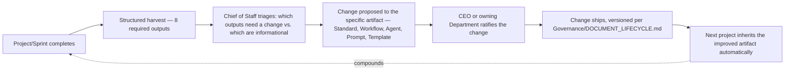

# Continuous Improvement System

> A Kaizen-style closed loop: every completed project is required to produce specific, structured outputs that make the *next* project measurably better — not just a retrospective conversation that evaporates. This is the mechanism that makes `Core/AI_OS_CONSTITUTION.md` §4's claim ("knowledge compounds") actually true rather than aspirational.

Governed by `Core/AI_OS_CONSTITUTION.md` §4 and §9, `Core/KNOWLEDGE_STANDARD.md`'s Lessons Learned format, `Governance/MEETING_OPERATING_SYSTEM.md`'s Sprint Retrospective and QBR cadences.

## The Core Loop



The loop only compounds if step D→E→F actually happens — a harvested lesson that stops at step B (written down, discussed, never acted on) is exactly the "anecdote, not a lesson" failure mode `Core/KNOWLEDGE_STANDARD.md` already warns against. This document exists to make the harvest **mandatory and structured**, and the follow-through **tracked**, so that failure mode is visible and correctable rather than invisible.

## The 8 Required Outputs

Every completed project (and, at a lighter weight, every closed Sprint per `Governance/MEETING_OPERATING_SYSTEM.md`) produces these eight outputs before it is considered fully closed. A project marked "done" without them is incomplete, per `Core/AI_OS_CONSTITUTION.md` §5 rule 6.

| Output | What it captures | Lands in |
|---|---|---|
| 1. Lessons Learned | What happened, root cause, resulting change, per `Core/KNOWLEDGE_STANDARD.md` format | `Memory/Lessons Learned.md` or Department equivalent |
| 2. Successes | What worked better than expected and why — worth deliberately repeating, not just avoiding failure | `Projects/<name>/retrospective.md` §Successes |
| 3. Failures | What went wrong, distinct from a Lesson Learned in that not every failure needs a systemic fix — some are simply logged so the pattern is visible over time | `Projects/<name>/retrospective.md` §Failures |
| 4. New Standards | Any `Standards/` or `Core/` gap this project exposed, proposed as a concrete addition | Draft in the relevant `Standards/` folder, or a `Core/`/`Governance/` amendment proposal |
| 5. Knowledge Updates | Corrections or additions to existing `Knowledge/` entries this project's work surfaced | Updated `Knowledge/` entries, per `Governance/KNOWLEDGE_GOVERNANCE.md` |
| 6. Workflow Improvements | Any `Core/WORKFLOW_STANDARD.md` stage sequencing or handoff rule that didn't fit this project's reality | Proposed edit to the relevant `Workflows/` file or `Core/WORKFLOW_STANDARD.md` |
| 7. Agent Improvements | Gaps in a specific Agent's `Core/AGENT_SPECIFICATION.md` instance — missing Constraint, unclear Escalation Rule, an Example that no longer reflects real behavior | Proposed edit to the Agent's spec file |
| 8. Prompt & Template Improvements | Where a `Templates/` file, Checklist, or Agent's underlying operational prompt caused friction or was reused successfully enough to generalize | Proposed edit to `Templates/`, `Checklists/`, or the Agent's spec |

## Harvest Template

Stored at `Projects/<name>/retrospective.md`, produced at project close (full version) or `Executive/Project_Manager/Templates/Sprint.md`'s Retrospective section (lightweight version, per-sprint).

```markdown
# Retrospective: <Project/Sprint name>

## Lessons Learned
(One or more entries in Core/KNOWLEDGE_STANDARD.md format — link to Memory/Lessons Learned.md entries filed)

## Successes
- <what worked, why, and whether it's a pattern worth generalizing beyond this project>

## Failures
- <what didn't work — root cause if known; if it doesn't warrant a systemic fix, say why>

## New Standards Proposed
- <gap identified> → <proposed addition, with a draft link if written>

## Knowledge Updates Made
- <Knowledge/ file> → <what changed and why>

## Workflow Improvements Proposed
- <Core/WORKFLOW_STANDARD.md or Workflows/ file> → <what should change>

## Agent Improvements Proposed
- <Agent spec file> → <what section, what change>

## Template/Prompt Improvements Proposed
- <Templates/ or Checklists/ file> → <what change>

## Follow-Through Tracking
| Proposed change | Owner | Status | Ratified date |
|---|---|---|---|
| | | Proposed / In Review / Ratified / Rejected (with reason) | |
```

The **Follow-Through Tracking** table is the anti-anecdote mechanism — it is checked at the next Quarterly Business Review (`Governance/MEETING_OPERATING_SYSTEM.md`) and any row still "Proposed" after one full quarter is either escalated for a ratification decision or explicitly rejected with a stated reason, never left to quietly expire.

## Triage: What Actually Becomes a Change

Not every harvested item warrants a systemic change — over-reacting to a single data point is its own failure mode (`Core/AI_OS_CONSTITUTION.md`'s "avoid unnecessary complexity" applied to process, not just code). The Chief of Staff triages using this rule, consistent with `Executive/Chief_of_Staff/CHIEF_OF_STAFF_AGENT.md`'s Decision Rules:

- **First occurrence** of a friction point → logged, monitored, not yet acted on unless the impact was severe (aligns with `Governance/RISK_MANAGEMENT_FRAMEWORK.md`'s scoring logic — a one-off Low-impact issue doesn't need a standard change).
- **Second occurrence** of the same friction point → treated as a signal the underlying Standard/Workflow/Agent spec needs revisiting, proposed as a change.
- **Any single occurrence with High/Critical impact** (per risk scoring) → proposed as a change immediately, no need to wait for recurrence.

## Ratification

| Change type | Ratified by |
|---|---|
| Knowledge update, Template/Checklist tweak | Owning Department |
| Agent spec improvement | Owning Department, reviewed by Chief of Staff for cross-Agent consistency |
| Workflow improvement (project-specific `Workflows/` file) | Chief of Staff + Project Manager |
| `Core/WORKFLOW_STANDARD.md` or other `Core/` change | CEO, per `Core/AI_OS_CONSTITUTION.md` §12 |
| New `Standards/` entry | Owning Department + Chief of Staff |
| `Governance/` change | CEO, ratified at QBR or Annual Review per `Governance/MEETING_OPERATING_SYSTEM.md` |

## Cadence

- **Per Sprint:** lightweight retrospective (Successes/Failures/one concrete change), per `Governance/MEETING_OPERATING_SYSTEM.md` Sprint Review.
- **Per Project close:** full 8-output harvest, mandatory before a project is marked Done in `Executive/Project_Manager/Templates/Release.md`.
- **Quarterly:** Chief of Staff reports the aggregate Follow-Through Tracking status across all projects closed that quarter, at the QBR — this is where "did continuous improvement actually happen, or just get discussed" is measured.

## Success Metrics for This System Itself

- **Harvest completion rate:** percentage of closed projects/sprints with all 8 outputs actually filed (not just Lessons Learned, the other 7 too).
- **Follow-through rate:** percentage of proposed changes that reach Ratified (or an explicit Rejected-with-reason) within one quarter of being proposed.
- **Recurrence rate:** percentage of "second occurrence" triage triggers — a high rate means first-occurrence items aren't being watched closely enough between sprints; trending down over time is the system working.
- **Compounding evidence:** whether the same category of Lesson Learned shows up less often project over project (the actual point of the whole system) — tracked qualitatively at Annual Review alongside the quantitative metrics above.

## Anti-Patterns

- **Retrospective theater.** A meeting that produces discussion but no filled Harvest Template — not compliant; per `Governance/MEETING_OPERATING_SYSTEM.md`'s meeting discipline rule, every standing session produces a written artifact.
- **Change without ratification.** An Agent or Department unilaterally editing a `Core/`, `Governance/`, or another Department's spec because a project surfaced a gap — routed through the correct ratification path in the table above instead.
- **Improvement backlog rot.** Proposed changes accumulating in "Proposed" status indefinitely — caught by the Follow-Through Tracking review at QBR, which forces a Ratified/Rejected resolution.
- **Overreacting to a single data point.** Turning every one-off friction into an immediate standard change — apply the Triage rule; systemic change is earned by recurrence or severity, not by anecdote.

## Metadata

```yaml
version: 1.0.0
status: active
last_reviewed: 2026-07-22
owner: Chief of Staff (system stewardship), CEO (ratification of Core/Governance-level changes)
```
