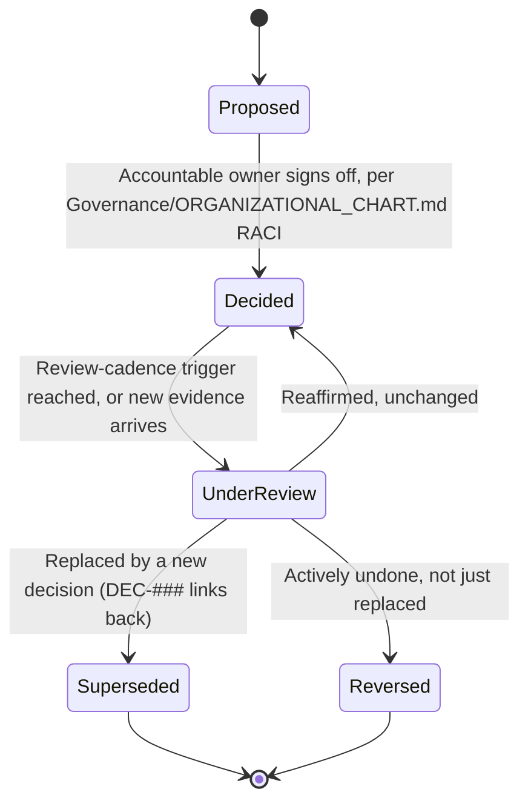

# Decision Log Standard

> How a major decision — business, product, or organizational, as distinct from a purely technical/architectural one — gets documented so it can be understood, audited, and safely revisited years later. Technical/architectural decisions use the sibling `Governance/ARCHITECTURE_DECISION_RECORDS_STANDARD.md` instead; if a decision is both (e.g., "we will not support self-hosting," which is business-driven but has deep technical consequence), log it here and cross-link the resulting ADR.

Governed by `Core/AI_OS_CONSTITUTION.md` §5 rule 6 (no undocumented decisions) and `Core/DECISION_FRAMEWORK.md` (the reasoning method this standard captures in writing).

## Why a Separate Log From the ADR Standard

An ADR answers "what did we build this way and why." A Decision Log entry answers "what did we decide to *do* (scope, priority, resourcing, risk acceptance, org structure) and why." Conflating them produces a document nobody trusts for either purpose — a business call gets buried in technical rationale, or a technical trade-off gets diluted by business narrative. Keep them separate; cross-link liberally.

## What Belongs in the Decision Log

- Roadmap prioritization calls (why milestone A shipped before B)
- Cross-department conflict resolutions (per `Executive/EXECUTIVE_OPERATING_MODEL.md` escalation flow)
- Scope cuts, deferrals, and "we chose not to build X"
- Risk acceptances (per `Governance/RISK_MANAGEMENT_FRAMEWORK.md`)
- Organizational changes (new Department, retired Agent, changed RACI)
- Vendor/partner/commercial commitments
- Standard or `Core/`/`Governance/` amendments

## Decision Template

Every entry lives at `Projects/<name>/decisions/DEC-###-<slug>.md` for project-scoped decisions, or `Governance/Decisions/DEC-###-<slug>.md` for organization-wide ones.

```markdown
# DEC-### — <short, decision-stated-as-a-verb title>

## Status
Proposed | Decided | Under Review | Superseded | Reversed

## Date
YYYY-MM-DD

## Decision Owner
<the accountable role per Governance/ORGANIZATIONAL_CHART.md RACI — usually CEO>

## Context
What situation forced this decision. Link to the triggering brief, escalation, or risk entry. State the business goal this decision serves, per Core/QUALITY_STANDARD.md's Business Value gate.

## Decision
The actual call, stated in one or two sentences, unambiguously. If a reader only reads this section, they should know exactly what was decided.

## Alternatives Considered
| Option | Summary | Why not chosen |
|---|---|---|
| <option A> | | |
| <option B> | | |
| Do nothing / defer | | |

## Trade-offs
Stated explicitly per Core/DECISION_FRAMEWORK.md — what this decision gains and what it costs, in the same breath. A decision with no stated cost is under-examined.

## Impact Analysis
| Dimension | Impact |
|---|---|
| Departments affected | |
| Timeline | |
| Cost/resourcing | |
| Risk profile (link Governance/RISK_MANAGEMENT_FRAMEWORK.md entries if any) | |
| Reversibility | Reversible / Hard to reverse / Irreversible |

## Review Cadence
When this decision will be revisited, and what would trigger an earlier review (e.g., "revisit at 10x current traffic," "revisit if Analytics shows conversion drop >5%").

## Related
- Related ADRs: <links>
- Related risk entries: <links>
- Supersedes: <DEC-### or "none">
- Superseded by: <DEC-### or "n/a">
```

## Alternatives Considered — Standard of Rigor

At minimum two real alternatives plus "do nothing / defer" must appear, per `Core/DECISION_FRAMEWORK.md` step 1 ("name the options, including do nothing and escalate as real options"). An Alternatives section containing only the chosen option and a straw-man is non-compliant and should be sent back for rework — it signals the decision wasn't actually examined, only rationalized after the fact.

## Trade-offs and Impact Analysis — Why Both Sections Exist

Trade-offs are the *qualitative* reasoning (what we gain vs. give up); Impact Analysis is the *structural* footprint (who/what is affected, how reversible it is). Keeping them distinct means a future reader auditing "was this decision reversible" doesn't have to parse prose to find the answer — it's a fixed-shape table every time.

## Decision Lifecycle



- **Proposed** entries are draft — visible for review, not yet binding on any Department.
- **Decided** is binding from its date forward; every affected Department's work should reflect it going forward, and any pre-existing work that contradicts it is flagged, not silently left inconsistent.
- **Superseded** vs. **Reversed** matters: superseded means a *new* decision replaced this one (the old reasoning may still be historically valid, just no longer current); reversed means this decision is now considered to have been wrong or no longer applicable, with no replacement decision necessarily in place yet.
- A decision is never silently deleted — per `Core/KNOWLEDGE_STANDARD.md`'s retirement rules, superseded/reversed entries stay in place with pointers, because past Projects that relied on them must remain auditable.

## Review Cadence

- **Project-scoped decisions** are reviewed at the next relevant `Executive/EXECUTIVE_OPERATING_MODEL.md` cadence point (sprint review for tactical, weekly executive review for anything roadmap-level).
- **Organization-wide decisions** (in `Governance/Decisions/`) are reviewed at the Quarterly Business Review at minimum, per `Governance/MEETING_OPERATING_SYSTEM.md`, and immediately if their stated review trigger fires early.
- A decision without a stated review trigger defaults to "review at next Quarterly Business Review" — decisions are never permanently unexamined by default.

## Numbering and Storage

- Project-scoped: `Projects/<name>/decisions/DEC-001-<slug>.md`, sequential per project.
- Organization-wide: `Governance/Decisions/DEC-001-<slug>.md`, sequential across the whole OS.
- Never reuse a number, even for a reversed/superseded decision — the ID is a permanent historical marker.

## Anti-Patterns

- **Decision-as-afterthought.** Writing the entry after the fact to justify a call already acted on, rather than before/at the point of decision — defeats the purpose of a log meant to support revisiting.
- **Alternatives theater.** Listing alternatives no one seriously considered just to fill the template section (see rigor standard above).
- **Silent supersession.** A new decision that contradicts an old one without linking back and marking the old one Superseded — leaves two "active-looking" decisions contradicting each other.
- **Missing review trigger.** A high-impact decision with no stated revisit condition, left to be forgotten until someone stumbles on the consequence.

## Metadata

```yaml
version: 1.0.0
status: active
last_reviewed: 2026-07-22
owner: Chief of Staff (standard maintenance), CEO (decision accountability)
```
