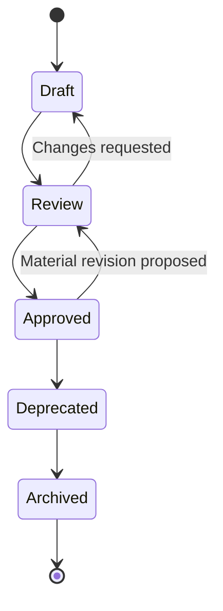

# Document Lifecycle

> The universal state machine, naming convention, and folder convention for **every** markdown document in Umer AI OS — `Core/`, `Executive/`, `Departments/`, `Governance/`, `Knowledge/`, `Standards/`, `Templates/`, `Checklists/`, `Workflows/`, `Projects/`. `Governance/KNOWLEDGE_GOVERNANCE.md` applies this specifically to `Knowledge/`/`Memory/` content; this document is the general form every document type derives from.

Governed by `Core/AI_OS_CONSTITUTION.md` §10 and `Core/KNOWLEDGE_STANDARD.md`.

## The Five States



| State | Meaning | Binding on the org? |
|---|---|---|
| Draft | Being written or actively revised; not yet trustworthy as a reference | No |
| Review | Complete enough to evaluate; under review per `Governance/KNOWLEDGE_GOVERNANCE.md` or `Core/AI_OS_CONSTITUTION.md` §12 depending on document type | No |
| Approved | Reviewed and signed off; the current source of truth | Yes |
| Deprecated | No longer current, but not yet removed from view; a `superseded_by` pointer is required | No — but historically informative |
| Archived | Retention window elapsed; moved out of active folders, kept for audit history | No |

Every document's front matter carries its current state explicitly (see §Metadata Block below) — a document with no stated status defaults to Draft and cannot be relied upon by any Agent as authoritative.

## Naming Conventions

- **Files:** `PascalCase` or `UPPER_SNAKE_CASE` matching the existing convention of its folder — `Core/` and `Governance/` use `UPPER_SNAKE_CASE.md` (e.g., `RISK_MANAGEMENT_FRAMEWORK.md`); `Departments/`, `Templates/`, `Checklists/` use `PascalCase.md` or descriptive title case matching existing files in that folder. New documents match the sibling files already in their folder — do not introduce a third convention into an existing folder.
- **Numbered records** (ADRs, Decision Log entries, Risk entries) use a zero-padded sequential ID plus a kebab-case slug: `ADR-0031-graphql-partner-layer.md`, `DEC-014-partner-integration-priority.md`, `RISK-007-single-tenant-redis-spof.md`.
- **No dates in filenames** for anything meant to be a living reference (dates belong in front-matter `last_reviewed`/`date` fields) — a filename with a date invites exactly the fork-by-date anti-pattern `Core/KNOWLEDGE_STANDARD.md` warns against. Dates in filenames are acceptable only for genuinely point-in-time artifacts (a dated research snapshot, e.g. `2026-competitor-scan.md`).
- **No version suffixes in filenames** (`-v2`, `-final`, `-final-FINAL`) — version history lives in the metadata block and, where applicable, git/version-control history, never in the name.

## Folder Conventions

| Folder | What lives here | Lifecycle notes |
|---|---|---|
| `Core/` | Foundational standards every Agent inherits | Amendments follow `Core/AI_OS_CONSTITUTION.md` §12; deprecated `Core/` docs are exceedingly rare and require CEO + human ratification |
| `Governance/` | Organization-wide operating rules (this folder) | Same rigor as `Core/` — amendments ratified at QBR or Annual Review per `Governance/MEETING_OPERATING_SYSTEM.md` |
| `Executive/` | Executive role specifications | Versioned per `Core/AGENT_SPECIFICATION.md` Metadata; superseded roles keep a pointer stub (see `Agents/CEO.md` for the pattern) |
| `Departments/`, `Agents/` | Department and Agent specs | Follow `Core/AGENT_SPECIFICATION.md` lifecycle exactly (Draft → Active → UnderRevision → Deprecated) |
| `Knowledge/`, `Memory/` | Reusable and operational knowledge | Follow `Governance/KNOWLEDGE_GOVERNANCE.md` |
| `Standards/` | Cross-department technical/process standards | Same review bar as `Knowledge/` cross-department entries |
| `Templates/`, `Checklists/` | Reusable structures | Changes are low-ceremony (Draft → Approved, rarely need a Deprecated stage) but still versioned |
| `Workflows/` | Named end-to-end process definitions | Approved via Chief of Staff + CEO sign-off; changes logged if they alter `Core/WORKFLOW_STANDARD.md` stage sequencing |
| `Projects/` | Project-scoped, time-bound artifacts | Archived wholesale when a project closes, per §Archival below — not held to the same "always current" bar as org-wide docs |
| `Governance/Decisions/`, `Knowledge/*/ADR/` | Numbered, immutable records | Never edited post-Approved except via supersession, per `Governance/DECISION_LOG_STANDARD.md` / `Governance/ARCHITECTURE_DECISION_RECORDS_STANDARD.md` |

## Metadata Block (Required in Every Document)

```yaml
version: 1.0.0
status: draft | review | approved | deprecated | archived
last_reviewed: YYYY-MM-DD
owner: <Department/Executive role accountable>
supersedes: <path, if applicable>
superseded_by: <path, if applicable — required once status is deprecated>
```

This is the same shape introduced in `Core/AGENT_SPECIFICATION.md` §16 and `Core/KNOWLEDGE_STANDARD.md`'s versioning section — this document makes it universal across every folder, not just Agent specs.

## Version History Rules

- **Patch (1.0.x):** wording, typo, formatting — no meaning change, no status change required.
- **Minor (1.x.0):** additive change (new section, expanded scope) that doesn't invalidate anything relying on the old version.
- **Major (x.0.0):** a change that alters what a downstream Agent/Workflow/Department must do differently — requires a stated migration note in the change and, for `Core/`/`Governance/` documents, the full amendment process (`Core/AI_OS_CONSTITUTION.md` §12).
- Every version bump updates `last_reviewed`, even if the content reviewed turned out not to need changing — a stale `last_reviewed` date is itself a `Governance/KNOWLEDGE_GOVERNANCE.md` quality finding.

## State Transition Rules

1. **Draft → Review:** author declares it complete enough to evaluate. No minimum time in Draft, but it must satisfy its folder's applicable quality bar (`Core/AGENT_SPECIFICATION.md` for agent specs, `Governance/KNOWLEDGE_GOVERNANCE.md` for knowledge, `Core/AI_OS_CONSTITUTION.md` §12 process for Core/Governance).
2. **Review → Approved:** the accountable owner (per `Governance/ORGANIZATIONAL_CHART.md` RACI) signs off explicitly — silence is never approval.
3. **Approved → Review:** any material revision (not a patch) re-enters review before becoming the new Approved version; the old Approved version remains authoritative until the new one clears review.
4. **Approved → Deprecated:** triggered by supersession, retirement, or a review cycle finding the content no longer applicable. `superseded_by` is set at this transition, never left blank.
5. **Deprecated → Archived:** after the retention window (default: 1 year for org-wide docs, immediately at project close for `Projects/` artifacts) or immediately if no active Project/Workflow references it.
6. **Nothing skips straight from Draft to Approved.** Even a small document passes through Review — this is what makes "Approved" a meaningful, trustworthy label rather than a default.

## Archival

- Archived documents move to a sibling `Archive/` folder within their parent (e.g., `Departments/Archive/`, `Knowledge/Architecture/ADR/Archive/`) rather than being deleted — per `Core/KNOWLEDGE_STANDARD.md`'s retirement rule, historical Projects/decisions that referenced them must remain auditable.
- An archived document's metadata block is never edited further — it is a frozen historical record from that point forward.
- Only documents created in error and never referenced by any real Project, Decision, or ADR may be deleted outright, per `Core/KNOWLEDGE_STANDARD.md`.

## Anti-Patterns

- **The perpetual Draft.** A document referenced by active work but never moved to Review/Approved — flagged at the next Chief of Staff documentation audit (`Governance/MEETING_OPERATING_SYSTEM.md` Monthly Business Review).
- **Silent Approved edits.** Editing an Approved document's substance without a version bump or re-review — treated as a process violation, not a shortcut.
- **Filename versioning.** `Standard-v2-final.md` instead of a proper version bump in metadata plus, if warranted, a supersession record.
- **Orphaned Deprecated entries.** A Deprecated document with no `superseded_by` pointer, leaving a reader unable to find the current source of truth.

## Metadata

```yaml
version: 1.0.0
status: active
last_reviewed: 2026-07-22
owner: Chief of Staff
```
