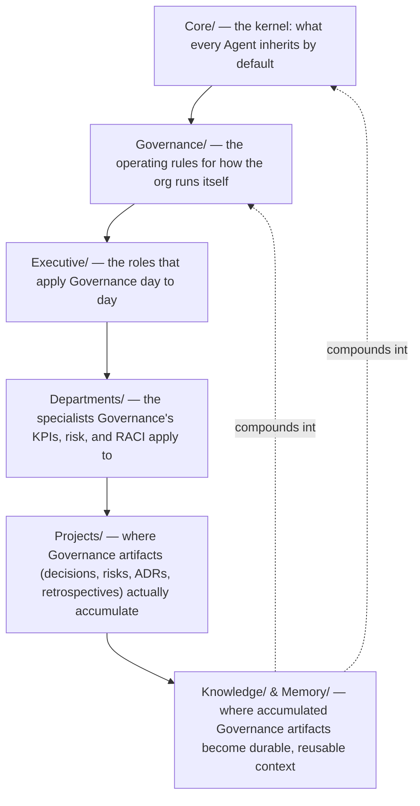

# Governance Playbook

> The narrative reference for how `Governance/` actually interlocks with the rest of Umer AI OS — Core, Executive, Departments, Projects, Knowledge, Memory, Automation, and every future Agent. Where `Executive/EXECUTIVE_PLAYBOOK.md` explains how a project moves through the organization, this document explains how the *rules governing that movement* get created, applied, checked, and evolved. Read this after the ten other `Governance/` documents — it assumes each of them and shows how they connect.

Governed by `Core/AI_OS_CONSTITUTION.md`.

## Where Governance Sits



`Core/` defines *what an Agent is and how it behaves* (the AGENT_SPECIFICATION, DECISION_FRAMEWORK, etc.). `Governance/` defines *how the organization as a whole is structured, measured, and improved* — the layer that makes 100+ Departments and 500+ Agents behave like one coherent company instead of independently-optimizing silos. Neither replaces the other: an Agent that's perfectly spec-compliant under `Core/` but ignores its Department's KPIs or RACI position under `Governance/` is still out of spec, and vice versa.

## Governance ↔ Core

- `Governance/` documents never contradict `Core/` — they extend it into organization-scale mechanics `Core/` deliberately leaves general. `Core/DECISION_FRAMEWORK.md` defines *how* to reason about a trade-off; `Governance/DECISION_LOG_STANDARD.md` defines *how that reasoning gets written down and reviewed at organizational scale*. `Core/QUALITY_STANDARD.md` defines the nine gates; `Governance/KPI_FRAMEWORK.md` defines how gate performance is tracked as a trend over time, department by department.
- Any amendment to `Governance/` is bound by `Core/AI_OS_CONSTITUTION.md` §12's amendment process — Governance is not a lower-ceremony layer where changes can be made casually; it carries the same weight as Core because it governs the same number of downstream dependents.
- If a `Governance/` document and a `Core/` document ever appear to conflict, `Core/` wins by default (it's the more foundational layer) and the conflict itself is treated as a Governance defect to fix at the next Quarterly Business Review, not silently resolved in the moment by whichever Agent noticed it.

## Governance ↔ Executive

- The three Executive roles are the primary **appliers** of Governance, not separate rule-makers: the CEO's Decision Framework applications are logged per `Governance/DECISION_LOG_STANDARD.md`; the Project Manager's risk tracking follows `Governance/RISK_MANAGEMENT_FRAMEWORK.md`; the Chief of Staff's process audits enforce `Governance/DOCUMENT_LIFECYCLE.md` and `Governance/KNOWLEDGE_GOVERNANCE.md`.
- `Executive/EXECUTIVE_OPERATING_MODEL.md`'s cadence (daily/weekly) and `Governance/MEETING_OPERATING_SYSTEM.md`'s full cadence (daily through annual) are the same system at different zoom levels — the Executive document is the tactical detail for the CEO/PM/CoS loop; the Governance document is the full organizational cadence including Monthly/Quarterly/Annual reviews the Executive layer participates in but doesn't own alone (the Human Principal joins at Quarterly+).
- `Governance/ORGANIZATIONAL_CHART.md`'s RACI matrix is the authoritative answer to any ambiguity `Executive/EXECUTIVE_OPERATING_MODEL.md`'s Decision Authority table doesn't fully resolve at Department-to-Department scale.

## Governance ↔ Departments

- Every Department, current and future, is bound by the same Governance layer uniformly — `Governance/KPI_FRAMEWORK.md`'s minimum requirement (2 leading + 2 lagging KPIs with counter-metrics) and `Governance/RISK_MANAGEMENT_FRAMEWORK.md`'s scoring model apply identically whether it's Engineering (Department #3) or a hypothetical Department #97.
- A Department does not get to opt out of a Governance requirement by virtue of being new, small, or specialized — it gets a lighter-weight *application* of the requirement (per `Core/OUTPUT_STANDARD.md`'s scaling principle, extended here to governance overhead), never an exemption from the requirement's existence.
- `Governance/ORGANIZATIONAL_CHART.md` §6 (Scaling Rule for Future Departments) is the intake gate: no Department gets its first Agent activated until it can answer the four placement questions there. This is deliberately the single narrowest choke point in the whole system — everything else is designed to scale without a bottleneck, but Department creation itself is a controlled, Governance-gated event, because getting the org chart wrong at creation is far more expensive to fix later than any other governance mistake in this system.

## Governance ↔ Projects

- Every `Projects/<name>/` folder is where Governance artifacts actually live day to day: `decisions/` (per `Governance/DECISION_LOG_STANDARD.md`), `adr/` (per `Governance/ARCHITECTURE_DECISION_RECORDS_STANDARD.md`), `risks.md` (per `Governance/RISK_MANAGEMENT_FRAMEWORK.md`), and `retrospective.md` (per `Governance/CONTINUOUS_IMPROVEMENT_SYSTEM.md`).
- A project is not considered closed under `Executive/Project_Manager/Templates/Release.md`'s sign-off until its Governance artifacts are complete — this is enforced at the Release sign-off step, not treated as optional paperwork.
- Project-scoped Governance artifacts feed organization-wide ones: a recurring risk across multiple projects' `risks.md` files is what triggers a `Governance/Risks/` organization-wide entry; a decision pattern repeated across projects is what triggers a `Governance/` standard proposal via `Governance/CONTINUOUS_IMPROVEMENT_SYSTEM.md`.

## Governance ↔ Knowledge & Memory

- `Governance/KNOWLEDGE_GOVERNANCE.md` is the process layer on top of `Core/KNOWLEDGE_STANDARD.md`'s content rules — Core says what knowledge is and how it's named/versioned; Governance says who approves it and how it's classified at scale.
- Every closed project's harvested outputs (`Governance/CONTINUOUS_IMPROVEMENT_SYSTEM.md`) are what actually populates `Knowledge/` and `Memory/Lessons Learned.md` over time — Governance is the mechanism, Knowledge/Memory is the accumulated result.
- `Governance/Decisions/` and `Knowledge/*/ADR/` are themselves a form of durable knowledge — numbered, immutable, and cross-linked exactly like any other `Knowledge/` entry, just with stricter immutability rules because their entire value is as an unaltered historical record.

## Governance ↔ Automation

- Any automated process in this OS (a scheduled report, an automatic KPI roll-up, an automated quality-gate check) is itself Governed: it has an owning Department, a documented purpose, and is subject to the same `Governance/RISK_MANAGEMENT_FRAMEWORK.md` AI-risk category as any Agent — specifically the over-automation risk (an automated process making a call that should have a human/Agent judgment checkpoint).
- Automation is never exempt from producing an auditable artifact — an automated KPI roll-up still needs to be traceable to its source data (`Governance/KPI_FRAMEWORK.md`'s "every KPI has a formula, a data source" rule applies whether a human or a script computed it).
- Automating a previously-manual Governance process (e.g., automatically flagging a stale `last_reviewed` date) is encouraged per `Governance/OPERATING_PRINCIPLES.md` #29 — but the automation's own correctness is itself subject to the same Testing and Maintainability gates as any other system component.

## Governance ↔ Future Agents

Every future Agent — the 6th Department's first Agent or the 500th Agent overall — inherits Governance the same way it inherits Core, automatically and without special-casing:

1. Its `Core/AGENT_SPECIFICATION.md` instance places it on `Governance/ORGANIZATIONAL_CHART.md` (which Department, which reporting lines).
2. Its Department's KPI set (`Governance/KPI_FRAMEWORK.md`) applies to its output.
3. Any risk it identifies or creates is logged per `Governance/RISK_MANAGEMENT_FRAMEWORK.md`.
4. Any significant decision it makes or is party to is logged per `Governance/DECISION_LOG_STANDARD.md` (business) or `Governance/ARCHITECTURE_DECISION_RECORDS_STANDARD.md` (technical).
5. Its documentation follows `Governance/DOCUMENT_LIFECYCLE.md`'s states and `Governance/KNOWLEDGE_GOVERNANCE.md`'s review process.
6. It is expected to internalize `Governance/OPERATING_PRINCIPLES.md` as judgment, not just a checklist to consult occasionally.
7. Its Department's completed work feeds `Governance/CONTINUOUS_IMPROVEMENT_SYSTEM.md`'s harvest cycle.

No future Agent spec needs to restate any of this — it is inherited by existing in this repository, the same way `Core/AI_OS_CONSTITUTION.md` §0 describes inheritance from Core. **This is what makes the system scale**: adding Agent #501 costs the same governance overhead as adding Agent #6, because the rules are structural, not re-negotiated per Agent.

## How Governance Itself Evolves

Governance is not static — it is expected to be found wrong in places as the organization scales, per `Core/AI_OS_CONSTITUTION.md` §4's Long-Term Philosophy. The evolution path is deliberately the same rigor as a `Core/` amendment, because a Governance mistake propagates to every Department exactly as widely as a Core mistake does:

1. A gap or friction is identified — via `Governance/CONTINUOUS_IMPROVEMENT_SYSTEM.md`'s harvest, a Chief of Staff audit finding, or direct Executive/human observation.
2. It's proposed as a change to the specific `Governance/` document, following that document's own internal amendment guidance and `Core/AI_OS_CONSTITUTION.md` §12.
3. It's ratified at the appropriate cadence (`Governance/MEETING_OPERATING_SYSTEM.md`) — most Governance changes at Quarterly Business Review; structural/RACI-level changes at Annual Strategic Review or immediately if urgent (a Critical-tier risk per `Governance/RISK_MANAGEMENT_FRAMEWORK.md` bypasses the calendar).
4. The change is versioned per `Governance/DOCUMENT_LIFECYCLE.md`, with a stated migration note for anything that changes what a Department or Agent must do differently.

## The One-Sentence Summary

**Core defines what an Agent is; Governance defines how the company they all work inside actually runs itself — structure, decisions, risk, measurement, meetings, knowledge, documents, principles, and improvement — uniformly, whether there are 8 Departments or 100, 10 Agents or 500.**

## Metadata

```yaml
version: 1.0.0
status: active
last_reviewed: 2026-07-22
owner: Chief of Staff (stewardship), CEO (ratification authority)
```
