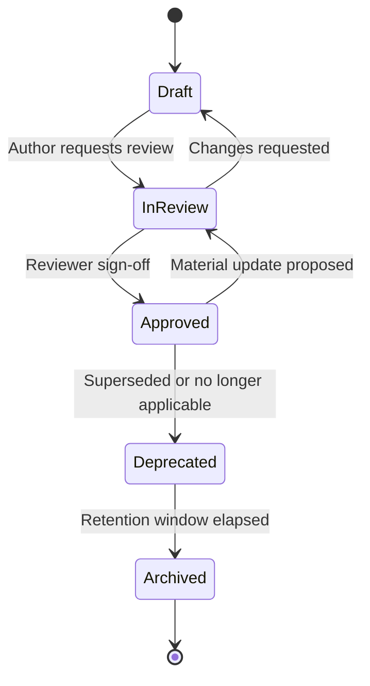

# Knowledge Governance

> `Core/KNOWLEDGE_STANDARD.md` defines *what* knowledge is, *where* it lives (Knowledge/ vs Memory/), and the baseline rules for naming, versioning, and linking. This document defines the *governance process* on top of that: who can create/approve/retire a knowledge entry, what quality bar it must clear, and how it's classified so it stays findable at 100+ Departments' worth of accumulated content. Read `Core/KNOWLEDGE_STANDARD.md` first — this document assumes it.

Governed by `Core/AI_OS_CONSTITUTION.md` §10 (Documentation Philosophy) and `Core/KNOWLEDGE_STANDARD.md`.

## Knowledge Lifecycle



This mirrors `Governance/DOCUMENT_LIFECYCLE.md`'s general document states, applied specifically to `Knowledge/` and `Memory/` content — a `Knowledge/` entry is a document, and every document in this repository moves through the same five states; this section exists to call out the knowledge-specific triggers for each transition.

- **Draft → In Review:** triggered when the author (any Department Agent) believes the entry is complete enough to be reused by others — not necessarily perfect, but usable.
- **In Review → Approved:** the owning Department's lead reviews for accuracy and the Quality Standards below; Chief of Staff spot-checks for cross-Department consistency per its `EXECUTIVE_OPERATING_MODEL.md` mandate.
- **Approved → Deprecated:** triggered by a superseding entry, a `Governance/ARCHITECTURE_DECISION_RECORDS_STANDARD.md` supersession, or a Quarterly Business Review finding it's stale and no longer applicable.
- **Deprecated → Archived:** after the retention window (default 1 year, or immediately if superseded and no historical Project references it — see `Core/KNOWLEDGE_STANDARD.md`'s retirement rules).

## Review Process

| Entry type | Reviewer | Bar to clear |
|---|---|---|
| Department-specific pattern/reference | Owning Department's lead Agent | Accurate, sourced, reusable by a new Agent without side-channel context |
| Cross-department standard (`Standards/`) | Owning Department + Chief of Staff | Above, plus: doesn't contradict an existing `Standards/` or `Core/` entry |
| `Core/` or `Governance/` document | CEO (ratifying), Chief of Staff (drafting/stewardship) | Full `Core/AI_OS_CONSTITUTION.md` §12 amendment process |
| Lessons Learned entry | Chief of Staff | Traces to a concrete resulting change, per `Core/KNOWLEDGE_STANDARD.md` |
| External research/citation | Author + one peer Agent in the same Department | Source and access date present, per `Core/COMMUNICATION_STANDARD.md` evidence rule |

A review that only checks spelling/formatting is not a review under this standard — it must verify the entry is *accurate* and *actually reusable*, the two failure modes that make a knowledge base rot.

## Ownership

- Every `Knowledge/` entry has exactly one owning Department, recorded in its metadata — ownership means accountable for accuracy and freshness, not necessarily sole authorship.
- `Memory/` entries (Clients, Preferences, Common Mistakes, Lessons Learned) are owned by the Chief of Staff at the OS level — any Agent may append, but currency and consistency are the Chief of Staff's accountability, per `Executive/Chief_of_Staff/CHIEF_OF_STAFF_AGENT.md`.
- Ownership transfers if a Department is restructured or retired (`Governance/GOVERNANCE_PLAYBOOK.md`) — an entry is never left ownerless; the Chief of Staff reassigns it as part of that restructuring.

## Quality Standards

Every `Knowledge/` entry, before reaching Approved status, must:

1. State its scope explicitly — what it covers and, if non-obvious, what it deliberately doesn't.
2. Cite sources for any external fact, with an access date (`Core/COMMUNICATION_STANDARD.md`).
3. Include a `last_reviewed` date and owning Department, per `Core/KNOWLEDGE_STANDARD.md` metadata.
4. Link to related entries rather than duplicating their content (`Core/KNOWLEDGE_STANDARD.md` cross-linking rule).
5. Be written for a reader with zero prior context on this specific entry — per `Core/AI_OS_CONSTITUTION.md` §10.

An entry failing any of these is returned to Draft, not approved with a caveat — a "mostly good" knowledge entry that quietly skips sourcing is worse than a missing one, because it looks trustworthy while not being verifiable.

## Taxonomy

Knowledge is organized in two dimensions: **Domain** (the existing `Knowledge/<Domain>/` folders — e.g., `SEO`, `Database`, `Accessibility`, `Marketing`) and **Type** (cutting across domains):

| Type | Purpose | Example |
|---|---|---|
| Reference | Stable factual/technical grounding | `Knowledge/Database/indexing-strategies.md` |
| Pattern | A reusable approach with rationale | `Knowledge/API/graphql-partner-layer.md` |
| Research | Point-in-time findings, dated | `Knowledge/Marketing/2026-competitor-scan.md` |
| Lesson | Incident + resulting change | `Memory/Lessons Learned.md` entries |
| Decision-linked | Rationale tied to a specific DEC/ADR | Cross-linked from `Governance/Decisions/` or `Knowledge/Architecture/ADR/` |

As the Department roster grows past 100, new Domain folders are added under the same pattern (`Knowledge/<NewDomain>/`) — the Type dimension does not need to grow; it's designed to be exhaustive at any scale. If a new entry doesn't fit any existing Type, that's a signal to propose a Type addition via the QBR amendment process (`Governance/MEETING_OPERATING_SYSTEM.md`), not to leave it untyped.

## Tagging Conventions

- Front-matter tags are lowercase, kebab-case, and drawn from a controlled vocabulary maintained by the Chief of Staff (e.g., `security`, `performance`, `mvp-scope`, `partner-integration`) — free-form tagging is disallowed because it silently fragments findability at scale (`security` and `sec` and `Security` becoming three untraceable buckets).
- Every entry tags its **Domain** (folder-implied, not repeated in front-matter), its **Type** (from the taxonomy above), and 0–5 **free topical tags** from the controlled vocabulary.
- New vocabulary terms are proposed the same way as new Types — via the Chief of Staff, ratified informally at the next Monthly Business Review (low bar, since this is additive and reversible) rather than requiring a full amendment.

```yaml
# Example front-matter
type: pattern
domain: API
tags: [security, partner-integration]
owner: Engineering
last_reviewed: 2026-07-15
status: approved
```

## Reuse Enforcement

Per `Core/KNOWLEDGE_STANDARD.md`'s reuse-check flowchart: Governance's role is to make reuse *checkable*, not just encouraged. The Chief of Staff's periodic audit (Monthly Business Review) includes a sample check: for a handful of recently completed tasks, was relevant existing `Knowledge/` actually consulted (per citation in the deliverable) before new analysis was done from scratch? A pattern of unnecessary re-derivation is logged as a process finding and routed to `Governance/CONTINUOUS_IMPROVEMENT_SYSTEM.md`.

## Anti-Patterns

- **Approval as rubber stamp.** A review that doesn't actually check sourcing or reusability defeats the entire governance layer — see Quality Standards above.
- **Untagged or free-tagged sprawl.** Bypassing the controlled vocabulary "just this once" is exactly how findability degrades at scale; a proposed new tag goes through the (lightweight) vocabulary process instead.
- **Ownerless drift.** A `Knowledge/` entry whose owning Department was retired or restructured and never reassigned — caught at the next Chief of Staff audit, not left to be discovered by whoever next needs it and finds it stale.

## Metadata

```yaml
version: 1.0.0
status: active
last_reviewed: 2026-07-22
owner: Chief of Staff
```
