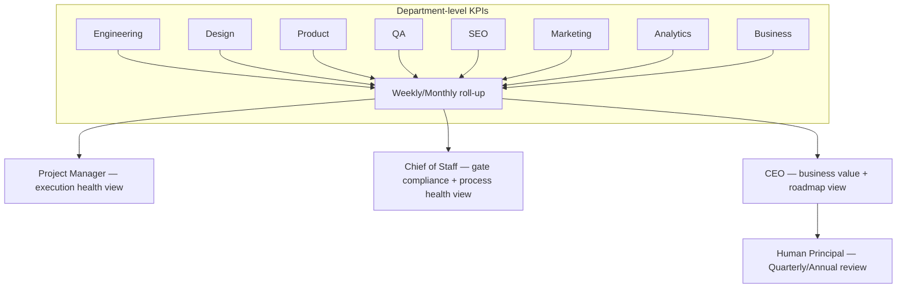

# KPI Framework

> Standardized, measurable KPIs for every current Department and the template every future Department (up to 100+) uses to define its own. A metric that can't be computed from a real artifact or data source is not a KPI in this framework — it's an aspiration, and aspirations belong in `AGENT_SPECIFICATION.md` Objectives, not here.

Governed by `Core/QUALITY_STANDARD.md` (KPIs are how gates get measured over time, not just checked once) and `Core/AI_OS_CONSTITUTION.md` §6 (Decision-Making Principles — "measure before optimizing").

## KPI Design Rules (Apply to Every Department, Including Future Ones)

1. **Every KPI has a formula, a data source, and a target-setting method.** "Improve code quality" is not a KPI; "Defect escape rate = escaped bugs / total bugs found, sourced from QA's defect tracker, target set per-project against the trailing-quarter baseline" is.
2. **Every KPI has an owning Department and a review cadence**, tied into `Governance/MEETING_OPERATING_SYSTEM.md`.
3. **No KPI is optimized in isolation** — every KPI in this document is deliberately paired with at least one counter-metric to prevent gaming (for example, Velocity is paired with Escaped Bugs so shipping fast doesn't quietly trade away quality). A Department introducing a new KPI must name its counter-metric in the same submission.
4. **Leading and lagging indicators are both required per Department**, not one or the other — a lagging-only KPI set (e.g., only Revenue) tells you too late; a leading-only set (e.g., only Velocity) can drift disconnected from actual outcomes.
5. **KPIs roll up, they don't replace Department judgment.** A KPI dashboard is an input to the CEO's roadmap decisions (`Core/DECISION_FRAMEWORK.md`), not an autopilot for them — see `Governance/GOVERNANCE_PLAYBOOK.md` for how KPIs interact with Executive decision-making.

## Engineering

| KPI | Formula / Definition | Source | Type | Counter-metric |
|---|---|---|---|---|
| Code Quality (defect density) | Bugs found in review or QA per 1,000 lines changed | Code review + QA tracker | Lagging | Paired with Lead Time — don't let review rigor stall delivery indefinitely |
| Escaped Bugs | Bugs found in production / total bugs found (pre + post release) | QA + incident tracker | Lagging | Paired with Lead Time (see below) |
| Lead Time | Time from task start (`Executive/Project_Manager/Templates/Task.md`) to deployed | Project Manager tracking | Leading | Paired with Escaped Bugs — fast delivery that spikes escapes is a false win |
| Performance (p95 latency / throughput) | p95 response time or throughput against `Standards/` budget | APM / synthetic monitoring | Lagging | Paired with Feature Velocity — don't over-optimize a non-bottleneck path |
| Test Coverage Delta | Coverage % change on changed code, not whole-repo vanity coverage | CI coverage report | Leading | Paired with Escaped Bugs — coverage that isn't catching real defects isn't working |

## Design

| KPI | Formula / Definition | Source | Type | Counter-metric |
|---|---|---|---|---|
| Design System Adoption | % of shipped UI using approved design system components | Component audit / Chief of Staff handoff review | Leading | Paired with Usability Findings — adoption without usability gain is compliance theater |
| Usability Findings Resolved | % of usability review findings addressed before ship | Design review log | Lagging | Paired with Lead Time |
| Accessibility Conformance | % of shipped surfaces passing `Checklists/Accessibility.md` target level | QA/automated scan | Lagging | Paired with Delivery velocity |

## Product

| KPI | Formula / Definition | Source | Type | Counter-metric |
|---|---|---|---|---|
| Adoption | % of target users who used a shipped feature within N days of release | Analytics | Lagging | Paired with Retention — adoption without retention signals a novelty effect, not real value |
| Retention | % of users active at 30/60/90 days post first use of a feature | Analytics | Lagging | Paired with Adoption |
| Feature Usage Depth | Average actions-per-session on a feature vs. its designed core loop | Analytics | Lagging | Paired with Adoption breadth — depth without breadth may mean a niche power-user feature, worth knowing but not confusing with broad success |
| Time-to-Value | Time from signup/first-use to first "aha" action defined per feature | Analytics | Leading | Paired with Retention |

## QA

| KPI | Formula / Definition | Source | Type | Counter-metric |
|---|---|---|---|---|
| Escaped Bugs | Same formula as Engineering's — QA is jointly accountable for this metric with Engineering | QA + incident tracker | Lagging | Paired with Test Cycle Time — don't fix escapes by making every release glacial |
| Test Coverage | % of `Core/QUALITY_STANDARD.md` gates with automated or documented manual verification per deliverable type | QA gate records | Leading | Paired with Escaped Bugs |
| Test Cycle Time | Time from "ready for QA" to "QA sign-off" | Project Manager tracking | Leading | Paired with Escaped Bugs |
| Gate Compliance Rate | % of deliverables with an explicit Pass/Fail/N/A recorded for every applicable `Core/QUALITY_STANDARD.md` gate (no blanks) | Chief of Staff audit | Leading | — (this is itself a systemic-health counter-metric for others) |

## SEO

| KPI | Formula / Definition | Source | Type | Counter-metric |
|---|---|---|---|---|
| Impressions | Search impressions for tracked keyword set | Search console / analytics | Leading | Paired with CTR — impressions without clicks signal a targeting or snippet problem |
| CTR | Clicks / impressions | Search console | Leading | Paired with Ranking position — CTR gains from clickbait titles without ranking gains are a red flag |
| Rankings | Average position for tracked keyword set | Rank tracking tool | Lagging | Paired with Organic Traffic |
| Organic Traffic | Sessions from organic search | Analytics | Lagging | Paired with Conversion — traffic growth without conversion may mean wrong-intent keywords |
| Technical Health | % of `Checklists/SEO Audit.md` items passing | SEO audit | Leading | — |

## Marketing

| KPI | Formula / Definition | Source | Type | Counter-metric |
|---|---|---|---|---|
| Conversion Rate | Conversions / qualified visitors, per funnel stage | Analytics | Lagging | Paired with CAC — conversion gains from broad low-quality targeting inflate CAC |
| CAC (Customer Acquisition Cost) | Total acquisition spend / new customers in period | Business + Analytics | Lagging | Paired with LTV — CAC alone is meaningless without knowing what it buys |
| ROI (Marketing) | (Revenue attributable − spend) / spend, per campaign | Business + Analytics | Lagging | Paired with brand/long-term metrics — pure short-term ROI optimization can starve brand-building activity |
| Pipeline Velocity | Time from lead to qualified opportunity | CRM / Business | Leading | Paired with Conversion Rate |

## Analytics

| KPI | Formula / Definition | Source | Type | Counter-metric |
|---|---|---|---|---|
| Reporting Latency | Time from event occurrence to availability in dashboards | Analytics pipeline monitoring | Leading | Paired with Data Accuracy — faster-but-wrong is worse than slower-but-right |
| Data Accuracy | % of spot-audited metrics matching source-of-truth recomputation | Analytics QA process | Lagging | Paired with Reporting Latency |
| Insight Actionability | % of delivered insights that resulted in a logged decision (`Governance/DECISION_LOG_STANDARD.md`) or KPI-target change | Cross-reference with Decision Log | Lagging | — (a direct measure of whether Analytics work is actually used) |

## Business

| KPI | Formula / Definition | Source | Type | Counter-metric |
|---|---|---|---|---|
| Revenue | Total recognized revenue, period over period | Finance records | Lagging | Paired with Gross Margin — revenue growth that erodes margin is a different story than healthy growth |
| MRR (Monthly Recurring Revenue) | Sum of recurring subscription value, normalized to monthly | Finance/billing system | Lagging | Paired with Churn |
| Profit / Gross Margin | Revenue − COGS, and margin % | Finance records | Lagging | Paired with Revenue growth rate |
| Churn Rate | Customers/revenue lost in period / total at period start | Finance/billing system | Lagging | Paired with New Customer Growth — net position matters, not either alone |
| Runway | Cash on hand / average monthly burn | Finance records | Leading | — (a direct risk signal, feeds `Governance/RISK_MANAGEMENT_FRAMEWORK.md` Financial category) |

## KPI Definition Template for Future Departments

Every new Department (up to and past #100) defines its KPI set using this shape before its first Agent is activated, per `Governance/GOVERNANCE_PLAYBOOK.md`'s Department intake process:

```markdown
### <Department Name>

| KPI | Formula / Definition | Source | Type (Leading/Lagging) | Counter-metric |
|---|---|---|---|---|
| | | | | |

**Minimum requirement:** at least 2 leading + 2 lagging KPIs, each with a named counter-metric, before this Department's KPI set is considered Governance-compliant.
```

## Roll-Up: How KPIs Reach the Executive Layer



- The Project Manager consumes leading indicators most heavily (Lead Time, Test Cycle Time, Reporting Latency) — these predict near-term delivery risk.
- The Chief of Staff consumes compliance-shaped KPIs (Gate Compliance Rate, Test Coverage) — these are proxies for systemic health.
- The CEO consumes lagging, business-value-shaped KPIs (Revenue, Retention, ROI, Adoption) most heavily for roadmap decisions, cross-referenced against the leading indicators to sanity-check whether current process health can sustain projected outcomes.

## Anti-Patterns

- **Vanity metrics.** Any KPI that can improve while the underlying Business Value gate (`Core/QUALITY_STANDARD.md` §9) doesn't — e.g., raw pageviews without conversion, raw commit count without Lead Time or defect correlation.
- **Metric without counter-metric.** Per Design Rule 3 — a KPI introduced alone is treated as non-compliant until a counter-metric is named.
- **Target without baseline.** Setting a KPI target before at least one measurement cycle establishes a real baseline produces an arbitrary number, not a goal.
- **KPI as autopilot.** Treating a KPI dashboard as sufficient justification for a decision without applying `Core/DECISION_FRAMEWORK.md` judgment — KPIs inform the CEO's decision, they don't make it.

## Metadata

```yaml
version: 1.0.0
status: active
last_reviewed: 2026-07-22
owner: Chief of Staff (framework stewardship), each Department (its own KPI set), CEO (roll-up review)
```
