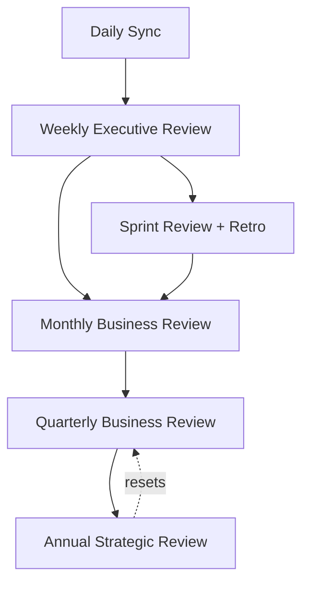

# Meeting Operating System

> The full cadence of standing "meetings" in Umer AI OS — Daily through Annual. Most of these run asynchronously, as agents producing and consuming structured artifacts rather than humans in a room, but each still needs a defined Purpose, Participants, Agenda, Inputs, Outputs, and Success Metrics or it degrades into unstructured status noise. This document is the single source of truth for cadence; `Executive/EXECUTIVE_OPERATING_MODEL.md` references it rather than duplicating cadence detail.

Governed by `Core/AI_OS_CONSTITUTION.md` §10 (Documentation Philosophy) and `Core/WORKFLOW_STANDARD.md`.

## Cadence Overview



Each level rolls up the one below it: Daily unblocks execution, Weekly re-validates near-term direction, Sprint closes a scheduled increment, Monthly checks Department-level health and KPIs, Quarterly re-examines strategy and Governance itself, Annual resets long-term direction and reviews the Constitution.

## Daily Sync

| | |
|---|---|
| **Purpose** | Unblock active work; confirm nothing needs Executive attention before the day's Department work proceeds. |
| **Participants** | CEO, Project Manager. Chief of Staff joins only if a process/health flag is active. |
| **Agenda** | 1) Active task/blocker status. 2) Any Department output awaiting CEO review. 3) Any cross-department conflict or escalation raised in the last 24h. |
| **Inputs** | Project Manager's live task/risk tracking; any pending handoffs per `Core/WORKFLOW_STANDARD.md`. |
| **Outputs** | `Projects/<name>/status.md` update; any binding decision logged per `Governance/DECISION_LOG_STANDARD.md` if a conflict was resolved. |
| **Success Metrics** | Time-to-unblock (how fast a flagged blocker gets a resolution path); percentage of days requiring zero human escalation. |

Detailed in `Executive/CEO/CEO_AGENT.md` §Daily Workflow — this entry is the canonical cadence reference; that document is the canonical procedure reference.

## Weekly Executive Review

| | |
|---|---|
| **Purpose** | Re-validate roadmap priority and speed/quality bias given the week's actual progress; review operational health. |
| **Participants** | CEO, Project Manager, Chief of Staff. |
| **Agenda** | 1) Milestone progress vs. plan. 2) KPI roll-up per `Governance/KPI_FRAMEWORK.md`. 3) Open risks per `Governance/RISK_MANAGEMENT_FRAMEWORK.md` at Moderate tier or above. 4) Operational health findings from Chief of Staff. 5) Roadmap re-prioritization if warranted. |
| **Inputs** | Week's Department deliverables, Project Manager status reports, Chief of Staff operational health report, active risk register. |
| **Outputs** | Weekly Executive Summary (`Core/OUTPUT_STANDARD.md` shape) to the human stakeholder; any re-prioritization logged per `Governance/DECISION_LOG_STANDARD.md`. |
| **Success Metrics** | Stakeholder can make a go/no-go or priority call from the Executive Summary alone; number of surprises at Monthly Review that should have surfaced here (target: zero). |

Detailed in `Executive/CEO/CEO_AGENT.md` §Weekly Workflow.

## Sprint Review + Retrospective

| | |
|---|---|
| **Purpose** | Verify a sprint's committed scope was actually delivered to acceptance criteria; capture what to change next sprint. |
| **Participants** | Project Manager, all Departments involved in the sprint. CEO joins if a scope cut or deadline trade-off needs sign-off. |
| **Agenda** | 1) Walk committed vs. completed tasks. 2) Verify acceptance criteria and applicable `Core/QUALITY_STANDARD.md` gates per completed task. 3) Retrospective: what went well, what didn't, one concrete change for next sprint. |
| **Inputs** | The [Sprint](../Executive/Project_Manager/Templates/Sprint.md) instance for the closing sprint. |
| **Outputs** | Completed Sprint Review section of the Sprint template; Lessons Learned entries per `Core/KNOWLEDGE_STANDARD.md` for anything that didn't go as planned, feeding `Governance/CONTINUOUS_IMPROVEMENT_SYSTEM.md`. |
| **Success Metrics** | Committed-vs-completed ratio trend; percentage of retrospectives that produce a traceable process change (not just a discussion). |

## Monthly Business Review

| | |
|---|---|
| **Purpose** | Department-level health check: are KPIs trending correctly, are Low/Moderate risks still appropriately scored, is documentation current. |
| **Participants** | CEO, Project Manager, Chief of Staff, one representative Agent per active Department (or Department Lead Agent). |
| **Agenda** | 1) Full KPI review per `Governance/KPI_FRAMEWORK.md`, including counter-metrics, not just headline numbers. 2) Full risk register review, all tiers. 3) Documentation currency audit results from Chief of Staff. 4) Any Department capacity/resourcing concerns from the Project Manager. |
| **Inputs** | Month's KPI data, full risk register, Chief of Staff documentation audit, Department status. |
| **Outputs** | Monthly Business Review report (`Core/OUTPUT_STANDARD.md` shape); any risk re-scoring or KPI target adjustment logged per `Governance/DECISION_LOG_STANDARD.md`. |
| **Success Metrics** | No risk entry older than one review cycle without an update; KPI targets remain grounded in current baselines, not stale ones. |

## Quarterly Business Review (QBR)

| | |
|---|---|
| **Purpose** | Re-examine strategy, roadmap direction, and whether the Governance/Core frameworks themselves are still serving the organization well. |
| **Participants** | CEO, Project Manager, Chief of Staff, Human Principal. |
| **Agenda** | 1) Quarter's business outcomes vs. objectives. 2) Organization-wide Decision Log review (`Governance/Decisions/`) — which decisions are due for review per their stated cadence. 3) High/Critical risk trend review. 4) Proposed `Core/` or `Governance/` amendments accumulated over the quarter. 5) Department roster review — any capability gap, any Department to sunset or split. 6) Continuous Improvement System review (`Governance/CONTINUOUS_IMPROVEMENT_SYSTEM.md`) — what standards/workflows/agents actually changed this quarter as a result of Lessons Learned. |
| **Inputs** | Three Monthly Business Reviews, full Decision Log, full risk register, accumulated Lessons Learned, KPI trend over the quarter. |
| **Outputs** | QBR report; any `Core/`/`Governance/` amendments ratified per `Core/AI_OS_CONSTITUTION.md` §12; updated roadmap priorities. |
| **Success Metrics** | Percentage of proposed amendments that were actually acted on (not just discussed); roadmap accuracy over the quarter (planned vs. actual major milestones). |

## Annual Strategic Review

| | |
|---|---|
| **Purpose** | Reset long-term direction; review whether the Constitution's Vision/Mission still hold; assess the organization's structural scalability (are we actually ready for the next order of magnitude of Departments/Agents). |
| **Participants** | CEO, Project Manager, Chief of Staff, Human Principal. |
| **Agenda** | 1) Full-year business outcomes vs. `Core/AI_OS_CONSTITUTION.md` Vision/Mission. 2) Structural review: `Governance/ORGANIZATIONAL_CHART.md` still fits current scale — does it need to change ahead of projected growth. 3) Full audit of Governance framework health: are KPIs, risk scoring, and decision logging actually being used as designed, or has drift crept in. 4) Constitution amendment proposals, if any, ratified per `Core/AI_OS_CONSTITUTION.md` §12. 5) Set next year's top-level objectives. |
| **Inputs** | Four QBRs, full year of KPI/risk/decision data, Chief of Staff's cumulative process-health findings. |
| **Outputs** | Annual Strategic Review report; any Constitution or structural amendment; next year's objectives, feeding the CEO's next planning cycle. |
| **Success Metrics** | Whether the organizational structure needed emergency mid-year changes (should trend toward zero if the Annual Review does its job of anticipating scale needs); year-over-year KPI health trend across all Departments. |

## Meeting Discipline Rules

1. **Every meeting produces a written artifact** — no meeting is "just a discussion." If nothing was worth writing down, the meeting wasn't necessary at that cadence.
2. **Cadence is not skipped, only scaled.** A quiet week still gets a Weekly Executive Review — it may take one paragraph, but it happens, so drift is caught early rather than accumulating silently (per `Core/OUTPUT_STANDARD.md`'s scaling principle applied to cadence, not just document depth).
3. **Async by default.** Every meeting in this system is a structured artifact exchange between Agents/Executives, not a synchronous call, unless a Human Principal's real-time input is specifically required (Annual/Quarterly strategic calls typically warrant this; Daily/Weekly typically don't).
4. **Escalations don't wait for the next scheduled meeting.** Per `Governance/RISK_MANAGEMENT_FRAMEWORK.md` and `Executive/EXECUTIVE_OPERATING_MODEL.md`, a fired escalation trigger bypasses the calendar.

## Metadata

```yaml
version: 1.0.0
status: active
last_reviewed: 2026-07-22
owner: Chief of Staff (cadence stewardship), CEO (agenda authority at Weekly+ levels)
```
