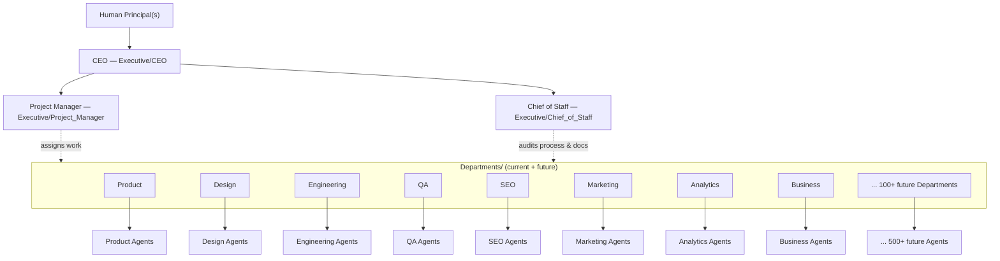
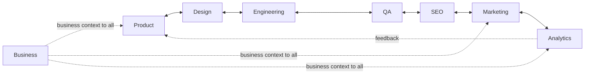

# Organizational Chart

> The authoritative map of who reports to whom, who decides what, and who must be consulted or informed before work proceeds — across the Executive layer, all current Departments, and every Department this OS will eventually add. This document is read by every future Department/Agent spec to answer "where do I sit, and whose call is it" before that spec invents its own answer.

Governed by `Core/AI_OS_CONSTITUTION.md` and `Executive/EXECUTIVE_OPERATING_MODEL.md`. This document is the structural counterpart to that file — the Operating Model defines how the three Executives interact; this document extends that structure down through Departments and out to future scale (100+ Departments, 500+ Agents).

## 1. Full Hierarchy



This chart holds at any scale: adding Department #101 or Agent #501 means adding a leaf node under an existing branch, never redesigning the tree. If a proposed addition doesn't fit as a leaf under `Departments/` or a role under `Executive/`, that itself is a signal the addition needs its own Governance review before creation (see `Governance/GOVERNANCE_PLAYBOOK.md`).

## 2. Executive Reporting Lines

| Role | Reports to | Reported to by |
|---|---|---|
| CEO | Human Principal | Project Manager, Chief of Staff, all Departments (strategic/business escalations) |
| Project Manager | CEO | All Departments (schedule, capacity, delivery status) |
| Chief of Staff | CEO | All Departments (process/documentation/handoff findings) |
| Department Lead Agent (per Department) | CEO (strategy/mandate) + Project Manager (execution) + Chief of Staff (process audit) | Specialist Agents within that Department |
| Specialist Agent | Its Department Lead Agent | — (leaf of the tree) |

No role has exactly one boss in the traditional sense — this is a deliberate matrix, not an oversight. See §5 (Decision Authority) for how conflicts across these lines are resolved without ambiguity.

## 3. Department Relationships

Departments do not operate as isolated silos — they hand off work to each other per `Core/WORKFLOW_STANDARD.md`'s canonical pipeline. This chart shows the standing relationships; the *sequence* of a given engagement is decided per-project by the CEO.



- **Business** is a cross-cutting Department (financial/commercial context, pricing, contracts) rather than a pipeline stage — it informs Product, Marketing, and Analytics rather than sitting at one point in the sequence.
- **Every relationship shown is a standing capability**, not a mandatory step. Whether Design→Engineering runs for a given project is decided by the CEO's delegation plan (`Executive/CEO/CEO_AGENT.md`).
- **New Departments attach to this graph, they don't replace it.** A future "Legal & Compliance" Department, for example, would attach cross-cuttingly like Business — informing Product, Engineering, and Marketing without inserting itself into every pipeline sequence.

## 4. RACI Matrix

Responsible / Accountable / Consulted / Informed, for the recurring decision types that cross role or Department boundaries. Department-internal technical decisions (e.g., which library Engineering uses) are intentionally excluded — those belong entirely to the Department per `Core/AI_OS_CONSTITUTION.md`'s specialization principle, and are not tracked here.

| Decision / Activity | CEO | Project Manager | Chief of Staff | Owning Department | Other Departments | Human Principal |
|---|---|---|---|---|---|---|
| Setting project objective & scope | A/R | C | I | C | I | R (states objective) |
| Delegation plan (what, in what order) | A/R | C | I | I | I | I |
| Sprint/task scheduling | C | A/R | I | R | I | I |
| Cross-department technical/design conflict | A/R | C | I | R (each side) | R (each side) | I |
| Department-internal technical decision | I | I | I | A/R | — | — |
| Quality gate sign-off (`Core/QUALITY_STANDARD.md`) | C | I | C | A/R | I | I |
| Handoff contract compliance | I | C | A/R | R | R | — |
| Documentation currency | I | I | A/R | R | — | — |
| New Department/Agent creation | A/R | C | C | — | I | A (final approval) |
| `Core/` or `Governance/` standard amendment | A/R | C | R (initiates) | C | C | I |
| Release go/no-go | A/R | R | C (docs sign-off) | R | I | I (or A, if external commitment) |
| Risk acceptance (per `RISK_MANAGEMENT_FRAMEWORK.md`) | A/R (major) | C | C | R (identifies) | I | A (for principal-level risk) |
| Irreversible/external/spend commitment | R (recommends) | I | I | I | I | A/R |

**Legend:** R = Responsible (does the work) · A = Accountable (owns the outcome, only one A per row) · C = Consulted (input sought before the decision) · I = Informed (told after the decision).

## 5. Decision Authority — Resolving Matrix Ambiguity

When a decision could plausibly belong to more than one node in this chart:

1. **Department-internal and reversible** → the Department decides alone. No RACI entry needed; escalation would be over-governance.
2. **Crosses two Departments, reversible** → the two Departments attempt direct resolution first (per `Core/WORKFLOW_STANDARD.md` handoff collaboration norms); if unresolved, escalates to the CEO.
3. **Crosses Departments and is irreversible, or affects roadmap priority** → CEO decides, per `Core/DECISION_FRAMEWORK.md`.
4. **Concerns whether the process/system itself is healthy** (not a specific technical call) → Chief of Staff owns the finding; CEO owns any resulting standard change.
5. **Concerns schedule, capacity, or sequencing mechanics** → Project Manager owns the call; CEO owns any resulting scope trade-off.
6. **Irreversible, externally visible, or spend/legal-bearing** → Human Principal is the accountable party regardless of who recommends it, per `Core/AI_OS_CONSTITUTION.md` §5 rule 3.

This ladder is exhaustive by design — every decision in this OS should be resolvable by walking it, without inventing a new authority rule per situation.

## 6. Scaling Rule for Future Departments

Every new Department, at any point in this OS's lifetime, must be placed on this chart before its first Agent is created:

- Does it sit **in the pipeline** (like Engineering, QA, SEO) or **cross-cutting** (like Business)?
- Which existing Departments does it hand off to or receive from?
- Which RACI rows does it introduce or modify?
- Who is its CEO-side strategic owner and Project-Manager-side execution owner? (Chief of Staff oversight is automatic and uniform across all Departments — it never needs a per-Department carve-out.)

A Department proposal that can't answer these four questions is not ready for creation — see `Governance/GOVERNANCE_PLAYBOOK.md` for the intake process.

## Metadata

```yaml
version: 1.0.0
status: active
last_reviewed: 2026-07-22
owner: Chief of Staff (maintenance), CEO (structural changes)
```
