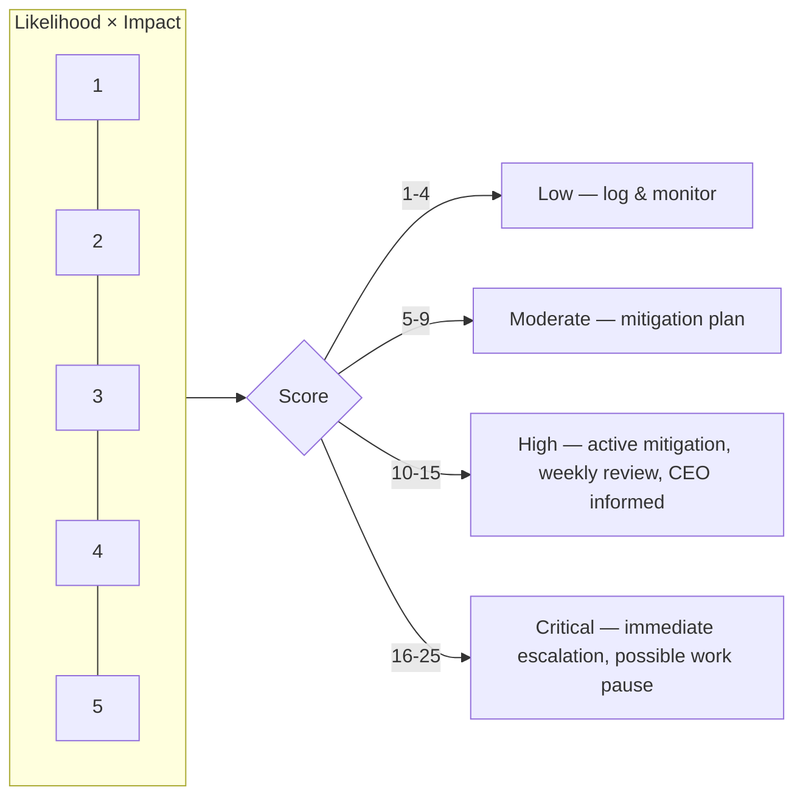
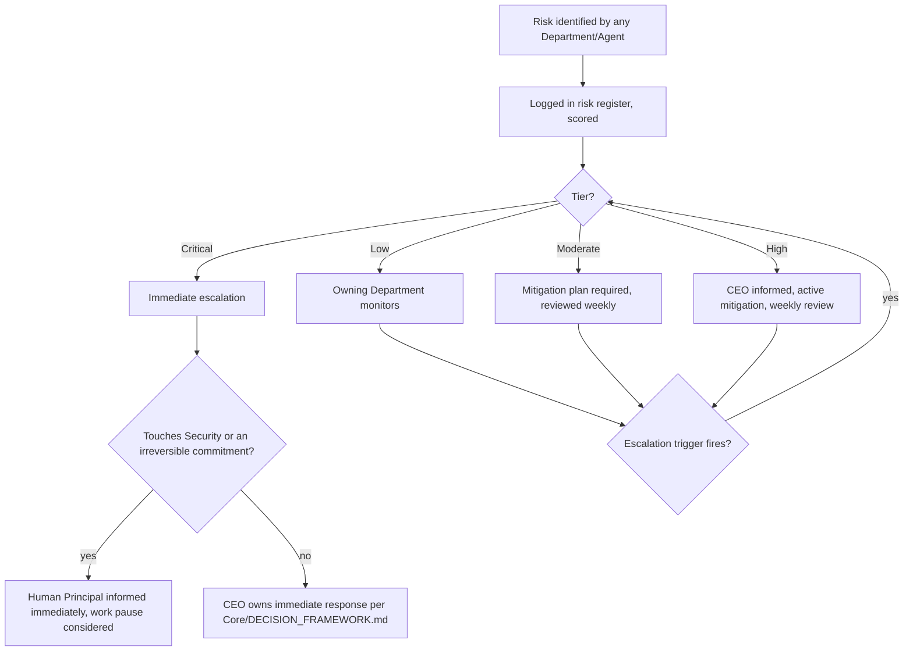

# Risk Management Framework

> How risk is identified, scored, owned, monitored, and escalated across every category of risk this OS is exposed to — technical, business, product, security, SEO, financial, AI-specific, and operational. Individual Departments identify and mitigate risk in their domain; this framework standardizes how that risk is *scored and communicated* so a CEO or human principal can compare a Security risk against a Financial risk on the same scale.

Governed by `Core/AI_OS_CONSTITUTION.md` §5 (Non-Negotiable Rules) and `Core/DECISION_FRAMEWORK.md`. Risk acceptance decisions are logged per `Governance/DECISION_LOG_STANDARD.md`.

## Risk Categories

| Category | Owning Department(s) | Example |
|---|---|---|
| Technical | Engineering | Unpatched dependency, architecture single point of failure, data model that won't scale |
| Business | Business, CEO | Market timing miss, dependency on a single client/revenue source |
| Product | Product | Building the wrong feature, misjudged user need, scope creep diluting core value |
| Security | Engineering, QA | Credential exposure, injection vulnerability, insufficient access control |
| SEO | SEO | Algorithm-update exposure, over-reliance on a single keyword/channel, technical crawlability regression |
| Financial | Business | Cash runway, cost overrun, pricing model that doesn't cover CAC |
| AI-specific | Owning Department + Chief of Staff | Model hallucination in a customer-facing output, prompt injection, model deprecation/behavior drift, over-automation without human checkpoint |
| Operational | Chief of Staff, Project Manager | Handoff breakdown, knowledge loss (undocumented decision), key-Department overload |

A single real-world risk often spans categories (e.g., a security breach is Technical + Security + Financial + Business reputational risk at once) — log it once, tag all applicable categories, and assign one accountable owner per §Ownership below rather than splitting it into duplicate entries.

## Risk Scoring

Score every identified risk on two axes, 1–5 each, per the standard risk-matrix method:

- **Likelihood** (1 = rare, 5 = near-certain / already occurring)
- **Impact** (1 = negligible, 5 = severe — existential to the project/business, irreversible harm, or a Security/Constitution violation)

**Risk Score = Likelihood × Impact** (range 1–25).

| Score | Tier | Response requirement |
|---|---|---|
| 1–4 | Low | Logged, monitored passively, no immediate action required |
| 5–9 | Moderate | Mitigation plan required, owner assigned, reviewed at next standing cadence |
| 10–15 | High | Active mitigation in progress now, reviewed weekly, CEO informed |
| 16–25 | Critical | Immediate escalation, work affecting this risk paused if mitigation isn't already underway, human principal informed for anything in this tier touching Security or an irreversible commitment |

**Impact scoring floor for specific categories:** Any Security risk with a plausible path to credential/data exposure is never scored below Impact 4, regardless of perceived likelihood — per `Core/AI_OS_CONSTITUTION.md` §5 rule 4, security is a non-negotiable, and understating its impact score to keep a risk in a lower tier is itself a governance violation.



## Risk Register Entry Template

Stored at `Projects/<name>/risks.md` (project-scoped, feeding the Project Manager's risk register per `Executive/Project_Manager/PROJECT_MANAGER_AGENT.md`) or `Governance/Risks/RISK-###-<slug>.md` (organization-wide, structural risk).

```markdown
# RISK-### — <short title>

## Category
<Technical | Business | Product | Security | SEO | Financial | AI | Operational — one or more>

## Description
What could go wrong, concretely — not "performance issues" but "checkout API p95 latency exceeds 2s under Black-Friday-level concurrent load, causing cart abandonment."

## Likelihood
1-5, with the reasoning stated (not just the number).

## Impact
1-5, with the reasoning stated, including which Core/QUALITY_STANDARD.md gate(s) this would violate if realized.

## Risk Score
Likelihood x Impact = Score (Tier)

## Owner
The accountable Department/Agent/Executive per Governance/ORGANIZATIONAL_CHART.md RACI-style assignment — one owner, not a committee.

## Mitigation Plan
Concrete steps being taken now to reduce likelihood and/or impact. "Monitor" is a valid mitigation only for Low-tier risks; Moderate+ requires an active reduction plan.

## Monitoring
How this risk's status is tracked going forward — a metric, a recurring check, an alert threshold. Link to Departments/Analytics/ instrumentation if applicable.

## Escalation Trigger
The specific condition that would move this risk to a higher tier or require immediate escalation (e.g., "escalate immediately if likelihood evidence appears — a single real occurrence, even minor, moves this to Critical review").

## Status
Open | Mitigating | Accepted | Closed | Realized

## History
| Date | Event |
|---|---|
| | Risk identified |
| | Score changed / mitigation updated |
| | Status changed |
```

## Ownership

- Every risk has exactly **one accountable owner** — a Department, an Executive, or (for Critical-tier risk touching irreversible commitments) the Human Principal. Shared ownership across multiple parties with no single accountable party is the most common way a known risk gets silently dropped.
- The owning Department identifies and proposes mitigation; the CEO is informed at High tier and above per the scoring table; the Human Principal is the accountable party for any Critical-tier risk that would require an irreversible response (per `Core/AI_OS_CONSTITUTION.md` §5 rule 3).
- The Chief of Staff audits that every logged risk actually has a named owner and an update history — an orphaned risk entry (no owner, no update in a full review cycle) is itself flagged as a process finding, per `Executive/Chief_of_Staff/CHIEF_OF_STAFF_AGENT.md`.

## Monitoring Cadence

| Tier | Review frequency | Reviewed by |
|---|---|---|
| Low | Monthly Business Review | Owning Department |
| Moderate | Weekly Executive Review | Owning Department + Project Manager |
| High | Weekly (minimum), status visible to CEO continuously | Owning Department + CEO |
| Critical | Continuous until de-escalated | CEO + Human Principal (Security/irreversible) |

## Escalation



Escalation never waits for the next scheduled review if the stated Escalation Trigger fires — the trigger exists precisely to bypass the calendar when reality outruns the review cadence.

## Category-Specific Notes

- **Technical risk** is scored with Maintainability and Correctness cost in mind, not just uptime — a fragile-but-currently-working system is still a real risk, per `Core/QUALITY_STANDARD.md` Maintainability gate.
- **AI-specific risk** deserves explicit attention this OS's other frameworks don't fully cover elsewhere: hallucination in any customer-facing or decision-supporting output (mitigated by `Core/COMMUNICATION_STANDARD.md`'s no-hallucination rules, but still logged as a risk if a category of output is especially exposed — e.g., an agent summarizing legal terms), model behavior drift after an upstream model version change (mitigated by re-validating `Core/AGENT_SPECIFICATION.md` Examples sections after any model migration), and over-automation — an Agent given authority beyond its `AGENT_SPECIFICATION.md` Constraints without adequate human checkpoint.
- **SEO risk** includes concentration risk (over-reliance on a small set of keywords/channels) as much as technical risk (crawlability, algorithm updates) — both are tracked, not just the technical half.
- **Financial risk** is owned by Business but reviewed jointly with the CEO at Moderate tier and above, since financial risk almost always has a roadmap-priority consequence.
- **Operational risk** includes knowledge loss — an undocumented decision or a departed context source is a real, scoreable risk under this framework, not just a `Core/KNOWLEDGE_STANDARD.md` compliance nicety.

## Anti-Patterns

- **Risk theater.** Logging a risk once and never updating its History — a stale risk register is worse than none, because it creates false confidence that risk is being tracked.
- **Score deflation.** Understating Likelihood or Impact to avoid the escalation/mitigation burden of a higher tier — explicitly disallowed for Security (see the scoring floor above) and treated as a Chief of Staff finding wherever else it's caught.
- **Ownerless risk.** A risk entry with no single accountable owner — flagged and corrected immediately, not left ambiguous "in case someone picks it up."
- **Mitigation-as-hope.** "We'll keep an eye on it" as the entire mitigation plan for anything above Low tier — insufficient; a real reduction action is required.

## Metadata

```yaml
version: 1.0.0
status: active
last_reviewed: 2026-07-22
owner: Chief of Staff (framework stewardship), CEO (Critical-tier accountability)
```
