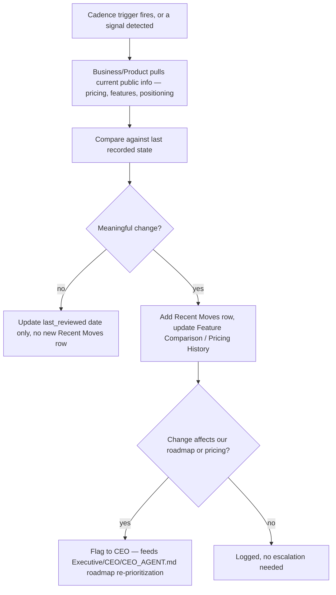

# Competitive Intelligence Framework

> The standing, continuously-updated system for tracking named competitors — as distinct from `Intelligence/RESEARCH_LIBRARY_STANDARD.md`'s occasional, point-in-time market/technology research. A competitor tracker is a living document that gets revisited on a fixed cadence for as long as that competitor is relevant to the business; a Research Library entry is a one-time (or infrequently refreshed) answer to a specific question.

Governed by `Intelligence/RESEARCH_LIBRARY_STANDARD.md` (sourcing rules), `Governance/KPI_FRAMEWORK.md` (Business/Marketing/Product KPIs this feeds), `Executive/CEO/CEO_AGENT.md` (primary consumer for roadmap decisions).

## Why This Is Its Own System

A competitor isn't a fact to look up once — it's a moving target that a Fortune 100 company tracks the way it tracks its own KPIs: continuously, with a defined cadence, feeding directly into product and pricing decisions. Treating competitive intelligence as occasional research (commissioned only when someone asks "what's competitor X doing") means the organization is always reacting a cycle late. This framework makes it standing infrastructure instead.

## What Gets Tracked, Per Competitor

Stored at `Intelligence/CompetitiveIntelligence/<competitor-slug>.md`, one living file per tracked competitor.

```markdown
# Competitor: <name>

## Overview
What they do, target market, founding/scale context — the orienting facts a new Agent needs before reading anything else here.

## Feature Comparison
| Capability | Us | <Competitor> | Notes |
|---|---|---|---|
| | | | |

## Pricing History
| Date | Plan/Tier | Price | Change from prior | Source |
|---|---|---|---|---|
| | | | | |

## Positioning
How they position themselves (messaging, target segment) — sourced from their own marketing, not inferred without evidence, per Core/COMMUNICATION_STANDARD.md.

## SWOT (from our perspective, about them)
| Strengths | Weaknesses | Opportunities (for us) | Threats (to us) |
|---|---|---|---|
| | | | |

## Product Positioning Map Notes
Where they sit relative to us on the dimensions that matter for our market (e.g., price vs. feature depth, self-serve vs. enterprise-sales-led) — narrative or link to a Departments/Analytics-produced visualization.

## Recent Moves (reverse-chronological log)
| Date | Move | Source | Our assessed impact |
|---|---|---|---|
| | | | |

## Update Cadence
<Tier — see cadence table below> — last updated YYYY-MM-DD, next due YYYY-MM-DD

## Related
- Related Research Library entries: Intelligence/ResearchLibrary/ links
- Related Product/Marketing decisions influenced: Governance/Decisions/ links

## Metadata
version: 1.0.0
status: active | watch-list | archived
owner: Business + Product (joint)
last_reviewed: YYYY-MM-DD
```

## Competitor Tiering and Update Cadence

Not every competitor warrants the same tracking intensity — tiering keeps this sustainable as the tracked list grows.

| Tier | Definition | Update Cadence | Depth |
|---|---|---|---|
| Tier 1 — Direct | Competes for the same customer, same core use case | Monthly (Feature Comparison, Pricing) + immediate on any detected major move | Full template |
| Tier 2 — Adjacent | Overlaps on some capability or could plausibly expand into direct competition | Quarterly | Full template, lighter Recent Moves logging |
| Tier 3 — Watch-list | Emerging, unproven, or peripheral — tracked for early signal only | Semi-annual, or triggered by a specific signal (funding round, notable feature launch) | Overview + SWOT only, promoted to Tier 2 if it starts colliding on features |

A competitor is assigned a tier at first tracking and re-tiered at any Quarterly Business Review if its competitive relevance has changed (up or down) — tiering is not permanent, per the same "expected to evolve" principle governing every framework in this OS.

## Feature Comparison — Standard of Rigor

Every row must be sourced (a public pricing page, a product demo, a documented capability) — "we assume they don't have X" is not a valid Feature Comparison entry; it's either verified or marked explicitly `unverified — assumed based on <reasoning>`, per `Core/COMMUNICATION_STANDARD.md`'s assumption-stating rule.

## Pricing History — Why History, Not Just Current State

A single current price point tells you where a competitor is; a pricing history tells you the direction and pattern (aggressive discounting before a funding round, steady increases as they move upmarket) — which is what actually informs our own pricing strategy decisions (`Governance/KPI_FRAMEWORK.md` Business KPIs — CAC, ROI). Never overwrite a prior pricing entry; append.

## SWOT — Applied Correctly

The SWOT here is explicitly **from our perspective, about them** — Opportunities and Threats are framed as what their strengths/weaknesses mean *for us*, not a generic four-quadrant exercise. A Weakness entry like "limited enterprise features" should have a corresponding Opportunity entry like "our enterprise-tier can differentiate here" — an unlinked SWOT quadrant is incomplete.

## Update Workflow



## How This Feeds the Rest of the Organization

- **CEO:** consults tracked competitors during objective-decomposition (`Executive/CEO/CEO_AGENT.md`) — a new objective in a market with an existing Tier 1 competitor entry starts with real positioning data instead of a cold competitor scan.
- **Product:** Feature Comparison directly informs roadmap prioritization (`Governance/KPI_FRAMEWORK.md` Product KPIs — Adoption/Retention decisions are contextualized against what alternatives exist).
- **Marketing:** Positioning and SWOT inform messaging differentiation.
- **Business:** Pricing History directly informs pricing model decisions (`Governance/KPI_FRAMEWORK.md` Business KPIs).

## Anti-Patterns

- **Tracking everyone at Tier 1 intensity.** Unsustainable at scale and dilutes attention from the competitors that actually matter — tier deliberately, per the table above.
- **Unsourced claims presented as fact.** Every Feature Comparison and Positioning claim is sourced or explicitly marked as an assumption.
- **Pricing History overwritten instead of appended.** Loses the trend information that's the actual point of tracking history at all.
- **Stale trackers with no next-due date.** Every tracker states its own next update date; a tracker past due with no update is flagged at the Chief of Staff's Monthly Business Review sweep, same mechanism as `Intelligence/RESEARCH_LIBRARY_STANDARD.md`'s staleness check.
- **SWOT as a generic exercise disconnected from our own strategy.** Every quadrant must tie back to an implication for us, not stand alone as abstract analysis.

## Metadata

```yaml
version: 1.0.0
status: active
last_reviewed: 2026-07-22
owner: Business + Product (joint ownership), CEO (roadmap consumption)
```
